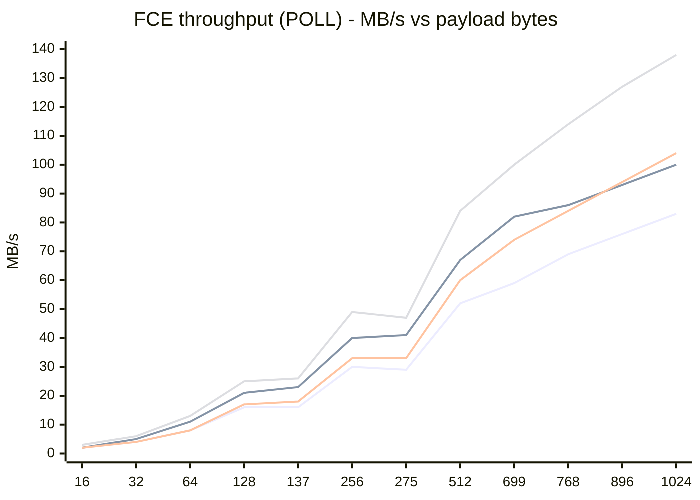
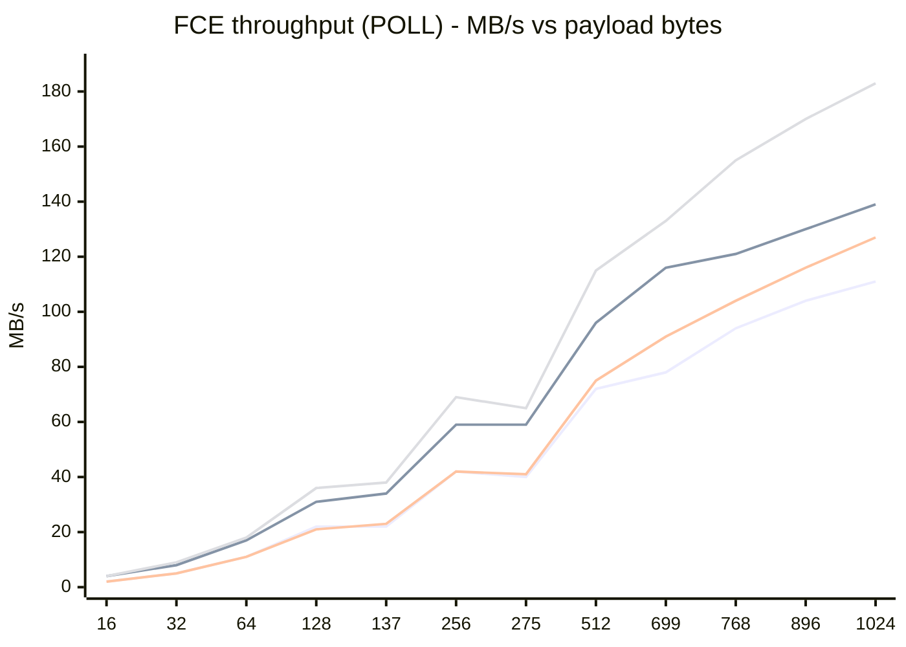
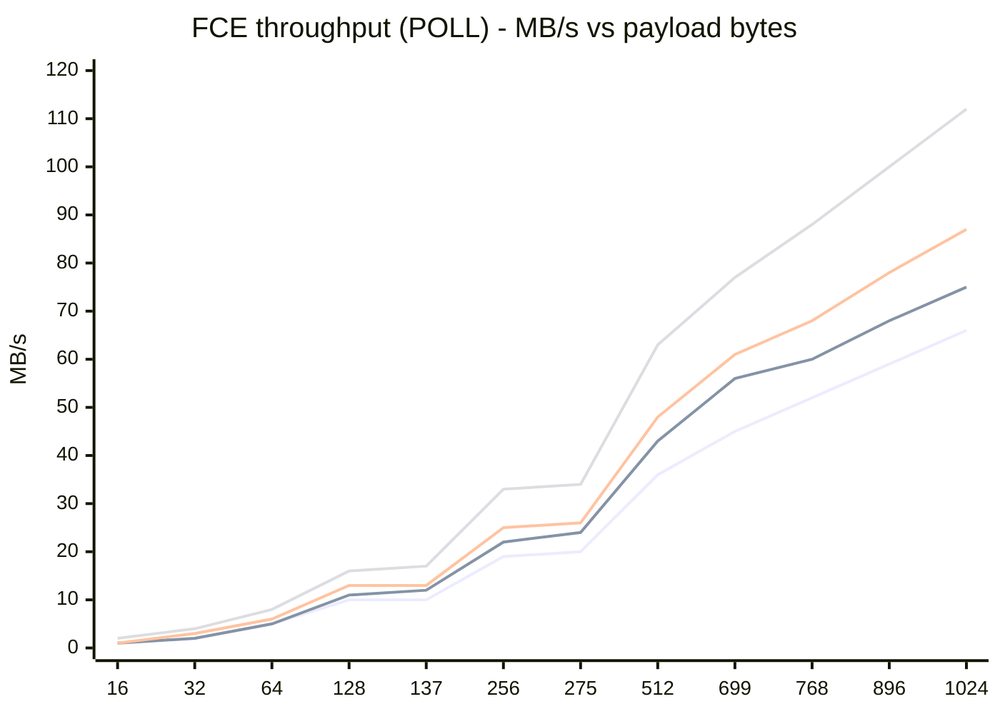
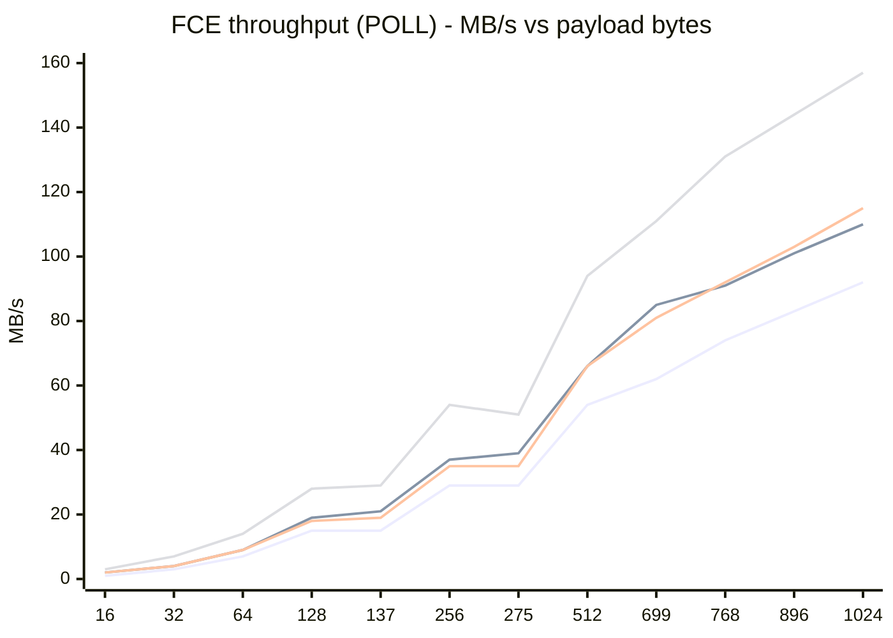

# FCE Crypto Benchmark - i.MX943 EVK Performance Report

This document accompanies the `v2x_fce_benchmark` example. It captures four
bare-metal, DWT-timed benchmark runs (two cores x two optimization levels) and
summarizes the throughput, the optimization/clock scaling, and the identified
performance bottleneck of the EdgeLock FCE (Fast Crypto Engine) on the i.MX943 EVK.

All four runs completed with **0 FAIL / 0 ERROR / 0 timeout**. AES-128/192/256
GCM+CBC (encrypt and decrypt), HMAC/HASH SHA-256/384/512, and multi-slot /
batch / peak-sustained submission modes all pass on both cores.

## 1. Test matrix

| Run | Core | Clock | Toolchain | Config |
|-----|------|-------|-----------|--------|
| 15  | Cortex-M7 (cm7_core0)  | 800 MHz   | armgcc | debug (-O0)   |
| 16  | Cortex-M7 (cm7_core0)  | 800 MHz   | armgcc | release (-Os)  |
| 3   | Cortex-M33 (cm33_core1)| 266.7 MHz | armgcc | debug (-O0)   |
| 4   | Cortex-M33 (cm33_core1)| 266.7 MHz | armgcc | release (-Os)  |

## 2. Methodology note

The FCE public API is synchronous. Per-operation time is dominated by the fixed
MU round-trip + FCE request-descriptor setup, NOT by the crypto itself (AES/SHA
run inside the FCE hardware). Consequently the per-byte cost is only ~1-4 ns and
**kpps (operations/second) is nearly flat from 16 B up to 1 KB**. For small-frame
packet workloads (tens to a couple hundred bytes per frame), kpps is therefore
the binding metric, not MB/s. SIGNAL vs POLL differ only in the small fixed
completion-wait cost; on bare metal POLL is marginally faster, and both are
functionally identical.

## 3. Single-op setup latency (us) - lower is better

| Primitive (mode)        | M7 dbg | M7 rel | M33 dbg | M33 rel |
|-------------------------|-------:|-------:|--------:|--------:|
| AES-256-GCM  (SIGNAL)   | 8.87   | 5.96   | 14.77   | 8.78    |
| AES-256-GCM  (POLL)     | 7.67   | 5.53   | 12.78   | 8.23    |
| AES-256-CBC  (POLL)     | 5.78   | 3.67   | 11.61   | 6.65    |
| HMAC-SHA-256 (POLL)     | 7.32   | 5.81   | 9.68    | 6.92    |
| HASH-SHA-256 (POLL)     | 4.95   | 3.45   | 7.77    | 4.54    |

Observations:
- **Optimization -O0 -> -Os**: M7 GCM setup -28% (7.67->5.53 us); M33 GCM -36%
  (12.78->8.23 us). The M33 gains relatively more because its lower clock makes
  the host software (descriptor packing, MU register loop) a larger share of the
  fixed cost - confirming the setup phase is software/CPU-bound, not HW-bound.
- **M7 vs M33**: at the same optimization the M33 is only ~1.5x slower despite a
  3:1 clock ratio, because a large clock-independent component (FCE firmware +
  MU handshake, ~4-4.5 us) dominates. The M33 does not scale down 3x.

## 4. Peak sustained throughput (release, batch + 4-slot), small-packet kpps

Small-packet (16-137 B) kpps is the practical operations/second ceiling:

| Primitive (256-bit)         | M7 release kpps | M33 release kpps |
|-----------------------------|----------------:|-----------------:|
| AES-256-GCM (enc+auth)       | **~194-201**    | ~130-135         |
| AES-256-CBC                  | ~285-290        | ~168-173         |
| HMAC-SHA-512                 | ~131-135        | ~119-122         |
| HASH-SHA-512                 | ~282-313        | ~228-247         |

(Large-packet 1 KB data rate peaks: M7 GCM ~8.6 MB/s, M33 GCM ~10.3 MB/s;
irrelevant for small-packet workloads where kpps binds.)

The 4-slot multi-slot batching + release optimization raised single-engine
AES-GCM from the earlier ~140 kpps baseline to **~200 kpps on the M7 (~+40%)**.

## 5. BOTTLENECK (the key conclusion)

**The bottleneck is the fixed per-request MU round-trip + FCE descriptor-setup
overhead on a single FCE engine, NOT the crypto core and NOT payload size.**

Evidence:
1. Per-byte cost is ~1-4 ns while fixed setup is ~5.5-14.8 us; a 1 KB GCM op is
   only ~15-55% slower than a 16 B op. The engine is latency/overhead-bound, not
   bandwidth-bound.
2. kpps is essentially flat vs payload -> the ceiling is "requests per second",
   set by the MU handshake + firmware request pipeline, not by AES throughput.
3. Optimization and core-clock changes move setup latency substantially (28-43%),
   proving a large part of the fixed cost is host-side software issuing the
   request - i.e. the single-threaded request-submission path is the limiter.
4. A single engine tops out near ~200 kpps for AES-GCM; raising AES key size,
   payload, or clock alone cannot move this ceiling.

Because the limiter is *request rate on one engine*, throughput scales with the
number of *parallel request submitters / engines*, not with raw CPU MHz.

## 6. Recommendations to raise throughput

1. **Parallel engines / multi-core dispatch** - the most realistic path to
   higher aggregate throughput. Two parallel FCE request streams (e.g.
   cm7_core0 + cm7_core1, or two MU channels) roughly double single-engine kpps;
   three streams roughly triple it.
2. **Measure GMAC explicitly** - GMAC = AES-GCM with AAD-only (zero-length
   plaintext) drops the ciphertext DMA, so per-op cost is lower and kpps should
   exceed plain GCM.
3. **End-to-end validation** - current data is raw crypto only; an integrated
   ENETC / BD-ring packet path with real framing is not yet measured and should
   be characterized separately.

---

## Appendix: full benchmark logs (verbatim)

The complete UART capture of all four runs is embedded below for traceability.


### M7 (cm7_core0) @800 MHz, armgcc DEBUG (-O0)


```

*************** EdgeLock V2X/FCE performance benchmark (MCUX-90943) ****

Runtime environment: BARE-METAL (no RTOS/scheduler; DWT-timed micro-benchmark)
Core clock (from SystemCoreClock): 800000000 Hz
Iterations/point: 256  (warmup 16)
Payload: swept 16..1024 bytes (12 points) per algo (CBC uses 16-byte multiples).
Payload content: filled at runtime with a deterministic pattern
(s_in[i] = i*7 + 0x11), regenerated per payload size. It is reproducible,
not truly random. AES/SHA are data-oblivious (execution time depends only on
byte count, not content), so the pattern choice does not affect the timings.

Each result table is tagged with method= and submit= so the submission
model is unambiguous:
  method=one-shot       : one op per synchronous request, timed individually
                          (single-request latency, no amortization)
  method=batch-stream   : one op per request, N requests back-to-back, block-timed
                          (software pipelining amortization)
  method=multi-slot     : 1..4 ops per PUSH_REQUEST (hardware MU slot batching)
  method=peak-sustained : batch + max slots stacked (practical peak)
Throughput metrics (unified across all tables):
  MB/s  = payload bytes / second (data rate)
  Ops/s = ops / second           (per-op rate)
  kpps  = thousand ops / second  (= Ops/s / 1000; kilo-packets-per-second)

****************** Bring up V2X firmware *****************
V2X firmware is running.

V2X/FCE service open.
AES-256 and HMAC-SHA-256 keys loaded into slot 0.

### AES-128-GCM / AES-128-CBC

#### AES-128-GCM  method=one-shot  submit=single-request  mode=SIGNAL

| bytes | min_us | avg_us | max_us | jitter_us | MB/s | Ops/s | kpps | ok |
|------:|-------:|-------:|-------:|----------:|-----:|------:|-----:|:--:|
| 16 | 8.917 | 8.917 | 8.927 | 0.  0 | 1 | 112145 | 112 | OK |
| 32 | 8.917 | 8.917 | 9. 82 | 0. 10 | 3 | 112145 | 112 | OK |
| 64 | 8.962 | 8.976 | 8.977 | 0.  3 | 7 | 111408 | 111 | OK |
| 128 | 9. 87 | 9. 96 | 9. 97 | 0.  1 | 14 | 109938 | 109 | OK |
| 137 | 9.137 | 9.142 | 9.152 | 0.  5 | 14 | 109385 | 109 | OK |
| 256 | 9.317 | 9.321 | 9.322 | 0.  1 | 27 | 107284 | 107 | OK |
| 275 | 9.382 | 9.382 | 9.382 | 0.  0 | 29 | 106587 | 106 | OK |
| 512 | 9.777 | 9.786 | 9.792 | 0.  5 | 52 | 102186 | 102 | OK |
| 699 | 11.717 | 11.717 | 11.717 | 0.  0 | 59 | 85346 | 85 | OK |
| 768 | 10.957 | 10.957 | 10.960 | 0.  0 | 70 | 91265 | 91 | OK |
| 896 | 11.637 | 11.661 | 11.687 | 0. 25 | 76 | 85755 | 85 | OK |
| 1024 | 12.272 | 12.307 | 12.342 | 0. 35 | 83 | 81254 | 81 | OK |

_Setup latency ~ 8.869 us, per-byte ~ 3 ns (ExecTime = Setup + N*Tpb)_

#### AES-128-CBC  method=one-shot  submit=single-request  mode=SIGNAL

| bytes | min_us | avg_us | max_us | jitter_us | MB/s | Ops/s | kpps | ok |
|------:|-------:|-------:|-------:|----------:|-----:|------:|-----:|:--:|
| 16 | 7.592 | 7.598 | 7.822 | 0. 15 | 2 | 131613 | 131 | OK |
| 32 | 7.592 | 7.596 | 7.597 | 0.  1 | 4 | 131648 | 131 | OK |
| 64 | 7.637 | 7.641 | 7.642 | 0.  1 | 8 | 130872 | 130 | OK |
| 128 | 7.757 | 7.761 | 7.762 | 0.  1 | 16 | 128849 | 128 | OK |
| 144 | 7.822 | 7.822 | 7.832 | 0.  0 | 18 | 127844 | 127 | OK |
| 256 | 7.987 | 7.987 | 7.997 | 0.  0 | 32 | 125203 | 125 | OK |
| 288 | 8. 37 | 8. 46 | 8. 52 | 0.  1 | 35 | 124285 | 124 | OK |
| 512 | 8.452 | 8.452 | 8.452 | 0.  0 | 60 | 118315 | 118 | OK |
| 704 | 8.792 | 8.796 | 8.797 | 0.  1 | 80 | 113688 | 113 | OK |
| 768 | 8.902 | 8.902 | 8.912 | 0.  0 | 86 | 112334 | 112 | OK |
| 896 | 9.497 | 9.501 | 9.502 | 0.  1 | 94 | 105252 | 105 | OK |
| 1024 | 10.245 | 10.245 | 10.245 | 0.  0 | 99 | 97608 | 97 | OK |

_Setup latency ~ 7.566 us, per-byte ~ 2 ns (ExecTime = Setup + N*Tpb)_

#### AES-128-GCM  method=one-shot  submit=single-request  mode=POLL

| bytes | min_us | avg_us | max_us | jitter_us | MB/s | Ops/s | kpps | ok |
|------:|-------:|-------:|-------:|----------:|-----:|------:|-----:|:--:|
| 16 | 7.732 | 7.732 | 7.732 | 0.  0 | 2 | 129332 | 129 | OK |
| 32 | 7.752 | 7.752 | 7.752 | 0.  0 | 4 | 128998 | 128 | OK |
| 64 | 7.712 | 7.721 | 7.725 | 0.  2 | 8 | 129516 | 129 | OK |
| 128 | 7.842 | 7.842 | 7.842 | 0.  0 | 16 | 127518 | 127 | OK |
| 137 | 8.437 | 8.437 | 8.437 | 0.  0 | 16 | 118525 | 118 | OK |
| 256 | 8.532 | 8.532 | 8.532 | 0.  0 | 30 | 117205 | 117 | OK |
| 275 | 9.207 | 9.207 | 9.207 | 0.  0 | 29 | 108613 | 108 | OK |
| 512 | 9.742 | 9.742 | 9.742 | 0.  0 | 52 | 102648 | 102 | OK |
| 699 | 11.787 | 11.787 | 11.787 | 0.  0 | 59 | 84839 | 84 | OK |
| 768 | 11. 47 | 11. 47 | 11. 47 | 0.  0 | 69 | 90522 | 90 | OK |
| 896 | 11.682 | 11.682 | 11.682 | 0.  0 | 76 | 85601 | 85 | OK |
| 1024 | 12.347 | 12.347 | 12.347 | 0.  0 | 82 | 80991 | 80 | OK |

_Setup latency ~ 7.668 us, per-byte ~ 4 ns (ExecTime = Setup + N*Tpb)_

#### AES-128-CBC  method=one-shot  submit=single-request  mode=POLL

| bytes | min_us | avg_us | max_us | jitter_us | MB/s | Ops/s | kpps | ok |
|------:|-------:|-------:|-------:|----------:|-----:|------:|-----:|:--:|
| 16 | 5.842 | 5.842 | 5.842 | 0.  0 | 2 | 171174 | 171 | OK |
| 32 | 5.842 | 5.842 | 5.842 | 0.  0 | 5 | 171174 | 171 | OK |
| 64 | 5.740 | 5.746 | 5.750 | 0.  2 | 11 | 174034 | 174 | OK |
| 128 | 5.867 | 5.867 | 5.867 | 0.  0 | 21 | 170444 | 170 | OK |
| 144 | 6.207 | 6.207 | 6.207 | 0.  0 | 23 | 161108 | 161 | OK |
| 256 | 6.457 | 6.457 | 6.457 | 0.  0 | 39 | 154870 | 154 | OK |
| 288 | 6.947 | 6.947 | 6.947 | 0.  0 | 41 | 143947 | 143 | OK |
| 512 | 7.612 | 7.612 | 7.612 | 0.  0 | 67 | 131371 | 131 | OK |
| 704 | 8.542 | 8.542 | 8.542 | 0.  0 | 82 | 117068 | 117 | OK |
| 768 | 8.902 | 8.902 | 8.902 | 0.  0 | 86 | 112334 | 112 | OK |
| 896 | 9.557 | 9.557 | 9.557 | 0.  0 | 93 | 104635 | 104 | OK |
| 1024 | 10.207 | 10.207 | 10.207 | 0.  0 | 100 | 97971 | 97 | OK |

_Setup latency ~ 5.778 us, per-byte ~ 4 ns (ExecTime = Setup + N*Tpb)_

### AES-192-GCM / AES-192-CBC

#### AES-192-GCM  method=one-shot  submit=single-request  mode=SIGNAL

| bytes | min_us | avg_us | max_us | jitter_us | MB/s | Ops/s | kpps | ok |
|------:|-------:|-------:|-------:|----------:|-----:|------:|-----:|:--:|
| 16 | 8.917 | 8.917 | 8.927 | 0.  0 | 1 | 112145 | 112 | OK |
| 32 | 8.917 | 8.917 | 8.927 | 0.  0 | 3 | 112145 | 112 | OK |
| 64 | 8.962 | 8.977 | 9.187 | 0. 17 | 7 | 111395 | 111 | OK |
| 128 | 9. 87 | 9. 96 | 9. 97 | 0.  1 | 14 | 109938 | 109 | OK |
| 137 | 9.142 | 9.142 | 9.147 | 0.  0 | 14 | 109385 | 109 | OK |
| 256 | 9.317 | 9.321 | 9.322 | 0.  1 | 27 | 107284 | 107 | OK |
| 275 | 9.372 | 9.382 | 9.387 | 0.  6 | 29 | 106587 | 106 | OK |
| 512 | 9.767 | 9.786 | 9.787 | 0.  1 | 52 | 102186 | 102 | OK |
| 699 | 11.792 | 11.792 | 11.792 | 0.  0 | 59 | 84803 | 84 | OK |
| 768 | 11. 35 | 11. 37 | 11. 40 | 0.  1 | 69 | 90604 | 90 | OK |
| 896 | 11.610 | 11.636 | 11.690 | 0. 36 | 77 | 85940 | 85 | OK |
| 1024 | 12.357 | 12.357 | 12.357 | 0.  0 | 82 | 80925 | 80 | OK |

_Setup latency ~ 8.869 us, per-byte ~ 3 ns (ExecTime = Setup + N*Tpb)_

#### AES-192-CBC  method=one-shot  submit=single-request  mode=SIGNAL

| bytes | min_us | avg_us | max_us | jitter_us | MB/s | Ops/s | kpps | ok |
|------:|-------:|-------:|-------:|----------:|-----:|------:|-----:|:--:|
| 16 | 7.592 | 7.596 | 7.597 | 0.  1 | 2 | 131648 | 131 | OK |
| 32 | 7.592 | 7.598 | 7.837 | 0. 17 | 4 | 131613 | 131 | OK |
| 64 | 7.642 | 7.642 | 7.652 | 0.  0 | 8 | 130855 | 130 | OK |
| 128 | 7.757 | 7.761 | 7.762 | 0.  1 | 16 | 128849 | 128 | OK |
| 144 | 7.822 | 7.822 | 7.832 | 0.  0 | 18 | 127844 | 127 | OK |
| 256 | 7.982 | 7.986 | 7.987 | 0.  1 | 32 | 125219 | 125 | OK |
| 288 | 8. 47 | 8. 47 | 8. 47 | 0.  0 | 35 | 124269 | 124 | OK |
| 512 | 8.447 | 8.451 | 8.452 | 0.  1 | 60 | 118329 | 118 | OK |
| 704 | 8.792 | 8.798 | 9.202 | 0. 25 | 80 | 113662 | 113 | OK |
| 768 | 8.902 | 8.902 | 8.912 | 0.  0 | 86 | 112334 | 112 | OK |
| 896 | 9.497 | 9.501 | 9.507 | 0.  5 | 94 | 105252 | 105 | OK |
| 1024 | 10.242 | 10.247 | 10.255 | 0.  5 | 99 | 97589 | 97 | OK |

_Setup latency ~ 7.564 us, per-byte ~ 2 ns (ExecTime = Setup + N*Tpb)_

#### AES-192-GCM  method=one-shot  submit=single-request  mode=POLL

| bytes | min_us | avg_us | max_us | jitter_us | MB/s | Ops/s | kpps | ok |
|------:|-------:|-------:|-------:|----------:|-----:|------:|-----:|:--:|
| 16 | 7.732 | 7.732 | 7.732 | 0.  0 | 2 | 129332 | 129 | OK |
| 32 | 7.737 | 7.737 | 7.737 | 0.  0 | 4 | 129249 | 129 | OK |
| 64 | 7.705 | 7.711 | 7.715 | 0.  2 | 8 | 129684 | 129 | OK |
| 128 | 7.842 | 7.842 | 7.842 | 0.  0 | 16 | 127518 | 127 | OK |
| 137 | 8.447 | 8.447 | 8.447 | 0.  0 | 16 | 118385 | 118 | OK |
| 256 | 8.522 | 8.522 | 8.522 | 0.  0 | 30 | 117343 | 117 | OK |
| 275 | 9.192 | 9.192 | 9.192 | 0.  0 | 29 | 108790 | 108 | OK |
| 512 | 9.742 | 9.742 | 9.742 | 0.  0 | 52 | 102648 | 102 | OK |
| 699 | 11.797 | 11.797 | 11.797 | 0.  0 | 59 | 84767 | 84 | OK |
| 768 | 11. 47 | 11. 47 | 11. 47 | 0.  0 | 69 | 90522 | 90 | OK |
| 896 | 11.682 | 11.682 | 11.682 | 0.  0 | 76 | 85601 | 85 | OK |
| 1024 | 12.362 | 12.362 | 12.362 | 0.  0 | 82 | 80893 | 80 | OK |

_Setup latency ~ 7.668 us, per-byte ~ 4 ns (ExecTime = Setup + N*Tpb)_

#### AES-192-CBC  method=one-shot  submit=single-request  mode=POLL

| bytes | min_us | avg_us | max_us | jitter_us | MB/s | Ops/s | kpps | ok |
|------:|-------:|-------:|-------:|----------:|-----:|------:|-----:|:--:|
| 16 | 5.842 | 5.842 | 5.842 | 0.  0 | 2 | 171174 | 171 | OK |
| 32 | 5.842 | 5.842 | 5.842 | 0.  0 | 5 | 171174 | 171 | OK |
| 64 | 5.740 | 5.746 | 5.750 | 0.  2 | 11 | 174034 | 174 | OK |
| 128 | 5.867 | 5.867 | 5.867 | 0.  0 | 21 | 170444 | 170 | OK |
| 144 | 6.202 | 6.202 | 6.202 | 0.  0 | 23 | 161238 | 161 | OK |
| 256 | 6.457 | 6.457 | 6.457 | 0.  0 | 39 | 154870 | 154 | OK |
| 288 | 6.947 | 6.950 | 6.952 | 0.  2 | 41 | 143884 | 143 | OK |
| 512 | 7.607 | 7.607 | 7.607 | 0.  0 | 67 | 131457 | 131 | OK |
| 704 | 8.625 | 8.627 | 8.630 | 0.  2 | 81 | 115915 | 115 | OK |
| 768 | 8.907 | 8.910 | 8.912 | 0.  2 | 86 | 112233 | 112 | OK |
| 896 | 9.557 | 9.560 | 9.562 | 0.  2 | 93 | 104602 | 104 | OK |
| 1024 | 10.212 | 10.215 | 10.217 | 0.  2 | 100 | 97895 | 97 | OK |

_Setup latency ~ 5.778 us, per-byte ~ 4 ns (ExecTime = Setup + N*Tpb)_

### AES-256-GCM / AES-256-CBC

#### AES-256-GCM  method=one-shot  submit=single-request  mode=SIGNAL

| bytes | min_us | avg_us | max_us | jitter_us | MB/s | Ops/s | kpps | ok |
|------:|-------:|-------:|-------:|----------:|-----:|------:|-----:|:--:|
| 16 | 8.917 | 8.917 | 8.927 | 0.  0 | 1 | 112145 | 112 | OK |
| 32 | 8.917 | 8.917 | 8.927 | 0.  0 | 3 | 112145 | 112 | OK |
| 64 | 8.962 | 8.976 | 9. 62 | 0.  7 | 7 | 111408 | 111 | OK |
| 128 | 9. 87 | 9. 90 | 9.217 | 0.  7 | 14 | 110011 | 110 | OK |
| 137 | 9.137 | 9.142 | 9.152 | 0.  5 | 14 | 109385 | 109 | OK |
| 256 | 9.317 | 9.321 | 9.322 | 0.  1 | 27 | 107284 | 107 | OK |
| 275 | 9.397 | 9.397 | 9.397 | 0.  0 | 29 | 106416 | 106 | OK |
| 512 | 9.777 | 9.787 | 9.792 | 0.  6 | 52 | 102176 | 102 | OK |
| 699 | 11.800 | 11.802 | 11.805 | 0.  1 | 59 | 84731 | 84 | OK |
| 768 | 10.957 | 10.957 | 11. 42 | 0.  5 | 70 | 91265 | 91 | OK |
| 896 | 11.637 | 11.662 | 11.687 | 0. 25 | 76 | 85748 | 85 | OK |
| 1024 | 12.272 | 12.306 | 12.307 | 0.  2 | 83 | 81261 | 81 | OK |

_Setup latency ~ 8.869 us, per-byte ~ 3 ns (ExecTime = Setup + N*Tpb)_

#### AES-256-CBC  method=one-shot  submit=single-request  mode=SIGNAL

| bytes | min_us | avg_us | max_us | jitter_us | MB/s | Ops/s | kpps | ok |
|------:|-------:|-------:|-------:|----------:|-----:|------:|-----:|:--:|
| 16 | 7.592 | 7.596 | 7.597 | 0.  1 | 2 | 131648 | 131 | OK |
| 32 | 7.592 | 7.598 | 7.867 | 0. 21 | 4 | 131613 | 131 | OK |
| 64 | 7.637 | 7.641 | 7.642 | 0.  1 | 8 | 130872 | 130 | OK |
| 128 | 7.757 | 7.761 | 7.762 | 0.  1 | 16 | 128849 | 128 | OK |
| 144 | 7.822 | 7.826 | 7.837 | 0.  6 | 18 | 127779 | 127 | OK |
| 256 | 7.982 | 7.986 | 7.987 | 0.  1 | 32 | 125219 | 125 | OK |
| 288 | 8. 47 | 8. 47 | 8. 57 | 0.  0 | 35 | 124269 | 124 | OK |
| 512 | 8.442 | 8.445 | 8.732 | 0. 17 | 60 | 118413 | 118 | OK |
| 704 | 8.782 | 8.787 | 9. 12 | 0. 13 | 80 | 113804 | 113 | OK |
| 768 | 8.917 | 8.917 | 8.917 | 0.  0 | 86 | 112145 | 112 | OK |
| 896 | 9.495 | 9.502 | 9.512 | 0.  5 | 94 | 105241 | 105 | OK |
| 1024 | 10.152 | 10.158 | 10.170 | 0.  6 | 100 | 98444 | 98 | OK |

_Setup latency ~ 7.564 us, per-byte ~ 2 ns (ExecTime = Setup + N*Tpb)_

#### AES-256-GCM  method=one-shot  submit=single-request  mode=POLL

| bytes | min_us | avg_us | max_us | jitter_us | MB/s | Ops/s | kpps | ok |
|------:|-------:|-------:|-------:|----------:|-----:|------:|-----:|:--:|
| 16 | 7.732 | 7.732 | 7.732 | 0.  0 | 2 | 129332 | 129 | OK |
| 32 | 7.732 | 7.732 | 7.732 | 0.  0 | 4 | 129332 | 129 | OK |
| 64 | 7.705 | 7.711 | 7.715 | 0.  2 | 8 | 129684 | 129 | OK |
| 128 | 7.832 | 7.832 | 7.832 | 0.  0 | 16 | 127681 | 127 | OK |
| 137 | 8.425 | 8.427 | 8.430 | 0.  2 | 16 | 118666 | 118 | OK |
| 256 | 8.505 | 8.505 | 8.505 | 0.  0 | 30 | 117577 | 117 | OK |
| 275 | 9.267 | 9.267 | 9.267 | 0.  0 | 29 | 107909 | 107 | OK |
| 512 | 9.712 | 9.712 | 9.712 | 0.  0 | 52 | 102965 | 102 | OK |
| 699 | 11.807 | 11.807 | 11.807 | 0.  0 | 59 | 84695 | 84 | OK |
| 768 | 11. 47 | 11. 47 | 11. 47 | 0.  0 | 69 | 90522 | 90 | OK |
| 896 | 11.682 | 11.682 | 11.682 | 0.  0 | 76 | 85601 | 85 | OK |
| 1024 | 12.242 | 12.242 | 12.242 | 0.  0 | 83 | 81685 | 81 | OK |

_Setup latency ~ 7.668 us, per-byte ~ 4 ns (ExecTime = Setup + N*Tpb)_

#### AES-256-CBC  method=one-shot  submit=single-request  mode=POLL

| bytes | min_us | avg_us | max_us | jitter_us | MB/s | Ops/s | kpps | ok |
|------:|-------:|-------:|-------:|----------:|-----:|------:|-----:|:--:|
| 16 | 5.842 | 5.842 | 5.842 | 0.  0 | 2 | 171174 | 171 | OK |
| 32 | 5.842 | 5.842 | 5.842 | 0.  0 | 5 | 171174 | 171 | OK |
| 64 | 5.740 | 5.746 | 5.750 | 0.  2 | 11 | 174034 | 174 | OK |
| 128 | 6. 57 | 6. 57 | 6. 57 | 0.  0 | 21 | 165098 | 165 | OK |
| 144 | 6.202 | 6.202 | 6.202 | 0.  0 | 23 | 161238 | 161 | OK |
| 256 | 6.372 | 6.372 | 6.372 | 0.  0 | 40 | 156936 | 156 | OK |
| 288 | 6.952 | 6.952 | 6.952 | 0.  0 | 41 | 143843 | 143 | OK |
| 512 | 7.622 | 7.622 | 7.622 | 0.  0 | 67 | 131199 | 131 | OK |
| 704 | 8.552 | 8.552 | 8.552 | 0.  0 | 82 | 116931 | 116 | OK |
| 768 | 8.907 | 8.907 | 8.907 | 0.  0 | 86 | 112271 | 112 | OK |
| 896 | 9.557 | 9.557 | 9.557 | 0.  0 | 93 | 104635 | 104 | OK |
| 1024 | 10.142 | 10.142 | 10.142 | 0.  0 | 100 | 98599 | 98 | OK |

_Setup latency ~ 5.778 us, per-byte ~ 4 ns (ExecTime = Setup + N*Tpb)_

### HMAC-SHA-256 / HASH-SHA-256

#### HMAC-SHA-256  method=one-shot  submit=single-request  mode=SIGNAL

| bytes | min_us | avg_us | max_us | jitter_us | MB/s | Ops/s | kpps | ok |
|------:|-------:|-------:|-------:|----------:|-----:|------:|-----:|:--:|
| 16 | 7.267 | 7.267 | 7.277 | 0.  0 | 2 | 137608 | 137 | OK |
| 32 | 7.357 | 7.357 | 7.367 | 0.  0 | 4 | 135924 | 135 | OK |
| 64 | 7.292 | 7.297 | 7.392 | 0.  6 | 8 | 137042 | 137 | OK |
| 128 | 7.412 | 7.416 | 7.417 | 0.  1 | 17 | 134843 | 134 | OK |
| 137 | 7.517 | 7.521 | 7.522 | 0.  1 | 18 | 132961 | 132 | OK |
| 256 | 7.655 | 7.657 | 7.670 | 0.  0 | 33 | 130599 | 130 | OK |
| 275 | 8.207 | 8.211 | 8.212 | 0.  1 | 33 | 121787 | 121 | OK |
| 512 | 8.422 | 8.422 | 8.507 | 0.  5 | 60 | 118736 | 118 | OK |
| 699 | 9.422 | 9.426 | 9.430 | 0.  1 | 74 | 106089 | 106 | OK |
| 768 | 9. 82 | 9.126 | 9.145 | 0.  3 | 84 | 109577 | 109 | OK |
| 896 | 9.450 | 9.493 | 9.525 | 0. 30 | 94 | 105340 | 105 | OK |
| 1024 | 9.867 | 9.870 | 9.872 | 0.  2 | 103 | 101317 | 101 | OK |

_Setup latency ~ 7.235 us, per-byte ~ 2 ns (ExecTime = Setup + N*Tpb)_

#### HASH-SHA-256  method=one-shot  submit=single-request  mode=SIGNAL

| bytes | min_us | avg_us | max_us | jitter_us | MB/s | Ops/s | kpps | ok |
|------:|-------:|-------:|-------:|----------:|-----:|------:|-----:|:--:|
| 16 | 6.682 | 6.682 | 6.682 | 0.  0 | 2 | 149655 | 149 | OK |
| 32 | 6.667 | 6.667 | 6.677 | 0.  0 | 4 | 149992 | 149 | OK |
| 64 | 6.677 | 6.681 | 6.682 | 0.  1 | 9 | 149678 | 149 | OK |
| 128 | 6.722 | 6.730 | 7.102 | 0. 32 | 19 | 148588 | 148 | OK |
| 137 | 6.742 | 6.748 | 6.752 | 0.  2 | 20 | 148192 | 148 | OK |
| 256 | 6.797 | 6.802 | 6.807 | 0.  5 | 37 | 147015 | 147 | OK |
| 275 | 6.812 | 6.816 | 6.817 | 0.  1 | 40 | 146713 | 146 | OK |
| 512 | 6.947 | 6.951 | 6.952 | 0.  1 | 73 | 143864 | 143 | OK |
| 699 | 7. 72 | 7. 72 | 7. 72 | 0.  0 | 98 | 141402 | 141 | OK |
| 768 | 7.107 | 7.118 | 7.382 | 0. 20 | 107 | 140488 | 140 | OK |
| 896 | 7.182 | 7.191 | 7.192 | 0.  1 | 124 | 139062 | 139 | OK |
| 1024 | 7.452 | 7.461 | 7.462 | 0.  1 | 137 | 134030 | 134 | OK |

_Setup latency ~ 6.682 us, per-byte ~ 0 ns (ExecTime = Setup + N*Tpb)_

#### HMAC-SHA-256  method=one-shot  submit=single-request  mode=POLL

| bytes | min_us | avg_us | max_us | jitter_us | MB/s | Ops/s | kpps | ok |
|------:|-------:|-------:|-------:|----------:|-----:|------:|-----:|:--:|
| 16 | 7.352 | 7.352 | 7.352 | 0.  0 | 2 | 136017 | 136 | OK |
| 32 | 7.352 | 7.352 | 7.352 | 0.  0 | 4 | 136017 | 136 | OK |
| 64 | 7.372 | 7.372 | 7.372 | 0.  0 | 8 | 135648 | 135 | OK |
| 128 | 7.407 | 7.407 | 7.407 | 0.  0 | 17 | 135007 | 135 | OK |
| 137 | 7.512 | 7.512 | 7.512 | 0.  0 | 18 | 133120 | 133 | OK |
| 256 | 7.657 | 7.657 | 7.657 | 0.  0 | 33 | 130599 | 130 | OK |
| 275 | 8.287 | 8.287 | 8.287 | 0.  0 | 33 | 120670 | 120 | OK |
| 512 | 8.507 | 8.507 | 8.507 | 0.  0 | 60 | 117550 | 117 | OK |
| 699 | 9.397 | 9.397 | 9.397 | 0.  0 | 74 | 106416 | 106 | OK |
| 768 | 9.102 | 9.102 | 9.102 | 0.  0 | 84 | 109865 | 109 | OK |
| 896 | 9.502 | 9.502 | 9.502 | 0.  0 | 94 | 105241 | 105 | OK |
| 1024 | 9.830 | 9.835 | 9.840 | 0.  5 | 104 | 101677 | 101 | OK |

_Setup latency ~ 7.320 us, per-byte ~ 2 ns (ExecTime = Setup + N*Tpb)_

#### HASH-SHA-256  method=one-shot  submit=single-request  mode=POLL

| bytes | min_us | avg_us | max_us | jitter_us | MB/s | Ops/s | kpps | ok |
|------:|-------:|-------:|-------:|----------:|-----:|------:|-----:|:--:|
| 16 | 4.977 | 4.977 | 4.977 | 0.  0 | 3 | 200924 | 200 | OK |
| 32 | 4.977 | 4.977 | 4.977 | 0.  0 | 6 | 200924 | 200 | OK |
| 64 | 4.912 | 4.912 | 4.912 | 0.  0 | 13 | 203583 | 203 | OK |
| 128 | 5. 32 | 5. 32 | 5. 32 | 0.  0 | 25 | 198728 | 198 | OK |
| 137 | 5.137 | 5.137 | 5.137 | 0.  0 | 26 | 194666 | 194 | OK |
| 256 | 5.197 | 5.197 | 5.197 | 0.  0 | 49 | 192418 | 192 | OK |
| 275 | 5.827 | 5.827 | 5.827 | 0.  0 | 47 | 171614 | 171 | OK |
| 512 | 6. 47 | 6. 47 | 6. 47 | 0.  0 | 84 | 165371 | 165 | OK |
| 699 | 6.932 | 6.932 | 6.932 | 0.  0 | 100 | 144258 | 144 | OK |
| 768 | 6.712 | 6.712 | 6.712 | 0.  0 | 114 | 148986 | 148 | OK |
| 896 | 7. 42 | 7. 42 | 7. 42 | 0.  0 | 127 | 142005 | 142 | OK |
| 1024 | 7.382 | 7.382 | 7.382 | 0.  0 | 138 | 135464 | 135 | OK |

_Setup latency ~ 4.945 us, per-byte ~ 2 ns (ExecTime = Setup + N*Tpb)_

### HMAC-SHA-384 / HASH-SHA-384

#### HMAC-SHA-384  method=one-shot  submit=single-request  mode=SIGNAL

| bytes | min_us | avg_us | max_us | jitter_us | MB/s | Ops/s | kpps | ok |
|------:|-------:|-------:|-------:|----------:|-----:|------:|-----:|:--:|
| 16 | 8.492 | 8.496 | 8.497 | 0.  1 | 1 | 117702 | 117 | OK |
| 32 | 8.582 | 8.586 | 8.587 | 0.  1 | 3 | 116468 | 116 | OK |
| 64 | 8.512 | 8.512 | 8.522 | 0.  0 | 7 | 117481 | 117 | OK |
| 128 | 8.552 | 8.556 | 8.557 | 0.  1 | 14 | 116877 | 116 | OK |
| 137 | 8.755 | 8.796 | 8.840 | 0. 41 | 15 | 113688 | 113 | OK |
| 256 | 8.970 | 8.976 | 8.985 | 0.  1 | 28 | 111408 | 111 | OK |
| 275 | 9.437 | 9.441 | 9.442 | 0.  1 | 29 | 105920 | 105 | OK |
| 512 | 9.652 | 9.652 | 9.662 | 0.  0 | 53 | 103605 | 103 | OK |
| 699 | 10.657 | 10.657 | 10.657 | 0.  0 | 65 | 93835 | 93 | OK |
| 768 | 10.412 | 10.422 | 10.427 | 0.  6 | 73 | 95950 | 95 | OK |
| 896 | 10.752 | 10.761 | 10.767 | 0.  6 | 83 | 92928 | 92 | OK |
| 1024 | 11.107 | 11.107 | 11.190 | 0.  5 | 92 | 90033 | 90 | OK |

_Setup latency ~ 8.464 us, per-byte ~ 2 ns (ExecTime = Setup + N*Tpb)_

#### HASH-SHA-384  method=one-shot  submit=single-request  mode=SIGNAL

| bytes | min_us | avg_us | max_us | jitter_us | MB/s | Ops/s | kpps | ok |
|------:|-------:|-------:|-------:|----------:|-----:|------:|-----:|:--:|
| 16 | 6.667 | 6.667 | 6.677 | 0.  0 | 2 | 149992 | 149 | OK |
| 32 | 6.672 | 6.683 | 6.977 | 0. 18 | 4 | 149633 | 149 | OK |
| 64 | 6.692 | 6.696 | 6.697 | 0.  1 | 9 | 149342 | 149 | OK |
| 128 | 6.722 | 6.726 | 6.727 | 0.  1 | 19 | 148676 | 148 | OK |
| 137 | 6.737 | 6.741 | 6.742 | 0.  1 | 20 | 148345 | 148 | OK |
| 256 | 6.797 | 6.801 | 6.802 | 0.  1 | 37 | 147037 | 147 | OK |
| 275 | 6.812 | 6.816 | 6.817 | 0.  1 | 40 | 146713 | 146 | OK |
| 512 | 6.952 | 6.952 | 7. 72 | 0.  8 | 73 | 143843 | 143 | OK |
| 699 | 7. 62 | 7. 71 | 7. 72 | 0.  1 | 98 | 141422 | 141 | OK |
| 768 | 7. 97 | 7.101 | 7.102 | 0.  1 | 108 | 140825 | 140 | OK |
| 896 | 7.277 | 7.282 | 7.287 | 0.  3 | 123 | 137324 | 137 | OK |
| 1024 | 7.622 | 7.627 | 7.632 | 0.  5 | 134 | 131113 | 131 | OK |

_Setup latency ~ 6.667 us, per-byte ~ 0 ns (ExecTime = Setup + N*Tpb)_

#### HMAC-SHA-384  method=one-shot  submit=single-request  mode=POLL

| bytes | min_us | avg_us | max_us | jitter_us | MB/s | Ops/s | kpps | ok |
|------:|-------:|-------:|-------:|----------:|-----:|------:|-----:|:--:|
| 16 | 8.577 | 8.577 | 8.577 | 0.  0 | 1 | 116590 | 116 | OK |
| 32 | 8.577 | 8.577 | 8.577 | 0.  0 | 3 | 116590 | 116 | OK |
| 64 | 8.507 | 8.507 | 8.507 | 0.  0 | 7 | 117550 | 117 | OK |
| 128 | 8.547 | 8.547 | 8.547 | 0.  0 | 14 | 117000 | 117 | OK |
| 137 | 8.827 | 8.827 | 8.827 | 0.  0 | 15 | 113288 | 113 | OK |
| 256 | 9. 57 | 9. 57 | 9. 57 | 0.  0 | 28 | 110411 | 110 | OK |
| 275 | 9.517 | 9.517 | 9.517 | 0.  0 | 28 | 105075 | 105 | OK |
| 512 | 9.737 | 9.737 | 9.737 | 0.  0 | 52 | 102701 | 102 | OK |
| 699 | 10.707 | 10.707 | 10.707 | 0.  0 | 65 | 93396 | 93 | OK |
| 768 | 10.397 | 10.397 | 10.397 | 0.  0 | 73 | 96181 | 96 | OK |
| 896 | 10.817 | 10.817 | 10.817 | 0.  0 | 82 | 92447 | 92 | OK |
| 1024 | 11.147 | 11.147 | 11.147 | 0.  0 | 91 | 89710 | 89 | OK |

_Setup latency ~ 8.545 us, per-byte ~ 2 ns (ExecTime = Setup + N*Tpb)_

#### HASH-SHA-384  method=one-shot  submit=single-request  mode=POLL

| bytes | min_us | avg_us | max_us | jitter_us | MB/s | Ops/s | kpps | ok |
|------:|-------:|-------:|-------:|----------:|-----:|------:|-----:|:--:|
| 16 | 5. 65 | 5. 67 | 5. 70 | 0.  2 | 3 | 197355 | 197 | OK |
| 32 | 5. 65 | 5. 67 | 5. 70 | 0.  2 | 6 | 197355 | 197 | OK |
| 64 | 5.  0 | 5.  0 | 5.  0 | 0.  0 | 12 | 200000 | 200 | OK |
| 128 | 5.122 | 5.122 | 5.122 | 0.  0 | 24 | 195236 | 195 | OK |
| 137 | 5.227 | 5.227 | 5.227 | 0.  0 | 26 | 191314 | 191 | OK |
| 256 | 5.457 | 5.457 | 5.457 | 0.  0 | 46 | 183250 | 183 | OK |
| 275 | 5.917 | 5.917 | 5.917 | 0.  0 | 46 | 169004 | 169 | OK |
| 512 | 6.222 | 6.222 | 6.222 | 0.  0 | 82 | 160720 | 160 | OK |
| 699 | 7. 32 | 7. 32 | 7. 32 | 0.  0 | 99 | 142207 | 142 | OK |
| 768 | 6.887 | 6.887 | 6.887 | 0.  0 | 111 | 145201 | 145 | OK |
| 896 | 7.307 | 7.307 | 7.307 | 0.  0 | 122 | 136855 | 136 | OK |
| 1024 | 7.642 | 7.642 | 7.642 | 0.  0 | 133 | 130855 | 130 | OK |

_Setup latency ~ 5. 35 us, per-byte ~ 2 ns (ExecTime = Setup + N*Tpb)_

### HMAC-SHA-512 / HASH-SHA-512

#### HMAC-SHA-512  method=one-shot  submit=single-request  mode=SIGNAL

| bytes | min_us | avg_us | max_us | jitter_us | MB/s | Ops/s | kpps | ok |
|------:|-------:|-------:|-------:|----------:|-----:|------:|-----:|:--:|
| 16 | 9. 67 | 9. 67 | 9. 77 | 0.  0 | 1 | 110290 | 110 | OK |
| 32 | 9.157 | 9.157 | 9.167 | 0.  0 | 3 | 109206 | 109 | OK |
| 64 | 9. 20 | 9. 96 | 9. 97 | 0.  5 | 7 | 109938 | 109 | OK |
| 128 | 9.137 | 9.141 | 9.142 | 0.  1 | 14 | 109397 | 109 | OK |
| 137 | 9.317 | 9.321 | 9.322 | 0.  1 | 14 | 107284 | 107 | OK |
| 256 | 9.550 | 9.561 | 9.562 | 0.  1 | 26 | 104591 | 104 | OK |
| 275 | 10.  7 | 10. 11 | 10. 15 | 0.  1 | 27 | 99890 | 99 | OK |
| 512 | 10.182 | 10.236 | 10.247 | 0.  3 | 50 | 97694 | 97 | OK |
| 699 | 11.227 | 11.227 | 11.237 | 0.  0 | 62 | 89070 | 89 | OK |
| 768 | 10.922 | 10.926 | 10.927 | 0.  1 | 70 | 91524 | 91 | OK |
| 896 | 11.347 | 11.352 | 11.357 | 0.  3 | 78 | 88090 | 88 | OK |
| 1024 | 11.687 | 11.691 | 11.692 | 0.  1 | 87 | 85535 | 85 | OK |

_Setup latency ~ 9. 35 us, per-byte ~ 2 ns (ExecTime = Setup + N*Tpb)_

#### HASH-SHA-512  method=one-shot  submit=single-request  mode=SIGNAL

| bytes | min_us | avg_us | max_us | jitter_us | MB/s | Ops/s | kpps | ok |
|------:|-------:|-------:|-------:|----------:|-----:|------:|-----:|:--:|
| 16 | 6.722 | 6.726 | 6.727 | 0.  1 | 2 | 148676 | 148 | OK |
| 32 | 6.722 | 6.726 | 6.727 | 0.  1 | 4 | 148676 | 148 | OK |
| 64 | 6.737 | 6.741 | 6.742 | 0.  1 | 9 | 148345 | 148 | OK |
| 128 | 6.772 | 6.778 | 7.327 | 0. 33 | 18 | 147536 | 147 | OK |
| 137 | 6.797 | 6.801 | 6.802 | 0.  1 | 20 | 147037 | 147 | OK |
| 256 | 6.847 | 6.847 | 6.857 | 0.  0 | 37 | 146049 | 146 | OK |
| 275 | 6.877 | 6.877 | 6.882 | 0.  0 | 39 | 145412 | 145 | OK |
| 512 | 6.997 | 6.997 | 7.  7 | 0.  0 | 73 | 142918 | 142 | OK |
| 699 | 7.222 | 7.222 | 7.222 | 0.  0 | 96 | 138465 | 138 | OK |
| 768 | 7.157 | 7.161 | 7.167 | 0.  5 | 107 | 139645 | 139 | OK |
| 896 | 7.437 | 7.495 | 7.522 | 0. 33 | 119 | 133422 | 133 | OK |
| 1024 | 7.855 | 7.860 | 7.865 | 0.  5 | 130 | 127226 | 127 | OK |

_Setup latency ~ 6.710 us, per-byte ~ 1 ns (ExecTime = Setup + N*Tpb)_

#### HMAC-SHA-512  method=one-shot  submit=single-request  mode=POLL

| bytes | min_us | avg_us | max_us | jitter_us | MB/s | Ops/s | kpps | ok |
|------:|-------:|-------:|-------:|----------:|-----:|------:|-----:|:--:|
| 16 | 9. 92 | 9. 92 | 9. 92 | 0.  0 | 1 | 109986 | 109 | OK |
| 32 | 9.177 | 9.177 | 9.177 | 0.  0 | 3 | 108968 | 108 | OK |
| 64 | 9.112 | 9.112 | 9.112 | 0.  0 | 7 | 109745 | 109 | OK |
| 128 | 9.147 | 9.147 | 9.147 | 0.  0 | 13 | 109325 | 109 | OK |
| 137 | 9.420 | 9.425 | 9.430 | 0.  5 | 14 | 106100 | 106 | OK |
| 256 | 9.662 | 9.662 | 9.662 | 0.  0 | 26 | 103498 | 103 | OK |
| 275 | 9.942 | 9.942 | 9.942 | 0.  0 | 27 | 100583 | 100 | OK |
| 512 | 10.252 | 10.252 | 10.252 | 0.  0 | 49 | 97541 | 97 | OK |
| 699 | 11.237 | 11.237 | 11.237 | 0.  0 | 62 | 88991 | 88 | OK |
| 768 | 11.  2 | 11.  2 | 11.  2 | 0.  0 | 69 | 90892 | 90 | OK |
| 896 | 11.332 | 11.332 | 11.332 | 0.  0 | 79 | 88245 | 88 | OK |
| 1024 | 11.747 | 11.747 | 11.747 | 0.  0 | 87 | 85128 | 85 | OK |

_Setup latency ~ 9. 60 us, per-byte ~ 2 ns (ExecTime = Setup + N*Tpb)_

#### HASH-SHA-512  method=one-shot  submit=single-request  mode=POLL

| bytes | min_us | avg_us | max_us | jitter_us | MB/s | Ops/s | kpps | ok |
|------:|-------:|-------:|-------:|----------:|-----:|------:|-----:|:--:|
| 16 | 5.310 | 5.316 | 5.320 | 0.  2 | 3 | 188111 | 188 | OK |
| 32 | 5.310 | 5.316 | 5.320 | 0.  2 | 6 | 188111 | 188 | OK |
| 64 | 5.245 | 5.251 | 5.252 | 0.  1 | 12 | 190439 | 190 | OK |
| 128 | 5.280 | 5.286 | 5.287 | 0.  1 | 24 | 189178 | 189 | OK |
| 137 | 5.390 | 5.396 | 5.397 | 0.  1 | 25 | 185322 | 185 | OK |
| 256 | 5.615 | 5.621 | 5.625 | 0.  2 | 45 | 177904 | 177 | OK |
| 275 | 6.160 | 6.166 | 6.170 | 0.  2 | 44 | 162179 | 162 | OK |
| 512 | 6.380 | 6.386 | 6.387 | 0.  1 | 80 | 156592 | 156 | OK |
| 699 | 7.275 | 7.281 | 7.282 | 0.  1 | 96 | 137343 | 137 | OK |
| 768 | 7.130 | 7.136 | 7.140 | 0.  2 | 107 | 140134 | 140 | OK |
| 896 | 7.460 | 7.466 | 7.467 | 0.  1 | 120 | 133940 | 133 | OK |
| 1024 | 7.875 | 7.881 | 7.882 | 0.  1 | 129 | 126887 | 126 | OK |

_Setup latency ~ 5.284 us, per-byte ~ 2 ns (ExecTime = Setup + N*Tpb)_

### Batch (sustained back-to-back) throughput

#### AES-256-GCM  method=batch-stream  submit=single-request-back-to-back  mode=SIGNAL  (x256)

| bytes | batch_us | amortized_us/op | MB/s | Ops/s | kpps | ok |
|------:|---------:|----------------:|-----:|------:|-----:|:--:|
| 16 | 2284.823 | 8.925 | 1 | 112044 | 112 | OK |
| 32 | 2284.823 | 8.925 | 3 | 112044 | 112 | OK |
| 64 | 2296.403 | 8.970 | 7 | 111482 | 111 | OK |
| 128 | 2327. 78 | 9. 90 | 14 | 110011 | 110 | OK |
| 137 | 2338.593 | 9.135 | 14 | 109469 | 109 | OK |
| 256 | 2384.678 | 9.315 | 27 | 107353 | 107 | OK |
| 275 | 2404.213 | 9.391 | 29 | 106484 | 106 | OK |
| 512 | 2505.  3 | 9.785 | 52 | 102197 | 102 | OK |
| 699 | 3020.838 | 11.800 | 59 | 84745 | 84 | OK |
| 768 | 2826.276 | 11. 40 | 69 | 90579 | 90 | OK |
| 896 | 2991.398 | 11.685 | 76 | 85579 | 85 | OK |
| 1024 | 3141.263 | 12.270 | 83 | 81499 | 81 | OK |

#### AES-256-CBC  method=batch-stream  submit=single-request-back-to-back  mode=SIGNAL  (x256)

| bytes | batch_us | amortized_us/op | MB/s | Ops/s | kpps | ok |
|------:|---------:|----------------:|-----:|------:|-----:|:--:|
| 16 | 1943.723 | 7.592 | 2 | 131717 | 131 | OK |
| 32 | 1943. 78 | 7.590 | 4 | 131752 | 131 | OK |
| 64 | 1954.598 | 7.635 | 8 | 130975 | 130 | OK |
| 128 | 1985.363 | 7.755 | 16 | 128949 | 128 | OK |
| 144 | 2004.513 | 7.830 | 18 | 127713 | 127 | OK |
| 256 | 2044.838 | 7.987 | 32 | 125203 | 125 | OK |
| 288 | 2062.118 | 8. 55 | 35 | 124146 | 124 | OK |
| 512 | 2161.943 | 8.445 | 60 | 118413 | 118 | OK |
| 704 | 2250.278 | 8.790 | 80 | 113765 | 113 | OK |
| 768 | 2280.978 | 8.910 | 86 | 112233 | 112 | OK |
| 896 | 2434.568 | 9.510 | 94 | 105152 | 105 | OK |
| 1024 | 2599.701 | 10.155 | 100 | 98473 | 98 | OK |

#### HMAC-SHA-512  method=batch-stream  submit=single-request-back-to-back  mode=SIGNAL  (x256)

| bytes | batch_us | amortized_us/op | MB/s | Ops/s | kpps | ok |
|------:|---------:|----------------:|-----:|------:|-----:|:--:|
| 16 | 2323.268 | 9. 75 | 1 | 110192 | 110 | OK |
| 32 | 2346.278 | 9.165 | 3 | 109110 | 109 | OK |
| 64 | 2307.956 | 9. 15 | 7 | 110926 | 110 | OK |
| 128 | 2338.598 | 9.135 | 14 | 109469 | 109 | OK |
| 137 | 2384.678 | 9.315 | 14 | 107353 | 107 | OK |
| 256 | 2446.118 | 9.555 | 26 | 104657 | 104 | OK |
| 275 | 2561.318 | 10.  5 | 27 | 99950 | 99 | OK |
| 512 | 2622.743 | 10.245 | 49 | 97608 | 97 | OK |
| 699 | 2876.198 | 11.235 | 62 | 89007 | 89 | OK |
| 768 | 2795.576 | 10.920 | 70 | 91575 | 91 | OK |
| 896 | 2906.903 | 11.355 | 78 | 88066 | 88 | OK |
| 1024 | 2991.403 | 11.685 | 87 | 85579 | 85 | OK |

#### HASH-SHA-512  method=batch-stream  submit=single-request-back-to-back  mode=SIGNAL  (x256)

| bytes | batch_us | amortized_us/op | MB/s | Ops/s | kpps | ok |
|------:|---------:|----------------:|-----:|------:|-----:|:--:|
| 16 | 1720.358 | 6.720 | 2 | 148809 | 148 | OK |
| 32 | 1720.358 | 6.720 | 4 | 148809 | 148 | OK |
| 64 | 1724.738 | 6.737 | 9 | 148434 | 148 | OK |
| 128 | 1735.718 | 6.780 | 18 | 147492 | 147 | OK |
| 137 | 1739.558 | 6.795 | 20 | 147167 | 147 | OK |
| 256 | 1754.978 | 6.855 | 37 | 145878 | 145 | OK |
| 275 | 1760.678 | 6.877 | 39 | 145412 | 145 | OK |
| 512 | 1793.318 | 7.  5 | 73 | 142755 | 142 | OK |
| 699 | 1850.918 | 7.230 | 96 | 138312 | 138 | OK |
| 768 | 1831.718 | 7.155 | 107 | 139762 | 139 | OK |
| 896 | 1919.203 | 7.496 | 119 | 133404 | 133 | OK |
| 1024 | 2012.186 | 7.860 | 130 | 127226 | 127 | OK |

#### AES-256-GCM  method=batch-stream  submit=single-request-back-to-back  mode=POLL  (x256)

| bytes | batch_us | amortized_us/op | MB/s | Ops/s | kpps | ok |
|------:|---------:|----------------:|-----:|------:|-----:|:--:|
| 16 | 1978.918 | 7.730 | 2 | 129366 | 129 | OK |
| 32 | 1978.918 | 7.730 | 4 | 129366 | 129 | OK |
| 64 | 1973.798 | 7.710 | 8 | 129701 | 129 | OK |
| 128 | 2004.518 | 7.830 | 16 | 127713 | 127 | OK |
| 137 | 2156.838 | 8.425 | 16 | 118694 | 118 | OK |
| 256 | 2176.673 | 8.502 | 30 | 117619 | 117 | OK |
| 275 | 2371.878 | 9.265 | 29 | 107933 | 107 | OK |
| 512 | 2485.798 | 9.710 | 52 | 102986 | 102 | OK |
| 699 | 3022.118 | 11.805 | 59 | 84709 | 84 | OK |
| 768 | 2827.553 | 11. 45 | 69 | 90538 | 90 | OK |
| 896 | 2990.118 | 11.680 | 76 | 85616 | 85 | OK |
| 1024 | 3133.473 | 12.240 | 83 | 81699 | 81 | OK |

#### AES-256-CBC  method=batch-stream  submit=single-request-back-to-back  mode=POLL  (x256)

| bytes | batch_us | amortized_us/op | MB/s | Ops/s | kpps | ok |
|------:|---------:|----------------:|-----:|------:|-----:|:--:|
| 16 | 1495. 78 | 5.840 | 2 | 171232 | 171 | OK |
| 32 | 1495. 78 | 5.840 | 5 | 171232 | 171 | OK |
| 64 | 1470.758 | 5.745 | 11 | 174064 | 174 | OK |
| 128 | 1550.118 | 6. 55 | 21 | 165152 | 165 | OK |
| 144 | 1587.238 | 6.200 | 23 | 161290 | 161 | OK |
| 256 | 1630.753 | 6.370 | 40 | 156985 | 156 | OK |
| 288 | 1779.238 | 6.950 | 41 | 143884 | 143 | OK |
| 512 | 1950.753 | 7.620 | 67 | 131233 | 131 | OK |
| 704 | 2188.838 | 8.550 | 82 | 116959 | 116 | OK |
| 768 | 2279.713 | 8.905 | 86 | 112296 | 112 | OK |
| 896 | 2446.118 | 9.555 | 93 | 104657 | 104 | OK |
| 1024 | 2595.873 | 10.140 | 100 | 98619 | 98 | OK |

#### HMAC-SHA-512  method=batch-stream  submit=single-request-back-to-back  mode=POLL  (x256)

| bytes | batch_us | amortized_us/op | MB/s | Ops/s | kpps | ok |
|------:|---------:|----------------:|-----:|------:|-----:|:--:|
| 16 | 2326.998 | 9. 89 | 1 | 110023 | 110 | OK |
| 32 | 2348.758 | 9.174 | 3 | 109003 | 109 | OK |
| 64 | 2332. 38 | 9.109 | 7 | 109781 | 109 | OK |
| 128 | 2341. 78 | 9.144 | 13 | 109361 | 109 | OK |
| 137 | 2412.758 | 9.424 | 14 | 106112 | 106 | OK |
| 256 | 2472.918 | 9.659 | 26 | 103530 | 103 | OK |
| 275 | 2544.513 | 9.939 | 27 | 100613 | 100 | OK |
| 512 | 2623.958 | 10.249 | 49 | 97570 | 97 | OK |
| 699 | 2876.118 | 11.234 | 62 | 89015 | 89 | OK |
| 768 | 2815.878 | 10.999 | 69 | 90917 | 90 | OK |
| 896 | 2900.358 | 11.329 | 79 | 88269 | 88 | OK |
| 1024 | 3006.678 | 11.744 | 87 | 85149 | 85 | OK |

#### HASH-SHA-512  method=batch-stream  submit=single-request-back-to-back  mode=POLL  (x256)

| bytes | batch_us | amortized_us/op | MB/s | Ops/s | kpps | ok |
|------:|---------:|----------------:|-----:|------:|-----:|:--:|
| 16 | 1360.678 | 5.315 | 3 | 188146 | 188 | OK |
| 32 | 1360.518 | 5.314 | 6 | 188182 | 188 | OK |
| 64 | 1344. 38 | 5.250 | 12 | 190476 | 190 | OK |
| 128 | 1352.678 | 5.283 | 24 | 189286 | 189 | OK |
| 137 | 1381.153 | 5.395 | 25 | 185356 | 185 | OK |
| 256 | 1438.598 | 5.619 | 45 | 177967 | 177 | OK |
| 275 | 1578.278 | 6.165 | 44 | 162206 | 162 | OK |
| 512 | 1634.278 | 6.383 | 80 | 156666 | 156 | OK |
| 699 | 1863.718 | 7.280 | 96 | 137362 | 137 | OK |
| 768 | 1826.438 | 7.134 | 107 | 140173 | 140 | OK |
| 896 | 1911. 78 | 7.465 | 120 | 133958 | 133 | OK |
| 1024 | 2016.998 | 7.878 | 129 | 126935 | 126 | OK |

### Multi-slot push (1..4 MU slots per PUSH_REQUEST)

#### AES-256-GCM  method=multi-slot  submit=1-slot-push  mode=SIGNAL  (x256 pushes)

| bytes | block_us | amortized_us/op | ops/push | MB/s | Ops/s | kpps | ok |
|------:|---------:|----------------:|---------:|-----:|------:|-----:|:--:|
| 16 | 2296.357 | 8.970 | 1 | 1 | 111482 | 111 | OK |
| 32 | 2296.357 | 8.970 | 1 | 3 | 111482 | 111 | OK |
| 64 | 2307.877 | 9. 15 | 1 | 7 | 110926 | 110 | OK |
| 128 | 2338.597 | 9.135 | 1 | 14 | 109469 | 109 | OK |
| 137 | 2353.957 | 9.195 | 1 | 14 | 108754 | 108 | OK |
| 256 | 2400.292 | 9.376 | 1 | 27 | 106655 | 106 | OK |
| 275 | 2415.397 | 9.435 | 1 | 29 | 105988 | 105 | OK |
| 512 | 2519. 77 | 9.840 | 1 | 52 | 101626 | 101 | OK |
| 699 | 3033.635 | 11.850 | 1 | 58 | 84388 | 84 | OK |
| 768 | 2837.795 | 11. 85 | 1 | 69 | 90211 | 90 | OK |
| 896 | 2991.397 | 11.685 | 1 | 76 | 85579 | 85 | OK |
| 1024 | 3158.437 | 12.337 | 1 | 82 | 81056 | 81 | OK |

#### AES-256-GCM  method=multi-slot  submit=2-slot-push  mode=SIGNAL  (x256 pushes)

| bytes | block_us | amortized_us/op | ops/push | MB/s | Ops/s | kpps | ok |
|------:|---------:|----------------:|---------:|-----:|------:|-----:|:--:|
| 16 | 3570.277 | 6.973 | 2 | 2 | 143410 | 143 | OK |
| 32 | 3656.995 | 7.142 | 2 | 4 | 140016 | 140 | OK |
| 64 | 3576.997 | 6.986 | 2 | 9 | 143143 | 143 | OK |
| 128 | 3720.965 | 7.267 | 2 | 17 | 137608 | 137 | OK |
| 137 | 4046. 72 | 7.902 | 2 | 17 | 126550 | 126 | OK |
| 256 | 4043.542 | 7.897 | 2 | 32 | 126630 | 126 | OK |
| 275 | 4421.797 | 8.636 | 2 | 31 | 115794 | 115 | OK |
| 512 | 4692.517 | 9.165 | 2 | 55 | 109110 | 109 | OK |
| 699 | 5729.317 | 11.190 | 2 | 62 | 89365 | 89 | OK |
| 768 | 5350.447 | 10.450 | 2 | 73 | 95693 | 95 | OK |
| 896 | 5667.877 | 11. 70 | 2 | 80 | 90334 | 90 | OK |
| 1024 | 6001.960 | 11.722 | 2 | 87 | 85309 | 85 | OK |

#### AES-256-GCM  method=multi-slot  submit=3-slot-push  mode=SIGNAL  (x256 pushes)

| bytes | block_us | amortized_us/op | ops/push | MB/s | Ops/s | kpps | ok |
|------:|---------:|----------------:|---------:|-----:|------:|-----:|:--:|
| 16 | 5291.557 | 6.890 | 3 | 2 | 145137 | 145 | OK |
| 32 | 5403.137 | 7. 35 | 3 | 4 | 142146 | 142 | OK |
| 64 | 5317.412 | 6.923 | 3 | 9 | 144446 | 144 | OK |
| 128 | 5495. 77 | 7.155 | 3 | 17 | 139762 | 139 | OK |
| 137 | 5856.  2 | 7.625 | 3 | 17 | 131147 | 131 | OK |
| 256 | 5879. 82 | 7.655 | 3 | 33 | 130633 | 130 | OK |
| 275 | 6488.357 | 8.448 | 3 | 32 | 118371 | 118 | OK |
| 512 | 6883.235 | 8.962 | 3 | 57 | 111582 | 111 | OK |
| 699 | 8440.365 | 10.990 | 3 | 63 | 90991 | 90 | OK |
| 768 | 7854.757 | 10.227 | 3 | 75 | 97780 | 97 | OK |
| 896 | 8339.242 | 10.858 | 3 | 82 | 92097 | 92 | OK |
| 1024 | 8828.262 | 11.495 | 3 | 89 | 86994 | 86 | OK |

#### AES-256-GCM  method=multi-slot  submit=4-slot-push  mode=SIGNAL  (x256 pushes)

| bytes | block_us | amortized_us/op | ops/push | MB/s | Ops/s | kpps | ok |
|------:|---------:|----------------:|---------:|-----:|------:|-----:|:--:|
| 16 | 7008. 37 | 6.843 | 4 | 2 | 146134 | 146 | OK |
| 32 | 7188.537 | 7. 20 | 4 | 4 | 142450 | 142 | OK |
| 64 | 7058.917 | 6.893 | 4 | 9 | 145074 | 145 | OK |
| 128 | 7310.117 | 7.138 | 4 | 17 | 140095 | 140 | OK |
| 137 | 7799. 77 | 7.616 | 4 | 17 | 131302 | 131 | OK |
| 256 | 7828.517 | 7.645 | 4 | 33 | 130804 | 130 | OK |
| 275 | 8554.277 | 8.353 | 4 | 32 | 119717 | 119 | OK |
| 512 | 9073.957 | 8.861 | 4 | 57 | 112854 | 112 | OK |
| 699 | 11150.117 | 10.888 | 4 | 64 | 91844 | 91 | OK |
| 768 | 10362.907 | 10.120 | 4 | 75 | 98814 | 98 | OK |
| 896 | 11017. 27 | 10.758 | 4 | 83 | 92954 | 92 | OK |
| 1024 | 11671. 77 | 11.397 | 4 | 89 | 87742 | 87 | OK |

#### AES-256-CBC  method=multi-slot  submit=1-slot-push  mode=SIGNAL  (x256 pushes)

| bytes | block_us | amortized_us/op | ops/push | MB/s | Ops/s | kpps | ok |
|------:|---------:|----------------:|---------:|-----:|------:|-----:|:--:|
| 16 | 1962.277 | 7.665 | 1 | 2 | 130463 | 130 | OK |
| 32 | 1962.277 | 7.665 | 1 | 4 | 130463 | 130 | OK |
| 64 | 1973.797 | 7.710 | 1 | 8 | 129701 | 129 | OK |
| 128 | 2000.677 | 7.815 | 1 | 16 | 127959 | 127 | OK |
| 144 | 2020.837 | 7.893 | 1 | 18 | 126694 | 126 | OK |
| 256 | 2062.117 | 8. 55 | 1 | 31 | 124146 | 124 | OK |
| 288 | 2077.972 | 8.117 | 1 | 35 | 123198 | 123 | OK |
| 512 | 2177.317 | 8.505 | 1 | 60 | 117577 | 117 | OK |
| 704 | 2266.922 | 8.855 | 1 | 79 | 112930 | 112 | OK |
| 768 | 2296.357 | 8.970 | 1 | 85 | 111482 | 111 | OK |
| 896 | 2449.955 | 9.570 | 1 | 93 | 104493 | 104 | OK |
| 1024 | 2618.905 | 10.230 | 1 | 100 | 97751 | 97 | OK |

#### AES-256-CBC  method=multi-slot  submit=2-slot-push  mode=SIGNAL  (x256 pushes)

| bytes | block_us | amortized_us/op | ops/push | MB/s | Ops/s | kpps | ok |
|------:|---------:|----------------:|---------:|-----:|------:|-----:|:--:|
| 16 | 2603.497 | 5. 84 | 2 | 3 | 196695 | 196 | OK |
| 32 | 2691.862 | 5.257 | 2 | 6 | 190222 | 190 | OK |
| 64 | 2634.277 | 5.145 | 2 | 12 | 194363 | 194 | OK |
| 128 | 2691.877 | 5.257 | 2 | 24 | 190222 | 190 | OK |
| 144 | 2810.920 | 5.490 | 2 | 26 | 182149 | 182 | OK |
| 256 | 2945.317 | 5.752 | 2 | 44 | 173852 | 173 | OK |
| 288 | 3263.390 | 6.373 | 2 | 45 | 156911 | 156 | OK |
| 512 | 3607.777 | 7. 46 | 2 | 72 | 141924 | 141 | OK |
| 704 | 4099.892 | 8.  7 | 2 | 87 | 124890 | 124 | OK |
| 768 | 4270. 72 | 8.339 | 2 | 92 | 119918 | 119 | OK |
| 896 | 4586.290 | 8.957 | 2 | 100 | 111644 | 111 | OK |
| 1024 | 4921.955 | 9.613 | 2 | 106 | 104025 | 104 | OK |

#### AES-256-CBC  method=multi-slot  submit=3-slot-push  mode=SIGNAL  (x256 pushes)

| bytes | block_us | amortized_us/op | ops/push | MB/s | Ops/s | kpps | ok |
|------:|---------:|----------------:|---------:|-----:|------:|-----:|:--:|
| 16 | 3828.520 | 4.985 | 3 | 3 | 200601 | 200 | OK |
| 32 | 3941.155 | 5.131 | 3 | 6 | 194893 | 194 | OK |
| 64 | 3870.757 | 5. 40 | 3 | 12 | 198412 | 198 | OK |
| 128 | 3981.157 | 5.183 | 3 | 24 | 192938 | 192 | OK |
| 144 | 4181.767 | 5.445 | 3 | 26 | 183654 | 183 | OK |
| 256 | 4331.557 | 5.640 | 3 | 45 | 177304 | 177 | OK |
| 288 | 4803.880 | 6.255 | 3 | 46 | 159872 | 159 | OK |
| 512 | 5253.157 | 6.840 | 3 | 74 | 146198 | 146 | OK |
| 704 | 5988.457 | 7.797 | 3 | 90 | 128254 | 128 | OK |
| 768 | 6236.202 | 8.120 | 3 | 94 | 123152 | 123 | OK |
| 896 | 6723.872 | 8.755 | 3 | 102 | 114220 | 114 | OK |
| 1024 | 7205.797 | 9.382 | 3 | 109 | 106587 | 106 | OK |

#### AES-256-CBC  method=multi-slot  submit=4-slot-push  mode=SIGNAL  (x256 pushes)

| bytes | block_us | amortized_us/op | ops/push | MB/s | Ops/s | kpps | ok |
|------:|---------:|----------------:|---------:|-----:|------:|-----:|:--:|
| 16 | 5094.737 | 4.975 | 4 | 3 | 201005 | 201 | OK |
| 32 | 5210.882 | 5. 88 | 4 | 6 | 196540 | 196 | OK |
| 64 | 5109.172 | 4.989 | 4 | 12 | 200440 | 200 | OK |
| 128 | 5259.575 | 5.136 | 4 | 24 | 194704 | 194 | OK |
| 144 | 5529.637 | 5.400 | 4 | 26 | 185185 | 185 | OK |
| 256 | 5763.882 | 5.628 | 4 | 45 | 177683 | 177 | OK |
| 288 | 6255.397 | 6.108 | 4 | 47 | 163719 | 163 | OK |
| 512 | 6896.677 | 6.735 | 4 | 76 | 148478 | 148 | OK |
| 704 | 7870.757 | 7.686 | 4 | 91 | 130106 | 130 | OK |
| 768 | 8209.945 | 8. 17 | 4 | 95 | 124734 | 124 | OK |
| 896 | 8856.582 | 8.649 | 4 | 103 | 115620 | 115 | OK |
| 1024 | 9506.625 | 9.283 | 4 | 110 | 107723 | 107 | OK |

#### HMAC-SHA-512  method=multi-slot  submit=1-slot-push  mode=SIGNAL  (x256 pushes)

| bytes | block_us | amortized_us/op | ops/push | MB/s | Ops/s | kpps | ok |
|------:|---------:|----------------:|---------:|-----:|------:|-----:|:--:|
| 16 | 2342.437 | 9.150 | 1 | 1 | 109289 | 109 | OK |
| 32 | 2365.372 | 9.239 | 1 | 3 | 108236 | 108 | OK |
| 64 | 2338.597 | 9.135 | 1 | 7 | 109469 | 109 | OK |
| 128 | 2357.797 | 9.210 | 1 | 13 | 108577 | 108 | OK |
| 137 | 2407.717 | 9.405 | 1 | 14 | 106326 | 106 | OK |
| 256 | 2465.317 | 9.630 | 1 | 26 | 103842 | 103 | OK |
| 275 | 2580.487 | 10. 80 | 1 | 27 | 99206 | 99 | OK |
| 512 | 2641.957 | 10.320 | 1 | 49 | 96899 | 96 | OK |
| 699 | 2895.397 | 11.310 | 1 | 61 | 88417 | 88 | OK |
| 768 | 2826.277 | 11. 40 | 1 | 69 | 90579 | 90 | OK |
| 896 | 2926.117 | 11.430 | 1 | 78 | 87489 | 87 | OK |
| 1024 | 3011.882 | 11.765 | 1 | 87 | 84997 | 84 | OK |

#### HMAC-SHA-512  method=multi-slot  submit=2-slot-push  mode=SIGNAL  (x256 pushes)

| bytes | block_us | amortized_us/op | ops/push | MB/s | Ops/s | kpps | ok |
|------:|---------:|----------------:|---------:|-----:|------:|-----:|:--:|
| 16 | 4474.117 | 8.738 | 2 | 1 | 114442 | 114 | OK |
| 32 | 4561.957 | 8.910 | 2 | 3 | 112233 | 112 | OK |
| 64 | 4470.117 | 8.730 | 2 | 7 | 114547 | 114 | OK |
| 128 | 4580.802 | 8.946 | 2 | 14 | 111781 | 111 | OK |
| 137 | 4606.597 | 8.997 | 2 | 15 | 111148 | 111 | OK |
| 256 | 4636.837 | 9. 56 | 2 | 28 | 110424 | 110 | OK |
| 275 | 4727.560 | 9.233 | 2 | 29 | 108307 | 108 | OK |
| 512 | 5011.237 | 9.787 | 2 | 52 | 102176 | 102 | OK |
| 699 | 5472. 35 | 10.687 | 2 | 65 | 93571 | 93 | OK |
| 768 | 5336.350 | 10.422 | 2 | 73 | 95950 | 95 | OK |
| 896 | 5513.477 | 10.768 | 2 | 83 | 92867 | 92 | OK |
| 1024 | 5698.587 | 11.130 | 2 | 92 | 89847 | 89 | OK |

#### HMAC-SHA-512  method=multi-slot  submit=3-slot-push  mode=SIGNAL  (x256 pushes)

| bytes | block_us | amortized_us/op | ops/push | MB/s | Ops/s | kpps | ok |
|------:|---------:|----------------:|---------:|-----:|------:|-----:|:--:|
| 16 | 6635.567 | 8.640 | 3 | 1 | 115740 | 115 | OK |
| 32 | 6762.752 | 8.805 | 3 | 3 | 113571 | 113 | OK |
| 64 | 6617.627 | 8.616 | 3 | 7 | 116063 | 116 | OK |
| 128 | 6771.717 | 8.817 | 3 | 14 | 113417 | 113 | OK |
| 137 | 6831.402 | 8.895 | 3 | 15 | 112422 | 112 | OK |
| 256 | 6872.677 | 8.948 | 3 | 28 | 111756 | 111 | OK |
| 275 | 7025.317 | 9.147 | 3 | 30 | 109325 | 109 | OK |
| 512 | 7294.585 | 9.498 | 3 | 53 | 105285 | 105 | OK |
| 699 | 8042.267 | 10.471 | 3 | 66 | 95501 | 95 | OK |
| 768 | 7874.427 | 10.253 | 3 | 74 | 97532 | 97 | OK |
| 896 | 8113.967 | 10.565 | 3 | 84 | 94652 | 94 | OK |
| 1024 | 8386.907 | 10.920 | 3 | 93 | 91575 | 91 | OK |

#### HMAC-SHA-512  method=multi-slot  submit=4-slot-push  mode=SIGNAL  (x256 pushes)

| bytes | block_us | amortized_us/op | ops/push | MB/s | Ops/s | kpps | ok |
|------:|---------:|----------------:|---------:|-----:|------:|-----:|:--:|
| 16 | 8842.597 | 8.635 | 4 | 1 | 115807 | 115 | OK |
| 32 | 8966.437 | 8.756 | 4 | 3 | 114207 | 114 | OK |
| 64 | 8797.957 | 8.591 | 4 | 7 | 116400 | 116 | OK |
| 128 | 8963.877 | 8.753 | 4 | 14 | 114246 | 114 | OK |
| 137 | 9047.557 | 8.835 | 4 | 15 | 113186 | 113 | OK |
| 256 | 9112.357 | 8.898 | 4 | 28 | 112384 | 112 | OK |
| 275 | 9346.907 | 9.127 | 4 | 30 | 109565 | 109 | OK |
| 512 | 9696. 37 | 9.468 | 4 | 54 | 105618 | 105 | OK |
| 699 | 10658.437 | 10.408 | 4 | 67 | 96079 | 96 | OK |
| 768 | 10344.997 | 10.102 | 4 | 76 | 98990 | 98 | OK |
| 896 | 10790.757 | 10.537 | 4 | 85 | 94903 | 94 | OK |
| 1024 | 11075.877 | 10.816 | 4 | 94 | 92455 | 92 | OK |

#### HASH-SHA-512  method=multi-slot  submit=1-slot-push  mode=SIGNAL  (x256 pushes)

| bytes | block_us | amortized_us/op | ops/push | MB/s | Ops/s | kpps | ok |
|------:|---------:|----------------:|---------:|-----:|------:|-----:|:--:|
| 16 | 1739.557 | 6.795 | 1 | 2 | 147167 | 147 | OK |
| 32 | 1739.557 | 6.795 | 1 | 4 | 147167 | 147 | OK |
| 64 | 1743.397 | 6.810 | 1 | 9 | 146842 | 146 | OK |
| 128 | 1753. 57 | 6.847 | 1 | 18 | 146049 | 146 | OK |
| 137 | 1758.757 | 6.870 | 1 | 19 | 145560 | 145 | OK |
| 256 | 1770.277 | 6.915 | 1 | 37 | 144613 | 144 | OK |
| 275 | 1777.962 | 6.945 | 1 | 39 | 143988 | 143 | OK |
| 512 | 1808.692 | 7. 65 | 1 | 72 | 141542 | 141 | OK |
| 699 | 1866.277 | 7.290 | 1 | 95 | 137174 | 137 | OK |
| 768 | 1850.917 | 7.230 | 1 | 106 | 138312 | 138 | OK |
| 896 | 1936.347 | 7.563 | 1 | 118 | 132222 | 132 | OK |
| 1024 | 2029.465 | 7.927 | 1 | 129 | 126151 | 126 | OK |

#### HASH-SHA-512  method=multi-slot  submit=2-slot-push  mode=SIGNAL  (x256 pushes)

| bytes | block_us | amortized_us/op | ops/push | MB/s | Ops/s | kpps | ok |
|------:|---------:|----------------:|---------:|-----:|------:|-----:|:--:|
| 16 | 2442.277 | 4.770 | 2 | 3 | 209643 | 209 | OK |
| 32 | 2465.332 | 4.815 | 2 | 6 | 207684 | 207 | OK |
| 64 | 2403.877 | 4.695 | 2 | 13 | 212992 | 212 | OK |
| 128 | 2511.395 | 4.905 | 2 | 26 | 203873 | 203 | OK |
| 137 | 2592. 37 | 5. 62 | 2 | 27 | 197550 | 197 | OK |
| 256 | 2618.917 | 5.115 | 2 | 50 | 195503 | 195 | OK |
| 275 | 2676.517 | 5.227 | 2 | 52 | 191314 | 191 | OK |
| 512 | 2945.322 | 5.752 | 2 | 89 | 173852 | 173 | OK |
| 699 | 3398.437 | 6.637 | 2 | 105 | 150670 | 150 | OK |
| 768 | 3329.317 | 6.502 | 2 | 118 | 153798 | 153 | OK |
| 896 | 3521.320 | 6.877 | 2 | 130 | 145412 | 145 | OK |
| 1024 | 3696. 37 | 7.218 | 2 | 141 | 138542 | 138 | OK |

#### HASH-SHA-512  method=multi-slot  submit=3-slot-push  mode=SIGNAL  (x256 pushes)

| bytes | block_us | amortized_us/op | ops/push | MB/s | Ops/s | kpps | ok |
|------:|---------:|----------------:|---------:|-----:|------:|-----:|:--:|
| 16 | 3498.262 | 4.555 | 3 | 3 | 219538 | 219 | OK |
| 32 | 3632.677 | 4.730 | 3 | 6 | 211416 | 211 | OK |
| 64 | 3440.677 | 4.480 | 3 | 14 | 223214 | 223 | OK |
| 128 | 3654.440 | 4.758 | 3 | 26 | 210172 | 210 | OK |
| 137 | 3824.580 | 4.979 | 3 | 27 | 200843 | 200 | OK |
| 256 | 3845.795 | 5.  7 | 3 | 51 | 199720 | 199 | OK |
| 275 | 3959. 75 | 5.155 | 3 | 53 | 193986 | 193 | OK |
| 512 | 4270.117 | 5.560 | 3 | 92 | 179856 | 179 | OK |
| 699 | 4928. 50 | 6.416 | 3 | 108 | 155860 | 155 | OK |
| 768 | 4872.997 | 6.345 | 3 | 121 | 157604 | 157 | OK |
| 896 | 5103.397 | 6.645 | 3 | 134 | 150489 | 150 | OK |
| 1024 | 5384.997 | 7. 11 | 3 | 146 | 142633 | 142 | OK |

#### HASH-SHA-512  method=multi-slot  submit=4-slot-push  mode=SIGNAL  (x256 pushes)

| bytes | block_us | amortized_us/op | ops/push | MB/s | Ops/s | kpps | ok |
|------:|---------:|----------------:|---------:|-----:|------:|-----:|:--:|
| 16 | 4573.480 | 4.466 | 4 | 3 | 223914 | 223 | OK |
| 32 | 4823. 77 | 4.710 | 4 | 6 | 212314 | 212 | OK |
| 64 | 4504.357 | 4.398 | 4 | 14 | 227376 | 227 | OK |
| 128 | 4848. 37 | 4.734 | 4 | 27 | 211237 | 211 | OK |
| 137 | 4992. 37 | 4.875 | 4 | 28 | 205128 | 205 | OK |
| 256 | 5072.675 | 4.953 | 4 | 51 | 201897 | 201 | OK |
| 275 | 5241.637 | 5.118 | 4 | 53 | 195388 | 195 | OK |
| 512 | 5687. 77 | 5.553 | 4 | 92 | 180082 | 180 | OK |
| 699 | 6529.325 | 6.376 | 4 | 109 | 156838 | 156 | OK |
| 768 | 6324.447 | 6.176 | 4 | 124 | 161917 | 161 | OK |
| 896 | 6685.477 | 6.528 | 4 | 137 | 153186 | 153 | OK |
| 1024 | 7070.712 | 6.904 | 4 | 148 | 144843 | 144 | OK |

#### AES-256-GCM  method=multi-slot  submit=1-slot-push  mode=POLL  (x256 pushes)

| bytes | block_us | amortized_us/op | ops/push | MB/s | Ops/s | kpps | ok |
|------:|---------:|----------------:|---------:|-----:|------:|-----:|:--:|
| 16 | 1991.717 | 7.780 | 1 | 2 | 128534 | 128 | OK |
| 32 | 1991.717 | 7.780 | 1 | 4 | 128534 | 128 | OK |
| 64 | 1986.277 | 7.758 | 1 | 8 | 128899 | 128 | OK |
| 128 | 2017.317 | 7.880 | 1 | 16 | 126903 | 126 | OK |
| 137 | 2168.997 | 8.472 | 1 | 16 | 118035 | 118 | OK |
| 256 | 2188.837 | 8.550 | 1 | 29 | 116959 | 116 | OK |
| 275 | 2384.677 | 9.315 | 1 | 29 | 107353 | 107 | OK |
| 512 | 2498.597 | 9.760 | 1 | 52 | 102459 | 102 | OK |
| 699 | 3034.917 | 11.855 | 1 | 58 | 84352 | 84 | OK |
| 768 | 2839. 77 | 11. 90 | 1 | 69 | 90171 | 90 | OK |
| 896 | 3002.917 | 11.730 | 1 | 76 | 85251 | 85 | OK |
| 1024 | 3144.997 | 12.285 | 1 | 83 | 81400 | 81 | OK |

#### AES-256-GCM  method=multi-slot  submit=2-slot-push  mode=POLL  (x256 pushes)

| bytes | block_us | amortized_us/op | ops/push | MB/s | Ops/s | kpps | ok |
|------:|---------:|----------------:|---------:|-----:|------:|-----:|:--:|
| 16 | 3559.717 | 6.952 | 2 | 2 | 143843 | 143 | OK |
| 32 | 3676.197 | 7.180 | 2 | 4 | 139275 | 139 | OK |
| 64 | 3600.677 | 7. 32 | 2 | 9 | 142207 | 142 | OK |
| 128 | 3728.677 | 7.282 | 2 | 17 | 137324 | 137 | OK |
| 137 | 4055. 77 | 7.920 | 2 | 17 | 126262 | 126 | OK |
| 256 | 4040.997 | 7.892 | 2 | 32 | 126710 | 126 | OK |
| 275 | 4433.957 | 8.660 | 2 | 31 | 115473 | 115 | OK |
| 512 | 4706.597 | 9.192 | 2 | 55 | 108790 | 108 | OK |
| 699 | 5733.157 | 11.197 | 2 | 62 | 89309 | 89 | OK |
| 768 | 5333.797 | 10.417 | 2 | 73 | 95996 | 95 | OK |
| 896 | 5678.117 | 11. 90 | 2 | 80 | 90171 | 90 | OK |
| 1024 | 5992.997 | 11.705 | 2 | 87 | 85433 | 85 | OK |

#### AES-256-GCM  method=multi-slot  submit=3-slot-push  mode=POLL  (x256 pushes)

| bytes | block_us | amortized_us/op | ops/push | MB/s | Ops/s | kpps | ok |
|------:|---------:|----------------:|---------:|-----:|------:|-----:|:--:|
| 16 | 5292.837 | 6.891 | 3 | 2 | 145116 | 145 | OK |
| 32 | 5428.517 | 7. 68 | 3 | 4 | 141482 | 141 | OK |
| 64 | 5344.357 | 6.958 | 3 | 9 | 143719 | 143 | OK |
| 128 | 5509.157 | 7.173 | 3 | 17 | 139411 | 139 | OK |
| 137 | 5859.877 | 7.630 | 3 | 17 | 131061 | 131 | OK |
| 256 | 5894.437 | 7.675 | 3 | 33 | 130293 | 130 | OK |
| 275 | 6502.437 | 8.466 | 3 | 32 | 118119 | 118 | OK |
| 512 | 6896.677 | 8.980 | 3 | 57 | 111358 | 111 | OK |
| 699 | 8436.517 | 10.985 | 3 | 63 | 91033 | 91 | OK |
| 768 | 7868.197 | 10.245 | 3 | 74 | 97608 | 97 | OK |
| 896 | 8359.652 | 10.884 | 3 | 82 | 91877 | 91 | OK |
| 1024 | 8834.652 | 11.503 | 3 | 89 | 86933 | 86 | OK |

#### AES-256-GCM  method=multi-slot  submit=4-slot-push  mode=POLL  (x256 pushes)

| bytes | block_us | amortized_us/op | ops/push | MB/s | Ops/s | kpps | ok |
|------:|---------:|----------------:|---------:|-----:|------:|-----:|:--:|
| 16 | 7016.997 | 6.852 | 4 | 2 | 145942 | 145 | OK |
| 32 | 7194.917 | 7. 26 | 4 | 4 | 142328 | 142 | OK |
| 64 | 7083.557 | 6.917 | 4 | 9 | 144571 | 144 | OK |
| 128 | 7322.917 | 7.151 | 4 | 17 | 139840 | 139 | OK |
| 137 | 7848.997 | 7.665 | 4 | 17 | 130463 | 130 | OK |
| 256 | 7851.557 | 7.667 | 4 | 33 | 130429 | 130 | OK |
| 275 | 8551.717 | 8.351 | 4 | 32 | 119746 | 119 | OK |
| 512 | 9090.597 | 8.877 | 4 | 57 | 112650 | 112 | OK |
| 699 | 11159. 77 | 10.897 | 4 | 64 | 91768 | 91 | OK |
| 768 | 10371.237 | 10.128 | 4 | 75 | 98736 | 98 | OK |
| 896 | 11016.997 | 10.758 | 4 | 83 | 92954 | 92 | OK |
| 1024 | 11683.877 | 11.410 | 4 | 89 | 87642 | 87 | OK |

#### AES-256-CBC  method=multi-slot  submit=1-slot-push  mode=POLL  (x256 pushes)

| bytes | block_us | amortized_us/op | ops/push | MB/s | Ops/s | kpps | ok |
|------:|---------:|----------------:|---------:|-----:|------:|-----:|:--:|
| 16 | 1512.997 | 5.910 | 1 | 2 | 169204 | 169 | OK |
| 32 | 1512.997 | 5.910 | 1 | 5 | 169204 | 169 | OK |
| 64 | 1488.597 | 5.814 | 1 | 11 | 171998 | 171 | OK |
| 128 | 1568. 37 | 6.125 | 1 | 20 | 163265 | 163 | OK |
| 144 | 1605.157 | 6.270 | 1 | 22 | 159489 | 159 | OK |
| 256 | 1647.397 | 6.435 | 1 | 39 | 155400 | 155 | OK |
| 288 | 1797.157 | 7. 20 | 1 | 41 | 142450 | 142 | OK |
| 512 | 1967.397 | 7.685 | 1 | 66 | 130123 | 130 | OK |
| 704 | 2206.757 | 8.620 | 1 | 81 | 116009 | 116 | OK |
| 768 | 2296.357 | 8.970 | 1 | 85 | 111482 | 111 | OK |
| 896 | 2464. 37 | 9.625 | 1 | 93 | 103896 | 103 | OK |
| 1024 | 2612.517 | 10.205 | 1 | 100 | 97991 | 97 | OK |

#### AES-256-CBC  method=multi-slot  submit=2-slot-push  mode=POLL  (x256 pushes)

| bytes | block_us | amortized_us/op | ops/push | MB/s | Ops/s | kpps | ok |
|------:|---------:|----------------:|---------:|-----:|------:|-----:|:--:|
| 16 | 2597.157 | 5. 72 | 2 | 3 | 197160 | 197 | OK |
| 32 | 2692.517 | 5.258 | 2 | 6 | 190186 | 190 | OK |
| 64 | 2653. 77 | 5.181 | 2 | 12 | 193012 | 193 | OK |
| 128 | 2711. 77 | 5.295 | 2 | 24 | 188857 | 188 | OK |
| 144 | 2831.397 | 5.530 | 2 | 26 | 180831 | 180 | OK |
| 256 | 2960.677 | 5.782 | 2 | 44 | 172950 | 172 | OK |
| 288 | 3278.117 | 6.402 | 2 | 44 | 156201 | 156 | OK |
| 512 | 3615.397 | 7. 61 | 2 | 72 | 141622 | 141 | OK |
| 704 | 4098.597 | 8.  5 | 2 | 87 | 124921 | 124 | OK |
| 768 | 4261.157 | 8.322 | 2 | 92 | 120163 | 120 | OK |
| 896 | 4595.237 | 8.975 | 2 | 99 | 111420 | 111 | OK |
| 1024 | 4911.397 | 9.592 | 2 | 106 | 104253 | 104 | OK |

#### AES-256-CBC  method=multi-slot  submit=3-slot-push  mode=POLL  (x256 pushes)

| bytes | block_us | amortized_us/op | ops/push | MB/s | Ops/s | kpps | ok |
|------:|---------:|----------------:|---------:|-----:|------:|-----:|:--:|
| 16 | 3834.917 | 4.993 | 3 | 3 | 200280 | 200 | OK |
| 32 | 3965.477 | 5.163 | 3 | 6 | 193685 | 193 | OK |
| 64 | 3883.797 | 5. 57 | 3 | 12 | 197745 | 197 | OK |
| 128 | 3989.797 | 5.195 | 3 | 24 | 192492 | 192 | OK |
| 144 | 4171.557 | 5.431 | 3 | 26 | 184128 | 184 | OK |
| 256 | 4341.797 | 5.653 | 3 | 45 | 176897 | 176 | OK |
| 288 | 4826.917 | 6.285 | 3 | 45 | 159108 | 159 | OK |
| 512 | 5263.397 | 6.853 | 3 | 74 | 145921 | 145 | OK |
| 704 | 6001.957 | 7.815 | 3 | 90 | 127959 | 127 | OK |
| 768 | 6245.157 | 8.131 | 3 | 94 | 122986 | 122 | OK |
| 896 | 6727.717 | 8.760 | 3 | 102 | 114155 | 114 | OK |
| 1024 | 7224.357 | 9.406 | 3 | 108 | 106315 | 106 | OK |

#### AES-256-CBC  method=multi-slot  submit=4-slot-push  mode=POLL  (x256 pushes)

| bytes | block_us | amortized_us/op | ops/push | MB/s | Ops/s | kpps | ok |
|------:|---------:|----------------:|---------:|-----:|------:|-----:|:--:|
| 16 | 5115.557 | 4.995 | 4 | 3 | 200200 | 200 | OK |
| 32 | 5223.717 | 5.101 | 4 | 6 | 196039 | 196 | OK |
| 64 | 5127.957 | 5.  7 | 4 | 12 | 199720 | 199 | OK |
| 128 | 5268.517 | 5.145 | 4 | 24 | 194363 | 194 | OK |
| 144 | 5529.637 | 5.400 | 4 | 26 | 185185 | 185 | OK |
| 256 | 5766.437 | 5.631 | 4 | 45 | 177588 | 177 | OK |
| 288 | 6261.797 | 6.115 | 4 | 47 | 163532 | 163 | OK |
| 512 | 6905.637 | 6.743 | 4 | 75 | 148301 | 148 | OK |
| 704 | 7896.357 | 7.711 | 4 | 91 | 129684 | 129 | OK |
| 768 | 8207.397 | 8. 15 | 4 | 95 | 124766 | 124 | OK |
| 896 | 8876.837 | 8.668 | 4 | 103 | 115366 | 115 | OK |
| 1024 | 9521.957 | 9.298 | 4 | 110 | 107550 | 107 | OK |

#### HMAC-SHA-512  method=multi-slot  submit=1-slot-push  mode=POLL  (x256 pushes)

| bytes | block_us | amortized_us/op | ops/push | MB/s | Ops/s | kpps | ok |
|------:|---------:|----------------:|---------:|-----:|------:|-----:|:--:|
| 16 | 2347.557 | 9.170 | 1 | 1 | 109051 | 109 | OK |
| 32 | 2369.317 | 9.255 | 1 | 3 | 108049 | 108 | OK |
| 64 | 2350.757 | 9.182 | 1 | 6 | 108908 | 108 | OK |
| 128 | 2361.637 | 9.225 | 1 | 13 | 108401 | 108 | OK |
| 137 | 2433.317 | 9.505 | 1 | 14 | 105207 | 105 | OK |
| 256 | 2493.477 | 9.740 | 1 | 26 | 102669 | 102 | OK |
| 275 | 2563.877 | 10. 15 | 1 | 27 | 99850 | 99 | OK |
| 512 | 2644.517 | 10.330 | 1 | 49 | 96805 | 96 | OK |
| 699 | 2896.677 | 11.315 | 1 | 61 | 88378 | 88 | OK |
| 768 | 2835.237 | 11. 75 | 1 | 69 | 90293 | 90 | OK |
| 896 | 2919. 77 | 11.402 | 1 | 78 | 87703 | 87 | OK |
| 1024 | 3027.237 | 11.825 | 1 | 86 | 84566 | 84 | OK |

#### HMAC-SHA-512  method=multi-slot  submit=2-slot-push  mode=POLL  (x256 pushes)

| bytes | block_us | amortized_us/op | ops/push | MB/s | Ops/s | kpps | ok |
|------:|---------:|----------------:|---------:|-----:|------:|-----:|:--:|
| 16 | 4467.237 | 8.725 | 2 | 1 | 114613 | 114 | OK |
| 32 | 4581.157 | 8.947 | 2 | 3 | 111769 | 111 | OK |
| 64 | 4483.877 | 8.757 | 2 | 7 | 114194 | 114 | OK |
| 128 | 4593.957 | 8.972 | 2 | 14 | 111457 | 111 | OK |
| 137 | 4619.557 | 9. 22 | 2 | 15 | 110840 | 110 | OK |
| 256 | 4651.557 | 9. 85 | 2 | 28 | 110071 | 110 | OK |
| 275 | 4742.437 | 9.262 | 2 | 29 | 107968 | 107 | OK |
| 512 | 5024. 37 | 9.812 | 2 | 52 | 101916 | 101 | OK |
| 699 | 5477.157 | 10.697 | 2 | 65 | 93484 | 93 | OK |
| 768 | 5352.357 | 10.453 | 2 | 73 | 95666 | 95 | OK |
| 896 | 5527. 77 | 10.795 | 2 | 83 | 92635 | 92 | OK |
| 1024 | 5706.277 | 11.145 | 2 | 91 | 89726 | 89 | OK |

#### HMAC-SHA-512  method=multi-slot  submit=3-slot-push  mode=POLL  (x256 pushes)

| bytes | block_us | amortized_us/op | ops/push | MB/s | Ops/s | kpps | ok |
|------:|---------:|----------------:|---------:|-----:|------:|-----:|:--:|
| 16 | 6654.117 | 8.664 | 3 | 1 | 115420 | 115 | OK |
| 32 | 6778.917 | 8.826 | 3 | 3 | 113301 | 113 | OK |
| 64 | 6611.237 | 8.608 | 3 | 7 | 116171 | 116 | OK |
| 128 | 6679. 77 | 8.696 | 3 | 14 | 114995 | 114 | OK |
| 137 | 6845.477 | 8.913 | 3 | 15 | 112195 | 112 | OK |
| 256 | 6883.877 | 8.963 | 3 | 28 | 111569 | 111 | OK |
| 275 | 7040. 37 | 9.166 | 3 | 29 | 109098 | 109 | OK |
| 512 | 7310.117 | 9.518 | 3 | 53 | 105064 | 105 | OK |
| 699 | 8057.637 | 10.491 | 3 | 66 | 95319 | 95 | OK |
| 768 | 7896.357 | 10.281 | 3 | 74 | 97266 | 97 | OK |
| 896 | 8130.597 | 10.586 | 3 | 84 | 94464 | 94 | OK |
| 1024 | 8398.117 | 10.935 | 3 | 93 | 91449 | 91 | OK |

#### HMAC-SHA-512  method=multi-slot  submit=4-slot-push  mode=POLL  (x256 pushes)

| bytes | block_us | amortized_us/op | ops/push | MB/s | Ops/s | kpps | ok |
|------:|---------:|----------------:|---------:|-----:|------:|-----:|:--:|
| 16 | 8860.197 | 8.652 | 4 | 1 | 115580 | 115 | OK |
| 32 | 8986.917 | 8.776 | 4 | 3 | 113947 | 113 | OK |
| 64 | 8815.397 | 8.608 | 4 | 7 | 116171 | 116 | OK |
| 128 | 8976.677 | 8.766 | 4 | 14 | 114077 | 114 | OK |
| 137 | 9058.597 | 8.846 | 4 | 15 | 113045 | 113 | OK |
| 256 | 9131.557 | 8.917 | 4 | 28 | 112145 | 112 | OK |
| 275 | 9359.397 | 9.140 | 4 | 30 | 109409 | 109 | OK |
| 512 | 9713.957 | 9.486 | 4 | 53 | 105418 | 105 | OK |
| 699 | 10672.677 | 10.422 | 4 | 67 | 95950 | 95 | OK |
| 768 | 10361.637 | 10.118 | 4 | 75 | 98833 | 98 | OK |
| 896 | 10784. 37 | 10.531 | 4 | 85 | 94957 | 94 | OK |
| 1024 | 11092.517 | 10.832 | 4 | 94 | 92319 | 92 | OK |

#### HASH-SHA-512  method=multi-slot  submit=1-slot-push  mode=POLL  (x256 pushes)

| bytes | block_us | amortized_us/op | ops/push | MB/s | Ops/s | kpps | ok |
|------:|---------:|----------------:|---------:|-----:|------:|-----:|:--:|
| 16 | 1378.437 | 5.384 | 1 | 2 | 185735 | 185 | OK |
| 32 | 1378.597 | 5.385 | 1 | 5 | 185701 | 185 | OK |
| 64 | 1361.637 | 5.318 | 1 | 12 | 188040 | 188 | OK |
| 128 | 1370.917 | 5.355 | 1 | 23 | 186741 | 186 | OK |
| 137 | 1398.757 | 5.463 | 1 | 25 | 183049 | 183 | OK |
| 256 | 1456.677 | 5.690 | 1 | 44 | 175746 | 175 | OK |
| 275 | 1596. 37 | 6.234 | 1 | 44 | 160410 | 160 | OK |
| 512 | 1652.517 | 6.455 | 1 | 79 | 154918 | 154 | OK |
| 699 | 1881.317 | 7.348 | 1 | 95 | 136091 | 136 | OK |
| 768 | 1844.517 | 7.205 | 1 | 106 | 138792 | 138 | OK |
| 896 | 1928.677 | 7.533 | 1 | 118 | 132749 | 132 | OK |
| 1024 | 2035.237 | 7.950 | 1 | 128 | 125786 | 125 | OK |

#### HASH-SHA-512  method=multi-slot  submit=2-slot-push  mode=POLL  (x256 pushes)

| bytes | block_us | amortized_us/op | ops/push | MB/s | Ops/s | kpps | ok |
|------:|---------:|----------------:|---------:|-----:|------:|-----:|:--:|
| 16 | 2447.397 | 4.780 | 2 | 3 | 209205 | 209 | OK |
| 32 | 2492.517 | 4.868 | 2 | 6 | 205423 | 205 | OK |
| 64 | 2391. 77 | 4.670 | 2 | 13 | 214132 | 214 | OK |
| 128 | 2522.117 | 4.926 | 2 | 25 | 203004 | 203 | OK |
| 137 | 2621.477 | 5.120 | 2 | 26 | 195312 | 195 | OK |
| 256 | 2628.197 | 5.133 | 2 | 49 | 194817 | 194 | OK |
| 275 | 2681.637 | 5.237 | 2 | 52 | 190949 | 190 | OK |
| 512 | 2969.957 | 5.800 | 2 | 88 | 172413 | 172 | OK |
| 699 | 3402.277 | 6.645 | 2 | 105 | 150489 | 150 | OK |
| 768 | 3340. 37 | 6.523 | 2 | 117 | 153303 | 153 | OK |
| 896 | 3526.437 | 6.887 | 2 | 130 | 145201 | 145 | OK |
| 1024 | 3698.437 | 7.223 | 2 | 141 | 138446 | 138 | OK |

#### HASH-SHA-512  method=multi-slot  submit=3-slot-push  mode=POLL  (x256 pushes)

| bytes | block_us | amortized_us/op | ops/push | MB/s | Ops/s | kpps | ok |
|------:|---------:|----------------:|---------:|-----:|------:|-----:|:--:|
| 16 | 3516.517 | 4.578 | 3 | 3 | 218435 | 218 | OK |
| 32 | 3650.597 | 4.753 | 3 | 6 | 210393 | 210 | OK |
| 64 | 3465.477 | 4.512 | 3 | 14 | 221631 | 221 | OK |
| 128 | 3672.357 | 4.781 | 3 | 26 | 209161 | 209 | OK |
| 137 | 3730.437 | 4.857 | 3 | 28 | 205888 | 205 | OK |
| 256 | 3886.117 | 5. 60 | 3 | 50 | 197628 | 197 | OK |
| 275 | 3967.237 | 5.165 | 3 | 53 | 193610 | 193 | OK |
| 512 | 4289.317 | 5.585 | 3 | 91 | 179051 | 179 | OK |
| 699 | 4951.397 | 6.447 | 3 | 108 | 155110 | 155 | OK |
| 768 | 4866.597 | 6.336 | 3 | 121 | 157828 | 157 | OK |
| 896 | 5121.637 | 6.668 | 3 | 134 | 149970 | 149 | OK |
| 1024 | 5400.357 | 7. 31 | 3 | 145 | 142227 | 142 | OK |

#### HASH-SHA-512  method=multi-slot  submit=4-slot-push  mode=POLL  (x256 pushes)

| bytes | block_us | amortized_us/op | ops/push | MB/s | Ops/s | kpps | ok |
|------:|---------:|----------------:|---------:|-----:|------:|-----:|:--:|
| 16 | 4586.277 | 4.478 | 4 | 3 | 223313 | 223 | OK |
| 32 | 4833.797 | 4.720 | 4 | 6 | 211864 | 211 | OK |
| 64 | 4515.877 | 4.410 | 4 | 14 | 226757 | 226 | OK |
| 128 | 4847.717 | 4.734 | 4 | 27 | 211237 | 211 | OK |
| 137 | 5024. 37 | 4.906 | 4 | 27 | 203832 | 203 | OK |
| 256 | 5147.237 | 5. 26 | 4 | 50 | 198965 | 198 | OK |
| 275 | 5253.157 | 5.130 | 4 | 53 | 194931 | 194 | OK |
| 512 | 5688.197 | 5.554 | 4 | 92 | 180050 | 180 | OK |
| 699 | 6533.157 | 6.380 | 4 | 109 | 156739 | 156 | OK |
| 768 | 6332.677 | 6.184 | 4 | 124 | 161707 | 161 | OK |
| 896 | 6693.157 | 6.536 | 4 | 137 | 152998 | 152 | OK |
| 1024 | 7081.317 | 6.915 | 4 | 148 | 144613 | 144 | OK |

### Peak sustained throughput (batch + 4-slot: back-to-back full-slot pushes)

#### AES-256-GCM  method=peak-sustained  submit=batch+4-slot  mode=SIGNAL  (256 pushes x 4 slots back-to-back)

| bytes | block_us | amortized_us/op | ops/block | MB/s | Ops/s | kpps | ok |
|------:|---------:|----------------:|----------:|-----:|------:|-----:|:--:|
| 16 | 7008. 40 | 6.843 | 1024 | 2 | 146134 | 146 | OK |
| 32 | 7188.530 | 7. 20 | 1024 | 4 | 142450 | 142 | OK |
| 64 | 7058.260 | 6.892 | 1024 | 9 | 145095 | 145 | OK |
| 128 | 7310.120 | 7.138 | 1024 | 17 | 140095 | 140 | OK |
| 137 | 7800.997 | 7.618 | 1024 | 17 | 131268 | 131 | OK |
| 256 | 7828.505 | 7.645 | 1024 | 33 | 130804 | 130 | OK |
| 275 | 8554.275 | 8.353 | 1024 | 32 | 119717 | 119 | OK |
| 512 | 9073.940 | 8.861 | 1024 | 57 | 112854 | 112 | OK |
| 699 | 11150.120 | 10.888 | 1024 | 64 | 91844 | 91 | OK |
| 768 | 10362.920 | 10.120 | 1024 | 75 | 98814 | 98 | OK |
| 896 | 11017.  0 | 10.758 | 1024 | 83 | 92954 | 92 | OK |
| 1024 | 11671. 75 | 11.397 | 1024 | 89 | 87742 | 87 | OK |

#### AES-256-CBC  method=peak-sustained  submit=batch+4-slot  mode=SIGNAL  (256 pushes x 4 slots back-to-back)

| bytes | block_us | amortized_us/op | ops/block | MB/s | Ops/s | kpps | ok |
|------:|---------:|----------------:|----------:|-----:|------:|-----:|:--:|
| 16 | 5094.785 | 4.975 | 1024 | 3 | 201005 | 201 | OK |
| 32 | 5203.802 | 5. 81 | 1024 | 6 | 196811 | 196 | OK |
| 64 | 5109.160 | 4.989 | 1024 | 12 | 200440 | 200 | OK |
| 128 | 5259.577 | 5.136 | 1024 | 24 | 194704 | 194 | OK |
| 144 | 5529.640 | 5.400 | 1024 | 26 | 185185 | 185 | OK |
| 256 | 5763.885 | 5.628 | 1024 | 45 | 177683 | 177 | OK |
| 288 | 6255.400 | 6.108 | 1024 | 47 | 163719 | 163 | OK |
| 512 | 6896.680 | 6.735 | 1024 | 76 | 148478 | 148 | OK |
| 704 | 7870.760 | 7.686 | 1024 | 91 | 130106 | 130 | OK |
| 768 | 8209.967 | 8. 17 | 1024 | 95 | 124734 | 124 | OK |
| 896 | 8858.920 | 8.651 | 1024 | 103 | 115593 | 115 | OK |
| 1024 | 9506.632 | 9.283 | 1024 | 110 | 107723 | 107 | OK |

#### HMAC-SHA-512  method=peak-sustained  submit=batch+4-slot  mode=SIGNAL  (256 pushes x 4 slots back-to-back)

| bytes | block_us | amortized_us/op | ops/block | MB/s | Ops/s | kpps | ok |
|------:|---------:|----------------:|----------:|-----:|------:|-----:|:--:|
| 16 | 8842.440 | 8.635 | 1024 | 1 | 115807 | 115 | OK |
| 32 | 8966.675 | 8.756 | 1024 | 3 | 114207 | 114 | OK |
| 64 | 8797.720 | 8.591 | 1024 | 7 | 116400 | 116 | OK |
| 128 | 8964. 40 | 8.753 | 1024 | 14 | 114246 | 114 | OK |
| 137 | 9047.325 | 8.835 | 1024 | 15 | 113186 | 113 | OK |
| 256 | 9112.600 | 8.899 | 1024 | 28 | 112372 | 112 | OK |
| 275 | 9346.760 | 9.127 | 1024 | 30 | 109565 | 109 | OK |
| 512 | 9696.275 | 9.469 | 1024 | 54 | 105607 | 105 | OK |
| 699 | 10658.200 | 10.408 | 1024 | 67 | 96079 | 96 | OK |
| 768 | 10345.160 | 10.102 | 1024 | 76 | 98990 | 98 | OK |
| 896 | 10790.590 | 10.537 | 1024 | 85 | 94903 | 94 | OK |
| 1024 | 11076. 35 | 10.816 | 1024 | 94 | 92455 | 92 | OK |

#### HASH-SHA-512  method=peak-sustained  submit=batch+4-slot  mode=SIGNAL  (256 pushes x 4 slots back-to-back)

| bytes | block_us | amortized_us/op | ops/block | MB/s | Ops/s | kpps | ok |
|------:|---------:|----------------:|----------:|-----:|------:|-----:|:--:|
| 16 | 4573.542 | 4.466 | 1024 | 3 | 223914 | 223 | OK |
| 32 | 4823. 75 | 4.710 | 1024 | 6 | 212314 | 212 | OK |
| 64 | 4504.390 | 4.398 | 1024 | 14 | 227376 | 227 | OK |
| 128 | 4848. 40 | 4.734 | 1024 | 27 | 211237 | 211 | OK |
| 137 | 5007.472 | 4.890 | 1024 | 28 | 204498 | 204 | OK |
| 256 | 5072.677 | 4.953 | 1024 | 51 | 201897 | 201 | OK |
| 275 | 5241.640 | 5.118 | 1024 | 53 | 195388 | 195 | OK |
| 512 | 5687. 70 | 5.553 | 1024 | 92 | 180082 | 180 | OK |
| 699 | 6529.300 | 6.376 | 1024 | 109 | 156838 | 156 | OK |
| 768 | 6324.517 | 6.176 | 1024 | 124 | 161917 | 161 | OK |
| 896 | 6685.480 | 6.528 | 1024 | 137 | 153186 | 153 | OK |
| 1024 | 7070.755 | 6.905 | 1024 | 148 | 144822 | 144 | OK |

#### AES-256-GCM  method=peak-sustained  submit=batch+4-slot  mode=POLL  (256 pushes x 4 slots back-to-back)

| bytes | block_us | amortized_us/op | ops/block | MB/s | Ops/s | kpps | ok |
|------:|---------:|----------------:|----------:|-----:|------:|-----:|:--:|
| 16 | 7017.  0 | 6.852 | 1024 | 2 | 145942 | 145 | OK |
| 32 | 7194.920 | 7. 26 | 1024 | 4 | 142328 | 142 | OK |
| 64 | 7083.715 | 6.917 | 1024 | 9 | 144571 | 144 | OK |
| 128 | 7322.920 | 7.151 | 1024 | 17 | 139840 | 139 | OK |
| 137 | 7849.  0 | 7.665 | 1024 | 17 | 130463 | 130 | OK |
| 256 | 7851.560 | 7.667 | 1024 | 33 | 130429 | 130 | OK |
| 275 | 8551.720 | 8.351 | 1024 | 32 | 119746 | 119 | OK |
| 512 | 9090.600 | 8.877 | 1024 | 57 | 112650 | 112 | OK |
| 699 | 11159. 80 | 10.897 | 1024 | 64 | 91768 | 91 | OK |
| 768 | 10371.240 | 10.128 | 1024 | 75 | 98736 | 98 | OK |
| 896 | 11017.  0 | 10.758 | 1024 | 83 | 92954 | 92 | OK |
| 1024 | 11683.880 | 11.410 | 1024 | 89 | 87642 | 87 | OK |

#### AES-256-CBC  method=peak-sustained  submit=batch+4-slot  mode=POLL  (256 pushes x 4 slots back-to-back)

| bytes | block_us | amortized_us/op | ops/block | MB/s | Ops/s | kpps | ok |
|------:|---------:|----------------:|----------:|-----:|------:|-----:|:--:|
| 16 | 5115.560 | 4.995 | 1024 | 3 | 200200 | 200 | OK |
| 32 | 5223.720 | 5.101 | 1024 | 6 | 196039 | 196 | OK |
| 64 | 5128.200 | 5.  8 | 1024 | 12 | 199680 | 199 | OK |
| 128 | 5268.520 | 5.145 | 1024 | 24 | 194363 | 194 | OK |
| 144 | 5529.640 | 5.400 | 1024 | 26 | 185185 | 185 | OK |
| 256 | 5766.440 | 5.631 | 1024 | 45 | 177588 | 177 | OK |
| 288 | 6261.800 | 6.115 | 1024 | 47 | 163532 | 163 | OK |
| 512 | 6905.640 | 6.743 | 1024 | 75 | 148301 | 148 | OK |
| 704 | 7896.360 | 7.711 | 1024 | 91 | 129684 | 129 | OK |
| 768 | 8207.400 | 8. 15 | 1024 | 95 | 124766 | 124 | OK |
| 896 | 8876.840 | 8.668 | 1024 | 103 | 115366 | 115 | OK |
| 1024 | 9521.960 | 9.298 | 1024 | 110 | 107550 | 107 | OK |

#### HMAC-SHA-512  method=peak-sustained  submit=batch+4-slot  mode=POLL  (256 pushes x 4 slots back-to-back)

| bytes | block_us | amortized_us/op | ops/block | MB/s | Ops/s | kpps | ok |
|------:|---------:|----------------:|----------:|-----:|------:|-----:|:--:|
| 16 | 8860.440 | 8.652 | 1024 | 1 | 115580 | 115 | OK |
| 32 | 8985.795 | 8.775 | 1024 | 3 | 113960 | 113 | OK |
| 64 | 8815.555 | 8.608 | 1024 | 7 | 116171 | 116 | OK |
| 128 | 8976.835 | 8.766 | 1024 | 14 | 114077 | 114 | OK |
| 137 | 9058.840 | 8.846 | 1024 | 15 | 113045 | 113 | OK |
| 256 | 9131.715 | 8.917 | 1024 | 28 | 112145 | 112 | OK |
| 275 | 9359.640 | 9.140 | 1024 | 30 | 109409 | 109 | OK |
| 512 | 9714.200 | 9.486 | 1024 | 53 | 105418 | 105 | OK |
| 699 | 10672.920 | 10.422 | 1024 | 67 | 95950 | 95 | OK |
| 768 | 10360.515 | 10.117 | 1024 | 75 | 98843 | 98 | OK |
| 896 | 10784.280 | 10.531 | 1024 | 85 | 94957 | 94 | OK |
| 1024 | 11092.755 | 10.832 | 1024 | 94 | 92319 | 92 | OK |

#### HASH-SHA-512  method=peak-sustained  submit=batch+4-slot  mode=POLL  (256 pushes x 4 slots back-to-back)

| bytes | block_us | amortized_us/op | ops/block | MB/s | Ops/s | kpps | ok |
|------:|---------:|----------------:|----------:|-----:|------:|-----:|:--:|
| 16 | 4586.440 | 4.478 | 1024 | 3 | 223313 | 223 | OK |
| 32 | 4833.560 | 4.720 | 1024 | 6 | 211864 | 211 | OK |
| 64 | 4516. 40 | 4.410 | 1024 | 14 | 226757 | 226 | OK |
| 128 | 4847.560 | 4.733 | 1024 | 27 | 211282 | 211 | OK |
| 137 | 5024.200 | 4.906 | 1024 | 27 | 203832 | 203 | OK |
| 256 | 5147. 80 | 5. 26 | 1024 | 50 | 198965 | 198 | OK |
| 275 | 5253.400 | 5.130 | 1024 | 53 | 194931 | 194 | OK |
| 512 | 5687.960 | 5.554 | 1024 | 92 | 180050 | 180 | OK |
| 699 | 6533.320 | 6.380 | 1024 | 109 | 156739 | 156 | OK |
| 768 | 6332.440 | 6.184 | 1024 | 124 | 161707 | 161 | OK |
| 896 | 6693.400 | 6.536 | 1024 | 137 | 152998 | 152 | OK |
| 1024 | 7081.160 | 6.915 | 1024 | 148 | 144613 | 144 | OK |

### Reverse direction (decrypt / verify)

#### AES-256-GCM-DECRYPT  method=one-shot  submit=single-request  mode=SIGNAL

| bytes | min_us | avg_us | max_us | jitter_us | MB/s | Ops/s | kpps | ok |
|------:|-------:|-------:|-------:|----------:|-----:|------:|-----:|:--:|
| 16 | 8.902 | 8.902 | 8.902 | 0.  0 | 1 | 112334 | 112 | OK |
| 32 | 8.892 | 8.901 | 8.907 | 0.  5 | 3 | 112346 | 112 | OK |
| 64 | 8.947 | 8.947 | 8.957 | 0.  0 | 7 | 111769 | 111 | OK |
| 128 | 9. 77 | 9. 81 | 9. 82 | 0.  1 | 14 | 110120 | 110 | OK |
| 137 | 9.127 | 9.127 | 9.137 | 0.  0 | 15 | 109565 | 109 | OK |
| 256 | 9.307 | 9.307 | 9.317 | 0.  0 | 27 | 107446 | 107 | OK |
| 275 | 9.357 | 9.367 | 9.572 | 0. 12 | 29 | 106757 | 106 | OK |
| 512 | 9.762 | 9.772 | 10. 67 | 0. 17 | 52 | 102333 | 102 | OK |
| 699 | 11.497 | 11.526 | 11.527 | 0.  2 | 60 | 86760 | 86 | OK |
| 768 | 10.597 | 10.597 | 10.597 | 0.  0 | 72 | 94366 | 94 | OK |
| 896 | 11.267 | 11.267 | 11.267 | 0.  0 | 79 | 88754 | 88 | OK |
| 1024 | 11.932 | 11.932 | 11.932 | 0.  0 | 85 | 83808 | 83 | OK |

_Setup latency ~ 8.854 us, per-byte ~ 3 ns (ExecTime = Setup + N*Tpb)_

#### AES-256-CBC-DECRYPT  method=one-shot  submit=single-request  mode=SIGNAL

| bytes | min_us | avg_us | max_us | jitter_us | MB/s | Ops/s | kpps | ok |
|------:|-------:|-------:|-------:|----------:|-----:|------:|-----:|:--:|
| 16 | 7.592 | 7.596 | 7.597 | 0.  1 | 2 | 131648 | 131 | OK |
| 32 | 7.592 | 7.596 | 7.597 | 0.  1 | 4 | 131648 | 131 | OK |
| 64 | 7.652 | 7.656 | 7.657 | 0.  1 | 8 | 130616 | 130 | OK |
| 128 | 7.762 | 7.762 | 7.772 | 0.  0 | 16 | 128832 | 128 | OK |
| 144 | 7.822 | 7.830 | 8. 32 | 0. 15 | 18 | 127713 | 127 | OK |
| 256 | 7.982 | 7.986 | 7.987 | 0.  1 | 32 | 125219 | 125 | OK |
| 288 | 8. 42 | 8. 46 | 8. 47 | 0.  1 | 35 | 124285 | 124 | OK |
| 512 | 8.437 | 8.437 | 8.437 | 0.  0 | 60 | 118525 | 118 | OK |
| 704 | 8.787 | 8.791 | 8.792 | 0.  1 | 80 | 113752 | 113 | OK |
| 768 | 8.902 | 8.902 | 8.902 | 0.  0 | 86 | 112334 | 112 | OK |
| 896 | 9.577 | 9.582 | 9.592 | 0.  5 | 93 | 104362 | 104 | OK |
| 1024 | 10.160 | 10.162 | 10.167 | 0.  0 | 100 | 98405 | 98 | OK |

_Setup latency ~ 7.564 us, per-byte ~ 2 ns (ExecTime = Setup + N*Tpb)_

#### HMAC-SHA-512-VERIFY  method=one-shot  submit=single-request  mode=SIGNAL

| bytes | min_us | avg_us | max_us | jitter_us | MB/s | Ops/s | kpps | ok |
|------:|-------:|-------:|-------:|----------:|-----:|------:|-----:|:--:|
| 16 | 8.972 | 8.977 | 9. 22 | 0.  2 | 1 | 111395 | 111 | OK |
| 32 | 8.957 | 8.976 | 8.987 | 0.  2 | 3 | 111408 | 111 | OK |
| 64 | 8.912 | 8.916 | 8.917 | 0.  1 | 7 | 112157 | 112 | OK |
| 128 | 9. 37 | 9. 37 | 9. 47 | 0.  0 | 14 | 110656 | 110 | OK |
| 137 | 9.227 | 9.231 | 9.232 | 0.  1 | 14 | 108330 | 108 | OK |
| 256 | 9.380 | 9.381 | 9.382 | 0.  1 | 27 | 106598 | 106 | OK |
| 275 | 9.827 | 9.831 | 9.832 | 0.  1 | 27 | 101719 | 101 | OK |
| 512 | 10. 52 | 10. 56 | 10. 57 | 0.  1 | 50 | 99443 | 99 | OK |
| 699 | 11. 57 | 11.136 | 11.137 | 0.  6 | 62 | 89798 | 89 | OK |
| 768 | 10.822 | 10.822 | 10.827 | 0.  0 | 70 | 92404 | 92 | OK |
| 896 | 11.162 | 11.162 | 11.217 | 0.  2 | 80 | 89589 | 89 | OK |
| 1024 | 11.505 | 11.586 | 11.600 | 0.  5 | 88 | 86311 | 86 | OK |

_Setup latency ~ 8.945 us, per-byte ~ 2 ns (ExecTime = Setup + N*Tpb)_

#### AES-256-GCM-DECRYPT  method=one-shot  submit=single-request  mode=POLL

| bytes | min_us | avg_us | max_us | jitter_us | MB/s | Ops/s | kpps | ok |
|------:|-------:|-------:|-------:|----------:|-----:|------:|-----:|:--:|
| 16 | 7.297 | 7.297 | 7.297 | 0.  0 | 2 | 137042 | 137 | OK |
| 32 | 7.472 | 7.472 | 7.472 | 0.  0 | 4 | 133832 | 133 | OK |
| 64 | 7.360 | 7.366 | 7.367 | 0.  1 | 8 | 135758 | 135 | OK |
| 128 | 7.487 | 7.487 | 7.487 | 0.  0 | 17 | 133564 | 133 | OK |
| 137 | 8. 77 | 8. 77 | 8. 77 | 0.  0 | 16 | 123808 | 123 | OK |
| 256 | 8. 62 | 8. 62 | 8. 62 | 0.  0 | 31 | 124038 | 124 | OK |
| 275 | 8.987 | 8.987 | 8.987 | 0.  0 | 30 | 111271 | 111 | OK |
| 512 | 9.397 | 9.397 | 9.397 | 0.  0 | 54 | 106416 | 106 | OK |
| 699 | 11.522 | 11.522 | 11.522 | 0.  0 | 60 | 86790 | 86 | OK |
| 768 | 10.677 | 10.677 | 10.677 | 0.  0 | 71 | 93659 | 93 | OK |
| 896 | 11.237 | 11.237 | 11.237 | 0.  0 | 79 | 88991 | 88 | OK |
| 1024 | 11.887 | 11.887 | 11.887 | 0.  0 | 86 | 84125 | 84 | OK |

_Setup latency ~ 7.233 us, per-byte ~ 4 ns (ExecTime = Setup + N*Tpb)_

#### AES-256-CBC-DECRYPT  method=one-shot  submit=single-request  mode=POLL

| bytes | min_us | avg_us | max_us | jitter_us | MB/s | Ops/s | kpps | ok |
|------:|-------:|-------:|-------:|----------:|-----:|------:|-----:|:--:|
| 16 | 5.837 | 5.837 | 5.837 | 0.  0 | 2 | 171320 | 171 | OK |
| 32 | 5.837 | 5.840 | 5.842 | 0.  2 | 5 | 171232 | 171 | OK |
| 64 | 5.747 | 5.747 | 5.747 | 0.  0 | 11 | 174003 | 174 | OK |
| 128 | 6. 57 | 6. 57 | 6. 57 | 0.  0 | 21 | 165098 | 165 | OK |
| 144 | 6.197 | 6.197 | 6.197 | 0.  0 | 23 | 161368 | 161 | OK |
| 256 | 6.372 | 6.372 | 6.372 | 0.  0 | 40 | 156936 | 156 | OK |
| 288 | 6.967 | 6.967 | 6.967 | 0.  0 | 41 | 143533 | 143 | OK |
| 512 | 7.612 | 7.612 | 7.612 | 0.  0 | 67 | 131371 | 131 | OK |
| 704 | 8.627 | 8.627 | 8.627 | 0.  0 | 81 | 115915 | 115 | OK |
| 768 | 8.910 | 8.910 | 8.910 | 0.  0 | 86 | 112233 | 112 | OK |
| 896 | 9.557 | 9.557 | 9.557 | 0.  0 | 93 | 104635 | 104 | OK |
| 1024 | 10.212 | 10.212 | 10.212 | 0.  0 | 100 | 97924 | 97 | OK |

_Setup latency ~ 5.773 us, per-byte ~ 4 ns (ExecTime = Setup + N*Tpb)_

#### HMAC-SHA-512-VERIFY  method=one-shot  submit=single-request  mode=POLL

| bytes | min_us | avg_us | max_us | jitter_us | MB/s | Ops/s | kpps | ok |
|------:|-------:|-------:|-------:|----------:|-----:|------:|-----:|:--:|
| 16 | 9. 87 | 9. 87 | 9. 87 | 0.  0 | 1 | 110047 | 110 | OK |
| 32 | 9. 87 | 9. 87 | 9. 87 | 0.  0 | 3 | 110047 | 110 | OK |
| 64 | 9. 17 | 9. 17 | 9. 17 | 0.  0 | 7 | 110901 | 110 | OK |
| 128 | 9.142 | 9.142 | 9.142 | 0.  0 | 14 | 109385 | 109 | OK |
| 137 | 9.252 | 9.252 | 9.252 | 0.  0 | 14 | 108084 | 108 | OK |
| 256 | 9.482 | 9.482 | 9.482 | 0.  0 | 26 | 105462 | 105 | OK |
| 275 | 9.937 | 9.937 | 9.937 | 0.  0 | 27 | 100633 | 100 | OK |
| 512 | 10.155 | 10.157 | 10.160 | 0.  2 | 50 | 98454 | 98 | OK |
| 699 | 11.132 | 11.132 | 11.132 | 0.  0 | 62 | 89831 | 89 | OK |
| 768 | 10.822 | 10.822 | 10.822 | 0.  0 | 70 | 92404 | 92 | OK |
| 896 | 11.242 | 11.242 | 11.242 | 0.  0 | 79 | 88952 | 88 | OK |
| 1024 | 11.567 | 11.567 | 11.567 | 0.  0 | 88 | 86452 | 86 | OK |

_Setup latency ~ 9. 55 us, per-byte ~ 2 ns (ExecTime = Setup + N*Tpb)_

### Throughput chart (Mermaid, POLL mode)
_Copy the block below into a Mermaid-aware viewer (GitHub/GitLab/VS Code/mermaid.live) to render._

Line order: 1=AES-256-GCM 2=AES-256-CBC 3=HMAC-SHA-256 4=HASH-SHA-256



NOTE (bottleneck): at small payloads the per-request latency is dominated
by the fixed MU round-trip + FCE request setup (see 'setup latency' rows);
at large payloads the DMA + LTC-AES engine throughput dominates. SIGNAL vs
POLL differ mainly in the small-payload setup component (IRQ entry/exit vs
busy-poll). Compare the two mode blocks per algorithm to identify the cross-
over point.

_All figures above are BARE-METAL results (no RTOS/scheduler, no tick IRQ);
they represent the FCE micro-benchmark lower bound. RTOS/system-level numbers
would add scheduler/tick overhead and are reported separately._

*************** V2X/FCE benchmark END **************
```

### M7 (cm7_core0) @800 MHz, armgcc RELEASE (-Os)


```

*************** EdgeLock V2X/FCE performance benchmark (MCUX-90943) ****

Runtime environment: BARE-METAL (no RTOS/scheduler; DWT-timed micro-benchmark)
Core clock (from SystemCoreClock): 800000000 Hz
Iterations/point: 256  (warmup 16)
Payload: swept 16..1024 bytes (12 points) per algo (CBC uses 16-byte multiples).
Payload content: filled at runtime with a deterministic pattern
(s_in[i] = i*7 + 0x11), regenerated per payload size. It is reproducible,
not truly random. AES/SHA are data-oblivious (execution time depends only on
byte count, not content), so the pattern choice does not affect the timings.

Each result table is tagged with method= and submit= so the submission
model is unambiguous:
  method=one-shot       : one op per synchronous request, timed individually
                          (single-request latency, no amortization)
  method=batch-stream   : one op per request, N requests back-to-back, block-timed
                          (software pipelining amortization)
  method=multi-slot     : 1..4 ops per PUSH_REQUEST (hardware MU slot batching)
  method=peak-sustained : batch + max slots stacked (practical peak)
Throughput metrics (unified across all tables):
  MB/s  = payload bytes / second (data rate)
  Ops/s = ops / second           (per-op rate)
  kpps  = thousand ops / second  (= Ops/s / 1000; kilo-packets-per-second)

****************** Bring up V2X firmware *****************
V2X firmware is running.

V2X/FCE service open.
AES-256 and HMAC-SHA-256 keys loaded into slot 0.

### AES-128-GCM / AES-128-CBC

#### AES-128-GCM  method=one-shot  submit=single-request  mode=SIGNAL

| bytes | min_us | avg_us | max_us | jitter_us | MB/s | Ops/s | kpps | ok |
|------:|-------:|-------:|-------:|----------:|-----:|------:|-----:|:--:|
| 16 | 6.  2 | 6.  5 | 6.  8 | 0.  2 | 2 | 166527 | 166 | OK |
| 32 | 6.  2 | 6.  7 | 6.372 | 0. 27 | 5 | 166472 | 166 | OK |
| 64 | 5.722 | 5.726 | 5.727 | 0.  1 | 11 | 174641 | 174 | OK |
| 128 | 5.772 | 5.772 | 5.778 | 0.  0 | 22 | 173250 | 173 | OK |
| 137 | 6.107 | 6.110 | 6.113 | 0.  2 | 22 | 163666 | 163 | OK |
| 256 | 6. 27 | 6. 27 | 6. 33 | 0.  0 | 42 | 165920 | 165 | OK |
| 275 | 6.717 | 6.761 | 6.763 | 0.  2 | 40 | 147907 | 147 | OK |
| 512 | 7. 67 | 7. 70 | 7. 73 | 0.  2 | 72 | 141442 | 141 | OK |
| 699 | 8.897 | 8.897 | 8.898 | 0.  0 | 78 | 112397 | 112 | OK |
| 768 | 8. 97 | 8. 97 | 8. 98 | 0.  0 | 94 | 123502 | 123 | OK |
| 896 | 8.637 | 8.637 | 8.643 | 0.  0 | 103 | 115780 | 115 | OK |
| 1024 | 9.160 | 9.183 | 9.186 | 0.  1 | 111 | 108896 | 108 | OK |

_Setup latency ~ 5.957 us, per-byte ~ 3 ns (ExecTime = Setup + N*Tpb)_

#### AES-128-CBC  method=one-shot  submit=single-request  mode=SIGNAL

| bytes | min_us | avg_us | max_us | jitter_us | MB/s | Ops/s | kpps | ok |
|------:|-------:|-------:|-------:|----------:|-----:|------:|-----:|:--:|
| 16 | 4.882 | 4.890 | 5.277 | 0. 35 | 3 | 204498 | 204 | OK |
| 32 | 4.882 | 4.886 | 4.887 | 0.  1 | 6 | 204666 | 204 | OK |
| 64 | 4.902 | 4.902 | 4.908 | 0.  0 | 13 | 203998 | 203 | OK |
| 128 | 4.957 | 4.961 | 4.962 | 0.  1 | 25 | 201572 | 201 | OK |
| 144 | 4.977 | 4.981 | 5.667 | 0. 46 | 28 | 200762 | 200 | OK |
| 256 | 5. 62 | 5. 66 | 5. 67 | 0.  1 | 50 | 197394 | 197 | OK |
| 288 | 5. 87 | 5. 88 | 5. 92 | 0.  2 | 56 | 196540 | 196 | OK |
| 512 | 5.347 | 5.351 | 5.352 | 0.  1 | 95 | 186880 | 186 | OK |
| 704 | 6.102 | 6.102 | 6.108 | 0.  0 | 115 | 163880 | 163 | OK |
| 768 | 6.350 | 6.381 | 6.387 | 0.  3 | 120 | 156715 | 156 | OK |
| 896 | 6.862 | 6.862 | 6.867 | 0.  2 | 130 | 145730 | 145 | OK |
| 1024 | 7.457 | 7.461 | 7.470 | 0.  3 | 137 | 134030 | 134 | OK |

_Setup latency ~ 4.858 us, per-byte ~ 2 ns (ExecTime = Setup + N*Tpb)_

#### AES-128-GCM  method=one-shot  submit=single-request  mode=POLL

| bytes | min_us | avg_us | max_us | jitter_us | MB/s | Ops/s | kpps | ok |
|------:|-------:|-------:|-------:|----------:|-----:|------:|-----:|:--:|
| 16 | 5.507 | 5.507 | 5.508 | 0.  0 | 2 | 181587 | 181 | OK |
| 32 | 5.577 | 5.577 | 5.578 | 0.  0 | 5 | 179307 | 179 | OK |
| 64 | 5.472 | 5.472 | 5.473 | 0.  0 | 11 | 182748 | 182 | OK |
| 128 | 5.527 | 5.527 | 5.528 | 0.  0 | 23 | 180929 | 180 | OK |
| 137 | 6. 93 | 6. 96 | 6.100 | 0.  1 | 22 | 164041 | 164 | OK |
| 256 | 6. 65 | 6. 67 | 6. 70 | 0.  0 | 42 | 164826 | 164 | OK |
| 275 | 6.773 | 6.776 | 6.780 | 0.  1 | 40 | 147579 | 147 | OK |
| 512 | 7. 65 | 7. 67 | 7. 70 | 0.  0 | 72 | 141502 | 141 | OK |
| 699 | 8.925 | 8.926 | 8.928 | 0.  1 | 78 | 112032 | 112 | OK |
| 768 | 8. 97 | 8. 97 | 8. 98 | 0.  0 | 94 | 123502 | 123 | OK |
| 896 | 8.610 | 8.612 | 8.620 | 0.  2 | 104 | 116117 | 116 | OK |
| 1024 | 9.157 | 9.157 | 9.158 | 0.  0 | 111 | 109206 | 109 | OK |

_Setup latency ~ 5.459 us, per-byte ~ 3 ns (ExecTime = Setup + N*Tpb)_

#### AES-128-CBC  method=one-shot  submit=single-request  mode=POLL

| bytes | min_us | avg_us | max_us | jitter_us | MB/s | Ops/s | kpps | ok |
|------:|-------:|-------:|-------:|----------:|-----:|------:|-----:|:--:|
| 16 | 3.711 | 3.718 | 3.745 | 0.  6 | 4 | 268961 | 268 | OK |
| 32 | 3.711 | 3.718 | 3.745 | 0.  6 | 8 | 268961 | 268 | OK |
| 64 | 3.508 | 3.520 | 3.550 | 0.  7 | 18 | 284090 | 284 | OK |
| 128 | 3.716 | 3.723 | 3.755 | 0.  6 | 34 | 268600 | 268 | OK |
| 144 | 4.193 | 4.200 | 4.230 | 0.  7 | 34 | 238095 | 238 | OK |
| 256 | 4.271 | 4.278 | 4.305 | 0.  7 | 59 | 233754 | 233 | OK |
| 288 | 4.825 | 4.832 | 4.850 | 0.  6 | 59 | 206953 | 206 | OK |
| 512 | 5.293 | 5.300 | 5.317 | 0.  7 | 96 | 188679 | 188 | OK |
| 704 | 6. 18 | 6. 26 | 6. 55 | 0.  8 | 116 | 165947 | 165 | OK |
| 768 | 6.288 | 6.296 | 6.323 | 0.  8 | 121 | 158831 | 158 | OK |
| 896 | 6.838 | 6.845 | 6.867 | 0.  7 | 130 | 146092 | 146 | OK |
| 1024 | 7.382 | 7.387 | 7.402 | 0.  5 | 138 | 135372 | 135 | OK |

_Setup latency ~ 3.670 us, per-byte ~ 3 ns (ExecTime = Setup + N*Tpb)_

### AES-192-GCM / AES-192-CBC

#### AES-192-GCM  method=one-shot  submit=single-request  mode=SIGNAL

| bytes | min_us | avg_us | max_us | jitter_us | MB/s | Ops/s | kpps | ok |
|------:|-------:|-------:|-------:|----------:|-----:|------:|-----:|:--:|
| 16 | 6.  2 | 6.  5 | 6.  8 | 0.  2 | 2 | 166527 | 166 | OK |
| 32 | 6.  2 | 6.  5 | 6.  8 | 0.  2 | 5 | 166527 | 166 | OK |
| 64 | 5.722 | 5.726 | 5.727 | 0.  1 | 11 | 174641 | 174 | OK |
| 128 | 5.772 | 5.772 | 5.778 | 0.  0 | 22 | 173250 | 173 | OK |
| 137 | 6.107 | 6.110 | 6.113 | 0.  2 | 22 | 163666 | 163 | OK |
| 256 | 6.102 | 6.102 | 6.107 | 0.  0 | 41 | 163880 | 163 | OK |
| 275 | 6.747 | 6.747 | 6.751 | 0.  0 | 40 | 148214 | 148 | OK |
| 512 | 7. 67 | 7. 70 | 7. 72 | 0.  2 | 72 | 141442 | 141 | OK |
| 699 | 8.910 | 8.936 | 8.942 | 0.  1 | 78 | 111906 | 111 | OK |
| 768 | 8. 92 | 8. 92 | 8. 93 | 0.  0 | 94 | 123578 | 123 | OK |
| 896 | 8.642 | 8.642 | 8.643 | 0.  0 | 103 | 115713 | 115 | OK |
| 1024 | 9.172 | 9.172 | 9.173 | 0.  0 | 111 | 109027 | 109 | OK |

_Setup latency ~ 5.957 us, per-byte ~ 3 ns (ExecTime = Setup + N*Tpb)_

#### AES-192-CBC  method=one-shot  submit=single-request  mode=SIGNAL

| bytes | min_us | avg_us | max_us | jitter_us | MB/s | Ops/s | kpps | ok |
|------:|-------:|-------:|-------:|----------:|-----:|------:|-----:|:--:|
| 16 | 4.882 | 4.886 | 4.887 | 0.  1 | 3 | 204666 | 204 | OK |
| 32 | 4.882 | 4.886 | 4.887 | 0.  1 | 6 | 204666 | 204 | OK |
| 64 | 4.902 | 4.902 | 4.908 | 0.  0 | 13 | 203998 | 203 | OK |
| 128 | 4.957 | 4.961 | 4.962 | 0.  1 | 25 | 201572 | 201 | OK |
| 144 | 4.977 | 4.977 | 4.982 | 0.  0 | 28 | 200924 | 200 | OK |
| 256 | 5. 62 | 5. 66 | 5. 67 | 0.  1 | 50 | 197394 | 197 | OK |
| 288 | 5. 87 | 5. 90 | 5. 92 | 0.  2 | 56 | 196463 | 196 | OK |
| 512 | 5.348 | 5.351 | 5.352 | 0.  1 | 95 | 186880 | 186 | OK |
| 704 | 6.112 | 6.112 | 6.113 | 0.  0 | 115 | 163612 | 163 | OK |
| 768 | 6.372 | 6.375 | 6.383 | 0.  2 | 120 | 156862 | 156 | OK |
| 896 | 6.917 | 6.921 | 6.927 | 0.  3 | 129 | 144487 | 144 | OK |
| 1024 | 7.457 | 7.461 | 7.467 | 0.  3 | 137 | 134030 | 134 | OK |

_Setup latency ~ 4.854 us, per-byte ~ 2 ns (ExecTime = Setup + N*Tpb)_

#### AES-192-GCM  method=one-shot  submit=single-request  mode=POLL

| bytes | min_us | avg_us | max_us | jitter_us | MB/s | Ops/s | kpps | ok |
|------:|-------:|-------:|-------:|----------:|-----:|------:|-----:|:--:|
| 16 | 5.522 | 5.522 | 5.523 | 0.  0 | 2 | 181093 | 181 | OK |
| 32 | 5.582 | 5.582 | 5.583 | 0.  0 | 5 | 179147 | 179 | OK |
| 64 | 5.467 | 5.467 | 5.468 | 0.  0 | 11 | 182915 | 182 | OK |
| 128 | 5.527 | 5.527 | 5.528 | 0.  0 | 23 | 180929 | 180 | OK |
| 137 | 6.103 | 6.106 | 6.110 | 0.  1 | 22 | 163773 | 163 | OK |
| 256 | 6. 82 | 6. 82 | 6. 85 | 0.  0 | 42 | 164419 | 164 | OK |
| 275 | 6.783 | 6.786 | 6.787 | 0.  1 | 40 | 147362 | 147 | OK |
| 512 | 7. 65 | 7. 67 | 7. 70 | 0.  0 | 72 | 141502 | 141 | OK |
| 699 | 8.907 | 8.907 | 8.912 | 0.  1 | 78 | 112271 | 112 | OK |
| 768 | 8. 92 | 8. 92 | 8. 93 | 0.  0 | 94 | 123578 | 123 | OK |
| 896 | 8.610 | 8.612 | 8.620 | 0.  2 | 104 | 116117 | 116 | OK |
| 1024 | 9.172 | 9.172 | 9.173 | 0.  0 | 111 | 109027 | 109 | OK |

_Setup latency ~ 5.474 us, per-byte ~ 3 ns (ExecTime = Setup + N*Tpb)_

#### AES-192-CBC  method=one-shot  submit=single-request  mode=POLL

| bytes | min_us | avg_us | max_us | jitter_us | MB/s | Ops/s | kpps | ok |
|------:|-------:|-------:|-------:|----------:|-----:|------:|-----:|:--:|
| 16 | 3.711 | 3.718 | 3.745 | 0.  6 | 4 | 268961 | 268 | OK |
| 32 | 3.728 | 3.781 | 3.811 | 0. 23 | 8 | 264480 | 264 | OK |
| 64 | 3.513 | 3.520 | 3.550 | 0.  7 | 18 | 284090 | 284 | OK |
| 128 | 3.716 | 3.723 | 3.755 | 0.  6 | 34 | 268600 | 268 | OK |
| 144 | 4.193 | 4.200 | 4.230 | 0.  7 | 34 | 238095 | 238 | OK |
| 256 | 4.315 | 4.353 | 4.367 | 0.  6 | 58 | 229726 | 229 | OK |
| 288 | 4.825 | 4.832 | 4.850 | 0.  6 | 59 | 206953 | 206 | OK |
| 512 | 5.293 | 5.300 | 5.320 | 0.  7 | 96 | 188679 | 188 | OK |
| 704 | 6. 31 | 6. 37 | 6. 60 | 0.  5 | 116 | 165645 | 165 | OK |
| 768 | 6.291 | 6.297 | 6.327 | 0.  6 | 121 | 158805 | 158 | OK |
| 896 | 6.838 | 6.845 | 6.867 | 0.  7 | 130 | 146092 | 146 | OK |
| 1024 | 7.383 | 7.390 | 7.410 | 0.  7 | 138 | 135317 | 135 | OK |

_Setup latency ~ 3.670 us, per-byte ~ 3 ns (ExecTime = Setup + N*Tpb)_

### AES-256-GCM / AES-256-CBC

#### AES-256-GCM  method=one-shot  submit=single-request  mode=SIGNAL

| bytes | min_us | avg_us | max_us | jitter_us | MB/s | Ops/s | kpps | ok |
|------:|-------:|-------:|-------:|----------:|-----:|------:|-----:|:--:|
| 16 | 6.  2 | 6.  5 | 6.  8 | 0.  2 | 2 | 166527 | 166 | OK |
| 32 | 6.  2 | 6.  5 | 6.  8 | 0.  2 | 5 | 166527 | 166 | OK |
| 64 | 5.722 | 5.726 | 5.727 | 0.  1 | 11 | 174641 | 174 | OK |
| 128 | 5.772 | 5.772 | 5.778 | 0.  0 | 22 | 173250 | 173 | OK |
| 137 | 6.107 | 6.111 | 6.487 | 0. 23 | 22 | 163639 | 163 | OK |
| 256 | 6. 27 | 6. 27 | 6. 32 | 0.  0 | 42 | 165920 | 165 | OK |
| 275 | 6.762 | 6.762 | 6.763 | 0.  0 | 40 | 147885 | 147 | OK |
| 512 | 7. 67 | 7. 70 | 7. 73 | 0.  2 | 72 | 141442 | 141 | OK |
| 699 | 8.952 | 8.952 | 8.953 | 0.  0 | 78 | 111706 | 111 | OK |
| 768 | 8. 97 | 8. 97 | 8. 98 | 0.  0 | 94 | 123502 | 123 | OK |
| 896 | 8.637 | 8.637 | 8.638 | 0.  0 | 103 | 115780 | 115 | OK |
| 1024 | 9.122 | 9.122 | 9.123 | 0.  0 | 112 | 109625 | 109 | OK |

_Setup latency ~ 5.957 us, per-byte ~ 3 ns (ExecTime = Setup + N*Tpb)_

#### AES-256-CBC  method=one-shot  submit=single-request  mode=SIGNAL

| bytes | min_us | avg_us | max_us | jitter_us | MB/s | Ops/s | kpps | ok |
|------:|-------:|-------:|-------:|----------:|-----:|------:|-----:|:--:|
| 16 | 4.882 | 4.886 | 4.887 | 0.  1 | 3 | 204666 | 204 | OK |
| 32 | 4.882 | 4.886 | 4.887 | 0.  1 | 6 | 204666 | 204 | OK |
| 64 | 4.902 | 4.902 | 4.903 | 0.  0 | 13 | 203998 | 203 | OK |
| 128 | 4.957 | 4.961 | 4.962 | 0.  1 | 25 | 201572 | 201 | OK |
| 144 | 4.977 | 4.977 | 4.983 | 0.  0 | 28 | 200924 | 200 | OK |
| 256 | 5. 62 | 5. 66 | 5. 67 | 0.  1 | 50 | 197394 | 197 | OK |
| 288 | 5. 87 | 5. 88 | 5. 92 | 0.  2 | 56 | 196540 | 196 | OK |
| 512 | 5.347 | 5.353 | 5.652 | 0. 21 | 95 | 186811 | 186 | OK |
| 704 | 6.105 | 6.107 | 6.110 | 0.  1 | 115 | 163746 | 163 | OK |
| 768 | 6.377 | 6.381 | 6.387 | 0.  3 | 120 | 156715 | 156 | OK |
| 896 | 6.927 | 6.927 | 6.932 | 0.  2 | 129 | 144362 | 144 | OK |
| 1024 | 7.390 | 7.392 | 7.397 | 0.  2 | 138 | 135281 | 135 | OK |

_Setup latency ~ 4.854 us, per-byte ~ 2 ns (ExecTime = Setup + N*Tpb)_

#### AES-256-GCM  method=one-shot  submit=single-request  mode=POLL

| bytes | min_us | avg_us | max_us | jitter_us | MB/s | Ops/s | kpps | ok |
|------:|-------:|-------:|-------:|----------:|-----:|------:|-----:|:--:|
| 16 | 5.577 | 5.577 | 5.578 | 0.  0 | 2 | 179307 | 179 | OK |
| 32 | 5.587 | 5.587 | 5.588 | 0.  0 | 5 | 178986 | 178 | OK |
| 64 | 5.487 | 5.487 | 5.488 | 0.  0 | 11 | 182248 | 182 | OK |
| 128 | 5.582 | 5.582 | 5.587 | 0.  1 | 22 | 179147 | 179 | OK |
| 137 | 6. 77 | 6. 77 | 6. 82 | 0.  1 | 22 | 164554 | 164 | OK |
| 256 | 6. 67 | 6. 67 | 6. 72 | 0.  1 | 42 | 164826 | 164 | OK |
| 275 | 6.767 | 6.770 | 6.797 | 0.  8 | 40 | 147710 | 147 | OK |
| 512 | 7. 65 | 7. 67 | 7. 70 | 0.  0 | 72 | 141502 | 141 | OK |
| 699 | 8.915 | 8.917 | 8.920 | 0.  0 | 78 | 112145 | 112 | OK |
| 768 | 8. 97 | 8. 97 | 8. 98 | 0.  0 | 94 | 123502 | 123 | OK |
| 896 | 8.610 | 8.612 | 8.620 | 0.  2 | 104 | 116117 | 116 | OK |
| 1024 | 9.120 | 9.148 | 9.155 | 0.  8 | 111 | 109313 | 109 | OK |

_Setup latency ~ 5.529 us, per-byte ~ 3 ns (ExecTime = Setup + N*Tpb)_

#### AES-256-CBC  method=one-shot  submit=single-request  mode=POLL

| bytes | min_us | avg_us | max_us | jitter_us | MB/s | Ops/s | kpps | ok |
|------:|-------:|-------:|-------:|----------:|-----:|------:|-----:|:--:|
| 16 | 3.711 | 3.718 | 3.745 | 0.  6 | 4 | 268961 | 268 | OK |
| 32 | 3.786 | 3.793 | 3.820 | 0.  6 | 8 | 263643 | 263 | OK |
| 64 | 3.588 | 3.596 | 3.625 | 0.  8 | 17 | 278086 | 278 | OK |
| 128 | 4. 92 | 4. 98 | 4.122 | 0.  6 | 31 | 244021 | 244 | OK |
| 144 | 4.193 | 4.200 | 4.230 | 0.  7 | 34 | 238095 | 238 | OK |
| 256 | 4.271 | 4.278 | 4.310 | 0.  6 | 59 | 233754 | 233 | OK |
| 288 | 4.815 | 4.822 | 4.861 | 0.  6 | 59 | 207382 | 207 | OK |
| 512 | 5.281 | 5.292 | 5.335 | 0. 12 | 96 | 188964 | 188 | OK |
| 704 | 6. 26 | 6. 32 | 6. 55 | 0.  5 | 116 | 165782 | 165 | OK |
| 768 | 6.288 | 6.296 | 6.322 | 0.  8 | 121 | 158831 | 158 | OK |
| 896 | 6.828 | 6.840 | 6.877 | 0. 12 | 130 | 146198 | 146 | OK |
| 1024 | 7.313 | 7.320 | 7.337 | 0.  7 | 139 | 136612 | 136 | OK |

_Setup latency ~ 3.670 us, per-byte ~ 3 ns (ExecTime = Setup + N*Tpb)_

### HMAC-SHA-256 / HASH-SHA-256

#### HMAC-SHA-256  method=one-shot  submit=single-request  mode=SIGNAL

| bytes | min_us | avg_us | max_us | jitter_us | MB/s | Ops/s | kpps | ok |
|------:|-------:|-------:|-------:|----------:|-----:|------:|-----:|:--:|
| 16 | 5.782 | 5.786 | 5.792 | 0.  2 | 2 | 172830 | 172 | OK |
| 32 | 5.817 | 5.861 | 5.867 | 0.  3 | 5 | 170619 | 170 | OK |
| 64 | 5.783 | 5.790 | 5.792 | 0.  2 | 11 | 172711 | 172 | OK |
| 128 | 5.882 | 5.886 | 5.892 | 0.  3 | 21 | 169894 | 169 | OK |
| 137 | 5.967 | 5.968 | 5.978 | 0.  2 | 22 | 167560 | 167 | OK |
| 256 | 6. 67 | 6. 71 | 6. 77 | 0.  2 | 42 | 164717 | 164 | OK |
| 275 | 6.632 | 6.680 | 6.687 | 0.  5 | 41 | 149700 | 149 | OK |
| 512 | 6.812 | 6.816 | 6.822 | 0.  3 | 75 | 146713 | 146 | OK |
| 699 | 7.688 | 7.693 | 7.697 | 0.  2 | 90 | 129988 | 129 | OK |
| 768 | 7.407 | 7.408 | 7.418 | 0.  2 | 103 | 134989 | 134 | OK |
| 896 | 7.742 | 7.746 | 7.752 | 0.  3 | 115 | 129098 | 129 | OK |
| 1024 | 8. 72 | 8. 76 | 8. 82 | 0.  3 | 126 | 123823 | 123 | OK |

_Setup latency ~ 5.754 us, per-byte ~ 2 ns (ExecTime = Setup + N*Tpb)_

#### HASH-SHA-256  method=one-shot  submit=single-request  mode=SIGNAL

| bytes | min_us | avg_us | max_us | jitter_us | MB/s | Ops/s | kpps | ok |
|------:|-------:|-------:|-------:|----------:|-----:|------:|-----:|:--:|
| 16 | 4. 28 | 4. 31 | 4. 32 | 0.  1 | 3 | 248077 | 248 | OK |
| 32 | 4. 22 | 4. 31 | 4. 32 | 0.  1 | 7 | 248077 | 248 | OK |
| 64 | 4. 32 | 4. 32 | 4. 38 | 0.  0 | 15 | 248015 | 248 | OK |
| 128 | 4. 48 | 4. 53 | 4. 57 | 0.  2 | 31 | 246730 | 246 | OK |
| 137 | 4.368 | 4.376 | 4.377 | 0.  1 | 31 | 228519 | 228 | OK |
| 256 | 4. 83 | 4. 91 | 4. 92 | 0.  1 | 62 | 244439 | 244 | OK |
| 275 | 4.247 | 4.250 | 4.252 | 0.  2 | 64 | 235294 | 235 | OK |
| 512 | 4.382 | 4.385 | 4.387 | 0.  2 | 116 | 228050 | 228 | OK |
| 699 | 5.263 | 5.271 | 5.277 | 0.  3 | 132 | 189717 | 189 | OK |
| 768 | 4.982 | 4.985 | 4.987 | 0.  2 | 154 | 200601 | 200 | OK |
| 896 | 5.317 | 5.321 | 5.327 | 0.  2 | 168 | 187934 | 187 | OK |
| 1024 | 5.643 | 5.651 | 5.657 | 0.  2 | 181 | 176959 | 176 | OK |

_Setup latency ~ 4. 15 us, per-byte ~ 1 ns (ExecTime = Setup + N*Tpb)_

#### HMAC-SHA-256  method=one-shot  submit=single-request  mode=POLL

| bytes | min_us | avg_us | max_us | jitter_us | MB/s | Ops/s | kpps | ok |
|------:|-------:|-------:|-------:|----------:|-----:|------:|-----:|:--:|
| 16 | 5.790 | 5.843 | 5.852 | 0.  3 | 2 | 171144 | 171 | OK |
| 32 | 5.842 | 5.845 | 5.870 | 0.  1 | 5 | 171086 | 171 | OK |
| 64 | 5.775 | 5.778 | 5.800 | 0.  1 | 11 | 173070 | 173 | OK |
| 128 | 5.870 | 5.870 | 5.895 | 0.  1 | 21 | 170357 | 170 | OK |
| 137 | 5.950 | 5.955 | 5.980 | 0.  1 | 23 | 167926 | 167 | OK |
| 256 | 6. 53 | 6. 55 | 6. 80 | 0.  1 | 42 | 165152 | 165 | OK |
| 275 | 6.662 | 6.665 | 6.690 | 0.  1 | 41 | 150037 | 150 | OK |
| 512 | 6.800 | 6.800 | 6.825 | 0.  1 | 75 | 147058 | 147 | OK |
| 699 | 7.670 | 7.670 | 7.690 | 0.  1 | 91 | 130378 | 130 | OK |
| 768 | 7.380 | 7.380 | 7.405 | 0.  1 | 104 | 135501 | 135 | OK |
| 896 | 7.705 | 7.705 | 7.730 | 0.  1 | 116 | 129785 | 129 | OK |
| 1024 | 8. 27 | 8. 30 | 8. 55 | 0.  1 | 127 | 124533 | 124 | OK |

_Setup latency ~ 5.811 us, per-byte ~ 2 ns (ExecTime = Setup + N*Tpb)_

#### HASH-SHA-256  method=one-shot  submit=single-request  mode=POLL

| bytes | min_us | avg_us | max_us | jitter_us | MB/s | Ops/s | kpps | ok |
|------:|-------:|-------:|-------:|----------:|-----:|------:|-----:|:--:|
| 16 | 3.477 | 3.481 | 3.483 | 0.  1 | 4 | 287273 | 287 | OK |
| 32 | 3.477 | 3.481 | 3.483 | 0.  1 | 9 | 287273 | 287 | OK |
| 64 | 3.412 | 3.412 | 3.413 | 0.  0 | 18 | 293083 | 293 | OK |
| 128 | 3.507 | 3.507 | 3.508 | 0.  0 | 36 | 285143 | 285 | OK |
| 137 | 3.587 | 3.591 | 3.593 | 0.  1 | 38 | 278473 | 278 | OK |
| 256 | 3.692 | 3.692 | 3.693 | 0.  0 | 69 | 270855 | 270 | OK |
| 275 | 4.222 | 4.226 | 4.228 | 0.  1 | 65 | 236630 | 236 | OK |
| 512 | 4.437 | 4.437 | 4.438 | 0.  0 | 115 | 225377 | 225 | OK |
| 699 | 5.227 | 5.227 | 5.228 | 0.  0 | 133 | 191314 | 191 | OK |
| 768 | 4.947 | 4.947 | 4.948 | 0.  0 | 155 | 202142 | 202 | OK |
| 896 | 5.267 | 5.267 | 5.268 | 0.  0 | 170 | 189861 | 189 | OK |
| 1024 | 5.592 | 5.592 | 5.593 | 0.  0 | 183 | 178826 | 178 | OK |

_Setup latency ~ 3.449 us, per-byte ~ 2 ns (ExecTime = Setup + N*Tpb)_

### HMAC-SHA-384 / HASH-SHA-384

#### HMAC-SHA-384  method=one-shot  submit=single-request  mode=SIGNAL

| bytes | min_us | avg_us | max_us | jitter_us | MB/s | Ops/s | kpps | ok |
|------:|-------:|-------:|-------:|----------:|-----:|------:|-----:|:--:|
| 16 | 7.  7 | 7. 61 | 7. 67 | 0.  3 | 2 | 141622 | 141 | OK |
| 32 | 7. 57 | 7. 61 | 7. 67 | 0.  2 | 4 | 141622 | 141 | OK |
| 64 | 6.993 | 7. 26 | 7. 67 | 0. 32 | 9 | 142328 | 142 | OK |
| 128 | 7. 82 | 7. 86 | 7. 92 | 0.  3 | 18 | 141123 | 141 | OK |
| 137 | 7.242 | 7.243 | 7.247 | 0.  2 | 18 | 138064 | 138 | OK |
| 256 | 7.302 | 7.346 | 7.352 | 0.  3 | 34 | 136128 | 136 | OK |
| 275 | 7.802 | 7.806 | 7.812 | 0.  3 | 35 | 128106 | 128 | OK |
| 512 | 8. 12 | 8. 16 | 8. 22 | 0.  3 | 63 | 124750 | 124 | OK |
| 699 | 8.963 | 8.968 | 8.972 | 0.  2 | 77 | 111507 | 111 | OK |
| 768 | 8.682 | 8.683 | 8.687 | 0.  2 | 88 | 115167 | 115 | OK |
| 896 | 9. 17 | 9. 21 | 9. 27 | 0.  3 | 99 | 110852 | 110 | OK |
| 1024 | 9.347 | 9.360 | 9.372 | 0. 10 | 109 | 106837 | 106 | OK |

_Setup latency ~ 7. 29 us, per-byte ~ 2 ns (ExecTime = Setup + N*Tpb)_

#### HASH-SHA-384  method=one-shot  submit=single-request  mode=SIGNAL

| bytes | min_us | avg_us | max_us | jitter_us | MB/s | Ops/s | kpps | ok |
|------:|-------:|-------:|-------:|----------:|-----:|------:|-----:|:--:|
| 16 | 4. 22 | 4. 32 | 4.357 | 0. 21 | 3 | 248015 | 248 | OK |
| 32 | 4. 23 | 4. 31 | 4. 32 | 0.  1 | 7 | 248077 | 248 | OK |
| 64 | 4. 32 | 4. 32 | 4. 33 | 0.  0 | 15 | 248015 | 248 | OK |
| 128 | 4. 48 | 4. 53 | 4. 57 | 0.  2 | 31 | 246730 | 246 | OK |
| 137 | 4. 57 | 4. 61 | 4. 62 | 0.  1 | 33 | 246244 | 246 | OK |
| 256 | 4. 87 | 4. 91 | 4. 92 | 0.  1 | 62 | 244439 | 244 | OK |
| 275 | 4.322 | 4.325 | 4.327 | 0.  2 | 63 | 231213 | 231 | OK |
| 512 | 4.532 | 4.533 | 4.537 | 0.  2 | 112 | 220604 | 220 | OK |
| 699 | 5.342 | 5.346 | 5.362 | 0.  2 | 130 | 187055 | 187 | OK |
| 768 | 5.207 | 5.211 | 5.217 | 0.  3 | 147 | 191901 | 191 | OK |
| 896 | 5.542 | 5.546 | 5.552 | 0.  2 | 161 | 180310 | 180 | OK |
| 1024 | 5.813 | 5.817 | 5.822 | 0.  2 | 176 | 171909 | 171 | OK |

_Setup latency ~ 4. 16 us, per-byte ~ 1 ns (ExecTime = Setup + N*Tpb)_

#### HMAC-SHA-384  method=one-shot  submit=single-request  mode=POLL

| bytes | min_us | avg_us | max_us | jitter_us | MB/s | Ops/s | kpps | ok |
|------:|-------:|-------:|-------:|----------:|-----:|------:|-----:|:--:|
| 16 | 7. 42 | 7. 45 | 7. 70 | 0.  1 | 2 | 141944 | 141 | OK |
| 32 | 7. 42 | 7. 45 | 7. 70 | 0.  1 | 4 | 141944 | 141 | OK |
| 64 | 7. 50 | 7. 53 | 7. 75 | 0.  1 | 9 | 141783 | 141 | OK |
| 128 | 7. 70 | 7. 70 | 7. 95 | 0.  1 | 18 | 141442 | 141 | OK |
| 137 | 7.227 | 7.230 | 7.255 | 0.  1 | 18 | 138312 | 138 | OK |
| 256 | 7.330 | 7.330 | 7.355 | 0.  1 | 34 | 136425 | 136 | OK |
| 275 | 7.787 | 7.790 | 7.815 | 0.  1 | 35 | 128369 | 128 | OK |
| 512 | 7.995 | 7.995 | 8. 15 | 0.  1 | 64 | 125078 | 125 | OK |
| 699 | 8.920 | 8.925 | 8.950 | 0.  1 | 78 | 112044 | 112 | OK |
| 768 | 8.645 | 8.648 | 8.690 | 0.  2 | 88 | 115633 | 115 | OK |
| 896 | 8.970 | 8.973 | 9. 10 | 0.  2 | 99 | 111445 | 111 | OK |
| 1024 | 9.310 | 9.313 | 9.330 | 0.  1 | 109 | 107376 | 107 | OK |

_Setup latency ~ 7. 13 us, per-byte ~ 2 ns (ExecTime = Setup + N*Tpb)_

#### HASH-SHA-384  method=one-shot  submit=single-request  mode=POLL

| bytes | min_us | avg_us | max_us | jitter_us | MB/s | Ops/s | kpps | ok |
|------:|-------:|-------:|-------:|----------:|-----:|------:|-----:|:--:|
| 16 | 3.552 | 3.556 | 3.558 | 0.  1 | 4 | 281214 | 281 | OK |
| 32 | 3.552 | 3.556 | 3.558 | 0.  1 | 8 | 281214 | 281 | OK |
| 64 | 3.487 | 3.487 | 3.488 | 0.  0 | 18 | 286779 | 286 | OK |
| 128 | 3.582 | 3.582 | 3.583 | 0.  0 | 35 | 279173 | 279 | OK |
| 137 | 3.662 | 3.666 | 3.668 | 0.  1 | 37 | 272776 | 272 | OK |
| 256 | 3.917 | 3.917 | 3.918 | 0.  0 | 65 | 255297 | 255 | OK |
| 275 | 4.297 | 4.301 | 4.302 | 0.  1 | 63 | 232504 | 232 | OK |
| 512 | 4.512 | 4.512 | 4.513 | 0.  0 | 113 | 221631 | 221 | OK |
| 699 | 5.377 | 5.377 | 5.378 | 0.  0 | 129 | 185977 | 185 | OK |
| 768 | 5.167 | 5.167 | 5.168 | 0.  0 | 148 | 193535 | 193 | OK |
| 896 | 5.492 | 5.492 | 5.493 | 0.  0 | 163 | 182083 | 182 | OK |
| 1024 | 5.817 | 5.817 | 5.818 | 0.  0 | 176 | 171909 | 171 | OK |

_Setup latency ~ 3.524 us, per-byte ~ 2 ns (ExecTime = Setup + N*Tpb)_

### HMAC-SHA-512 / HASH-SHA-512

#### HMAC-SHA-512  method=one-shot  submit=single-request  mode=SIGNAL

| bytes | min_us | avg_us | max_us | jitter_us | MB/s | Ops/s | kpps | ok |
|------:|-------:|-------:|-------:|----------:|-----:|------:|-----:|:--:|
| 16 | 7.532 | 7.536 | 7.542 | 0.  3 | 2 | 132696 | 132 | OK |
| 32 | 7.607 | 7.611 | 7.617 | 0.  3 | 4 | 131388 | 131 | OK |
| 64 | 7.542 | 7.543 | 7.567 | 0.  2 | 8 | 132573 | 132 | OK |
| 128 | 7.632 | 7.633 | 7.637 | 0.  2 | 16 | 131010 | 131 | OK |
| 137 | 7.792 | 7.796 | 7.802 | 0.  2 | 17 | 128270 | 128 | OK |
| 256 | 7.892 | 7.896 | 7.902 | 0.  3 | 32 | 126646 | 126 | OK |
| 275 | 8.352 | 8.353 | 8.357 | 0.  2 | 32 | 119717 | 119 | OK |
| 512 | 8.562 | 8.563 | 8.568 | 0.  2 | 59 | 116781 | 116 | OK |
| 699 | 9.517 | 9.522 | 9.527 | 0.  2 | 73 | 105019 | 105 | OK |
| 768 | 9.207 | 9.236 | 9.242 | 0.  3 | 83 | 108271 | 108 | OK |
| 896 | 9.557 | 9.568 | 9.582 | 0.  2 | 93 | 104515 | 104 | OK |
| 1024 | 9.892 | 9.897 | 9.902 | 0.  2 | 103 | 101040 | 101 | OK |

_Setup latency ~ 7.504 us, per-byte ~ 2 ns (ExecTime = Setup + N*Tpb)_

#### HASH-SHA-512  method=one-shot  submit=single-request  mode=SIGNAL

| bytes | min_us | avg_us | max_us | jitter_us | MB/s | Ops/s | kpps | ok |
|------:|-------:|-------:|-------:|----------:|-----:|------:|-----:|:--:|
| 16 | 4. 52 | 4. 53 | 4. 57 | 0.  2 | 3 | 246730 | 246 | OK |
| 32 | 4. 52 | 4. 55 | 4. 58 | 0.  2 | 7 | 246609 | 246 | OK |
| 64 | 4. 57 | 4. 61 | 4. 62 | 0.  1 | 15 | 246244 | 246 | OK |
| 128 | 4. 77 | 4. 77 | 4. 78 | 0.  0 | 31 | 245278 | 245 | OK |
| 137 | 4. 92 | 4. 92 | 4. 93 | 0.  0 | 33 | 244379 | 244 | OK |
| 256 | 4.112 | 4.113 | 4.117 | 0.  2 | 62 | 243131 | 243 | OK |
| 275 | 4.452 | 4.496 | 4.502 | 0.  2 | 61 | 222419 | 222 | OK |
| 512 | 4.712 | 4.713 | 4.717 | 0.  2 | 108 | 212179 | 212 | OK |
| 699 | 5.517 | 5.520 | 5.528 | 0.  2 | 126 | 181159 | 181 | OK |
| 768 | 5.317 | 5.385 | 5.388 | 0.  5 | 142 | 185701 | 185 | OK |
| 896 | 5.717 | 5.721 | 5.722 | 0.  1 | 156 | 174794 | 174 | OK |
| 1024 | 5.977 | 6.  6 | 6. 48 | 0. 32 | 170 | 166500 | 166 | OK |

_Setup latency ~ 4. 37 us, per-byte ~ 1 ns (ExecTime = Setup + N*Tpb)_

#### HMAC-SHA-512  method=one-shot  submit=single-request  mode=POLL

| bytes | min_us | avg_us | max_us | jitter_us | MB/s | Ops/s | kpps | ok |
|------:|-------:|-------:|-------:|----------:|-----:|------:|-----:|:--:|
| 16 | 7.520 | 7.520 | 7.545 | 0.  1 | 2 | 132978 | 132 | OK |
| 32 | 7.595 | 7.595 | 7.620 | 0.  1 | 4 | 131665 | 131 | OK |
| 64 | 7.530 | 7.530 | 7.555 | 0.  1 | 8 | 132802 | 132 | OK |
| 128 | 7.620 | 7.625 | 7.645 | 0.  1 | 16 | 131147 | 131 | OK |
| 137 | 7.780 | 7.780 | 7.805 | 0.  1 | 17 | 128534 | 128 | OK |
| 256 | 7.880 | 7.883 | 7.905 | 0.  1 | 32 | 126855 | 126 | OK |
| 275 | 8.340 | 8.340 | 8.365 | 0.  1 | 32 | 119904 | 119 | OK |
| 512 | 8.545 | 8.548 | 8.570 | 0.  1 | 59 | 116986 | 116 | OK |
| 699 | 9.472 | 9.475 | 9.497 | 0.  1 | 73 | 105540 | 105 | OK |
| 768 | 9.195 | 9.200 | 9.222 | 0.  1 | 83 | 108695 | 108 | OK |
| 896 | 9.520 | 9.523 | 9.547 | 0.  1 | 94 | 105008 | 105 | OK |
| 1024 | 9.845 | 9.848 | 9.872 | 0.  1 | 103 | 101543 | 101 | OK |

_Setup latency ~ 7.488 us, per-byte ~ 2 ns (ExecTime = Setup + N*Tpb)_

#### HASH-SHA-512  method=one-shot  submit=single-request  mode=POLL

| bytes | min_us | avg_us | max_us | jitter_us | MB/s | Ops/s | kpps | ok |
|------:|-------:|-------:|-------:|----------:|-----:|------:|-----:|:--:|
| 16 | 3.732 | 3.732 | 3.733 | 0.  0 | 4 | 267952 | 267 | OK |
| 32 | 3.732 | 3.732 | 3.733 | 0.  0 | 8 | 267952 | 267 | OK |
| 64 | 3.667 | 3.667 | 3.668 | 0.  0 | 17 | 272702 | 272 | OK |
| 128 | 3.757 | 3.757 | 3.758 | 0.  0 | 34 | 266169 | 266 | OK |
| 137 | 3.842 | 3.842 | 3.843 | 0.  0 | 35 | 260281 | 260 | OK |
| 256 | 4. 17 | 4. 17 | 4. 18 | 0.  0 | 63 | 248941 | 248 | OK |
| 275 | 4.477 | 4.477 | 4.478 | 0.  0 | 61 | 223363 | 223 | OK |
| 512 | 4.702 | 4.702 | 4.703 | 0.  0 | 108 | 212675 | 212 | OK |
| 699 | 5.477 | 5.477 | 5.478 | 0.  0 | 127 | 182581 | 182 | OK |
| 768 | 5.347 | 5.347 | 5.348 | 0.  0 | 143 | 187020 | 187 | OK |
| 896 | 5.672 | 5.672 | 5.673 | 0.  0 | 157 | 176304 | 176 | OK |
| 1024 | 5.997 | 5.997 | 5.998 | 0.  0 | 170 | 166750 | 166 | OK |

_Setup latency ~ 3.700 us, per-byte ~ 2 ns (ExecTime = Setup + N*Tpb)_

### Batch (sustained back-to-back) throughput

#### AES-256-GCM  method=batch-stream  submit=single-request-back-to-back  mode=SIGNAL  (x256)

| bytes | batch_us | amortized_us/op | MB/s | Ops/s | kpps | ok |
|------:|---------:|----------------:|-----:|------:|-----:|:--:|
| 16 | 1539.843 | 6. 15 | 2 | 166251 | 166 | OK |
| 32 | 1539.843 | 6. 15 | 5 | 166251 | 166 | OK |
| 64 | 1466.888 | 5.730 | 11 | 174520 | 174 | OK |
| 128 | 1480.323 | 5.782 | 22 | 172950 | 172 | OK |
| 137 | 1566.723 | 6.120 | 22 | 163398 | 163 | OK |
| 256 | 1545.603 | 6. 37 | 42 | 165645 | 165 | OK |
| 275 | 1733.128 | 6.770 | 40 | 147710 | 147 | OK |
| 512 | 1812.488 | 7. 80 | 72 | 141242 | 141 | OK |
| 699 | 2293.321 | 8.958 | 78 | 111632 | 111 | OK |
| 768 | 2074.888 | 8.105 | 94 | 123380 | 123 | OK |
| 896 | 2213.548 | 8.646 | 103 | 115660 | 115 | OK |
| 1024 | 2337.291 | 9.130 | 112 | 109529 | 109 | OK |

#### AES-256-CBC  method=batch-stream  submit=single-request-back-to-back  mode=SIGNAL  (x256)

| bytes | batch_us | amortized_us/op | MB/s | Ops/s | kpps | ok |
|------:|---------:|----------------:|-----:|------:|-----:|:--:|
| 16 | 1251.848 | 4.890 | 3 | 204498 | 204 | OK |
| 32 | 1251.848 | 4.890 | 6 | 204498 | 204 | OK |
| 64 | 1257.608 | 4.912 | 13 | 203583 | 203 | OK |
| 128 | 1271.433 | 4.966 | 25 | 201369 | 201 | OK |
| 144 | 1276.808 | 4.987 | 28 | 200521 | 200 | OK |
| 256 | 1297.923 | 5. 70 | 50 | 197238 | 197 | OK |
| 288 | 1305.603 | 5.100 | 56 | 196078 | 196 | OK |
| 512 | 1370.883 | 5.355 | 95 | 186741 | 186 | OK |
| 704 | 1565.443 | 6.115 | 115 | 163532 | 163 | OK |
| 768 | 1635.838 | 6.389 | 120 | 156519 | 156 | OK |
| 896 | 1775.368 | 6.935 | 129 | 144196 | 144 | OK |
| 1024 | 1893.133 | 7.395 | 138 | 135226 | 135 | OK |

#### HMAC-SHA-512  method=batch-stream  submit=single-request-back-to-back  mode=SIGNAL  (x256)

| bytes | batch_us | amortized_us/op | MB/s | Ops/s | kpps | ok |
|------:|---------:|----------------:|-----:|------:|-----:|:--:|
| 16 | 1931.523 | 7.545 | 2 | 132538 | 132 | OK |
| 32 | 1950.723 | 7.620 | 4 | 131233 | 131 | OK |
| 64 | 1933.443 | 7.552 | 8 | 132415 | 132 | OK |
| 128 | 1956.483 | 7.642 | 16 | 130855 | 130 | OK |
| 137 | 1996.808 | 7.800 | 17 | 128205 | 128 | OK |
| 256 | 2023.683 | 7.905 | 32 | 126502 | 126 | OK |
| 275 | 2140.803 | 8.362 | 32 | 119588 | 119 | OK |
| 512 | 2194.568 | 8.572 | 59 | 116658 | 116 | OK |
| 699 | 2438.388 | 9.524 | 73 | 104997 | 104 | OK |
| 768 | 2365.423 | 9.239 | 83 | 108236 | 108 | OK |
| 896 | 2451.843 | 9.577 | 93 | 104416 | 104 | OK |
| 1024 | 2534.408 | 9.900 | 103 | 101010 | 101 | OK |

#### HASH-SHA-512  method=batch-stream  submit=single-request-back-to-back  mode=SIGNAL  (x256)

| bytes | batch_us | amortized_us/op | MB/s | Ops/s | kpps | ok |
|------:|---------:|----------------:|-----:|------:|-----:|:--:|
| 16 | 1040.643 | 4. 65 | 3 | 246002 | 246 | OK |
| 32 | 1040.868 | 4. 65 | 7 | 246002 | 246 | OK |
| 64 | 1040.648 | 4. 65 | 15 | 246002 | 246 | OK |
| 128 | 1046.403 | 4. 87 | 31 | 244678 | 244 | OK |
| 137 | 1048.338 | 4. 95 | 33 | 244200 | 244 | OK |
| 256 | 1056.  3 | 4.125 | 62 | 242424 | 242 | OK |
| 275 | 1153.928 | 4.507 | 61 | 221877 | 221 | OK |
| 512 | 1209.603 | 4.725 | 108 | 211640 | 211 | OK |
| 699 | 1415. 43 | 5.527 | 126 | 180929 | 180 | OK |
| 768 | 1380.478 | 5.392 | 142 | 185459 | 185 | OK |
| 896 | 1466.883 | 5.730 | 156 | 174520 | 174 | OK |
| 1024 | 1532.233 | 5.985 | 171 | 167084 | 167 | OK |

#### AES-256-GCM  method=batch-stream  submit=single-request-back-to-back  mode=POLL  (x256)

| bytes | batch_us | amortized_us/op | MB/s | Ops/s | kpps | ok |
|------:|---------:|----------------:|-----:|------:|-----:|:--:|
| 16 | 1429.768 | 5.585 | 2 | 179051 | 179 | OK |
| 32 | 1432.328 | 5.595 | 5 | 178731 | 178 | OK |
| 64 | 1406.728 | 5.495 | 11 | 181983 | 181 | OK |
| 128 | 1431.258 | 5.590 | 22 | 178890 | 178 | OK |
| 137 | 1557.978 | 6. 85 | 22 | 164338 | 164 | OK |
| 256 | 1555.413 | 6. 75 | 42 | 164609 | 164 | OK |
| 275 | 1735.668 | 6.779 | 40 | 147514 | 147 | OK |
| 512 | 1811.203 | 7. 75 | 72 | 141342 | 141 | OK |
| 699 | 2284.803 | 8.925 | 78 | 112044 | 112 | OK |
| 768 | 2074.883 | 8.105 | 94 | 123380 | 123 | OK |
| 896 | 2206.938 | 8.620 | 103 | 116009 | 116 | OK |
| 1024 | 2343.678 | 9.154 | 111 | 109241 | 109 | OK |

#### AES-256-CBC  method=batch-stream  submit=single-request-back-to-back  mode=POLL  (x256)

| bytes | batch_us | amortized_us/op | MB/s | Ops/s | kpps | ok |
|------:|---------:|----------------:|-----:|------:|-----:|:--:|
| 16 | 952. 62 | 3.718 | 4 | 268961 | 268 | OK |
| 32 | 974.738 | 3.807 | 8 | 262674 | 262 | OK |
| 64 | 920.832 | 3.597 | 17 | 278009 | 278 | OK |
| 128 | 1039.332 | 4. 59 | 31 | 246366 | 246 | OK |
| 144 | 1079. 58 | 4.215 | 34 | 237247 | 237 | OK |
| 256 | 1091.  7 | 4.261 | 60 | 234686 | 234 | OK |
| 288 | 1246.680 | 4.869 | 59 | 205380 | 205 | OK |
| 512 | 1365.757 | 5.334 | 95 | 187476 | 187 | OK |
| 704 | 1552.550 | 6. 64 | 116 | 164907 | 164 | OK |
| 768 | 1621.682 | 6.334 | 121 | 157878 | 157 | OK |
| 896 | 1761.147 | 6.879 | 130 | 145369 | 145 | OK |
| 1024 | 1879.667 | 7.342 | 139 | 136202 | 136 | OK |

#### HMAC-SHA-512  method=batch-stream  submit=single-request-back-to-back  mode=POLL  (x256)

| bytes | batch_us | amortized_us/op | MB/s | Ops/s | kpps | ok |
|------:|---------:|----------------:|-----:|------:|-----:|:--:|
| 16 | 1938. 26 | 7.570 | 2 | 132100 | 132 | OK |
| 32 | 1957.236 | 7.645 | 4 | 130804 | 130 | OK |
| 64 | 1940.496 | 7.580 | 8 | 131926 | 131 | OK |
| 128 | 1963.636 | 7.670 | 16 | 130378 | 130 | OK |
| 137 | 2004.596 | 7.830 | 17 | 127713 | 127 | OK |
| 256 | 2011. 76 | 7.855 | 32 | 127307 | 127 | OK |
| 275 | 2128.826 | 8.315 | 33 | 120264 | 120 | OK |
| 512 | 2200.441 | 8.595 | 59 | 116346 | 116 | OK |
| 699 | 2438.421 | 9.525 | 73 | 104986 | 104 | OK |
| 768 | 2368. 73 | 9.250 | 83 | 108108 | 108 | OK |
| 896 | 2449.713 | 9.569 | 93 | 104504 | 104 | OK |
| 1024 | 2519. 53 | 9.840 | 104 | 101626 | 101 | OK |

#### HASH-SHA-512  method=batch-stream  submit=single-request-back-to-back  mode=POLL  (x256)

| bytes | batch_us | amortized_us/op | MB/s | Ops/s | kpps | ok |
|------:|---------:|----------------:|-----:|------:|-----:|:--:|
| 16 | 967.667 | 3.779 | 4 | 264620 | 264 | OK |
| 32 | 967.662 | 3.779 | 8 | 264620 | 264 | OK |
| 64 | 951. 17 | 3.714 | 17 | 269251 | 269 | OK |
| 128 | 974. 67 | 3.804 | 33 | 262881 | 262 | OK |
| 137 | 976.702 | 3.815 | 35 | 262123 | 262 | OK |
| 256 | 1040.757 | 4. 65 | 62 | 246002 | 246 | OK |
| 275 | 1158.517 | 4.525 | 60 | 220994 | 220 | OK |
| 512 | 1212.287 | 4.735 | 108 | 211193 | 211 | OK |
| 699 | 1414.515 | 5.525 | 126 | 180995 | 180 | OK |
| 768 | 1381.227 | 5.395 | 142 | 185356 | 185 | OK |
| 896 | 1464.427 | 5.720 | 156 | 174825 | 174 | OK |
| 1024 | 1547.622 | 6. 45 | 169 | 165425 | 165 | OK |

### Multi-slot push (1..4 MU slots per PUSH_REQUEST)

#### AES-256-GCM  method=multi-slot  submit=1-slot-push  mode=SIGNAL  (x256 pushes)

| bytes | block_us | amortized_us/op | ops/push | MB/s | Ops/s | kpps | ok |
|------:|---------:|----------------:|---------:|-----:|------:|-----:|:--:|
| 16 | 1541.733 | 6. 22 | 1 | 2 | 166057 | 166 | OK |
| 32 | 1541.723 | 6. 22 | 1 | 5 | 166057 | 166 | OK |
| 64 | 1468.803 | 5.737 | 1 | 11 | 174307 | 174 | OK |
| 128 | 1482.243 | 5.790 | 1 | 22 | 172711 | 172 | OK |
| 137 | 1568.643 | 6.127 | 1 | 22 | 163212 | 163 | OK |
| 256 | 1547.678 | 6. 45 | 1 | 42 | 165425 | 165 | OK |
| 275 | 1734.408 | 6.775 | 1 | 40 | 147601 | 147 | OK |
| 512 | 1812.878 | 7. 81 | 1 | 72 | 141222 | 141 | OK |
| 699 | 2295. 48 | 8.965 | 1 | 77 | 111544 | 111 | OK |
| 768 | 2076.163 | 8.110 | 1 | 94 | 123304 | 123 | OK |
| 896 | 2215.683 | 8.655 | 1 | 103 | 115540 | 115 | OK |
| 1024 | 2338.568 | 9.135 | 1 | 112 | 109469 | 109 | OK |

#### AES-256-GCM  method=multi-slot  submit=2-slot-push  mode=SIGNAL  (x256 pushes)

| bytes | block_us | amortized_us/op | ops/push | MB/s | Ops/s | kpps | ok |
|------:|---------:|----------------:|---------:|-----:|------:|-----:|:--:|
| 16 | 2548.633 | 4.977 | 2 | 3 | 200924 | 200 | OK |
| 32 | 2649.608 | 5.175 | 2 | 6 | 193236 | 193 | OK |
| 64 | 2530.573 | 4.942 | 2 | 12 | 202347 | 202 | OK |
| 128 | 2634.258 | 5.145 | 2 | 24 | 194363 | 194 | OK |
| 137 | 2957.938 | 5.777 | 2 | 23 | 173100 | 173 | OK |
| 256 | 2896.651 | 5.657 | 2 | 45 | 176772 | 176 | OK |
| 275 | 3279. 31 | 6.404 | 2 | 42 | 156152 | 156 | OK |
| 512 | 3433.161 | 6.705 | 2 | 76 | 149142 | 149 | OK |
| 699 | 4386.568 | 8.567 | 2 | 81 | 116726 | 116 | OK |
| 768 | 3959. 53 | 7.732 | 2 | 99 | 129332 | 129 | OK |
| 896 | 4221.581 | 8.245 | 2 | 108 | 121285 | 121 | OK |
| 1024 | 4493.198 | 8.775 | 2 | 116 | 113960 | 113 | OK |

#### AES-256-GCM  method=multi-slot  submit=3-slot-push  mode=SIGNAL  (x256 pushes)

| bytes | block_us | amortized_us/op | ops/push | MB/s | Ops/s | kpps | ok |
|------:|---------:|----------------:|---------:|-----:|------:|-----:|:--:|
| 16 | 3805.453 | 4.955 | 3 | 3 | 201816 | 201 | OK |
| 32 | 3941.103 | 5.131 | 3 | 6 | 194893 | 194 | OK |
| 64 | 3813.108 | 4.964 | 3 | 12 | 201450 | 201 | OK |
| 128 | 3934.728 | 5.123 | 3 | 24 | 195198 | 195 | OK |
| 137 | 4257.408 | 5.543 | 3 | 24 | 180407 | 180 | OK |
| 256 | 4232.853 | 5.511 | 3 | 46 | 181455 | 181 | OK |
| 275 | 4818.441 | 6.274 | 3 | 43 | 159387 | 159 | OK |
| 512 | 5035.566 | 6.556 | 3 | 78 | 152532 | 152 | OK |
| 699 | 6465.591 | 8.418 | 3 | 83 | 118793 | 118 | OK |
| 768 | 5834.268 | 7.596 | 3 | 101 | 131648 | 131 | OK |
| 896 | 6228.498 | 8.110 | 3 | 110 | 123304 | 123 | OK |
| 1024 | 6624. 31 | 8.625 | 3 | 118 | 115942 | 115 | OK |

#### AES-256-GCM  method=multi-slot  submit=4-slot-push  mode=SIGNAL  (x256 pushes)

| bytes | block_us | amortized_us/op | ops/push | MB/s | Ops/s | kpps | ok |
|------:|---------:|----------------:|---------:|-----:|------:|-----:|:--:|
| 16 | 5075.318 | 4.956 | 4 | 3 | 201775 | 201 | OK |
| 32 | 5268.483 | 5.145 | 4 | 6 | 194363 | 194 | OK |
| 64 | 5089.288 | 4.970 | 4 | 12 | 201207 | 201 | OK |
| 128 | 5258.513 | 5.135 | 4 | 24 | 194741 | 194 | OK |
| 137 | 5716.488 | 5.582 | 4 | 24 | 179147 | 179 | OK |
| 256 | 5661.433 | 5.528 | 4 | 46 | 180897 | 180 | OK |
| 275 | 6351.368 | 6.202 | 4 | 44 | 161238 | 161 | OK |
| 512 | 6650.898 | 6.495 | 4 | 78 | 153964 | 153 | OK |
| 699 | 8545.291 | 8.345 | 4 | 83 | 119832 | 119 | OK |
| 768 | 7709.193 | 7.528 | 4 | 102 | 132837 | 132 | OK |
| 896 | 8230.413 | 8. 37 | 4 | 111 | 124424 | 124 | OK |
| 1024 | 8766.753 | 8.561 | 4 | 119 | 116808 | 116 | OK |

#### AES-256-CBC  method=multi-slot  submit=1-slot-push  mode=SIGNAL  (x256 pushes)

| bytes | block_us | amortized_us/op | ops/push | MB/s | Ops/s | kpps | ok |
|------:|---------:|----------------:|---------:|-----:|------:|-----:|:--:|
| 16 | 1248.  3 | 4.875 | 1 | 3 | 205128 | 205 | OK |
| 32 | 1247.998 | 4.874 | 1 | 6 | 205170 | 205 | OK |
| 64 | 1253.758 | 4.897 | 1 | 13 | 204206 | 204 | OK |
| 128 | 1267.198 | 4.949 | 1 | 25 | 202061 | 202 | OK |
| 144 | 1272.963 | 4.972 | 1 | 28 | 201126 | 201 | OK |
| 256 | 1294. 83 | 5. 55 | 1 | 50 | 197823 | 197 | OK |
| 288 | 1299.853 | 5. 77 | 1 | 56 | 196966 | 196 | OK |
| 512 | 1367.598 | 5.342 | 1 | 95 | 187195 | 187 | OK |
| 704 | 1563.528 | 6.107 | 1 | 115 | 163746 | 163 | OK |
| 768 | 1631. 38 | 6.371 | 1 | 120 | 156961 | 156 | OK |
| 896 | 1773.153 | 6.926 | 1 | 129 | 144383 | 144 | OK |
| 1024 | 1892.486 | 7.392 | 1 | 138 | 135281 | 135 | OK |

#### AES-256-CBC  method=multi-slot  submit=2-slot-push  mode=SIGNAL  (x256 pushes)

| bytes | block_us | amortized_us/op | ops/push | MB/s | Ops/s | kpps | ok |
|------:|---------:|----------------:|---------:|-----:|------:|-----:|:--:|
| 16 | 1752.961 | 3.423 | 2 | 4 | 292141 | 292 | OK |
| 32 | 1850.876 | 3.614 | 2 | 8 | 276701 | 276 | OK |
| 64 | 1791.371 | 3.498 | 2 | 18 | 285877 | 285 | OK |
| 128 | 1810.556 | 3.536 | 2 | 36 | 282805 | 282 | OK |
| 144 | 1910.403 | 3.731 | 2 | 38 | 268024 | 268 | OK |
| 256 | 1996.781 | 3.899 | 2 | 65 | 256476 | 256 | OK |
| 288 | 2300.133 | 4.492 | 2 | 64 | 222617 | 222 | OK |
| 512 | 2536.333 | 4.953 | 2 | 103 | 201897 | 201 | OK |
| 704 | 2941.928 | 5.745 | 2 | 122 | 174064 | 174 | OK |
| 768 | 3063.196 | 5.982 | 2 | 128 | 167168 | 167 | OK |
| 896 | 3341. 28 | 6.525 | 2 | 137 | 153256 | 153 | OK |
| 1024 | 3595.193 | 7. 21 | 2 | 145 | 142429 | 142 | OK |

#### AES-256-CBC  method=multi-slot  submit=3-slot-push  mode=SIGNAL  (x256 pushes)

| bytes | block_us | amortized_us/op | ops/push | MB/s | Ops/s | kpps | ok |
|------:|---------:|----------------:|---------:|-----:|------:|-----:|:--:|
| 16 | 2621.808 | 3.413 | 3 | 4 | 292997 | 292 | OK |
| 32 | 2739.168 | 3.566 | 3 | 8 | 280426 | 280 | OK |
| 64 | 2654.406 | 3.456 | 3 | 18 | 289351 | 289 | OK |
| 128 | 2704.321 | 3.521 | 3 | 36 | 284010 | 284 | OK |
| 144 | 2865.263 | 3.730 | 3 | 38 | 268096 | 268 | OK |
| 256 | 2961.236 | 3.855 | 3 | 66 | 259403 | 259 | OK |
| 288 | 3413.773 | 4.445 | 3 | 64 | 224971 | 224 | OK |
| 512 | 3703.658 | 4.822 | 3 | 106 | 207382 | 207 | OK |
| 704 | 4292.486 | 5.589 | 3 | 125 | 178922 | 178 | OK |
| 768 | 4501.373 | 5.861 | 3 | 131 | 170619 | 170 | OK |
| 896 | 4890.248 | 6.367 | 3 | 140 | 157059 | 157 | OK |
| 1024 | 5283.198 | 6.879 | 3 | 148 | 145369 | 145 | OK |

#### AES-256-CBC  method=multi-slot  submit=4-slot-push  mode=SIGNAL  (x256 pushes)

| bytes | block_us | amortized_us/op | ops/push | MB/s | Ops/s | kpps | ok |
|------:|---------:|----------------:|---------:|-----:|------:|-----:|:--:|
| 16 | 3528.968 | 3.446 | 4 | 4 | 290191 | 290 | OK |
| 32 | 3646. 83 | 3.560 | 4 | 8 | 280898 | 280 | OK |
| 64 | 3519.376 | 3.436 | 4 | 18 | 291036 | 291 | OK |
| 128 | 3578.893 | 3.495 | 4 | 36 | 286123 | 286 | OK |
| 144 | 3826.596 | 3.736 | 4 | 38 | 267665 | 267 | OK |
| 256 | 3967.371 | 3.874 | 4 | 66 | 258131 | 258 | OK |
| 288 | 4420.488 | 4.316 | 4 | 66 | 231696 | 231 | OK |
| 512 | 4844.171 | 4.730 | 4 | 108 | 211416 | 211 | OK |
| 704 | 5646.733 | 5.514 | 4 | 127 | 181356 | 181 | OK |
| 768 | 5921.928 | 5.783 | 4 | 132 | 172920 | 172 | OK |
| 896 | 6443.478 | 6.292 | 4 | 142 | 158931 | 158 | OK |
| 1024 | 6984.198 | 6.820 | 4 | 150 | 146627 | 146 | OK |

#### HMAC-SHA-512  method=multi-slot  submit=1-slot-push  mode=SIGNAL  (x256 pushes)

| bytes | block_us | amortized_us/op | ops/push | MB/s | Ops/s | kpps | ok |
|------:|---------:|----------------:|---------:|-----:|------:|-----:|:--:|
| 16 | 1933.348 | 7.552 | 1 | 2 | 132415 | 132 | OK |
| 32 | 1952.868 | 7.628 | 1 | 4 | 131095 | 131 | OK |
| 64 | 1935.348 | 7.559 | 1 | 8 | 132292 | 132 | OK |
| 128 | 1958.723 | 7.651 | 1 | 16 | 130701 | 130 | OK |
| 137 | 2000.338 | 7.813 | 1 | 17 | 127991 | 127 | OK |
| 256 | 2025.923 | 7.913 | 1 | 32 | 126374 | 126 | OK |
| 275 | 2142.803 | 8.370 | 1 | 32 | 119474 | 119 | OK |
| 512 | 2196.803 | 8.581 | 1 | 59 | 116536 | 116 | OK |
| 699 | 2440.643 | 9.533 | 1 | 73 | 104898 | 104 | OK |
| 768 | 2369.278 | 9.254 | 1 | 82 | 108061 | 108 | OK |
| 896 | 2454. 83 | 9.586 | 1 | 93 | 104318 | 104 | OK |
| 1024 | 2538.178 | 9.914 | 1 | 103 | 100867 | 100 | OK |

#### HMAC-SHA-512  method=multi-slot  submit=2-slot-push  mode=SIGNAL  (x256 pushes)

| bytes | block_us | amortized_us/op | ops/push | MB/s | Ops/s | kpps | ok |
|------:|---------:|----------------:|---------:|-----:|------:|-----:|:--:|
| 16 | 3784.963 | 7.392 | 2 | 2 | 135281 | 135 | OK |
| 32 | 3898.968 | 7.615 | 2 | 4 | 131319 | 131 | OK |
| 64 | 3764.  8 | 7.351 | 2 | 8 | 136035 | 136 | OK |
| 128 | 3891.233 | 7.600 | 2 | 16 | 131578 | 131 | OK |
| 137 | 3918. 83 | 7.652 | 2 | 17 | 130684 | 130 | OK |
| 256 | 3932.171 | 7.680 | 2 | 33 | 130208 | 130 | OK |
| 275 | 4026.878 | 7.864 | 2 | 34 | 127161 | 127 | OK |
| 512 | 4288. 18 | 8.375 | 2 | 61 | 119402 | 119 | OK |
| 699 | 4693.758 | 9.167 | 2 | 76 | 109086 | 109 | OK |
| 768 | 4545.288 | 8.877 | 2 | 86 | 112650 | 112 | OK |
| 896 | 4712.963 | 9.205 | 2 | 97 | 108636 | 108 | OK |
| 1024 | 4878.923 | 9.529 | 2 | 107 | 104942 | 104 | OK |

#### HMAC-SHA-512  method=multi-slot  submit=3-slot-push  mode=SIGNAL  (x256 pushes)

| bytes | block_us | amortized_us/op | ops/push | MB/s | Ops/s | kpps | ok |
|------:|---------:|----------------:|---------:|-----:|------:|-----:|:--:|
| 16 | 5704.968 | 7.428 | 3 | 2 | 134625 | 134 | OK |
| 32 | 5816.228 | 7.573 | 3 | 4 | 132048 | 132 | OK |
| 64 | 5645. 73 | 7.350 | 3 | 8 | 136054 | 136 | OK |
| 128 | 5795.843 | 7.546 | 3 | 16 | 132520 | 132 | OK |
| 137 | 5841.788 | 7.606 | 3 | 18 | 131475 | 131 | OK |
| 256 | 5880.328 | 7.656 | 3 | 33 | 130616 | 130 | OK |
| 275 | 6026. 93 | 7.846 | 3 | 35 | 127453 | 127 | OK |
| 512 | 6231. 43 | 8.113 | 3 | 63 | 123258 | 123 | OK |
| 699 | 6937.593 | 9. 33 | 3 | 77 | 110705 | 110 | OK |
| 768 | 6735.993 | 8.770 | 3 | 87 | 114025 | 114 | OK |
| 896 | 6963.203 | 9. 66 | 3 | 98 | 110302 | 110 | OK |
| 1024 | 7212.778 | 9.391 | 3 | 109 | 106484 | 106 | OK |

#### HMAC-SHA-512  method=multi-slot  submit=4-slot-push  mode=SIGNAL  (x256 pushes)

| bytes | block_us | amortized_us/op | ops/push | MB/s | Ops/s | kpps | ok |
|------:|---------:|----------------:|---------:|-----:|------:|-----:|:--:|
| 16 | 7528.968 | 7.352 | 4 | 2 | 136017 | 136 | OK |
| 32 | 7741.478 | 7.560 | 4 | 4 | 132275 | 132 | OK |
| 64 | 7555.833 | 7.378 | 4 | 8 | 135538 | 135 | OK |
| 128 | 7657.606 | 7.478 | 4 | 17 | 133725 | 133 | OK |
| 137 | 7767. 43 | 7.585 | 4 | 18 | 131839 | 131 | OK |
| 256 | 7818.288 | 7.635 | 4 | 33 | 130975 | 130 | OK |
| 275 | 8040.968 | 7.852 | 4 | 35 | 127356 | 127 | OK |
| 512 | 8317.443 | 8.122 | 4 | 63 | 123122 | 123 | OK |
| 699 | 9219.848 | 9.  3 | 4 | 77 | 111074 | 111 | OK |
| 768 | 8872.988 | 8.665 | 4 | 88 | 115406 | 115 | OK |
| 896 | 9288.968 | 9. 71 | 4 | 98 | 110241 | 110 | OK |
| 1024 | 9564.168 | 9.340 | 4 | 109 | 107066 | 107 | OK |

#### HASH-SHA-512  method=multi-slot  submit=1-slot-push  mode=SIGNAL  (x256 pushes)

| bytes | block_us | amortized_us/op | ops/push | MB/s | Ops/s | kpps | ok |
|------:|---------:|----------------:|---------:|-----:|------:|-----:|:--:|
| 16 | 1044.483 | 4. 80 | 1 | 3 | 245098 | 245 | OK |
| 32 | 1044.483 | 4. 80 | 1 | 7 | 245098 | 245 | OK |
| 64 | 1046.873 | 4. 89 | 1 | 15 | 244558 | 244 | OK |
| 128 | 1052.158 | 4.109 | 1 | 31 | 243368 | 243 | OK |
| 137 | 1054. 73 | 4.117 | 1 | 33 | 242895 | 242 | OK |
| 256 | 1059.848 | 4.140 | 1 | 61 | 241545 | 241 | OK |
| 275 | 1159.683 | 4.530 | 1 | 60 | 220750 | 220 | OK |
| 512 | 1213.458 | 4.740 | 1 | 108 | 210970 | 210 | OK |
| 699 | 1420.758 | 5.549 | 1 | 125 | 180212 | 180 | OK |
| 768 | 1384.368 | 5.407 | 1 | 142 | 184945 | 184 | OK |
| 896 | 1471.108 | 5.746 | 1 | 155 | 174034 | 174 | OK |
| 1024 | 1549.743 | 6. 53 | 1 | 169 | 165207 | 165 | OK |

#### HASH-SHA-512  method=multi-slot  submit=2-slot-push  mode=SIGNAL  (x256 pushes)

| bytes | block_us | amortized_us/op | ops/push | MB/s | Ops/s | kpps | ok |
|------:|---------:|----------------:|---------:|-----:|------:|-----:|:--:|
| 16 | 1772.808 | 3.462 | 2 | 4 | 288850 | 288 | OK |
| 32 | 1810.538 | 3.536 | 2 | 9 | 282805 | 282 | OK |
| 64 | 1755.903 | 3.429 | 2 | 18 | 291630 | 291 | OK |
| 128 | 1825.923 | 3.566 | 2 | 35 | 280426 | 280 | OK |
| 137 | 1895.763 | 3.702 | 2 | 37 | 270124 | 270 | OK |
| 256 | 1958.418 | 3.825 | 2 | 66 | 261437 | 261 | OK |
| 275 | 1984.  8 | 3.875 | 2 | 70 | 258064 | 258 | OK |
| 512 | 2219.523 | 4.335 | 2 | 118 | 230680 | 230 | OK |
| 699 | 2630.373 | 5.137 | 2 | 136 | 194666 | 194 | OK |
| 768 | 2558.748 | 4.997 | 2 | 153 | 200120 | 200 | OK |
| 896 | 2728.323 | 5.328 | 2 | 168 | 187687 | 187 | OK |
| 1024 | 2887.688 | 5.640 | 2 | 181 | 177304 | 177 | OK |

#### HASH-SHA-512  method=multi-slot  submit=3-slot-push  mode=SIGNAL  (x256 pushes)

| bytes | block_us | amortized_us/op | ops/push | MB/s | Ops/s | kpps | ok |
|------:|---------:|----------------:|---------:|-----:|------:|-----:|:--:|
| 16 | 2565.123 | 3.340 | 3 | 4 | 299401 | 299 | OK |
| 32 | 2697.603 | 3.512 | 3 | 9 | 284738 | 284 | OK |
| 64 | 2519. 48 | 3.280 | 3 | 19 | 304878 | 304 | OK |
| 128 | 2696.973 | 3.511 | 3 | 36 | 284819 | 284 | OK |
| 137 | 2743.478 | 3.572 | 3 | 38 | 279955 | 279 | OK |
| 256 | 2857. 13 | 3.720 | 3 | 68 | 268817 | 268 | OK |
| 275 | 2968.341 | 3.865 | 3 | 71 | 258732 | 258 | OK |
| 512 | 3214. 83 | 4.185 | 3 | 122 | 238948 | 238 | OK |
| 699 | 3834.243 | 4.992 | 3 | 140 | 200320 | 200 | OK |
| 768 | 3755.538 | 4.890 | 3 | 157 | 204498 | 204 | OK |
| 896 | 3970.568 | 5.170 | 3 | 173 | 193423 | 193 | OK |
| 1024 | 4202.908 | 5.472 | 3 | 187 | 182748 | 182 | OK |

#### HASH-SHA-512  method=multi-slot  submit=4-slot-push  mode=SIGNAL  (x256 pushes)

| bytes | block_us | amortized_us/op | ops/push | MB/s | Ops/s | kpps | ok |
|------:|---------:|----------------:|---------:|-----:|------:|-----:|:--:|
| 16 | 3350.413 | 3.271 | 4 | 4 | 305716 | 305 | OK |
| 32 | 3621. 78 | 3.536 | 4 | 9 | 282805 | 282 | OK |
| 64 | 3266.638 | 3.190 | 4 | 20 | 313479 | 313 | OK |
| 128 | 3553.  3 | 3.469 | 4 | 36 | 288267 | 288 | OK |
| 137 | 3828.478 | 3.738 | 4 | 36 | 267522 | 267 | OK |
| 256 | 3800.328 | 3.711 | 4 | 68 | 269469 | 269 | OK |
| 275 | 3938.323 | 3.846 | 4 | 71 | 260010 | 260 | OK |
| 512 | 4320.  8 | 4.218 | 4 | 121 | 237079 | 237 | OK |
| 699 | 5102. 88 | 4.982 | 4 | 140 | 200722 | 200 | OK |
| 768 | 4876.808 | 4.762 | 4 | 161 | 209995 | 209 | OK |
| 896 | 5207. 48 | 5. 85 | 4 | 176 | 196656 | 196 | OK |
| 1024 | 5525.788 | 5.396 | 4 | 189 | 185322 | 185 | OK |

#### AES-256-GCM  method=multi-slot  submit=1-slot-push  mode=POLL  (x256 pushes)

| bytes | block_us | amortized_us/op | ops/push | MB/s | Ops/s | kpps | ok |
|------:|---------:|----------------:|---------:|-----:|------:|-----:|:--:|
| 16 | 1431. 48 | 5.590 | 1 | 2 | 178890 | 178 | OK |
| 32 | 1433.608 | 5.600 | 1 | 5 | 178571 | 178 | OK |
| 64 | 1408.  8 | 5.500 | 1 | 11 | 181818 | 181 | OK |
| 128 | 1432.578 | 5.596 | 1 | 22 | 178699 | 178 | OK |
| 137 | 1559.298 | 6. 91 | 1 | 22 | 164176 | 164 | OK |
| 256 | 1556.738 | 6. 81 | 1 | 42 | 164446 | 164 | OK |
| 275 | 1737.188 | 6.785 | 1 | 40 | 147383 | 147 | OK |
| 512 | 1812.488 | 7. 80 | 1 | 72 | 141242 | 141 | OK |
| 699 | 2286. 88 | 8.930 | 1 | 78 | 111982 | 111 | OK |
| 768 | 2076.168 | 8.110 | 1 | 94 | 123304 | 123 | OK |
| 896 | 2208.258 | 8.626 | 1 | 103 | 115928 | 115 | OK |
| 1024 | 2344.748 | 9.159 | 1 | 111 | 109182 | 109 | OK |

#### AES-256-GCM  method=multi-slot  submit=2-slot-push  mode=POLL  (x256 pushes)

| bytes | block_us | amortized_us/op | ops/push | MB/s | Ops/s | kpps | ok |
|------:|---------:|----------------:|---------:|-----:|------:|-----:|:--:|
| 16 | 2551. 13 | 4.982 | 2 | 3 | 200722 | 200 | OK |
| 32 | 2650.633 | 5.177 | 2 | 6 | 193162 | 193 | OK |
| 64 | 2551. 48 | 4.982 | 2 | 12 | 200722 | 200 | OK |
| 128 | 2648.328 | 5.172 | 2 | 24 | 193348 | 193 | OK |
| 137 | 2957. 23 | 5.775 | 2 | 23 | 173160 | 173 | OK |
| 256 | 2914.818 | 5.693 | 2 | 44 | 175654 | 175 | OK |
| 275 | 3292.168 | 6.430 | 2 | 42 | 155520 | 155 | OK |
| 512 | 3430.408 | 6.700 | 2 | 76 | 149253 | 149 | OK |
| 699 | 4378.328 | 8.551 | 2 | 81 | 116945 | 116 | OK |
| 768 | 3961.858 | 7.738 | 2 | 99 | 129232 | 129 | OK |
| 896 | 4224.  8 | 8.250 | 2 | 108 | 121212 | 121 | OK |
| 1024 | 4485.628 | 8.760 | 2 | 116 | 114155 | 114 | OK |

#### AES-256-GCM  method=multi-slot  submit=3-slot-push  mode=POLL  (x256 pushes)

| bytes | block_us | amortized_us/op | ops/push | MB/s | Ops/s | kpps | ok |
|------:|---------:|----------------:|---------:|-----:|------:|-----:|:--:|
| 16 | 3816.938 | 4.969 | 3 | 3 | 201247 | 201 | OK |
| 32 | 3949. 58 | 5.142 | 3 | 6 | 194476 | 194 | OK |
| 64 | 3824.898 | 4.980 | 3 | 12 | 200803 | 200 | OK |
| 128 | 3938.818 | 5.128 | 3 | 24 | 195007 | 195 | OK |
| 137 | 4272.643 | 5.563 | 3 | 24 | 179759 | 179 | OK |
| 256 | 4245.768 | 5.528 | 3 | 46 | 180897 | 180 | OK |
| 275 | 4823.853 | 6.281 | 3 | 43 | 159210 | 159 | OK |
| 512 | 5038.338 | 6.560 | 3 | 78 | 152439 | 152 | OK |
| 699 | 6462.728 | 8.415 | 3 | 83 | 118835 | 118 | OK |
| 768 | 5840.678 | 7.605 | 3 | 100 | 131492 | 131 | OK |
| 896 | 6224.648 | 8.105 | 3 | 110 | 123380 | 123 | OK |
| 1024 | 6625.288 | 8.626 | 3 | 118 | 115928 | 115 | OK |

#### AES-256-GCM  method=multi-slot  submit=4-slot-push  mode=POLL  (x256 pushes)

| bytes | block_us | amortized_us/op | ops/push | MB/s | Ops/s | kpps | ok |
|------:|---------:|----------------:|---------:|-----:|------:|-----:|:--:|
| 16 | 5085.193 | 4.966 | 4 | 3 | 201369 | 201 | OK |
| 32 | 5276.413 | 5.152 | 4 | 6 | 194099 | 194 | OK |
| 64 | 5099.528 | 4.980 | 4 | 12 | 200803 | 200 | OK |
| 128 | 5269.763 | 5.146 | 4 | 24 | 194325 | 194 | OK |
| 137 | 5722.138 | 5.588 | 4 | 24 | 178954 | 178 | OK |
| 256 | 5671.683 | 5.538 | 4 | 46 | 180570 | 180 | OK |
| 275 | 6360.328 | 6.211 | 4 | 44 | 161004 | 161 | OK |
| 512 | 6667.778 | 6.511 | 4 | 78 | 153586 | 153 | OK |
| 699 | 8546.568 | 8.346 | 4 | 83 | 119817 | 119 | OK |
| 768 | 7714.568 | 7.533 | 4 | 101 | 132749 | 132 | OK |
| 896 | 8232.963 | 8. 40 | 4 | 111 | 124378 | 124 | OK |
| 1024 | 8772.873 | 8.567 | 4 | 119 | 116726 | 116 | OK |

#### AES-256-CBC  method=multi-slot  submit=1-slot-push  mode=POLL  (x256 pushes)

| bytes | block_us | amortized_us/op | ops/push | MB/s | Ops/s | kpps | ok |
|------:|---------:|----------------:|---------:|-----:|------:|-----:|:--:|
| 16 | 965.420 | 3.771 | 1 | 4 | 265181 | 265 | OK |
| 32 | 978.557 | 3.822 | 1 | 8 | 261643 | 261 | OK |
| 64 | 934. 55 | 3.648 | 1 | 17 | 274122 | 274 | OK |
| 128 | 1052.168 | 4.110 | 1 | 31 | 243309 | 243 | OK |
| 144 | 1099.523 | 4.295 | 1 | 33 | 232828 | 232 | OK |
| 256 | 1100.808 | 4.300 | 1 | 59 | 232558 | 232 | OK |
| 288 | 1258.373 | 4.915 | 1 | 58 | 203458 | 203 | OK |
| 512 | 1363.333 | 5.325 | 1 | 96 | 187793 | 187 | OK |
| 704 | 1565.578 | 6.115 | 1 | 115 | 163532 | 163 | OK |
| 768 | 1639.688 | 6.405 | 1 | 119 | 156128 | 156 | OK |
| 896 | 1758.728 | 6.870 | 1 | 130 | 145560 | 145 | OK |
| 1024 | 1893.253 | 7.395 | 1 | 138 | 135226 | 135 | OK |

#### AES-256-CBC  method=multi-slot  submit=2-slot-push  mode=POLL  (x256 pushes)

| bytes | block_us | amortized_us/op | ops/push | MB/s | Ops/s | kpps | ok |
|------:|---------:|----------------:|---------:|-----:|------:|-----:|:--:|
| 16 | 1762.196 | 3.441 | 2 | 4 | 290613 | 290 | OK |
| 32 | 1857.413 | 3.627 | 2 | 8 | 275709 | 275 | OK |
| 64 | 1794.776 | 3.505 | 2 | 18 | 285306 | 285 | OK |
| 128 | 1822.643 | 3.559 | 2 | 35 | 280977 | 280 | OK |
| 144 | 1914.888 | 3.740 | 2 | 38 | 267379 | 267 | OK |
| 256 | 2005.893 | 3.917 | 2 | 65 | 255297 | 255 | OK |
| 288 | 2307.978 | 4.507 | 2 | 63 | 221877 | 221 | OK |
| 512 | 2545.708 | 4.972 | 2 | 102 | 201126 | 201 | OK |
| 704 | 2931.333 | 5.725 | 2 | 122 | 174672 | 174 | OK |
| 768 | 3063.418 | 5.983 | 2 | 128 | 167140 | 167 | OK |
| 896 | 3324. 38 | 6.492 | 2 | 138 | 154035 | 154 | OK |
| 1024 | 3596.308 | 7. 24 | 2 | 145 | 142369 | 142 | OK |

#### AES-256-CBC  method=multi-slot  submit=3-slot-push  mode=POLL  (x256 pushes)

| bytes | block_us | amortized_us/op | ops/push | MB/s | Ops/s | kpps | ok |
|------:|---------:|----------------:|---------:|-----:|------:|-----:|:--:|
| 16 | 2635.658 | 3.431 | 3 | 4 | 291460 | 291 | OK |
| 32 | 2753.288 | 3.585 | 3 | 8 | 278940 | 278 | OK |
| 64 | 2660.448 | 3.464 | 3 | 18 | 288683 | 288 | OK |
| 128 | 2713.498 | 3.533 | 3 | 36 | 283045 | 283 | OK |
| 144 | 2876.168 | 3.745 | 3 | 38 | 267022 | 267 | OK |
| 256 | 2968.328 | 3.865 | 3 | 66 | 258732 | 258 | OK |
| 288 | 3418.883 | 4.451 | 3 | 64 | 224668 | 224 | OK |
| 512 | 3709.448 | 4.830 | 3 | 106 | 207039 | 207 | OK |
| 704 | 4296.206 | 5.594 | 3 | 125 | 178762 | 178 | OK |
| 768 | 4500.488 | 5.860 | 3 | 131 | 170648 | 170 | OK |
| 896 | 4894.448 | 6.372 | 3 | 140 | 156936 | 156 | OK |
| 1024 | 5295.368 | 6.895 | 3 | 148 | 145032 | 145 | OK |

#### AES-256-CBC  method=multi-slot  submit=4-slot-push  mode=POLL  (x256 pushes)

| bytes | block_us | amortized_us/op | ops/push | MB/s | Ops/s | kpps | ok |
|------:|---------:|----------------:|---------:|-----:|------:|-----:|:--:|
| 16 | 3531.523 | 3.448 | 4 | 4 | 290023 | 290 | OK |
| 32 | 3647.223 | 3.561 | 4 | 8 | 280819 | 280 | OK |
| 64 | 3521.363 | 3.438 | 4 | 18 | 290866 | 290 | OK |
| 128 | 3590.448 | 3.506 | 4 | 36 | 285225 | 285 | OK |
| 144 | 3834.883 | 3.745 | 4 | 38 | 267022 | 267 | OK |
| 256 | 3960.298 | 3.867 | 4 | 66 | 258598 | 258 | OK |
| 288 | 4426.248 | 4.322 | 4 | 66 | 231374 | 231 | OK |
| 512 | 4866.563 | 4.752 | 4 | 107 | 210437 | 210 | OK |
| 704 | 5649.798 | 5.517 | 4 | 127 | 181257 | 181 | OK |
| 768 | 5920.  8 | 5.781 | 4 | 132 | 172980 | 172 | OK |
| 896 | 6454.823 | 6.303 | 4 | 142 | 158654 | 158 | OK |
| 1024 | 6972.168 | 6.808 | 4 | 150 | 146886 | 146 | OK |

#### HMAC-SHA-512  method=multi-slot  submit=1-slot-push  mode=POLL  (x256 pushes)

| bytes | block_us | amortized_us/op | ops/push | MB/s | Ops/s | kpps | ok |
|------:|---------:|----------------:|---------:|-----:|------:|-----:|:--:|
| 16 | 1939.223 | 7.575 | 1 | 2 | 132013 | 132 | OK |
| 32 | 1958.418 | 7.650 | 1 | 4 | 130718 | 130 | OK |
| 64 | 1941.703 | 7.584 | 1 | 8 | 131856 | 131 | OK |
| 128 | 1964.823 | 7.675 | 1 | 16 | 130293 | 130 | OK |
| 137 | 2005.783 | 7.835 | 1 | 17 | 127632 | 127 | OK |
| 256 | 2012.183 | 7.860 | 1 | 32 | 127226 | 127 | OK |
| 275 | 2129.943 | 8.320 | 1 | 33 | 120192 | 120 | OK |
| 512 | 2201.623 | 8.600 | 1 | 59 | 116279 | 116 | OK |
| 699 | 2439.618 | 9.529 | 1 | 73 | 104942 | 104 | OK |
| 768 | 2369.263 | 9.254 | 1 | 82 | 108061 | 108 | OK |
| 896 | 2452.398 | 9.579 | 1 | 93 | 104395 | 104 | OK |
| 1024 | 2520.283 | 9.844 | 1 | 104 | 101584 | 101 | OK |

#### HMAC-SHA-512  method=multi-slot  submit=2-slot-push  mode=POLL  (x256 pushes)

| bytes | block_us | amortized_us/op | ops/push | MB/s | Ops/s | kpps | ok |
|------:|---------:|----------------:|---------:|-----:|------:|-----:|:--:|
| 16 | 3786.327 | 7.395 | 2 | 2 | 135226 | 135 | OK |
| 32 | 3905.287 | 7.627 | 2 | 4 | 131113 | 131 | OK |
| 64 | 3764.167 | 7.351 | 2 | 8 | 136035 | 136 | OK |
| 128 | 3891.287 | 7.600 | 2 | 16 | 131578 | 131 | OK |
| 137 | 3919.367 | 7.655 | 2 | 17 | 130633 | 130 | OK |
| 256 | 3934.727 | 7.685 | 2 | 33 | 130123 | 130 | OK |
| 275 | 4028.377 | 7.867 | 2 | 34 | 127113 | 127 | OK |
| 512 | 4289.287 | 8.377 | 2 | 61 | 119374 | 119 | OK |
| 699 | 4690.  7 | 9.160 | 2 | 76 | 109170 | 109 | OK |
| 768 | 4542.807 | 8.872 | 2 | 86 | 112714 | 112 | OK |
| 896 | 4707.287 | 9.193 | 2 | 97 | 108778 | 108 | OK |
| 1024 | 4867.872 | 9.507 | 2 | 107 | 105185 | 105 | OK |

#### HMAC-SHA-512  method=multi-slot  submit=3-slot-push  mode=POLL  (x256 pushes)

| bytes | block_us | amortized_us/op | ops/push | MB/s | Ops/s | kpps | ok |
|------:|---------:|----------------:|---------:|-----:|------:|-----:|:--:|
| 16 | 5695.882 | 7.416 | 3 | 2 | 134843 | 134 | OK |
| 32 | 5831.482 | 7.593 | 3 | 4 | 131700 | 131 | OK |
| 64 | 5655.477 | 7.363 | 3 | 8 | 135814 | 135 | OK |
| 128 | 5811.172 | 7.566 | 3 | 16 | 132170 | 132 | OK |
| 137 | 5846.912 | 7.613 | 3 | 17 | 131354 | 131 | OK |
| 256 | 5875.287 | 7.650 | 3 | 33 | 130718 | 130 | OK |
| 275 | 6026.327 | 7.846 | 3 | 35 | 127453 | 127 | OK |
| 512 | 6233.872 | 8.117 | 3 | 63 | 123198 | 123 | OK |
| 699 | 6937.687 | 9. 33 | 3 | 77 | 110705 | 110 | OK |
| 768 | 6735.332 | 8.769 | 3 | 87 | 114038 | 114 | OK |
| 896 | 6960.472 | 9. 63 | 3 | 98 | 110338 | 110 | OK |
| 1024 | 7212.457 | 9.391 | 3 | 109 | 106484 | 106 | OK |

#### HMAC-SHA-512  method=multi-slot  submit=4-slot-push  mode=POLL  (x256 pushes)

| bytes | block_us | amortized_us/op | ops/push | MB/s | Ops/s | kpps | ok |
|------:|---------:|----------------:|---------:|-----:|------:|-----:|:--:|
| 16 | 7623.472 | 7.444 | 4 | 2 | 134336 | 134 | OK |
| 32 | 7755.322 | 7.573 | 4 | 4 | 132048 | 132 | OK |
| 64 | 7548.452 | 7.371 | 4 | 8 | 135666 | 135 | OK |
| 128 | 7719.687 | 7.538 | 4 | 16 | 132661 | 132 | OK |
| 137 | 7770.967 | 7.588 | 4 | 18 | 131787 | 131 | OK |
| 256 | 7829.847 | 7.646 | 4 | 33 | 130787 | 130 | OK |
| 275 | 8042.427 | 7.853 | 4 | 35 | 127339 | 127 | OK |
| 512 | 8320.  7 | 8.125 | 4 | 63 | 123076 | 123 | OK |
| 699 | 9221.127 | 9.  5 | 4 | 77 | 111049 | 111 | OK |
| 768 | 8876.807 | 8.668 | 4 | 88 | 115366 | 115 | OK |
| 896 | 9288.557 | 9. 70 | 4 | 98 | 110253 | 110 | OK |
| 1024 | 9558.627 | 9.334 | 4 | 109 | 107135 | 107 | OK |

#### HASH-SHA-512  method=multi-slot  submit=1-slot-push  mode=POLL  (x256 pushes)

| bytes | block_us | amortized_us/op | ops/push | MB/s | Ops/s | kpps | ok |
|------:|---------:|----------------:|---------:|-----:|------:|-----:|:--:|
| 16 | 962.568 | 3.760 | 1 | 4 | 265957 | 265 | OK |
| 32 | 962.568 | 3.760 | 1 | 8 | 265957 | 265 | OK |
| 64 | 945.928 | 3.695 | 1 | 17 | 270635 | 270 | OK |
| 128 | 970.208 | 3.789 | 1 | 33 | 263921 | 263 | OK |
| 137 | 971.528 | 3.795 | 1 | 36 | 263504 | 263 | OK |
| 256 | 1037. 18 | 4. 50 | 1 | 63 | 246913 | 246 | OK |
| 275 | 1153.538 | 4.506 | 1 | 61 | 221926 | 221 | OK |
| 512 | 1209.818 | 4.725 | 1 | 108 | 211640 | 211 | OK |
| 699 | 1411.998 | 5.515 | 1 | 126 | 181323 | 181 | OK |
| 768 | 1376.223 | 5.375 | 1 | 142 | 186046 | 186 | OK |
| 896 | 1459.413 | 5.700 | 1 | 157 | 175438 | 175 | OK |
| 1024 | 1542.633 | 6. 25 | 1 | 169 | 165975 | 165 | OK |

#### HASH-SHA-512  method=multi-slot  submit=2-slot-push  mode=POLL  (x256 pushes)

| bytes | block_us | amortized_us/op | ops/push | MB/s | Ops/s | kpps | ok |
|------:|---------:|----------------:|---------:|-----:|------:|-----:|:--:|
| 16 | 1773.616 | 3.464 | 2 | 4 | 288683 | 288 | OK |
| 32 | 1803.608 | 3.522 | 2 | 9 | 283929 | 283 | OK |
| 64 | 1747.843 | 3.413 | 2 | 18 | 292997 | 292 | OK |
| 128 | 1831.748 | 3.577 | 2 | 35 | 279563 | 279 | OK |
| 137 | 1934. 91 | 3.777 | 2 | 36 | 264760 | 264 | OK |
| 256 | 1927.111 | 3.763 | 2 | 68 | 265745 | 265 | OK |
| 275 | 1969.931 | 3.847 | 2 | 71 | 259942 | 259 | OK |
| 512 | 2226.563 | 4.348 | 2 | 117 | 229990 | 229 | OK |
| 699 | 2631.688 | 5.140 | 2 | 135 | 194552 | 194 | OK |
| 768 | 2550.418 | 4.981 | 2 | 154 | 200762 | 200 | OK |
| 896 | 2714.243 | 5.301 | 2 | 169 | 188643 | 188 | OK |
| 1024 | 2879.438 | 5.623 | 2 | 182 | 177841 | 177 | OK |

#### HASH-SHA-512  method=multi-slot  submit=3-slot-push  mode=POLL  (x256 pushes)

| bytes | block_us | amortized_us/op | ops/push | MB/s | Ops/s | kpps | ok |
|------:|---------:|----------------:|---------:|-----:|------:|-----:|:--:|
| 16 | 2566.403 | 3.341 | 3 | 4 | 299311 | 299 | OK |
| 32 | 2698.968 | 3.514 | 3 | 9 | 284575 | 284 | OK |
| 64 | 2505. 33 | 3.261 | 3 | 19 | 306654 | 306 | OK |
| 128 | 2700.538 | 3.516 | 3 | 36 | 284414 | 284 | OK |
| 137 | 2745. 48 | 3.574 | 3 | 38 | 279798 | 279 | OK |
| 256 | 2891.986 | 3.765 | 3 | 67 | 265604 | 265 | OK |
| 275 | 2969.603 | 3.866 | 3 | 71 | 258665 | 258 | OK |
| 512 | 3219.928 | 4.192 | 3 | 122 | 238549 | 238 | OK |
| 699 | 3836.803 | 4.995 | 3 | 139 | 200200 | 200 | OK |
| 768 | 3758.683 | 4.894 | 3 | 156 | 204331 | 204 | OK |
| 896 | 3954.543 | 5.149 | 3 | 174 | 194212 | 194 | OK |
| 1024 | 4204.238 | 5.474 | 3 | 187 | 182681 | 182 | OK |

#### HASH-SHA-512  method=multi-slot  submit=4-slot-push  mode=POLL  (x256 pushes)

| bytes | block_us | amortized_us/op | ops/push | MB/s | Ops/s | kpps | ok |
|------:|---------:|----------------:|---------:|-----:|------:|-----:|:--:|
| 16 | 3356.168 | 3.277 | 4 | 4 | 305157 | 305 | OK |
| 32 | 3620.488 | 3.535 | 4 | 9 | 282885 | 282 | OK |
| 64 | 3280. 78 | 3.203 | 4 | 19 | 312207 | 312 | OK |
| 128 | 3587.948 | 3.503 | 4 | 36 | 285469 | 285 | OK |
| 137 | 3827.928 | 3.738 | 4 | 36 | 267522 | 267 | OK |
| 256 | 3788.708 | 3.699 | 4 | 69 | 270343 | 270 | OK |
| 275 | 3937.288 | 3.845 | 4 | 71 | 260078 | 260 | OK |
| 512 | 4310.908 | 4.209 | 4 | 121 | 237586 | 237 | OK |
| 699 | 5100.808 | 4.981 | 4 | 140 | 200762 | 200 | OK |
| 768 | 4878. 88 | 4.763 | 4 | 161 | 209951 | 209 | OK |
| 896 | 5207.678 | 5. 85 | 4 | 176 | 196656 | 196 | OK |
| 1024 | 5525.771 | 5.396 | 4 | 189 | 185322 | 185 | OK |

### Peak sustained throughput (batch + 4-slot: back-to-back full-slot pushes)

#### AES-256-GCM  method=peak-sustained  submit=batch+4-slot  mode=SIGNAL  (256 pushes x 4 slots back-to-back)

| bytes | block_us | amortized_us/op | ops/block | MB/s | Ops/s | kpps | ok |
|------:|---------:|----------------:|----------:|-----:|------:|-----:|:--:|
| 16 | 5075.203 | 4.956 | 1024 | 3 | 201775 | 201 | OK |
| 32 | 5268.483 | 5.145 | 1024 | 6 | 194363 | 194 | OK |
| 64 | 5089.268 | 4.969 | 1024 | 12 | 201247 | 201 | OK |
| 128 | 5259.528 | 5.136 | 1024 | 24 | 194704 | 194 | OK |
| 137 | 5716.463 | 5.582 | 1024 | 24 | 179147 | 179 | OK |
| 256 | 5661.448 | 5.528 | 1024 | 46 | 180897 | 180 | OK |
| 275 | 6351.368 | 6.202 | 1024 | 44 | 161238 | 161 | OK |
| 512 | 6652.823 | 6.496 | 1024 | 78 | 153940 | 153 | OK |
| 699 | 8545.713 | 8.345 | 1024 | 83 | 119832 | 119 | OK |
| 768 | 7709.448 | 7.528 | 1024 | 102 | 132837 | 132 | OK |
| 896 | 8231.683 | 8. 38 | 1024 | 111 | 124409 | 124 | OK |
| 1024 | 8770.563 | 8.565 | 1024 | 119 | 116754 | 116 | OK |

#### AES-256-CBC  method=peak-sustained  submit=batch+4-slot  mode=SIGNAL  (256 pushes x 4 slots back-to-back)

| bytes | block_us | amortized_us/op | ops/block | MB/s | Ops/s | kpps | ok |
|------:|---------:|----------------:|----------:|-----:|------:|-----:|:--:|
| 16 | 3523.203 | 3.440 | 1024 | 4 | 290697 | 290 | OK |
| 32 | 3640.323 | 3.555 | 1024 | 9 | 281293 | 281 | OK |
| 64 | 3521.283 | 3.438 | 1024 | 18 | 290866 | 290 | OK |
| 128 | 3578.883 | 3.495 | 1024 | 36 | 286123 | 286 | OK |
| 144 | 3829.128 | 3.739 | 1024 | 38 | 267451 | 267 | OK |
| 256 | 3961.936 | 3.869 | 1024 | 66 | 258464 | 258 | OK |
| 288 | 4427.553 | 4.323 | 1024 | 66 | 231320 | 231 | OK |
| 512 | 4852.803 | 4.739 | 1024 | 108 | 211014 | 211 | OK |
| 704 | 5650.576 | 5.518 | 1024 | 127 | 181225 | 181 | OK |
| 768 | 5911.683 | 5.773 | 1024 | 133 | 173220 | 173 | OK |
| 896 | 6447.368 | 6.296 | 1024 | 142 | 158831 | 158 | OK |
| 1024 | 6990.723 | 6.826 | 1024 | 149 | 146498 | 146 | OK |

#### HMAC-SHA-512  method=peak-sustained  submit=batch+4-slot  mode=SIGNAL  (256 pushes x 4 slots back-to-back)

| bytes | block_us | amortized_us/op | ops/block | MB/s | Ops/s | kpps | ok |
|------:|---------:|----------------:|----------:|-----:|------:|-----:|:--:|
| 16 | 7529.668 | 7.353 | 1024 | 2 | 135998 | 135 | OK |
| 32 | 7741.443 | 7.560 | 1024 | 4 | 132275 | 132 | OK |
| 64 | 7555.953 | 7.378 | 1024 | 8 | 135538 | 135 | OK |
| 128 | 7634.571 | 7.455 | 1024 | 17 | 134138 | 134 | OK |
| 137 | 7767. 53 | 7.585 | 1024 | 18 | 131839 | 131 | OK |
| 256 | 7818.238 | 7.634 | 1024 | 33 | 130992 | 130 | OK |
| 275 | 8040.963 | 7.852 | 1024 | 35 | 127356 | 127 | OK |
| 512 | 8317.438 | 8.122 | 1024 | 63 | 123122 | 123 | OK |
| 699 | 9219.843 | 9.  3 | 1024 | 77 | 111074 | 111 | OK |
| 768 | 8873.608 | 8.665 | 1024 | 88 | 115406 | 115 | OK |
| 896 | 9288.963 | 9. 71 | 1024 | 98 | 110241 | 110 | OK |
| 1024 | 9564.163 | 9.340 | 1024 | 109 | 107066 | 107 | OK |

#### HASH-SHA-512  method=peak-sustained  submit=batch+4-slot  mode=SIGNAL  (256 pushes x 4 slots back-to-back)

| bytes | block_us | amortized_us/op | ops/block | MB/s | Ops/s | kpps | ok |
|------:|---------:|----------------:|----------:|-----:|------:|-----:|:--:|
| 16 | 3350.988 | 3.272 | 1024 | 4 | 305623 | 305 | OK |
| 32 | 3621.113 | 3.536 | 1024 | 9 | 282805 | 282 | OK |
| 64 | 3268.323 | 3.191 | 1024 | 20 | 313381 | 313 | OK |
| 128 | 3553.263 | 3.469 | 1024 | 36 | 288267 | 288 | OK |
| 137 | 3828.568 | 3.738 | 1024 | 36 | 267522 | 267 | OK |
| 256 | 3800.453 | 3.711 | 1024 | 68 | 269469 | 269 | OK |
| 275 | 3938.378 | 3.846 | 1024 | 71 | 260010 | 260 | OK |
| 512 | 4318.643 | 4.217 | 1024 | 121 | 237135 | 237 | OK |
| 699 | 5102. 23 | 4.982 | 1024 | 140 | 200722 | 200 | OK |
| 768 | 4877.  8 | 4.762 | 1024 | 161 | 209995 | 209 | OK |
| 896 | 5207.238 | 5. 85 | 1024 | 176 | 196656 | 196 | OK |
| 1024 | 5526.163 | 5.396 | 1024 | 189 | 185322 | 185 | OK |

#### AES-256-GCM  method=peak-sustained  submit=batch+4-slot  mode=POLL  (256 pushes x 4 slots back-to-back)

| bytes | block_us | amortized_us/op | ops/block | MB/s | Ops/s | kpps | ok |
|------:|---------:|----------------:|----------:|-----:|------:|-----:|:--:|
| 16 | 5085.231 | 4.966 | 1024 | 3 | 201369 | 201 | OK |
| 32 | 5276.373 | 5.152 | 1024 | 6 | 194099 | 194 | OK |
| 64 | 5099.523 | 4.980 | 1024 | 12 | 200803 | 200 | OK |
| 128 | 5269.763 | 5.146 | 1024 | 24 | 194325 | 194 | OK |
| 137 | 5722.256 | 5.588 | 1024 | 24 | 178954 | 178 | OK |
| 256 | 5671.683 | 5.538 | 1024 | 46 | 180570 | 180 | OK |
| 275 | 6360.323 | 6.211 | 1024 | 44 | 161004 | 161 | OK |
| 512 | 6667.733 | 6.511 | 1024 | 78 | 153586 | 153 | OK |
| 699 | 8546.563 | 8.346 | 1024 | 83 | 119817 | 119 | OK |
| 768 | 7714.563 | 7.533 | 1024 | 101 | 132749 | 132 | OK |
| 896 | 8232.963 | 8. 40 | 1024 | 111 | 124378 | 124 | OK |
| 1024 | 8772.908 | 8.567 | 1024 | 119 | 116726 | 116 | OK |

#### AES-256-CBC  method=peak-sustained  submit=batch+4-slot  mode=POLL  (256 pushes x 4 slots back-to-back)

| bytes | block_us | amortized_us/op | ops/block | MB/s | Ops/s | kpps | ok |
|------:|---------:|----------------:|----------:|-----:|------:|-----:|:--:|
| 16 | 3528.983 | 3.446 | 1024 | 4 | 290191 | 290 | OK |
| 32 | 3644.923 | 3.559 | 1024 | 8 | 280977 | 280 | OK |
| 64 | 3518.738 | 3.436 | 1024 | 18 | 291036 | 291 | OK |
| 128 | 3587.883 | 3.503 | 1024 | 36 | 285469 | 285 | OK |
| 144 | 3832.338 | 3.742 | 1024 | 38 | 267236 | 267 | OK |
| 256 | 3958.298 | 3.865 | 1024 | 66 | 258732 | 258 | OK |
| 288 | 4423.698 | 4.320 | 1024 | 66 | 231481 | 231 | OK |
| 512 | 4864. 18 | 4.750 | 1024 | 107 | 210526 | 210 | OK |
| 704 | 5647.198 | 5.514 | 1024 | 127 | 181356 | 181 | OK |
| 768 | 5917.458 | 5.778 | 1024 | 132 | 173070 | 173 | OK |
| 896 | 6451.558 | 6.300 | 1024 | 142 | 158730 | 158 | OK |
| 1024 | 6969.618 | 6.806 | 1024 | 150 | 146929 | 146 | OK |

#### HMAC-SHA-512  method=peak-sustained  submit=batch+4-slot  mode=POLL  (256 pushes x 4 slots back-to-back)

| bytes | block_us | amortized_us/op | ops/block | MB/s | Ops/s | kpps | ok |
|------:|---------:|----------------:|----------:|-----:|------:|-----:|:--:|
| 16 | 7630. 88 | 7.451 | 1024 | 2 | 134210 | 134 | OK |
| 32 | 7762.238 | 7.580 | 1024 | 4 | 131926 | 131 | OK |
| 64 | 7558.348 | 7.381 | 1024 | 8 | 135482 | 135 | OK |
| 128 | 7727.368 | 7.546 | 1024 | 16 | 132520 | 132 | OK |
| 137 | 7779.793 | 7.597 | 1024 | 18 | 131630 | 131 | OK |
| 256 | 7838.648 | 7.654 | 1024 | 33 | 130650 | 130 | OK |
| 275 | 8058.811 | 7.869 | 1024 | 34 | 127080 | 127 | OK |
| 512 | 8327.688 | 8.132 | 1024 | 62 | 122970 | 122 | OK |
| 699 | 9228.808 | 9. 12 | 1024 | 77 | 110963 | 110 | OK |
| 768 | 8884.488 | 8.676 | 1024 | 88 | 115260 | 115 | OK |
| 896 | 9294. 88 | 9. 76 | 1024 | 98 | 110180 | 110 | OK |
| 1024 | 9570.568 | 9.346 | 1024 | 109 | 106997 | 106 | OK |

#### HASH-SHA-512  method=peak-sustained  submit=batch+4-slot  mode=POLL  (256 pushes x 4 slots back-to-back)

| bytes | block_us | amortized_us/op | ops/block | MB/s | Ops/s | kpps | ok |
|------:|---------:|----------------:|----------:|-----:|------:|-----:|:--:|
| 16 | 3358.731 | 3.280 | 1024 | 4 | 304878 | 304 | OK |
| 32 | 3623.941 | 3.539 | 1024 | 9 | 282565 | 282 | OK |
| 64 | 3281.591 | 3.204 | 1024 | 19 | 312109 | 312 | OK |
| 128 | 3587.541 | 3.503 | 1024 | 36 | 285469 | 285 | OK |
| 137 | 3831.236 | 3.741 | 1024 | 36 | 267308 | 267 | OK |
| 256 | 3794.261 | 3.705 | 1024 | 69 | 269905 | 269 | OK |
| 275 | 3940.416 | 3.848 | 1024 | 71 | 259875 | 259 | OK |
| 512 | 4315. 61 | 4.213 | 1024 | 121 | 237360 | 237 | OK |
| 699 | 5103.806 | 4.984 | 1024 | 140 | 200642 | 200 | OK |
| 768 | 4881.281 | 4.766 | 1024 | 161 | 209819 | 209 | OK |
| 896 | 5210.946 | 5. 88 | 1024 | 176 | 196540 | 196 | OK |
| 1024 | 5529.366 | 5.399 | 1024 | 189 | 185219 | 185 | OK |

### Reverse direction (decrypt / verify)

#### AES-256-GCM-DECRYPT  method=one-shot  submit=single-request  mode=SIGNAL

| bytes | min_us | avg_us | max_us | jitter_us | MB/s | Ops/s | kpps | ok |
|------:|-------:|-------:|-------:|----------:|-----:|------:|-----:|:--:|
| 16 | 5.673 | 5.681 | 5.682 | 0.  1 | 2 | 176025 | 176 | OK |
| 32 | 5.673 | 5.681 | 5.682 | 0.  1 | 5 | 176025 | 176 | OK |
| 64 | 5.707 | 5.711 | 5.712 | 0.  1 | 11 | 175100 | 175 | OK |
| 128 | 5.757 | 5.757 | 5.763 | 0.  0 | 22 | 173701 | 173 | OK |
| 137 | 5.793 | 5.801 | 5.802 | 0.  1 | 23 | 172384 | 172 | OK |
| 256 | 5.862 | 5.862 | 5.868 | 0.  0 | 43 | 170590 | 170 | OK |
| 275 | 6.435 | 6.440 | 6.482 | 0.  2 | 42 | 155279 | 155 | OK |
| 512 | 6.687 | 6.687 | 6.688 | 0.  0 | 76 | 149543 | 149 | OK |
| 699 | 8.627 | 8.628 | 8.633 | 0.  2 | 81 | 115901 | 115 | OK |
| 768 | 7.692 | 7.693 | 7.697 | 0.  2 | 99 | 129988 | 129 | OK |
| 896 | 8.250 | 8.253 | 8.260 | 0.  2 | 108 | 121168 | 121 | OK |
| 1024 | 8.775 | 8.781 | 8.792 | 0.  6 | 116 | 113882 | 113 | OK |

_Setup latency ~ 5.633 us, per-byte ~ 3 ns (ExecTime = Setup + N*Tpb)_

#### AES-256-CBC-DECRYPT  method=one-shot  submit=single-request  mode=SIGNAL

| bytes | min_us | avg_us | max_us | jitter_us | MB/s | Ops/s | kpps | ok |
|------:|-------:|-------:|-------:|----------:|-----:|------:|-----:|:--:|
| 16 | 4.872 | 4.872 | 4.878 | 0.  0 | 3 | 205254 | 205 | OK |
| 32 | 4.872 | 4.872 | 4.873 | 0.  0 | 6 | 205254 | 205 | OK |
| 64 | 4.893 | 4.901 | 4.902 | 0.  1 | 13 | 204039 | 204 | OK |
| 128 | 4.947 | 4.947 | 4.953 | 0.  0 | 25 | 202142 | 202 | OK |
| 144 | 4.967 | 4.968 | 4.972 | 0.  2 | 28 | 201288 | 201 | OK |
| 256 | 5. 52 | 5. 52 | 5. 58 | 0.  0 | 50 | 197941 | 197 | OK |
| 288 | 5. 72 | 5. 73 | 5. 77 | 0.  2 | 56 | 197122 | 197 | OK |
| 512 | 5.337 | 5.337 | 5.343 | 0.  0 | 95 | 187371 | 187 | OK |
| 704 | 6.112 | 6.112 | 6.113 | 0.  0 | 115 | 163612 | 163 | OK |
| 768 | 6.370 | 6.375 | 6.380 | 0.  2 | 120 | 156862 | 156 | OK |
| 896 | 6.907 | 6.912 | 6.938 | 0.  2 | 129 | 144675 | 144 | OK |
| 1024 | 7.393 | 7.396 | 7.397 | 0.  1 | 138 | 135208 | 135 | OK |

_Setup latency ~ 4.840 us, per-byte ~ 2 ns (ExecTime = Setup + N*Tpb)_

#### HMAC-SHA-512-VERIFY  method=one-shot  submit=single-request  mode=SIGNAL

| bytes | min_us | avg_us | max_us | jitter_us | MB/s | Ops/s | kpps | ok |
|------:|-------:|-------:|-------:|----------:|-----:|------:|-----:|:--:|
| 16 | 7.447 | 7.455 | 7.458 | 0.  2 | 2 | 134138 | 134 | OK |
| 32 | 7.452 | 7.455 | 7.463 | 0.  2 | 4 | 134138 | 134 | OK |
| 64 | 7.382 | 7.385 | 7.388 | 0.  2 | 8 | 135409 | 135 | OK |
| 128 | 7.477 | 7.482 | 7.522 | 0.  5 | 17 | 133654 | 133 | OK |
| 137 | 7.637 | 7.640 | 7.643 | 0.  2 | 17 | 130890 | 130 | OK |
| 256 | 7.812 | 7.816 | 7.823 | 0.  2 | 32 | 127942 | 127 | OK |
| 275 | 8.272 | 8.276 | 8.282 | 0.  3 | 33 | 120831 | 120 | OK |
| 512 | 8.407 | 8.411 | 8.417 | 0.  5 | 60 | 118891 | 118 | OK |
| 699 | 9.357 | 9.361 | 9.368 | 0.  2 | 74 | 106826 | 106 | OK |
| 768 | 9. 77 | 9. 80 | 9. 83 | 0.  2 | 84 | 110132 | 110 | OK |
| 896 | 9.412 | 9.416 | 9.422 | 0.  5 | 95 | 106202 | 106 | OK |
| 1024 | 9.737 | 9.740 | 9.752 | 0.  2 | 105 | 102669 | 102 | OK |

_Setup latency ~ 7.423 us, per-byte ~ 2 ns (ExecTime = Setup + N*Tpb)_

#### AES-256-GCM-DECRYPT  method=one-shot  submit=single-request  mode=POLL

| bytes | min_us | avg_us | max_us | jitter_us | MB/s | Ops/s | kpps | ok |
|------:|-------:|-------:|-------:|----------:|-----:|------:|-----:|:--:|
| 16 | 5.117 | 5.117 | 5.118 | 0.  0 | 3 | 195427 | 195 | OK |
| 32 | 5.267 | 5.267 | 5.268 | 0.  0 | 6 | 189861 | 189 | OK |
| 64 | 5.143 | 5.146 | 5.147 | 0.  1 | 12 | 194325 | 194 | OK |
| 128 | 5.197 | 5.197 | 5.198 | 0.  0 | 24 | 192418 | 192 | OK |
| 137 | 5.752 | 5.752 | 5.757 | 0.  1 | 23 | 173852 | 173 | OK |
| 256 | 5.678 | 5.682 | 5.687 | 0.  1 | 45 | 175994 | 175 | OK |
| 275 | 6.467 | 6.468 | 6.477 | 0.  3 | 42 | 154607 | 154 | OK |
| 512 | 6.683 | 6.686 | 6.687 | 0.  1 | 76 | 149566 | 149 | OK |
| 699 | 8.682 | 8.682 | 8.683 | 0.  0 | 80 | 115180 | 115 | OK |
| 768 | 7.687 | 7.687 | 7.690 | 0.  1 | 99 | 130089 | 130 | OK |
| 896 | 8.228 | 8.235 | 8.252 | 0.  7 | 108 | 121432 | 121 | OK |
| 1024 | 8.767 | 8.767 | 8.772 | 0.  1 | 116 | 114064 | 114 | OK |

_Setup latency ~ 5. 69 us, per-byte ~ 3 ns (ExecTime = Setup + N*Tpb)_

#### AES-256-CBC-DECRYPT  method=one-shot  submit=single-request  mode=POLL

| bytes | min_us | avg_us | max_us | jitter_us | MB/s | Ops/s | kpps | ok |
|------:|-------:|-------:|-------:|----------:|-----:|------:|-----:|:--:|
| 16 | 3.708 | 3.713 | 3.727 | 0.  6 | 4 | 269323 | 269 | OK |
| 32 | 3.785 | 3.800 | 3.821 | 0.  7 | 8 | 263157 | 263 | OK |
| 64 | 3.588 | 3.593 | 3.607 | 0.  6 | 17 | 278318 | 278 | OK |
| 128 | 4.135 | 4.142 | 4.153 | 0.  7 | 30 | 241429 | 241 | OK |
| 144 | 4.235 | 4.243 | 4.256 | 0.  7 | 33 | 235682 | 235 | OK |
| 256 | 4.315 | 4.322 | 4.333 | 0.  7 | 59 | 231374 | 231 | OK |
| 288 | 4.855 | 4.863 | 4.876 | 0.  6 | 59 | 205634 | 205 | OK |
| 512 | 5.345 | 5.352 | 5.363 | 0.  5 | 95 | 186846 | 186 | OK |
| 704 | 6. 65 | 6. 72 | 6. 86 | 0.  6 | 115 | 164690 | 164 | OK |
| 768 | 6.335 | 6.341 | 6.353 | 0.  5 | 121 | 157703 | 157 | OK |
| 896 | 6.890 | 6.896 | 6.903 | 0.  5 | 129 | 145011 | 145 | OK |
| 1024 | 7.355 | 7.358 | 7.363 | 0.  2 | 139 | 135906 | 135 | OK |

_Setup latency ~ 3.665 us, per-byte ~ 3 ns (ExecTime = Setup + N*Tpb)_

#### HMAC-SHA-512-VERIFY  method=one-shot  submit=single-request  mode=POLL

| bytes | min_us | avg_us | max_us | jitter_us | MB/s | Ops/s | kpps | ok |
|------:|-------:|-------:|-------:|----------:|-----:|------:|-----:|:--:|
| 16 | 7.475 | 7.486 | 7.507 | 0. 10 | 2 | 133582 | 133 | OK |
| 32 | 7.475 | 7.486 | 7.507 | 0. 10 | 4 | 133582 | 133 | OK |
| 64 | 7.410 | 7.418 | 7.437 | 0.  7 | 8 | 134807 | 134 | OK |
| 128 | 7.503 | 7.513 | 7.532 | 0.  8 | 17 | 133102 | 133 | OK |
| 137 | 7.660 | 7.671 | 7.692 | 0. 10 | 17 | 130361 | 130 | OK |
| 256 | 7.838 | 7.848 | 7.867 | 0.  8 | 32 | 127420 | 127 | OK |
| 275 | 8.295 | 8.306 | 8.327 | 0. 10 | 33 | 120394 | 120 | OK |
| 512 | 8.433 | 8.443 | 8.462 | 0.  8 | 60 | 118441 | 118 | OK |
| 699 | 9.332 | 9.370 | 9.385 | 0. 10 | 74 | 106723 | 106 | OK |
| 768 | 9. 32 | 9. 75 | 9. 95 | 0. 21 | 84 | 110192 | 110 | OK |
| 896 | 9.353 | 9.361 | 9.372 | 0.  6 | 95 | 106826 | 106 | OK |
| 1024 | 9.673 | 9.681 | 9.692 | 0.  6 | 105 | 103295 | 103 | OK |

_Setup latency ~ 7.454 us, per-byte ~ 2 ns (ExecTime = Setup + N*Tpb)_

### Throughput chart (Mermaid, POLL mode)
_Copy the block below into a Mermaid-aware viewer (GitHub/GitLab/VS Code/mermaid.live) to render._

Line order: 1=AES-256-GCM 2=AES-256-CBC 3=HMAC-SHA-256 4=HASH-SHA-256



NOTE (bottleneck): at small payloads the per-request latency is dominated
by the fixed MU round-trip + FCE request setup (see 'setup latency' rows);
at large payloads the DMA + LTC-AES engine throughput dominates. SIGNAL vs
POLL differ mainly in the small-payload setup component (IRQ entry/exit vs
busy-poll). Compare the two mode blocks per algorithm to identify the cross-
over point.

_All figures above are BARE-METAL results (no RTOS/scheduler, no tick IRQ);
they represent the FCE micro-benchmark lower bound. RTOS/system-level numbers
would add scheduler/tick overhead and are reported separately._

*************** V2X/FCE benchmark END **************
```

### M33 (cm33_core1) @266.7 MHz, armgcc DEBUG (-O0)


```

*************** EdgeLock V2X/FCE performance benchmark (MCUX-90943) ****

Runtime environment: BARE-METAL (no RTOS/scheduler; DWT-timed micro-benchmark)
Core clock (from SystemCoreClock): 266666666 Hz
Iterations/point: 256  (warmup 16)
Payload: swept 16..1024 bytes (12 points) per algo (CBC uses 16-byte multiples).
Payload content: filled at runtime with a deterministic pattern
(s_in[i] = i*7 + 0x11), regenerated per payload size. It is reproducible,
not truly random. AES/SHA are data-oblivious (execution time depends only on
byte count, not content), so the pattern choice does not affect the timings.

Each result table is tagged with method= and submit= so the submission
model is unambiguous:
  method=one-shot       : one op per synchronous request, timed individually
                          (single-request latency, no amortization)
  method=batch-stream   : one op per request, N requests back-to-back, block-timed
                          (software pipelining amortization)
  method=multi-slot     : 1..4 ops per PUSH_REQUEST (hardware MU slot batching)
  method=peak-sustained : batch + max slots stacked (practical peak)
Throughput metrics (unified across all tables):
  MB/s  = payload bytes / second (data rate)
  Ops/s = ops / second           (per-op rate)
  kpps  = thousand ops / second  (= Ops/s / 1000; kilo-packets-per-second)

****************** Bring up V2X firmware *****************
V2X firmware is running.

V2X/FCE service open.
AES-256 and HMAC-SHA-256 keys loaded into slot 0.

### AES-128-GCM / AES-128-CBC

#### AES-128-GCM  method=one-shot  submit=single-request  mode=SIGNAL

| bytes | min_us | avg_us | max_us | jitter_us | MB/s | Ops/s | kpps | ok |
|------:|-------:|-------:|-------:|----------:|-----:|------:|-----:|:--:|
| 16 | 14.782 | 14.782 | 14.793 | 0.  0 | 1 | 67649 | 67 | OK |
| 32 | 14.797 | 14.797 | 14.808 | 0.  0 | 2 | 67581 | 67 | OK |
| 64 | 14.748 | 14.748 | 14.752 | 0.  0 | 4 | 67805 | 67 | OK |
| 128 | 14.812 | 14.812 | 14.838 | 0.  0 | 8 | 67512 | 67 | OK |
| 137 | 14.883 | 14.883 | 14.887 | 0.  0 | 9 | 67190 | 67 | OK |
| 256 | 14.973 | 14.973 | 14.977 | 0.  0 | 17 | 66786 | 66 | OK |
| 275 | 15. 93 | 15. 93 | 15. 97 | 0.  0 | 18 | 66255 | 66 | OK |
| 512 | 15.228 | 15.228 | 15.232 | 0.  0 | 33 | 65668 | 65 | OK |
| 699 | 15.806 | 15.806 | 15.810 | 0.  0 | 44 | 63267 | 63 | OK |
| 768 | 15.798 | 15.798 | 15.802 | 0.  0 | 48 | 63299 | 63 | OK |
| 896 | 15.933 | 15.933 | 15.937 | 0.  0 | 56 | 62762 | 62 | OK |
| 1024 | 16.147 | 16.147 | 16.158 | 0.  0 | 63 | 61931 | 61 | OK |

_Setup latency ~ 14.766 us, per-byte ~ 1 ns (ExecTime = Setup + N*Tpb)_

#### AES-128-CBC  method=one-shot  submit=single-request  mode=SIGNAL

| bytes | min_us | avg_us | max_us | jitter_us | MB/s | Ops/s | kpps | ok |
|------:|-------:|-------:|-------:|----------:|-----:|------:|-----:|:--:|
| 16 | 13.668 | 13.668 | 13.672 | 0.  0 | 1 | 73163 | 73 | OK |
| 32 | 13.653 | 13.653 | 13.657 | 0.  0 | 2 | 73243 | 73 | OK |
| 64 | 13.233 | 13.233 | 13.237 | 0.  0 | 4 | 75568 | 75 | OK |
| 128 | 13.293 | 13.293 | 13.297 | 0.  0 | 9 | 75227 | 75 | OK |
| 144 | 13.248 | 13.248 | 13.252 | 0.  0 | 10 | 75483 | 75 | OK |
| 256 | 13.496 | 13.496 | 13.503 | 0.  3 | 18 | 74096 | 74 | OK |
| 288 | 13.518 | 13.518 | 13.522 | 0.  0 | 21 | 73975 | 73 | OK |
| 512 | 13.773 | 13.773 | 13.777 | 0.  0 | 37 | 72605 | 72 | OK |
| 704 | 14.103 | 14.103 | 14.107 | 0.  0 | 49 | 70906 | 70 | OK |
| 768 | 14.238 | 14.238 | 14.242 | 0.  0 | 53 | 70234 | 70 | OK |
| 896 | 14.358 | 14.358 | 14.362 | 0.  0 | 62 | 69647 | 69 | OK |
| 1024 | 14.553 | 14.553 | 14.557 | 0.  0 | 70 | 68714 | 68 | OK |

_Setup latency ~ 13.668 us, per-byte ~ 0 ns (ExecTime = Setup + N*Tpb)_

#### AES-128-GCM  method=one-shot  submit=single-request  mode=POLL

| bytes | min_us | avg_us | max_us | jitter_us | MB/s | Ops/s | kpps | ok |
|------:|-------:|-------:|-------:|----------:|-----:|------:|-----:|:--:|
| 16 | 12.802 | 12.802 | 12.810 | 0.  0 | 1 | 78112 | 78 | OK |
| 32 | 12.832 | 12.832 | 12.836 | 0.  0 | 2 | 77930 | 77 | OK |
| 64 | 12.723 | 12.723 | 12.727 | 0.  0 | 5 | 78597 | 78 | OK |
| 128 | 12.772 | 12.772 | 12.783 | 0.  0 | 10 | 78296 | 78 | OK |
| 137 | 13.155 | 13.155 | 13.158 | 0.  0 | 10 | 76016 | 76 | OK |
| 256 | 13. 57 | 13. 57 | 13. 68 | 0.  0 | 19 | 76587 | 76 | OK |
| 275 | 13.691 | 13.691 | 13.695 | 0.  0 | 20 | 73040 | 73 | OK |
| 512 | 13.863 | 13.863 | 13.867 | 0.  0 | 36 | 72134 | 72 | OK |
| 699 | 15.472 | 15.472 | 15.476 | 0.  0 | 45 | 64632 | 64 | OK |
| 768 | 14.613 | 14.613 | 14.617 | 0.  0 | 52 | 68432 | 68 | OK |
| 896 | 15. 78 | 15. 78 | 15. 82 | 0.  0 | 59 | 66321 | 66 | OK |
| 1024 | 15.468 | 15.468 | 15.472 | 0.  0 | 66 | 64649 | 64 | OK |

_Setup latency ~ 12.770 us, per-byte ~ 2 ns (ExecTime = Setup + N*Tpb)_

#### AES-128-CBC  method=one-shot  submit=single-request  mode=POLL

| bytes | min_us | avg_us | max_us | jitter_us | MB/s | Ops/s | kpps | ok |
|------:|-------:|-------:|-------:|----------:|-----:|------:|-----:|:--:|
| 16 | 11.621 | 11.621 | 11.628 | 0.  3 | 1 | 86051 | 86 | OK |
| 32 | 11.617 | 11.617 | 11.625 | 0.  0 | 2 | 86080 | 86 | OK |
| 64 | 11.478 | 11.478 | 11.482 | 0.  0 | 5 | 87123 | 87 | OK |
| 128 | 11.523 | 11.523 | 11.527 | 0.  0 | 11 | 86782 | 86 | OK |
| 144 | 11.505 | 11.505 | 11.508 | 0.  0 | 12 | 86918 | 86 | OK |
| 256 | 11.497 | 11.497 | 11.501 | 0.  0 | 22 | 86979 | 86 | OK |
| 288 | 11.692 | 11.692 | 11.703 | 0.  0 | 24 | 85528 | 85 | OK |
| 512 | 11.838 | 11.838 | 11.842 | 0.  0 | 43 | 84473 | 84 | OK |
| 704 | 12.397 | 12.397 | 12.405 | 0.  0 | 56 | 80664 | 80 | OK |
| 768 | 12.648 | 12.648 | 12.652 | 0.  0 | 60 | 79063 | 79 | OK |
| 896 | 13. 87 | 13. 87 | 13. 91 | 0.  0 | 68 | 76411 | 76 | OK |
| 1024 | 13.545 | 13.545 | 13.548 | 0.  0 | 75 | 73827 | 73 | OK |

_Setup latency ~ 11.605 us, per-byte ~ 1 ns (ExecTime = Setup + N*Tpb)_

### AES-192-GCM / AES-192-CBC

#### AES-192-GCM  method=one-shot  submit=single-request  mode=SIGNAL

| bytes | min_us | avg_us | max_us | jitter_us | MB/s | Ops/s | kpps | ok |
|------:|-------:|-------:|-------:|----------:|-----:|------:|-----:|:--:|
| 16 | 14.782 | 14.782 | 14.793 | 0.  0 | 1 | 67649 | 67 | OK |
| 32 | 14.812 | 14.812 | 14.823 | 0.  0 | 2 | 67512 | 67 | OK |
| 64 | 14.752 | 14.752 | 14.778 | 0.  0 | 4 | 67787 | 67 | OK |
| 128 | 14.812 | 14.812 | 14.838 | 0.  0 | 8 | 67512 | 67 | OK |
| 137 | 14.868 | 14.868 | 14.872 | 0.  0 | 9 | 67258 | 67 | OK |
| 256 | 14.988 | 14.988 | 14.992 | 0.  0 | 17 | 66720 | 66 | OK |
| 275 | 15. 78 | 15. 78 | 15. 82 | 0.  0 | 18 | 66321 | 66 | OK |
| 512 | 15.228 | 15.228 | 15.232 | 0.  0 | 33 | 65668 | 65 | OK |
| 699 | 15.656 | 15.663 | 15.678 | 0. 11 | 44 | 63844 | 63 | OK |
| 768 | 15.757 | 15.757 | 15.765 | 0.  0 | 48 | 63463 | 63 | OK |
| 896 | 15.858 | 15.858 | 15.862 | 0.  0 | 56 | 63059 | 63 | OK |
| 1024 | 16. 23 | 16. 23 | 16. 27 | 0.  0 | 63 | 62410 | 62 | OK |

_Setup latency ~ 14.766 us, per-byte ~ 1 ns (ExecTime = Setup + N*Tpb)_

#### AES-192-CBC  method=one-shot  submit=single-request  mode=SIGNAL

| bytes | min_us | avg_us | max_us | jitter_us | MB/s | Ops/s | kpps | ok |
|------:|-------:|-------:|-------:|----------:|-----:|------:|-----:|:--:|
| 16 | 13.668 | 13.668 | 13.672 | 0.  0 | 1 | 73163 | 73 | OK |
| 32 | 13.653 | 13.653 | 13.657 | 0.  0 | 2 | 73243 | 73 | OK |
| 64 | 13.233 | 13.233 | 13.237 | 0.  0 | 4 | 75568 | 75 | OK |
| 128 | 13.293 | 13.293 | 13.297 | 0.  0 | 9 | 75227 | 75 | OK |
| 144 | 13.263 | 13.263 | 13.267 | 0.  0 | 10 | 75397 | 75 | OK |
| 256 | 13.473 | 13.473 | 13.477 | 0.  0 | 19 | 74222 | 74 | OK |
| 288 | 13.443 | 13.443 | 13.447 | 0.  0 | 21 | 74388 | 74 | OK |
| 512 | 13.878 | 13.878 | 13.882 | 0.  0 | 36 | 72056 | 72 | OK |
| 704 | 14.118 | 14.118 | 14.122 | 0.  0 | 49 | 70831 | 70 | OK |
| 768 | 14.216 | 14.216 | 14.223 | 0.  3 | 54 | 70343 | 70 | OK |
| 896 | 14.366 | 14.366 | 14.373 | 0.  3 | 62 | 69608 | 69 | OK |
| 1024 | 14.467 | 14.467 | 14.475 | 0.  0 | 70 | 69122 | 69 | OK |

_Setup latency ~ 13.668 us, per-byte ~ 0 ns (ExecTime = Setup + N*Tpb)_

#### AES-192-GCM  method=one-shot  submit=single-request  mode=POLL

| bytes | min_us | avg_us | max_us | jitter_us | MB/s | Ops/s | kpps | ok |
|------:|-------:|-------:|-------:|----------:|-----:|------:|-----:|:--:|
| 16 | 12.813 | 12.813 | 12.817 | 0.  0 | 1 | 78045 | 78 | OK |
| 32 | 12.798 | 12.810 | 12.821 | 0. 11 | 2 | 78064 | 78 | OK |
| 64 | 12.708 | 12.708 | 12.712 | 0.  0 | 5 | 78690 | 78 | OK |
| 128 | 12.772 | 12.772 | 12.783 | 0.  0 | 10 | 78296 | 78 | OK |
| 137 | 13. 80 | 13. 80 | 13. 83 | 0.  0 | 10 | 76452 | 76 | OK |
| 256 | 13. 68 | 13. 68 | 13. 72 | 0.  0 | 19 | 76522 | 76 | OK |
| 275 | 13.691 | 13.691 | 13.695 | 0.  0 | 20 | 73040 | 73 | OK |
| 512 | 13.863 | 13.863 | 13.867 | 0.  0 | 36 | 72134 | 72 | OK |
| 699 | 15.573 | 15.573 | 15.577 | 0.  0 | 44 | 64213 | 64 | OK |
| 768 | 14.613 | 14.613 | 14.617 | 0.  0 | 52 | 68432 | 68 | OK |
| 896 | 15. 78 | 15. 78 | 15. 82 | 0.  0 | 59 | 66321 | 66 | OK |
| 1024 | 15.487 | 15.487 | 15.498 | 0.  0 | 66 | 64570 | 64 | OK |

_Setup latency ~ 12.781 us, per-byte ~ 2 ns (ExecTime = Setup + N*Tpb)_

#### AES-192-CBC  method=one-shot  submit=single-request  mode=POLL

| bytes | min_us | avg_us | max_us | jitter_us | MB/s | Ops/s | kpps | ok |
|------:|-------:|-------:|-------:|----------:|-----:|------:|-----:|:--:|
| 16 | 11.621 | 11.625 | 11.628 | 0.  3 | 1 | 86021 | 86 | OK |
| 32 | 11.617 | 11.617 | 11.625 | 0.  0 | 2 | 86080 | 86 | OK |
| 64 | 11.482 | 11.482 | 11.482 | 0.  0 | 5 | 87092 | 87 | OK |
| 128 | 11.523 | 11.523 | 11.527 | 0.  0 | 11 | 86782 | 86 | OK |
| 144 | 11.497 | 11.497 | 11.505 | 0.  0 | 12 | 86979 | 86 | OK |
| 256 | 11.542 | 11.542 | 11.553 | 0.  0 | 22 | 86640 | 86 | OK |
| 288 | 11.606 | 11.606 | 11.610 | 0.  0 | 24 | 86162 | 86 | OK |
| 512 | 11.853 | 11.853 | 11.857 | 0.  0 | 43 | 84366 | 84 | OK |
| 704 | 12.423 | 12.423 | 12.427 | 0.  0 | 56 | 80495 | 80 | OK |
| 768 | 12.648 | 12.648 | 12.652 | 0.  0 | 60 | 79063 | 79 | OK |
| 896 | 13. 53 | 13. 53 | 13. 57 | 0.  0 | 68 | 76610 | 76 | OK |
| 1024 | 13.567 | 13.567 | 13.567 | 0.  0 | 75 | 73708 | 73 | OK |

_Setup latency ~ 11.609 us, per-byte ~ 1 ns (ExecTime = Setup + N*Tpb)_

### AES-256-GCM / AES-256-CBC

#### AES-256-GCM  method=one-shot  submit=single-request  mode=SIGNAL

| bytes | min_us | avg_us | max_us | jitter_us | MB/s | Ops/s | kpps | ok |
|------:|-------:|-------:|-------:|----------:|-----:|------:|-----:|:--:|
| 16 | 14.782 | 14.782 | 14.793 | 0.  0 | 1 | 67649 | 67 | OK |
| 32 | 14.823 | 14.823 | 14.827 | 0.  0 | 2 | 67462 | 67 | OK |
| 64 | 14.707 | 14.707 | 14.778 | 0.  3 | 4 | 67994 | 67 | OK |
| 128 | 14.812 | 14.812 | 14.823 | 0.  0 | 8 | 67512 | 67 | OK |
| 137 | 14.917 | 14.917 | 14.928 | 0.  0 | 9 | 67037 | 67 | OK |
| 256 | 15. 52 | 15. 52 | 15. 63 | 0.  0 | 17 | 66436 | 66 | OK |
| 275 | 15.138 | 15.168 | 15.172 | 0.  3 | 18 | 65928 | 65 | OK |
| 512 | 15.322 | 15.322 | 15.333 | 0.  0 | 33 | 65265 | 65 | OK |
| 699 | 15.682 | 15.682 | 15.690 | 0.  0 | 44 | 63767 | 63 | OK |
| 768 | 15.843 | 15.843 | 15.847 | 0.  0 | 48 | 63119 | 63 | OK |
| 896 | 15.922 | 15.922 | 15.960 | 0.  0 | 56 | 62806 | 62 | OK |
| 1024 | 16.233 | 16.233 | 16.237 | 0.  0 | 63 | 61602 | 61 | OK |

_Setup latency ~ 14.766 us, per-byte ~ 1 ns (ExecTime = Setup + N*Tpb)_

#### AES-256-CBC  method=one-shot  submit=single-request  mode=SIGNAL

| bytes | min_us | avg_us | max_us | jitter_us | MB/s | Ops/s | kpps | ok |
|------:|-------:|-------:|-------:|----------:|-----:|------:|-----:|:--:|
| 16 | 13.668 | 13.668 | 13.672 | 0.  0 | 1 | 73163 | 73 | OK |
| 32 | 13.653 | 13.653 | 13.657 | 0.  0 | 2 | 73243 | 73 | OK |
| 64 | 13.173 | 13.173 | 13.177 | 0.  0 | 4 | 75912 | 75 | OK |
| 128 | 13.263 | 13.263 | 13.267 | 0.  0 | 9 | 75397 | 75 | OK |
| 144 | 13.248 | 13.248 | 13.252 | 0.  0 | 10 | 75483 | 75 | OK |
| 256 | 13.323 | 13.323 | 13.327 | 0.  0 | 19 | 75058 | 75 | OK |
| 288 | 13.458 | 13.458 | 13.462 | 0.  0 | 21 | 74305 | 74 | OK |
| 512 | 13.788 | 13.788 | 13.792 | 0.  0 | 37 | 72526 | 72 | OK |
| 704 | 14.103 | 14.103 | 14.107 | 0.  0 | 49 | 70906 | 70 | OK |
| 768 | 14.171 | 14.171 | 14.178 | 0.  3 | 54 | 70566 | 70 | OK |
| 896 | 14.373 | 14.373 | 14.377 | 0.  0 | 62 | 69574 | 69 | OK |
| 1024 | 14.658 | 14.658 | 14.662 | 0.  0 | 69 | 68222 | 68 | OK |

_Setup latency ~ 13.668 us, per-byte ~ 0 ns (ExecTime = Setup + N*Tpb)_

#### AES-256-GCM  method=one-shot  submit=single-request  mode=POLL

| bytes | min_us | avg_us | max_us | jitter_us | MB/s | Ops/s | kpps | ok |
|------:|-------:|-------:|-------:|----------:|-----:|------:|-----:|:--:|
| 16 | 12.813 | 12.813 | 12.817 | 0.  0 | 1 | 78045 | 78 | OK |
| 32 | 12.787 | 12.787 | 12.787 | 0.  0 | 2 | 78204 | 78 | OK |
| 64 | 12.663 | 12.663 | 12.667 | 0.  0 | 5 | 78970 | 78 | OK |
| 128 | 12.798 | 12.798 | 12.802 | 0.  0 | 10 | 78137 | 78 | OK |
| 137 | 13. 87 | 13. 87 | 13. 91 | 0.  0 | 10 | 76411 | 76 | OK |
| 256 | 13. 23 | 13. 23 | 13. 27 | 0.  0 | 19 | 76787 | 76 | OK |
| 275 | 13.657 | 13.657 | 13.661 | 0.  0 | 20 | 73222 | 73 | OK |
| 512 | 13.863 | 13.863 | 13.867 | 0.  0 | 36 | 72134 | 72 | OK |
| 699 | 15.498 | 15.498 | 15.502 | 0.  0 | 45 | 64524 | 64 | OK |
| 768 | 14.613 | 14.613 | 14.617 | 0.  0 | 52 | 68432 | 68 | OK |
| 896 | 15. 78 | 15. 78 | 15. 82 | 0.  0 | 59 | 66321 | 66 | OK |
| 1024 | 15.438 | 15.438 | 15.442 | 0.  0 | 66 | 64775 | 64 | OK |

_Setup latency ~ 12.781 us, per-byte ~ 2 ns (ExecTime = Setup + N*Tpb)_

#### AES-256-CBC  method=one-shot  submit=single-request  mode=POLL

| bytes | min_us | avg_us | max_us | jitter_us | MB/s | Ops/s | kpps | ok |
|------:|-------:|-------:|-------:|----------:|-----:|------:|-----:|:--:|
| 16 | 11.621 | 11.625 | 11.628 | 0.  3 | 1 | 86021 | 86 | OK |
| 32 | 11.617 | 11.617 | 11.625 | 0.  0 | 2 | 86080 | 86 | OK |
| 64 | 11.433 | 11.433 | 11.437 | 0.  0 | 5 | 87466 | 87 | OK |
| 128 | 11.557 | 11.557 | 11.557 | 0.  0 | 11 | 86527 | 86 | OK |
| 144 | 11.512 | 11.512 | 11.523 | 0.  0 | 12 | 86865 | 86 | OK |
| 256 | 11.497 | 11.497 | 11.568 | 0.  3 | 22 | 86979 | 86 | OK |
| 288 | 11.621 | 11.621 | 11.628 | 0.  3 | 24 | 86051 | 86 | OK |
| 512 | 11.835 | 11.835 | 11.838 | 0.  0 | 43 | 84495 | 84 | OK |
| 704 | 12.517 | 12.517 | 12.521 | 0.  0 | 56 | 79891 | 79 | OK |
| 768 | 12.723 | 12.723 | 12.727 | 0.  0 | 60 | 78597 | 78 | OK |
| 896 | 13.106 | 13.106 | 13.110 | 0.  0 | 68 | 76300 | 76 | OK |
| 1024 | 13.530 | 13.530 | 13.533 | 0.  0 | 75 | 73909 | 73 | OK |

_Setup latency ~ 11.609 us, per-byte ~ 1 ns (ExecTime = Setup + N*Tpb)_

### HMAC-SHA-256 / HASH-SHA-256

#### HMAC-SHA-256  method=one-shot  submit=single-request  mode=SIGNAL

| bytes | min_us | avg_us | max_us | jitter_us | MB/s | Ops/s | kpps | ok |
|------:|-------:|-------:|-------:|----------:|-----:|------:|-----:|:--:|
| 16 | 10.533 | 10.533 | 10.537 | 0.  0 | 1 | 94939 | 94 | OK |
| 32 | 10.548 | 10.548 | 10.552 | 0.  0 | 3 | 94804 | 94 | OK |
| 64 | 10.548 | 10.556 | 10.571 | 0. 11 | 6 | 94732 | 94 | OK |
| 128 | 10. 23 | 10. 23 | 10. 27 | 0.  0 | 12 | 99770 | 99 | OK |
| 137 | 10. 76 | 10. 83 | 10. 95 | 0.  7 | 13 | 99176 | 99 | OK |
| 256 | 10.162 | 10.162 | 10.173 | 0.  0 | 25 | 98405 | 98 | OK |
| 275 | 10.503 | 10.503 | 10.507 | 0.  0 | 26 | 95210 | 95 | OK |
| 512 | 10.455 | 10.458 | 10.466 | 0.  3 | 48 | 95620 | 95 | OK |
| 699 | 11.403 | 11.403 | 11.407 | 0.  0 | 61 | 87696 | 87 | OK |
| 768 | 11. 36 | 11. 36 | 11. 40 | 0.  0 | 69 | 90612 | 90 | OK |
| 896 | 11.403 | 11.403 | 11.407 | 0.  0 | 78 | 87696 | 87 | OK |
| 1024 | 11.632 | 11.632 | 11.640 | 0.  0 | 88 | 85969 | 85 | OK |

_Setup latency ~ 10.517 us, per-byte ~ 1 ns (ExecTime = Setup + N*Tpb)_

#### HASH-SHA-256  method=one-shot  submit=single-request  mode=SIGNAL

| bytes | min_us | avg_us | max_us | jitter_us | MB/s | Ops/s | kpps | ok |
|------:|-------:|-------:|-------:|----------:|-----:|------:|-----:|:--:|
| 16 | 9.802 | 9.802 | 9.828 | 0.  0 | 1 | 102019 | 102 | OK |
| 32 | 9.813 | 9.813 | 9.817 | 0.  0 | 3 | 101905 | 101 | OK |
| 64 | 9.802 | 9.802 | 9.813 | 0.  0 | 6 | 102019 | 102 | OK |
| 128 | 9.862 | 9.862 | 9.903 | 0.  0 | 12 | 101399 | 101 | OK |
| 137 | 9.892 | 9.892 | 9.903 | 0.  0 | 13 | 101091 | 101 | OK |
| 256 | 9.453 | 9.453 | 9.457 | 0.  0 | 27 | 105786 | 105 | OK |
| 275 | 9.472 | 9.472 | 9.480 | 0.  0 | 29 | 105574 | 105 | OK |
| 512 | 9.577 | 9.577 | 9.585 | 0.  0 | 53 | 104416 | 104 | OK |
| 699 | 9.641 | 9.648 | 9.660 | 0.  3 | 72 | 103648 | 103 | OK |
| 768 | 9.682 | 9.682 | 9.682 | 0.  0 | 79 | 103284 | 103 | OK |
| 896 | 9.813 | 9.813 | 9.817 | 0.  0 | 91 | 101905 | 101 | OK |
| 1024 | 9.888 | 9.888 | 9.892 | 0.  0 | 103 | 101132 | 101 | OK |

_Setup latency ~ 9.802 us, per-byte ~ 0 ns (ExecTime = Setup + N*Tpb)_

#### HMAC-SHA-256  method=one-shot  submit=single-request  mode=POLL

| bytes | min_us | avg_us | max_us | jitter_us | MB/s | Ops/s | kpps | ok |
|------:|-------:|-------:|-------:|----------:|-----:|------:|-----:|:--:|
| 16 | 9.697 | 9.697 | 9.697 | 0.  0 | 1 | 103124 | 103 | OK |
| 32 | 9.712 | 9.712 | 9.720 | 0.  0 | 3 | 102965 | 102 | OK |
| 64 | 9.678 | 9.678 | 9.682 | 0.  0 | 6 | 103327 | 103 | OK |
| 128 | 9.716 | 9.716 | 9.720 | 0.  0 | 13 | 102923 | 102 | OK |
| 137 | 9.918 | 9.918 | 9.922 | 0.  0 | 13 | 100826 | 100 | OK |
| 256 | 10.  8 | 10.  8 | 10. 12 | 0.  0 | 25 | 99920 | 99 | OK |
| 275 | 10.537 | 10.537 | 10.537 | 0.  0 | 26 | 94903 | 94 | OK |
| 512 | 10.488 | 10.488 | 10.492 | 0.  0 | 48 | 95347 | 95 | OK |
| 699 | 11.422 | 11.422 | 11.426 | 0.  0 | 61 | 87550 | 87 | OK |
| 768 | 11.208 | 11.208 | 11.212 | 0.  0 | 68 | 89221 | 89 | OK |
| 896 | 11.433 | 11.433 | 11.437 | 0.  0 | 78 | 87466 | 87 | OK |
| 1024 | 11.662 | 11.662 | 11.670 | 0.  0 | 87 | 85748 | 85 | OK |

_Setup latency ~ 9.681 us, per-byte ~ 1 ns (ExecTime = Setup + N*Tpb)_

#### HASH-SHA-256  method=one-shot  submit=single-request  mode=POLL

| bytes | min_us | avg_us | max_us | jitter_us | MB/s | Ops/s | kpps | ok |
|------:|-------:|-------:|-------:|----------:|-----:|------:|-----:|:--:|
| 16 | 7.788 | 7.788 | 7.792 | 0.  0 | 2 | 128402 | 128 | OK |
| 32 | 7.807 | 7.807 | 7.815 | 0.  0 | 4 | 128090 | 128 | OK |
| 64 | 7.773 | 7.773 | 7.777 | 0.  0 | 8 | 128650 | 128 | OK |
| 128 | 7.691 | 7.695 | 7.698 | 0.  3 | 16 | 129954 | 129 | OK |
| 137 | 7.728 | 7.728 | 7.732 | 0.  0 | 17 | 129399 | 129 | OK |
| 256 | 7.691 | 7.695 | 7.698 | 0.  3 | 33 | 129954 | 129 | OK |
| 275 | 8. 47 | 8. 47 | 8. 51 | 0.  0 | 34 | 124269 | 124 | OK |
| 512 | 8.118 | 8.118 | 8.122 | 0.  0 | 63 | 123183 | 123 | OK |
| 699 | 8.973 | 8.973 | 8.977 | 0.  0 | 77 | 111445 | 111 | OK |
| 768 | 8.666 | 8.670 | 8.673 | 0.  3 | 88 | 115340 | 115 | OK |
| 896 | 8.932 | 8.932 | 8.940 | 0.  0 | 100 | 111957 | 111 | OK |
| 1024 | 9.120 | 9.120 | 9.123 | 0.  0 | 112 | 109649 | 109 | OK |

_Setup latency ~ 7.772 us, per-byte ~ 1 ns (ExecTime = Setup + N*Tpb)_

### HMAC-SHA-384 / HASH-SHA-384

#### HMAC-SHA-384  method=one-shot  submit=single-request  mode=SIGNAL

| bytes | min_us | avg_us | max_us | jitter_us | MB/s | Ops/s | kpps | ok |
|------:|-------:|-------:|-------:|----------:|-----:|------:|-----:|:--:|
| 16 | 10.871 | 10.938 | 11. 10 | 0. 67 | 1 | 91424 | 91 | OK |
| 32 | 10.983 | 10.983 | 10.987 | 0.  0 | 2 | 91049 | 91 | OK |
| 64 | 10.878 | 10.878 | 10.882 | 0.  0 | 5 | 91928 | 91 | OK |
| 128 | 10.863 | 10.863 | 10.867 | 0.  0 | 11 | 92055 | 92 | OK |
| 137 | 11.223 | 11.223 | 11.227 | 0.  0 | 12 | 89102 | 89 | OK |
| 256 | 11.148 | 11.148 | 11.152 | 0.  0 | 22 | 89702 | 89 | OK |
| 275 | 11.621 | 11.643 | 11.673 | 0. 26 | 23 | 85888 | 85 | OK |
| 512 | 11.853 | 11.853 | 11.857 | 0.  0 | 43 | 84366 | 84 | OK |
| 699 | 12.757 | 12.757 | 12.765 | 0.  0 | 54 | 78388 | 78 | OK |
| 768 | 12.322 | 12.322 | 12.348 | 0.  0 | 62 | 81155 | 81 | OK |
| 896 | 12.648 | 12.648 | 12.652 | 0.  0 | 70 | 79063 | 79 | OK |
| 1024 | 12.918 | 12.918 | 12.922 | 0.  0 | 79 | 77411 | 77 | OK |

_Setup latency ~ 10.922 us, per-byte ~ 1 ns (ExecTime = Setup + N*Tpb)_

#### HASH-SHA-384  method=one-shot  submit=single-request  mode=SIGNAL

| bytes | min_us | avg_us | max_us | jitter_us | MB/s | Ops/s | kpps | ok |
|------:|-------:|-------:|-------:|----------:|-----:|------:|-----:|:--:|
| 16 | 9.802 | 9.802 | 9.813 | 0.  0 | 1 | 102019 | 102 | OK |
| 32 | 9.802 | 9.802 | 9.828 | 0.  0 | 3 | 102019 | 102 | OK |
| 64 | 9.787 | 9.787 | 9.828 | 0.  0 | 6 | 102176 | 102 | OK |
| 128 | 9.843 | 9.888 | 9.892 | 0.  3 | 12 | 101132 | 101 | OK |
| 137 | 9.877 | 9.877 | 9.888 | 0.  0 | 13 | 101245 | 101 | OK |
| 256 | 9.453 | 9.453 | 9.457 | 0.  0 | 27 | 105786 | 105 | OK |
| 275 | 9.468 | 9.468 | 9.472 | 0.  0 | 29 | 105618 | 105 | OK |
| 512 | 9.558 | 9.558 | 9.562 | 0.  0 | 53 | 104624 | 104 | OK |
| 699 | 9.618 | 9.618 | 9.622 | 0.  0 | 72 | 103971 | 103 | OK |
| 768 | 9.701 | 9.705 | 9.720 | 0.  0 | 79 | 103039 | 103 | OK |
| 896 | 9.783 | 9.783 | 9.787 | 0.  0 | 91 | 102218 | 102 | OK |
| 1024 | 9.877 | 9.877 | 9.885 | 0.  0 | 103 | 101245 | 101 | OK |

_Setup latency ~ 9.802 us, per-byte ~ 0 ns (ExecTime = Setup + N*Tpb)_

#### HMAC-SHA-384  method=one-shot  submit=single-request  mode=POLL

| bytes | min_us | avg_us | max_us | jitter_us | MB/s | Ops/s | kpps | ok |
|------:|-------:|-------:|-------:|----------:|-----:|------:|-----:|:--:|
| 16 | 10.886 | 10.886 | 10.890 | 0.  0 | 1 | 91861 | 91 | OK |
| 32 | 11.  6 | 11. 10 | 11. 13 | 0.  3 | 2 | 90826 | 90 | OK |
| 64 | 10.893 | 10.893 | 10.897 | 0.  0 | 5 | 91802 | 91 | OK |
| 128 | 10.878 | 10.878 | 10.882 | 0.  0 | 11 | 91928 | 91 | OK |
| 137 | 11.220 | 11.220 | 11.223 | 0.  0 | 12 | 89126 | 89 | OK |
| 256 | 11.276 | 11.280 | 11.283 | 0.  3 | 22 | 88652 | 88 | OK |
| 275 | 11.632 | 11.632 | 11.643 | 0.  0 | 23 | 85969 | 85 | OK |
| 512 | 11.763 | 11.763 | 11.767 | 0.  0 | 43 | 85012 | 85 | OK |
| 699 | 12.697 | 12.697 | 12.701 | 0.  0 | 55 | 78758 | 78 | OK |
| 768 | 12.483 | 12.483 | 12.487 | 0.  0 | 61 | 80108 | 80 | OK |
| 896 | 12.693 | 12.693 | 12.697 | 0.  0 | 70 | 78783 | 78 | OK |
| 1024 | 12.941 | 12.945 | 12.948 | 0.  3 | 79 | 77249 | 77 | OK |

_Setup latency ~ 10.854 us, per-byte ~ 2 ns (ExecTime = Setup + N*Tpb)_

#### HASH-SHA-384  method=one-shot  submit=single-request  mode=POLL

| bytes | min_us | avg_us | max_us | jitter_us | MB/s | Ops/s | kpps | ok |
|------:|-------:|-------:|-------:|----------:|-----:|------:|-----:|:--:|
| 16 | 7.773 | 7.773 | 7.777 | 0.  0 | 2 | 128650 | 128 | OK |
| 32 | 7.788 | 7.788 | 7.792 | 0.  0 | 4 | 128402 | 128 | OK |
| 64 | 7.668 | 7.668 | 7.672 | 0.  0 | 8 | 130412 | 130 | OK |
| 128 | 7.672 | 7.672 | 7.672 | 0.  0 | 16 | 130344 | 130 | OK |
| 137 | 7.698 | 7.698 | 7.702 | 0.  0 | 17 | 129903 | 129 | OK |
| 256 | 7.706 | 7.710 | 7.713 | 0.  3 | 33 | 129701 | 129 | OK |
| 275 | 8.167 | 8.167 | 8.175 | 0.  0 | 33 | 122443 | 122 | OK |
| 512 | 8.216 | 8.216 | 8.223 | 0.  3 | 62 | 121713 | 121 | OK |
| 699 | 9. 78 | 9. 78 | 9. 82 | 0.  0 | 76 | 110156 | 110 | OK |
| 768 | 8.921 | 8.921 | 8.925 | 0.  0 | 86 | 112095 | 112 | OK |
| 896 | 9.206 | 9.206 | 9.210 | 0.  0 | 97 | 108624 | 108 | OK |
| 1024 | 9.416 | 9.420 | 9.423 | 0.  3 | 108 | 106157 | 106 | OK |

_Setup latency ~ 7.757 us, per-byte ~ 1 ns (ExecTime = Setup + N*Tpb)_

### HMAC-SHA-512 / HASH-SHA-512

#### HMAC-SHA-512  method=one-shot  submit=single-request  mode=SIGNAL

| bytes | min_us | avg_us | max_us | jitter_us | MB/s | Ops/s | kpps | ok |
|------:|-------:|-------:|-------:|----------:|-----:|------:|-----:|:--:|
| 16 | 11.460 | 11.460 | 11.463 | 0.  0 | 1 | 87260 | 87 | OK |
| 32 | 11.437 | 11.437 | 11.441 | 0.  0 | 2 | 87435 | 87 | OK |
| 64 | 11.437 | 11.437 | 11.448 | 0.  0 | 5 | 87435 | 87 | OK |
| 128 | 11.358 | 11.358 | 11.362 | 0.  0 | 11 | 88043 | 88 | OK |
| 137 | 11.677 | 11.677 | 11.703 | 0.  0 | 11 | 85638 | 85 | OK |
| 256 | 11.647 | 11.647 | 11.763 | 0.  7 | 21 | 85859 | 85 | OK |
| 275 | 12. 82 | 12. 82 | 12. 86 | 0.  0 | 22 | 82767 | 82 | OK |
| 512 | 12.228 | 12.348 | 12.352 | 0.  7 | 41 | 80984 | 80 | OK |
| 699 | 13.237 | 13.237 | 13.241 | 0.  0 | 52 | 75545 | 75 | OK |
| 768 | 12.836 | 12.840 | 12.843 | 0.  3 | 59 | 77881 | 77 | OK |
| 896 | 13.151 | 13.151 | 13.158 | 0.  3 | 68 | 76039 | 76 | OK |
| 1024 | 13.413 | 13.413 | 13.417 | 0.  0 | 76 | 74554 | 74 | OK |

_Setup latency ~ 11.444 us, per-byte ~ 1 ns (ExecTime = Setup + N*Tpb)_

#### HASH-SHA-512  method=one-shot  submit=single-request  mode=SIGNAL

| bytes | min_us | avg_us | max_us | jitter_us | MB/s | Ops/s | kpps | ok |
|------:|-------:|-------:|-------:|----------:|-----:|------:|-----:|:--:|
| 16 | 9.828 | 9.828 | 9.832 | 0.  0 | 1 | 101750 | 101 | OK |
| 32 | 9.843 | 9.843 | 9.847 | 0.  0 | 3 | 101595 | 101 | OK |
| 64 | 9.843 | 9.843 | 9.847 | 0.  0 | 6 | 101595 | 101 | OK |
| 128 | 9.903 | 9.903 | 9.907 | 0.  0 | 12 | 100979 | 100 | OK |
| 137 | 9.918 | 9.918 | 9.922 | 0.  0 | 13 | 100826 | 100 | OK |
| 256 | 9.498 | 9.498 | 9.502 | 0.  0 | 26 | 105285 | 105 | OK |
| 275 | 9.453 | 9.468 | 9.472 | 0.  3 | 29 | 105618 | 105 | OK |
| 512 | 9.607 | 9.607 | 9.615 | 0.  0 | 53 | 104090 | 104 | OK |
| 699 | 9.708 | 9.708 | 9.712 | 0.  0 | 72 | 103007 | 103 | OK |
| 768 | 9.723 | 9.723 | 9.727 | 0.  0 | 78 | 102848 | 102 | OK |
| 896 | 9.847 | 9.847 | 9.855 | 0.  0 | 90 | 101553 | 101 | OK |
| 1024 | 9.896 | 9.896 | 9.903 | 0.  3 | 103 | 101050 | 101 | OK |

_Setup latency ~ 9.828 us, per-byte ~ 0 ns (ExecTime = Setup + N*Tpb)_

#### HMAC-SHA-512  method=one-shot  submit=single-request  mode=POLL

| bytes | min_us | avg_us | max_us | jitter_us | MB/s | Ops/s | kpps | ok |
|------:|-------:|-------:|-------:|----------:|-----:|------:|-----:|:--:|
| 16 | 11.418 | 11.418 | 11.422 | 0.  0 | 1 | 87581 | 87 | OK |
| 32 | 11.471 | 11.475 | 11.478 | 0.  3 | 2 | 87145 | 87 | OK |
| 64 | 11.478 | 11.478 | 11.482 | 0.  0 | 5 | 87123 | 87 | OK |
| 128 | 11.373 | 11.373 | 11.377 | 0.  0 | 11 | 87927 | 87 | OK |
| 137 | 11.643 | 11.643 | 11.647 | 0.  0 | 11 | 85888 | 85 | OK |
| 256 | 11.666 | 11.666 | 11.670 | 0.  0 | 21 | 85719 | 85 | OK |
| 275 | 12.112 | 12.112 | 12.116 | 0.  0 | 22 | 82562 | 82 | OK |
| 512 | 12.326 | 12.330 | 12.333 | 0.  3 | 41 | 81103 | 81 | OK |
| 699 | 13.177 | 13.177 | 13.185 | 0.  0 | 53 | 75889 | 75 | OK |
| 768 | 12.963 | 12.963 | 12.967 | 0.  0 | 59 | 77142 | 77 | OK |
| 896 | 13.166 | 13.170 | 13.173 | 0.  3 | 68 | 75930 | 75 | OK |
| 1024 | 13.436 | 13.436 | 13.440 | 0.  0 | 76 | 74426 | 74 | OK |

_Setup latency ~ 11.386 us, per-byte ~ 2 ns (ExecTime = Setup + N*Tpb)_

#### HASH-SHA-512  method=one-shot  submit=single-request  mode=POLL

| bytes | min_us | avg_us | max_us | jitter_us | MB/s | Ops/s | kpps | ok |
|------:|-------:|-------:|-------:|----------:|-----:|------:|-----:|:--:|
| 16 | 7.762 | 7.762 | 7.773 | 0.  0 | 2 | 128832 | 128 | OK |
| 32 | 7.777 | 7.777 | 7.788 | 0.  0 | 4 | 128584 | 128 | OK |
| 64 | 7.803 | 7.803 | 7.807 | 0.  0 | 8 | 128155 | 128 | OK |
| 128 | 7.743 | 7.743 | 7.747 | 0.  0 | 16 | 129148 | 129 | OK |
| 137 | 7.773 | 7.773 | 7.777 | 0.  0 | 17 | 128650 | 128 | OK |
| 256 | 7.878 | 7.878 | 7.882 | 0.  0 | 32 | 126935 | 126 | OK |
| 275 | 8.313 | 8.313 | 8.317 | 0.  0 | 33 | 120293 | 120 | OK |
| 512 | 8.422 | 8.422 | 8.426 | 0.  0 | 60 | 118736 | 118 | OK |
| 699 | 9. 97 | 9. 97 | 9.168 | 0.  3 | 76 | 109926 | 109 | OK |
| 768 | 8.936 | 8.936 | 8.940 | 0.  0 | 85 | 111906 | 111 | OK |
| 896 | 9.348 | 9.348 | 9.352 | 0.  0 | 95 | 106974 | 106 | OK |
| 1024 | 9.611 | 9.615 | 9.618 | 0.  3 | 106 | 104004 | 104 | OK |

_Setup latency ~ 7.746 us, per-byte ~ 1 ns (ExecTime = Setup + N*Tpb)_

### Batch (sustained back-to-back) throughput

#### AES-256-GCM  method=batch-stream  submit=single-request-back-to-back  mode=SIGNAL  (x256)

| bytes | batch_us | amortized_us/op | MB/s | Ops/s | kpps | ok |
|------:|---------:|----------------:|-----:|------:|-----:|:--:|
| 16 | 3782.475 | 14.775 | 1 | 67681 | 67 | OK |
| 32 | 3793.995 | 14.820 | 2 | 67476 | 67 | OK |
| 64 | 3763.275 | 14.700 | 4 | 68027 | 68 | OK |
| 128 | 3790.155 | 14.805 | 8 | 67544 | 67 | OK |
| 137 | 3817. 35 | 14.910 | 9 | 67069 | 67 | OK |
| 256 | 3851.595 | 15. 45 | 17 | 66467 | 66 | OK |
| 275 | 3882.315 | 15.165 | 18 | 65941 | 65 | OK |
| 512 | 3920.715 | 15.315 | 33 | 65295 | 65 | OK |
| 699 | 4012.875 | 15.675 | 44 | 63795 | 63 | OK |
| 768 | 4055.115 | 15.840 | 48 | 63131 | 63 | OK |
| 896 | 4074.315 | 15.915 | 56 | 62833 | 62 | OK |
| 1024 | 4154.955 | 16.230 | 63 | 61614 | 61 | OK |

#### AES-256-CBC  method=batch-stream  submit=single-request-back-to-back  mode=SIGNAL  (x256)

| bytes | batch_us | amortized_us/op | MB/s | Ops/s | kpps | ok |
|------:|---------:|----------------:|-----:|------:|-----:|:--:|
| 16 | 3498.315 | 13.665 | 1 | 73179 | 73 | OK |
| 32 | 3494.475 | 13.650 | 2 | 73260 | 73 | OK |
| 64 | 3371.595 | 13.170 | 4 | 75930 | 75 | OK |
| 128 | 3394.635 | 13.260 | 9 | 75414 | 75 | OK |
| 144 | 3390.795 | 13.245 | 10 | 75500 | 75 | OK |
| 256 | 3409.995 | 13.320 | 19 | 75075 | 75 | OK |
| 288 | 3444.555 | 13.455 | 21 | 74321 | 74 | OK |
| 512 | 3529. 35 | 13.785 | 37 | 72542 | 72 | OK |
| 704 | 3609.675 | 14.100 | 49 | 70921 | 70 | OK |
| 768 | 3626.955 | 14.167 | 54 | 70586 | 70 | OK |
| 896 | 3678.795 | 14.370 | 62 | 69589 | 69 | OK |
| 1024 | 3751.755 | 14.655 | 69 | 68236 | 68 | OK |

#### HMAC-SHA-512  method=batch-stream  submit=single-request-back-to-back  mode=SIGNAL  (x256)

| bytes | batch_us | amortized_us/op | MB/s | Ops/s | kpps | ok |
|------:|---------:|----------------:|-----:|------:|-----:|:--:|
| 16 | 2931.915 | 11.452 | 1 | 87320 | 87 | OK |
| 32 | 2926.155 | 11.430 | 2 | 87489 | 87 | OK |
| 64 | 2926.155 | 11.430 | 5 | 87489 | 87 | OK |
| 128 | 2906.955 | 11.355 | 11 | 88066 | 88 | OK |
| 137 | 2987.595 | 11.670 | 11 | 85689 | 85 | OK |
| 256 | 2979.915 | 11.640 | 21 | 85910 | 85 | OK |
| 275 | 3091.275 | 12. 75 | 22 | 82815 | 82 | OK |
| 512 | 3160.395 | 12.345 | 41 | 81004 | 81 | OK |
| 699 | 3386.955 | 13.230 | 52 | 75585 | 75 | OK |
| 768 | 3285.195 | 12.832 | 59 | 77930 | 77 | OK |
| 896 | 3365.835 | 13.147 | 68 | 76062 | 76 | OK |
| 1024 | 3433. 35 | 13.410 | 76 | 74571 | 74 | OK |

#### HASH-SHA-512  method=batch-stream  submit=single-request-back-to-back  mode=SIGNAL  (x256)

| bytes | batch_us | amortized_us/op | MB/s | Ops/s | kpps | ok |
|------:|---------:|----------------:|-----:|------:|-----:|:--:|
| 16 | 2515.275 | 9.825 | 1 | 101781 | 101 | OK |
| 32 | 2519.115 | 9.840 | 3 | 101626 | 101 | OK |
| 64 | 2519.115 | 9.840 | 6 | 101626 | 101 | OK |
| 128 | 2534.475 | 9.900 | 12 | 101010 | 101 | OK |
| 137 | 2538.315 | 9.915 | 13 | 100857 | 100 | OK |
| 256 | 2430.795 | 9.495 | 26 | 105318 | 105 | OK |
| 275 | 2423.115 | 9.465 | 29 | 105652 | 105 | OK |
| 512 | 2457.675 | 9.600 | 53 | 104166 | 104 | OK |
| 699 | 2484.555 | 9.705 | 72 | 103039 | 103 | OK |
| 768 | 2488.395 | 9.720 | 79 | 102880 | 102 | OK |
| 896 | 2519.115 | 9.840 | 91 | 101626 | 101 | OK |
| 1024 | 2532.555 | 9.892 | 103 | 101091 | 101 | OK |

#### AES-256-GCM  method=batch-stream  submit=single-request-back-to-back  mode=POLL  (x256)

| bytes | batch_us | amortized_us/op | MB/s | Ops/s | kpps | ok |
|------:|---------:|----------------:|-----:|------:|-----:|:--:|
| 16 | 3279.435 | 12.810 | 1 | 78064 | 78 | OK |
| 32 | 3283.275 | 12.825 | 2 | 77972 | 77 | OK |
| 64 | 3241. 35 | 12.660 | 5 | 78988 | 78 | OK |
| 128 | 3275.595 | 12.795 | 10 | 78155 | 78 | OK |
| 137 | 3348.555 | 13. 80 | 10 | 76452 | 76 | OK |
| 256 | 3333.195 | 13. 20 | 19 | 76804 | 76 | OK |
| 275 | 3494.475 | 13.650 | 20 | 73260 | 73 | OK |
| 512 | 3548.235 | 13.860 | 36 | 72150 | 72 | OK |
| 699 | 3966.795 | 15.495 | 45 | 64536 | 64 | OK |
| 768 | 3740.235 | 14.610 | 52 | 68446 | 68 | OK |
| 896 | 3859.275 | 15. 75 | 59 | 66334 | 66 | OK |
| 1024 | 3951.435 | 15.435 | 66 | 64787 | 64 | OK |

#### AES-256-CBC  method=batch-stream  submit=single-request-back-to-back  mode=POLL  (x256)

| bytes | batch_us | amortized_us/op | MB/s | Ops/s | kpps | ok |
|------:|---------:|----------------:|-----:|------:|-----:|:--:|
| 16 | 2974.155 | 11.617 | 1 | 86080 | 86 | OK |
| 32 | 2972.235 | 11.610 | 2 | 86132 | 86 | OK |
| 64 | 2926.155 | 11.430 | 5 | 87489 | 87 | OK |
| 128 | 2929.995 | 11.445 | 11 | 87374 | 87 | OK |
| 144 | 2945.355 | 11.505 | 12 | 86918 | 86 | OK |
| 256 | 2941.515 | 11.490 | 22 | 87032 | 87 | OK |
| 288 | 2974.155 | 11.617 | 24 | 86080 | 86 | OK |
| 512 | 3027.915 | 11.827 | 43 | 84552 | 84 | OK |
| 704 | 3202.635 | 12.510 | 56 | 79936 | 79 | OK |
| 768 | 3256.395 | 12.720 | 60 | 78616 | 78 | OK |
| 896 | 3354.315 | 13.102 | 68 | 76324 | 76 | OK |
| 1024 | 3461.835 | 13.522 | 75 | 73953 | 73 | OK |

#### HMAC-SHA-512  method=batch-stream  submit=single-request-back-to-back  mode=POLL  (x256)

| bytes | batch_us | amortized_us/op | MB/s | Ops/s | kpps | ok |
|------:|---------:|----------------:|-----:|------:|-----:|:--:|
| 16 | 2922.315 | 11.415 | 1 | 87604 | 87 | OK |
| 32 | 2935.755 | 11.467 | 2 | 87206 | 87 | OK |
| 64 | 2937.675 | 11.475 | 5 | 87145 | 87 | OK |
| 128 | 2910.795 | 11.370 | 11 | 87950 | 87 | OK |
| 137 | 2979.915 | 11.640 | 11 | 85910 | 85 | OK |
| 256 | 2985.675 | 11.662 | 21 | 85748 | 85 | OK |
| 275 | 3098.955 | 12.105 | 22 | 82610 | 82 | OK |
| 512 | 3154.635 | 12.322 | 41 | 81155 | 81 | OK |
| 699 | 3371.595 | 13.170 | 53 | 75930 | 75 | OK |
| 768 | 3317.835 | 12.960 | 59 | 77160 | 77 | OK |
| 896 | 3369.675 | 13.162 | 68 | 75976 | 75 | OK |
| 1024 | 3438.795 | 13.432 | 76 | 74449 | 74 | OK |

#### HASH-SHA-512  method=batch-stream  submit=single-request-back-to-back  mode=POLL  (x256)

| bytes | batch_us | amortized_us/op | MB/s | Ops/s | kpps | ok |
|------:|---------:|----------------:|-----:|------:|-----:|:--:|
| 16 | 1985.355 | 7.755 | 2 | 128949 | 128 | OK |
| 32 | 1989.195 | 7.770 | 4 | 128700 | 128 | OK |
| 64 | 1996.875 | 7.800 | 8 | 128205 | 128 | OK |
| 128 | 1981.515 | 7.740 | 16 | 129198 | 129 | OK |
| 137 | 1989.195 | 7.770 | 17 | 128700 | 128 | OK |
| 256 | 2016. 75 | 7.875 | 32 | 126984 | 126 | OK |
| 275 | 2127.435 | 8.310 | 33 | 120336 | 120 | OK |
| 512 | 2154.315 | 8.415 | 60 | 118835 | 118 | OK |
| 699 | 2327.115 | 9. 90 | 76 | 110011 | 110 | OK |
| 768 | 2286.795 | 8.932 | 85 | 111957 | 111 | OK |
| 896 | 2392.395 | 9.345 | 95 | 107009 | 107 | OK |
| 1024 | 2459.595 | 9.607 | 106 | 104090 | 104 | OK |

### Multi-slot push (1..4 MU slots per PUSH_REQUEST)

#### AES-256-GCM  method=multi-slot  submit=1-slot-push  mode=SIGNAL  (x256 pushes)

| bytes | block_us | amortized_us/op | ops/push | MB/s | Ops/s | kpps | ok |
|------:|---------:|----------------:|---------:|-----:|------:|-----:|:--:|
| 16 | 3820.875 | 14.925 | 1 | 1 | 67001 | 67 | OK |
| 32 | 3832.395 | 14.970 | 1 | 2 | 66800 | 66 | OK |
| 64 | 3801.675 | 14.850 | 1 | 4 | 67340 | 67 | OK |
| 128 | 3828.555 | 14.955 | 1 | 8 | 66867 | 66 | OK |
| 137 | 3855.435 | 15. 60 | 1 | 9 | 66401 | 66 | OK |
| 256 | 3889.995 | 15.195 | 1 | 16 | 65811 | 65 | OK |
| 275 | 3920.715 | 15.315 | 1 | 17 | 65295 | 65 | OK |
| 512 | 3959.115 | 15.465 | 1 | 33 | 64662 | 64 | OK |
| 699 | 4051.278 | 15.825 | 1 | 44 | 63191 | 63 | OK |
| 768 | 4093.515 | 15.990 | 1 | 48 | 62539 | 62 | OK |
| 896 | 4112.715 | 16. 65 | 1 | 55 | 62247 | 62 | OK |
| 1024 | 4193.355 | 16.380 | 1 | 62 | 61050 | 61 | OK |

#### AES-256-GCM  method=multi-slot  submit=2-slot-push  mode=SIGNAL  (x256 pushes)

| bytes | block_us | amortized_us/op | ops/push | MB/s | Ops/s | kpps | ok |
|------:|---------:|----------------:|---------:|-----:|------:|-----:|:--:|
| 16 | 5998.155 | 11.715 | 2 | 1 | 85360 | 85 | OK |
| 32 | 6121. 35 | 11.955 | 2 | 2 | 83647 | 83 | OK |
| 64 | 6001.995 | 11.722 | 2 | 5 | 85309 | 85 | OK |
| 128 | 6167.115 | 12. 45 | 2 | 10 | 83022 | 83 | OK |
| 137 | 6362.955 | 12.427 | 2 | 11 | 80469 | 80 | OK |
| 256 | 6301.515 | 12.307 | 2 | 20 | 81254 | 81 | OK |
| 275 | 6658.635 | 13.  5 | 2 | 21 | 76893 | 76 | OK |
| 512 | 6704.715 | 13. 95 | 2 | 39 | 76365 | 76 | OK |
| 699 | 7580.235 | 14.805 | 2 | 47 | 67544 | 67 | OK |
| 768 | 7127.115 | 13.920 | 2 | 55 | 71839 | 71 | OK |
| 896 | 7334.475 | 14.325 | 2 | 62 | 69808 | 69 | OK |
| 1024 | 7545.675 | 14.737 | 2 | 69 | 67856 | 67 | OK |

#### AES-256-GCM  method=multi-slot  submit=3-slot-push  mode=SIGNAL  (x256 pushes)

| bytes | block_us | amortized_us/op | ops/push | MB/s | Ops/s | kpps | ok |
|------:|---------:|----------------:|---------:|-----:|------:|-----:|:--:|
| 16 | 8893.515 | 11.580 | 3 | 1 | 86355 | 86 | OK |
| 32 | 9024. 75 | 11.750 | 3 | 2 | 85106 | 85 | OK |
| 64 | 8901.195 | 11.590 | 3 | 5 | 86281 | 86 | OK |
| 128 | 8970.315 | 11.680 | 3 | 10 | 85616 | 85 | OK |
| 137 | 9275.595 | 12. 77 | 3 | 11 | 82802 | 82 | OK |
| 256 | 9235.275 | 12. 25 | 3 | 21 | 83160 | 83 | OK |
| 275 | 9749.835 | 12.695 | 3 | 21 | 78771 | 78 | OK |
| 512 | 9849.675 | 12.825 | 3 | 39 | 77972 | 77 | OK |
| 699 | 11155.275 | 14.525 | 3 | 48 | 68846 | 68 | OK |
| 768 | 10475.595 | 13.640 | 3 | 56 | 73313 | 73 | OK |
| 896 | 10794.315 | 14. 55 | 3 | 63 | 71149 | 71 | OK |
| 1024 | 11109.195 | 14.465 | 3 | 70 | 69132 | 69 | OK |

#### AES-256-GCM  method=multi-slot  submit=4-slot-push  mode=SIGNAL  (x256 pushes)

| bytes | block_us | amortized_us/op | ops/push | MB/s | Ops/s | kpps | ok |
|------:|---------:|----------------:|---------:|-----:|------:|-----:|:--:|
| 16 | 11773.515 | 11.497 | 4 | 1 | 86979 | 86 | OK |
| 32 | 11980.875 | 11.700 | 4 | 2 | 85470 | 85 | OK |
| 64 | 11806.155 | 11.529 | 4 | 5 | 86737 | 86 | OK |
| 128 | 11911.755 | 11.632 | 4 | 11 | 85969 | 85 | OK |
| 137 | 12322.635 | 12. 33 | 4 | 11 | 83104 | 83 | OK |
| 256 | 12222.795 | 11.936 | 4 | 21 | 83780 | 83 | OK |
| 275 | 12940.875 | 12.637 | 4 | 21 | 79132 | 79 | OK |
| 512 | 12994.635 | 12.690 | 4 | 40 | 78802 | 78 | OK |
| 699 | 14734.155 | 14.388 | 4 | 48 | 69502 | 69 | OK |
| 768 | 13831.755 | 13.507 | 4 | 56 | 74035 | 74 | OK |
| 896 | 14254.155 | 13.920 | 4 | 64 | 71839 | 71 | OK |
| 1024 | 14665. 35 | 14.321 | 4 | 71 | 69827 | 69 | OK |

#### AES-256-CBC  method=multi-slot  submit=1-slot-push  mode=SIGNAL  (x256 pushes)

| bytes | block_us | amortized_us/op | ops/push | MB/s | Ops/s | kpps | ok |
|------:|---------:|----------------:|---------:|-----:|------:|-----:|:--:|
| 16 | 3552. 75 | 13.875 | 1 | 1 | 72072 | 72 | OK |
| 32 | 3548.235 | 13.860 | 1 | 2 | 72150 | 72 | OK |
| 64 | 3425.355 | 13.380 | 1 | 4 | 74738 | 74 | OK |
| 128 | 3440.715 | 13.440 | 1 | 9 | 74404 | 74 | OK |
| 144 | 3459.915 | 13.515 | 1 | 10 | 73991 | 73 | OK |
| 256 | 3459.915 | 13.515 | 1 | 18 | 73991 | 73 | OK |
| 288 | 3494.475 | 13.650 | 1 | 21 | 73260 | 73 | OK |
| 512 | 3575.115 | 13.965 | 1 | 36 | 71607 | 71 | OK |
| 704 | 3659.595 | 14.295 | 1 | 49 | 69954 | 69 | OK |
| 768 | 3678.795 | 14.370 | 1 | 53 | 69589 | 69 | OK |
| 896 | 3730.635 | 14.572 | 1 | 61 | 68624 | 68 | OK |
| 1024 | 3805.515 | 14.865 | 1 | 68 | 67272 | 67 | OK |

#### AES-256-CBC  method=multi-slot  submit=2-slot-push  mode=SIGNAL  (x256 pushes)

| bytes | block_us | amortized_us/op | ops/push | MB/s | Ops/s | kpps | ok |
|------:|---------:|----------------:|---------:|-----:|------:|-----:|:--:|
| 16 | 5310.798 | 10.372 | 2 | 1 | 96413 | 96 | OK |
| 32 | 5314.635 | 10.380 | 2 | 3 | 96339 | 96 | OK |
| 64 | 5324.876 | 10.400 | 2 | 6 | 96153 | 96 | OK |
| 128 | 5356.908 | 10.462 | 2 | 12 | 95584 | 95 | OK |
| 144 | 5401. 35 | 10.548 | 2 | 13 | 94804 | 94 | OK |
| 256 | 5475.915 | 10.695 | 2 | 23 | 93501 | 93 | OK |
| 288 | 5568. 75 | 10.875 | 2 | 26 | 91954 | 91 | OK |
| 512 | 5733.195 | 11.197 | 2 | 45 | 89309 | 89 | OK |
| 704 | 6051.915 | 11.820 | 2 | 59 | 84602 | 84 | OK |
| 768 | 6155.595 | 12. 22 | 2 | 63 | 83180 | 83 | OK |
| 896 | 6366.795 | 12.435 | 2 | 72 | 80418 | 80 | OK |
| 1024 | 6577.995 | 12.847 | 2 | 79 | 77839 | 77 | OK |

#### AES-256-CBC  method=multi-slot  submit=3-slot-push  mode=SIGNAL  (x256 pushes)

| bytes | block_us | amortized_us/op | ops/push | MB/s | Ops/s | kpps | ok |
|------:|---------:|----------------:|---------:|-----:|------:|-----:|:--:|
| 16 | 7657. 35 | 9.970 | 3 | 1 | 100300 | 100 | OK |
| 32 | 7664.715 | 9.980 | 3 | 3 | 100200 | 100 | OK |
| 64 | 7522.631 | 9.795 | 3 | 6 | 102092 | 102 | OK |
| 128 | 7595.598 | 9.890 | 3 | 12 | 101112 | 101 | OK |
| 144 | 7720.395 | 10. 52 | 3 | 14 | 99482 | 99 | OK |
| 256 | 7764.555 | 10.110 | 3 | 25 | 98911 | 98 | OK |
| 288 | 8202.315 | 10.680 | 3 | 26 | 93632 | 93 | OK |
| 512 | 8382.795 | 10.915 | 3 | 46 | 91617 | 91 | OK |
| 704 | 8855.115 | 11.530 | 3 | 61 | 86730 | 86 | OK |
| 768 | 9012.555 | 11.735 | 3 | 65 | 85215 | 85 | OK |
| 896 | 9329.355 | 12.147 | 3 | 73 | 82324 | 82 | OK |
| 1024 | 9644.235 | 12.557 | 3 | 81 | 79636 | 79 | OK |

#### AES-256-CBC  method=multi-slot  submit=4-slot-push  mode=SIGNAL  (x256 pushes)

| bytes | block_us | amortized_us/op | ops/push | MB/s | Ops/s | kpps | ok |
|------:|---------:|----------------:|---------:|-----:|------:|-----:|:--:|
| 16 | 10039.755 | 9.804 | 4 | 1 | 101999 | 101 | OK |
| 32 | 10120.395 | 9.883 | 4 | 3 | 101183 | 101 | OK |
| 64 | 9937.995 | 9.705 | 4 | 6 | 103039 | 103 | OK |
| 128 | 10049.355 | 9.813 | 4 | 13 | 101905 | 101 | OK |
| 144 | 10233.675 | 9.993 | 4 | 14 | 100070 | 100 | OK |
| 256 | 10302.795 | 10. 61 | 4 | 25 | 99393 | 99 | OK |
| 288 | 10738.635 | 10.486 | 4 | 27 | 95365 | 95 | OK |
| 512 | 11093.835 | 10.833 | 4 | 47 | 92310 | 92 | OK |
| 704 | 11658.315 | 11.385 | 4 | 61 | 87834 | 87 | OK |
| 768 | 11869.515 | 11.591 | 4 | 66 | 86273 | 86 | OK |
| 896 | 12288. 75 | 12.  0 | 4 | 74 | 83333 | 83 | OK |
| 1024 | 12710.475 | 12.412 | 4 | 82 | 80567 | 80 | OK |

#### HMAC-SHA-512  method=multi-slot  submit=1-slot-push  mode=SIGNAL  (x256 pushes)

| bytes | block_us | amortized_us/op | ops/push | MB/s | Ops/s | kpps | ok |
|------:|---------:|----------------:|---------:|-----:|------:|-----:|:--:|
| 16 | 2987.595 | 11.670 | 1 | 1 | 85689 | 85 | OK |
| 32 | 2981.835 | 11.647 | 1 | 2 | 85859 | 85 | OK |
| 64 | 2983.755 | 11.655 | 1 | 5 | 85800 | 85 | OK |
| 128 | 2960.715 | 11.565 | 1 | 11 | 86467 | 86 | OK |
| 137 | 3049. 35 | 11.910 | 1 | 11 | 83963 | 83 | OK |
| 256 | 3064.395 | 11.970 | 1 | 21 | 83542 | 83 | OK |
| 275 | 3146.955 | 12.292 | 1 | 22 | 81353 | 81 | OK |
| 512 | 3183.435 | 12.435 | 1 | 41 | 80418 | 80 | OK |
| 699 | 3442.635 | 13.447 | 1 | 51 | 74366 | 74 | OK |
| 768 | 3340.871 | 13. 50 | 1 | 58 | 76628 | 76 | OK |
| 896 | 3421.515 | 13.365 | 1 | 67 | 74822 | 74 | OK |
| 1024 | 3486.798 | 13.620 | 1 | 75 | 73421 | 73 | OK |

#### HMAC-SHA-512  method=multi-slot  submit=2-slot-push  mode=SIGNAL  (x256 pushes)

| bytes | block_us | amortized_us/op | ops/push | MB/s | Ops/s | kpps | ok |
|------:|---------:|----------------:|---------:|-----:|------:|-----:|:--:|
| 16 | 5579.595 | 10.897 | 2 | 1 | 91768 | 91 | OK |
| 32 | 5671.755 | 11. 77 | 2 | 2 | 90277 | 90 | OK |
| 64 | 5575.755 | 10.890 | 2 | 5 | 91827 | 91 | OK |
| 128 | 5664. 75 | 11. 62 | 2 | 11 | 90399 | 90 | OK |
| 137 | 5662.155 | 11. 58 | 2 | 12 | 90432 | 90 | OK |
| 256 | 5698.631 | 11.130 | 2 | 23 | 89847 | 89 | OK |
| 275 | 5775.435 | 11.280 | 2 | 24 | 88652 | 88 | OK |
| 512 | 5990.475 | 11.700 | 2 | 43 | 85470 | 85 | OK |
| 699 | 6378.315 | 12.457 | 2 | 56 | 80276 | 80 | OK |
| 768 | 6232.395 | 12.172 | 2 | 63 | 82155 | 82 | OK |
| 896 | 6382.155 | 12.465 | 2 | 71 | 80224 | 80 | OK |
| 1024 | 6524.235 | 12.742 | 2 | 80 | 78480 | 78 | OK |

#### HMAC-SHA-512  method=multi-slot  submit=3-slot-push  mode=SIGNAL  (x256 pushes)

| bytes | block_us | amortized_us/op | ops/push | MB/s | Ops/s | kpps | ok |
|------:|---------:|----------------:|---------:|-----:|------:|-----:|:--:|
| 16 | 8233. 35 | 10.720 | 3 | 1 | 93283 | 93 | OK |
| 32 | 8378.955 | 10.910 | 3 | 2 | 91659 | 91 | OK |
| 64 | 8209.995 | 10.690 | 3 | 5 | 93545 | 93 | OK |
| 128 | 8302.155 | 10.810 | 3 | 11 | 92506 | 92 | OK |
| 137 | 8336.715 | 10.855 | 3 | 12 | 92123 | 92 | OK |
| 256 | 8363.595 | 10.890 | 3 | 23 | 91827 | 91 | OK |
| 275 | 8524.875 | 11.100 | 3 | 24 | 90090 | 90 | OK |
| 512 | 8697.675 | 11.325 | 3 | 45 | 88300 | 88 | OK |
| 699 | 9377.355 | 12.210 | 3 | 57 | 81900 | 81 | OK |
| 768 | 9143.115 | 11.905 | 3 | 64 | 83998 | 83 | OK |
| 896 | 9342.795 | 12.165 | 3 | 73 | 82203 | 82 | OK |
| 1024 | 9561.675 | 12.450 | 3 | 82 | 80321 | 80 | OK |

#### HMAC-SHA-512  method=multi-slot  submit=4-slot-push  mode=SIGNAL  (x256 pushes)

| bytes | block_us | amortized_us/op | ops/push | MB/s | Ops/s | kpps | ok |
|------:|---------:|----------------:|---------:|-----:|------:|-----:|:--:|
| 16 | 10934.475 | 10.678 | 4 | 1 | 93650 | 93 | OK |
| 32 | 11063.115 | 10.803 | 4 | 2 | 92566 | 92 | OK |
| 64 | 10840.395 | 10.586 | 4 | 6 | 94464 | 94 | OK |
| 128 | 10963.275 | 10.706 | 4 | 11 | 93405 | 93 | OK |
| 137 | 11028.555 | 10.770 | 4 | 12 | 92850 | 92 | OK |
| 256 | 11074.638 | 10.815 | 4 | 23 | 92464 | 92 | OK |
| 275 | 11301.195 | 11. 36 | 4 | 24 | 90612 | 90 | OK |
| 512 | 11520. 75 | 11.250 | 4 | 45 | 88888 | 88 | OK |
| 699 | 12370.635 | 12. 80 | 4 | 57 | 82781 | 82 | OK |
| 768 | 12003.915 | 11.722 | 4 | 65 | 85309 | 85 | OK |
| 896 | 12357.195 | 12. 67 | 4 | 74 | 82870 | 82 | OK |
| 1024 | 12614.475 | 12.318 | 4 | 83 | 81182 | 81 | OK |

#### HASH-SHA-512  method=multi-slot  submit=1-slot-push  mode=SIGNAL  (x256 pushes)

| bytes | block_us | amortized_us/op | ops/push | MB/s | Ops/s | kpps | ok |
|------:|---------:|----------------:|---------:|-----:|------:|-----:|:--:|
| 16 | 2569. 35 | 10. 35 | 1 | 1 | 99651 | 99 | OK |
| 32 | 2572.875 | 10. 50 | 1 | 3 | 99502 | 99 | OK |
| 64 | 2572.875 | 10. 50 | 1 | 6 | 99502 | 99 | OK |
| 128 | 2588.235 | 10.110 | 1 | 12 | 98911 | 98 | OK |
| 137 | 2592. 75 | 10.125 | 1 | 13 | 98765 | 98 | OK |
| 256 | 2474.955 | 9.667 | 1 | 26 | 103444 | 103 | OK |
| 275 | 2476.875 | 9.675 | 1 | 28 | 103359 | 103 | OK |
| 512 | 2511.435 | 9.810 | 1 | 52 | 101936 | 101 | OK |
| 699 | 2536.395 | 9.907 | 1 | 70 | 100938 | 100 | OK |
| 768 | 2540.235 | 9.922 | 1 | 77 | 100786 | 100 | OK |
| 896 | 2572.875 | 10. 50 | 1 | 89 | 99502 | 99 | OK |
| 1024 | 2584.398 | 10. 95 | 1 | 101 | 99058 | 99 | OK |

#### HASH-SHA-512  method=multi-slot  submit=2-slot-push  mode=SIGNAL  (x256 pushes)

| bytes | block_us | amortized_us/op | ops/push | MB/s | Ops/s | kpps | ok |
|------:|---------:|----------------:|---------:|-----:|------:|-----:|:--:|
| 16 | 3598.155 | 7. 27 | 2 | 2 | 142308 | 142 | OK |
| 32 | 3603.915 | 7. 38 | 2 | 4 | 142085 | 142 | OK |
| 64 | 3479.115 | 6.795 | 2 | 9 | 147167 | 147 | OK |
| 128 | 3578.955 | 6.990 | 2 | 18 | 143061 | 143 | OK |
| 137 | 3678.795 | 7.185 | 2 | 19 | 139178 | 139 | OK |
| 256 | 3663.435 | 7.155 | 2 | 35 | 139762 | 139 | OK |
| 275 | 3717.191 | 7.260 | 2 | 37 | 137741 | 137 | OK |
| 512 | 3932.235 | 7.680 | 2 | 66 | 130208 | 130 | OK |
| 699 | 4308.551 | 8.415 | 2 | 83 | 118835 | 118 | OK |
| 768 | 4224. 75 | 8.250 | 2 | 93 | 121212 | 121 | OK |
| 896 | 4369.995 | 8.535 | 2 | 104 | 117164 | 117 | OK |
| 1024 | 4512. 75 | 8.812 | 2 | 116 | 113481 | 113 | OK |

#### HASH-SHA-512  method=multi-slot  submit=3-slot-push  mode=SIGNAL  (x256 pushes)

| bytes | block_us | amortized_us/op | ops/push | MB/s | Ops/s | kpps | ok |
|------:|---------:|----------------:|---------:|-----:|------:|-----:|:--:|
| 16 | 5074.635 | 6.607 | 3 | 2 | 151354 | 151 | OK |
| 32 | 5195.595 | 6.765 | 3 | 4 | 147819 | 147 | OK |
| 64 | 5018.955 | 6.535 | 3 | 9 | 153022 | 153 | OK |
| 128 | 5199.435 | 6.770 | 3 | 18 | 147710 | 147 | OK |
| 137 | 5345.355 | 6.960 | 3 | 19 | 143678 | 143 | OK |
| 256 | 5320.395 | 6.927 | 3 | 36 | 144362 | 144 | OK |
| 275 | 5414.475 | 7. 50 | 3 | 39 | 141843 | 141 | OK |
| 512 | 5652.558 | 7.360 | 3 | 69 | 135869 | 135 | OK |
| 699 | 6213.198 | 8. 90 | 3 | 86 | 123609 | 123 | OK |
| 768 | 6121. 35 | 7.970 | 3 | 96 | 125470 | 125 | OK |
| 896 | 6303.435 | 8.207 | 3 | 109 | 121847 | 121 | OK |
| 1024 | 6528. 78 | 8.500 | 3 | 120 | 117647 | 117 | OK |

#### HASH-SHA-512  method=multi-slot  submit=4-slot-push  mode=SIGNAL  (x256 pushes)

| bytes | block_us | amortized_us/op | ops/push | MB/s | Ops/s | kpps | ok |
|------:|---------:|----------------:|---------:|-----:|------:|-----:|:--:|
| 16 | 6620.235 | 6.465 | 4 | 2 | 154679 | 154 | OK |
| 32 | 6862.155 | 6.701 | 4 | 4 | 149231 | 149 | OK |
| 64 | 6543.435 | 6.390 | 4 | 10 | 156494 | 156 | OK |
| 128 | 6842.955 | 6.682 | 4 | 19 | 149655 | 149 | OK |
| 137 | 7008. 78 | 6.843 | 4 | 20 | 146134 | 146 | OK |
| 256 | 7015.755 | 6.851 | 4 | 37 | 145964 | 145 | OK |
| 275 | 7142.475 | 6.975 | 4 | 39 | 143369 | 143 | OK |
| 512 | 7468.875 | 7.293 | 4 | 70 | 137117 | 137 | OK |
| 699 | 8183.115 | 7.991 | 4 | 87 | 125140 | 125 | OK |
| 768 | 7941.195 | 7.755 | 4 | 99 | 128949 | 128 | OK |
| 896 | 8240.715 | 8. 47 | 4 | 111 | 124269 | 124 | OK |
| 1024 | 8528.715 | 8.328 | 4 | 122 | 120076 | 120 | OK |

#### AES-256-GCM  method=multi-slot  submit=1-slot-push  mode=POLL  (x256 pushes)

| bytes | block_us | amortized_us/op | ops/push | MB/s | Ops/s | kpps | ok |
|------:|---------:|----------------:|---------:|-----:|------:|-----:|:--:|
| 16 | 3317.835 | 12.960 | 1 | 1 | 77160 | 77 | OK |
| 32 | 3321.675 | 12.975 | 1 | 2 | 77071 | 77 | OK |
| 64 | 3279.435 | 12.810 | 1 | 4 | 78064 | 78 | OK |
| 128 | 3313.995 | 12.945 | 1 | 9 | 77249 | 77 | OK |
| 137 | 3386.955 | 13.230 | 1 | 10 | 75585 | 75 | OK |
| 256 | 3371.595 | 13.170 | 1 | 19 | 75930 | 75 | OK |
| 275 | 3532.875 | 13.800 | 1 | 19 | 72463 | 72 | OK |
| 512 | 3586.635 | 14. 10 | 1 | 36 | 71377 | 71 | OK |
| 699 | 4005.195 | 15.645 | 1 | 44 | 63918 | 63 | OK |
| 768 | 3778.635 | 14.760 | 1 | 52 | 67750 | 67 | OK |
| 896 | 3897.675 | 15.225 | 1 | 58 | 65681 | 65 | OK |
| 1024 | 3989.835 | 15.585 | 1 | 65 | 64164 | 64 | OK |

#### AES-256-GCM  method=multi-slot  submit=2-slot-push  mode=POLL  (x256 pushes)

| bytes | block_us | amortized_us/op | ops/push | MB/s | Ops/s | kpps | ok |
|------:|---------:|----------------:|---------:|-----:|------:|-----:|:--:|
| 16 | 6005.835 | 11.730 | 2 | 1 | 85251 | 85 | OK |
| 32 | 6117.195 | 11.947 | 2 | 2 | 83703 | 83 | OK |
| 64 | 6017.355 | 11.752 | 2 | 5 | 85091 | 85 | OK |
| 128 | 6174.795 | 12. 60 | 2 | 10 | 82918 | 82 | OK |
| 137 | 6353.355 | 12.408 | 2 | 11 | 80593 | 80 | OK |
| 256 | 6305.355 | 12.315 | 2 | 20 | 81201 | 81 | OK |
| 275 | 6647.115 | 12.982 | 2 | 21 | 77029 | 77 | OK |
| 512 | 6712.395 | 13.110 | 2 | 39 | 76277 | 76 | OK |
| 699 | 7582.155 | 14.808 | 2 | 47 | 67531 | 67 | OK |
| 768 | 7134.795 | 13.935 | 2 | 55 | 71761 | 71 | OK |
| 896 | 7345.995 | 14.347 | 2 | 62 | 69700 | 69 | OK |
| 1024 | 7553.355 | 14.752 | 2 | 69 | 67787 | 67 | OK |

#### AES-256-GCM  method=multi-slot  submit=3-slot-push  mode=POLL  (x256 pushes)

| bytes | block_us | amortized_us/op | ops/push | MB/s | Ops/s | kpps | ok |
|------:|---------:|----------------:|---------:|-----:|------:|-----:|:--:|
| 16 | 8893.515 | 11.580 | 3 | 1 | 86355 | 86 | OK |
| 32 | 9027.915 | 11.755 | 3 | 2 | 85070 | 85 | OK |
| 64 | 8905. 35 | 11.595 | 3 | 5 | 86244 | 86 | OK |
| 128 | 8972.235 | 11.682 | 3 | 10 | 85601 | 85 | OK |
| 137 | 9269.835 | 12. 70 | 3 | 11 | 82850 | 82 | OK |
| 256 | 9239.115 | 12. 30 | 3 | 21 | 83125 | 83 | OK |
| 275 | 9757.515 | 12.705 | 3 | 21 | 78709 | 78 | OK |
| 512 | 9857.355 | 12.835 | 3 | 39 | 77911 | 77 | OK |
| 699 | 11166.795 | 14.540 | 3 | 48 | 68775 | 68 | OK |
| 768 | 10483.275 | 13.650 | 3 | 56 | 73260 | 73 | OK |
| 896 | 10805.835 | 14. 70 | 3 | 63 | 71073 | 71 | OK |
| 1024 | 11120.715 | 14.480 | 3 | 70 | 69060 | 69 | OK |

#### AES-256-GCM  method=multi-slot  submit=4-slot-push  mode=POLL  (x256 pushes)

| bytes | block_us | amortized_us/op | ops/push | MB/s | Ops/s | kpps | ok |
|------:|---------:|----------------:|---------:|-----:|------:|-----:|:--:|
| 16 | 11800.395 | 11.523 | 4 | 1 | 86782 | 86 | OK |
| 32 | 11980.875 | 11.700 | 4 | 2 | 85470 | 85 | OK |
| 64 | 11811.915 | 11.535 | 4 | 5 | 86692 | 86 | OK |
| 128 | 11915.595 | 11.636 | 4 | 11 | 85940 | 85 | OK |
| 137 | 12316.875 | 12. 28 | 4 | 11 | 83139 | 83 | OK |
| 256 | 12230.475 | 11.943 | 4 | 21 | 83731 | 83 | OK |
| 275 | 12944.715 | 12.641 | 4 | 21 | 79107 | 79 | OK |
| 512 | 12998.475 | 12.693 | 4 | 40 | 78783 | 78 | OK |
| 699 | 14741.835 | 14.396 | 4 | 48 | 69463 | 69 | OK |
| 768 | 13839.435 | 13.515 | 4 | 56 | 73991 | 73 | OK |
| 896 | 14261.835 | 13.927 | 4 | 64 | 71802 | 71 | OK |
| 1024 | 14680.395 | 14.336 | 4 | 71 | 69754 | 69 | OK |

#### AES-256-CBC  method=multi-slot  submit=1-slot-push  mode=POLL  (x256 pushes)

| bytes | block_us | amortized_us/op | ops/push | MB/s | Ops/s | kpps | ok |
|------:|---------:|----------------:|---------:|-----:|------:|-----:|:--:|
| 16 | 3025.995 | 11.820 | 1 | 1 | 84602 | 84 | OK |
| 32 | 3025.991 | 11.820 | 1 | 2 | 84602 | 84 | OK |
| 64 | 2976. 75 | 11.625 | 1 | 5 | 86021 | 86 | OK |
| 128 | 2995.275 | 11.700 | 1 | 10 | 85470 | 85 | OK |
| 144 | 2999.115 | 11.715 | 1 | 12 | 85360 | 85 | OK |
| 256 | 3010.635 | 11.760 | 1 | 21 | 85034 | 85 | OK |
| 288 | 3025.995 | 11.820 | 1 | 24 | 84602 | 84 | OK |
| 512 | 3079.755 | 12. 30 | 1 | 42 | 83125 | 83 | OK |
| 704 | 3254.475 | 12.712 | 1 | 55 | 78665 | 78 | OK |
| 768 | 3308.235 | 12.922 | 1 | 59 | 77387 | 77 | OK |
| 896 | 3406.155 | 13.305 | 1 | 67 | 75159 | 75 | OK |
| 1024 | 3513.675 | 13.725 | 1 | 74 | 72859 | 72 | OK |

#### AES-256-CBC  method=multi-slot  submit=2-slot-push  mode=POLL  (x256 pushes)

| bytes | block_us | amortized_us/op | ops/push | MB/s | Ops/s | kpps | ok |
|------:|---------:|----------------:|---------:|-----:|------:|-----:|:--:|
| 16 | 5120.715 | 10.  1 | 2 | 1 | 99990 | 99 | OK |
| 32 | 5195.595 | 10.147 | 2 | 3 | 98551 | 98 | OK |
| 64 | 5130.315 | 10. 20 | 2 | 6 | 99800 | 99 | OK |
| 128 | 5147.595 | 10. 53 | 2 | 12 | 99472 | 99 | OK |
| 144 | 5230.155 | 10.215 | 2 | 14 | 97895 | 97 | OK |
| 256 | 5364.551 | 10.477 | 2 | 24 | 95447 | 95 | OK |
| 288 | 5579.595 | 10.897 | 2 | 26 | 91768 | 91 | OK |
| 512 | 5738.955 | 11.208 | 2 | 45 | 89221 | 89 | OK |
| 704 | 6053.835 | 11.823 | 2 | 59 | 84580 | 84 | OK |
| 768 | 6159.435 | 12. 30 | 2 | 63 | 83125 | 83 | OK |
| 896 | 6370.635 | 12.442 | 2 | 72 | 80372 | 80 | OK |
| 1024 | 6581.835 | 12.855 | 2 | 79 | 77790 | 77 | OK |

#### AES-256-CBC  method=multi-slot  submit=3-slot-push  mode=POLL  (x256 pushes)

| bytes | block_us | amortized_us/op | ops/push | MB/s | Ops/s | kpps | ok |
|------:|---------:|----------------:|---------:|-----:|------:|-----:|:--:|
| 16 | 7603.275 | 9.900 | 3 | 1 | 101010 | 101 | OK |
| 32 | 7664.715 | 9.980 | 3 | 3 | 100200 | 100 | OK |
| 64 | 7541.835 | 9.820 | 3 | 6 | 101832 | 101 | OK |
| 128 | 7599.435 | 9.895 | 3 | 12 | 101061 | 101 | OK |
| 144 | 7729.995 | 10. 65 | 3 | 14 | 99354 | 99 | OK |
| 256 | 7764.555 | 10.110 | 3 | 25 | 98911 | 98 | OK |
| 288 | 8206.155 | 10.685 | 3 | 26 | 93589 | 93 | OK |
| 512 | 8386.635 | 10.920 | 3 | 46 | 91575 | 91 | OK |
| 704 | 8858.955 | 11.535 | 3 | 61 | 86692 | 86 | OK |
| 768 | 9016.395 | 11.740 | 3 | 65 | 85178 | 85 | OK |
| 896 | 9331.275 | 12.150 | 3 | 73 | 82304 | 82 | OK |
| 1024 | 9648. 75 | 12.562 | 3 | 81 | 79605 | 79 | OK |

#### AES-256-CBC  method=multi-slot  submit=4-slot-push  mode=POLL  (x256 pushes)

| bytes | block_us | amortized_us/op | ops/push | MB/s | Ops/s | kpps | ok |
|------:|---------:|----------------:|---------:|-----:|------:|-----:|:--:|
| 16 | 9980.235 | 9.746 | 4 | 1 | 102606 | 102 | OK |
| 32 | 10149.195 | 9.911 | 4 | 3 | 100897 | 100 | OK |
| 64 | 9943.755 | 9.710 | 4 | 6 | 102986 | 102 | OK |
| 128 | 10053.195 | 9.817 | 4 | 13 | 101864 | 101 | OK |
| 144 | 10237.515 | 9.997 | 4 | 14 | 100030 | 100 | OK |
| 256 | 10306.635 | 10. 65 | 4 | 25 | 99354 | 99 | OK |
| 288 | 10742.475 | 10.490 | 4 | 27 | 95328 | 95 | OK |
| 512 | 11093.835 | 10.833 | 4 | 47 | 92310 | 92 | OK |
| 704 | 11662.155 | 11.388 | 4 | 61 | 87811 | 87 | OK |
| 768 | 11873.355 | 11.595 | 4 | 66 | 86244 | 86 | OK |
| 896 | 12291.915 | 12.  3 | 4 | 74 | 83312 | 83 | OK |
| 1024 | 12714.315 | 12.416 | 4 | 82 | 80541 | 80 | OK |

#### HMAC-SHA-512  method=multi-slot  submit=1-slot-push  mode=POLL  (x256 pushes)

| bytes | block_us | amortized_us/op | ops/push | MB/s | Ops/s | kpps | ok |
|------:|---------:|----------------:|---------:|-----:|------:|-----:|:--:|
| 16 | 2976. 75 | 11.625 | 1 | 1 | 86021 | 86 | OK |
| 32 | 2991.435 | 11.685 | 1 | 2 | 85579 | 85 | OK |
| 64 | 2991.435 | 11.685 | 1 | 5 | 85579 | 85 | OK |
| 128 | 2964.555 | 11.580 | 1 | 11 | 86355 | 86 | OK |
| 137 | 3033.675 | 11.850 | 1 | 11 | 84388 | 84 | OK |
| 256 | 3039.435 | 11.872 | 1 | 21 | 84231 | 84 | OK |
| 275 | 3154.635 | 12.322 | 1 | 22 | 81155 | 81 | OK |
| 512 | 3210.315 | 12.540 | 1 | 40 | 79744 | 79 | OK |
| 699 | 3427.275 | 13.387 | 1 | 52 | 74699 | 74 | OK |
| 768 | 3371.595 | 13.170 | 1 | 58 | 75930 | 75 | OK |
| 896 | 3425.355 | 13.380 | 1 | 66 | 74738 | 74 | OK |
| 1024 | 3492.555 | 13.642 | 1 | 75 | 73303 | 73 | OK |

#### HMAC-SHA-512  method=multi-slot  submit=2-slot-push  mode=POLL  (x256 pushes)

| bytes | block_us | amortized_us/op | ops/push | MB/s | Ops/s | kpps | ok |
|------:|---------:|----------------:|---------:|-----:|------:|-----:|:--:|
| 16 | 5594.955 | 10.927 | 2 | 1 | 91516 | 91 | OK |
| 32 | 5679.435 | 11. 92 | 2 | 2 | 90155 | 90 | OK |
| 64 | 5552.715 | 10.845 | 2 | 5 | 92208 | 92 | OK |
| 128 | 5671.755 | 11. 77 | 2 | 11 | 90277 | 90 | OK |
| 137 | 5698.635 | 11.130 | 2 | 12 | 89847 | 89 | OK |
| 256 | 5683.275 | 11.100 | 2 | 23 | 90090 | 90 | OK |
| 275 | 5786.955 | 11.302 | 2 | 24 | 88479 | 88 | OK |
| 512 | 6025. 35 | 11.767 | 2 | 43 | 84983 | 84 | OK |
| 699 | 6389.831 | 12.480 | 2 | 56 | 80128 | 80 | OK |
| 768 | 6228.555 | 12.165 | 2 | 63 | 82203 | 82 | OK |
| 896 | 6385.995 | 12.472 | 2 | 71 | 80179 | 80 | OK |
| 1024 | 6531.915 | 12.757 | 2 | 80 | 78388 | 78 | OK |

#### HMAC-SHA-512  method=multi-slot  submit=3-slot-push  mode=POLL  (x256 pushes)

| bytes | block_us | amortized_us/op | ops/push | MB/s | Ops/s | kpps | ok |
|------:|---------:|----------------:|---------:|-----:|------:|-----:|:--:|
| 16 | 8240.715 | 10.730 | 3 | 1 | 93196 | 93 | OK |
| 32 | 8390.475 | 10.925 | 3 | 2 | 91533 | 91 | OK |
| 64 | 8186.955 | 10.660 | 3 | 6 | 93808 | 93 | OK |
| 128 | 8313.678 | 10.825 | 3 | 11 | 92378 | 92 | OK |
| 137 | 8375.118 | 10.905 | 3 | 12 | 91701 | 91 | OK |
| 256 | 8407.755 | 10.947 | 3 | 23 | 91349 | 91 | OK |
| 275 | 8532.555 | 11.110 | 3 | 24 | 90009 | 90 | OK |
| 512 | 8705.355 | 11.335 | 3 | 45 | 88222 | 88 | OK |
| 699 | 9354.315 | 12.180 | 3 | 57 | 82101 | 82 | OK |
| 768 | 9154.635 | 11.920 | 3 | 64 | 83892 | 83 | OK |
| 896 | 9354.315 | 12.180 | 3 | 73 | 82101 | 82 | OK |
| 1024 | 9573.195 | 12.465 | 3 | 82 | 80224 | 80 | OK |

#### HMAC-SHA-512  method=multi-slot  submit=4-slot-push  mode=POLL  (x256 pushes)

| bytes | block_us | amortized_us/op | ops/push | MB/s | Ops/s | kpps | ok |
|------:|---------:|----------------:|---------:|-----:|------:|-----:|:--:|
| 16 | 10959.431 | 10.702 | 4 | 1 | 93440 | 93 | OK |
| 32 | 11074.635 | 10.815 | 4 | 2 | 92464 | 92 | OK |
| 64 | 10849.995 | 10.595 | 4 | 6 | 94384 | 94 | OK |
| 128 | 10970.955 | 10.713 | 4 | 11 | 93344 | 93 | OK |
| 137 | 11038.155 | 10.779 | 4 | 12 | 92772 | 92 | OK |
| 256 | 11086.155 | 10.826 | 4 | 23 | 92370 | 92 | OK |
| 275 | 11305. 35 | 11. 40 | 4 | 24 | 90579 | 90 | OK |
| 512 | 11527.755 | 11.257 | 4 | 45 | 88833 | 88 | OK |
| 699 | 12361. 35 | 12. 71 | 4 | 57 | 82843 | 82 | OK |
| 768 | 12011.595 | 11.730 | 4 | 65 | 85251 | 85 | OK |
| 896 | 12384. 75 | 12. 93 | 4 | 74 | 82692 | 82 | OK |
| 1024 | 12629.835 | 12.333 | 4 | 83 | 81083 | 81 | OK |

#### HASH-SHA-512  method=multi-slot  submit=1-slot-push  mode=POLL  (x256 pushes)

| bytes | block_us | amortized_us/op | ops/push | MB/s | Ops/s | kpps | ok |
|------:|---------:|----------------:|---------:|-----:|------:|-----:|:--:|
| 16 | 2039.115 | 7.965 | 1 | 2 | 125549 | 125 | OK |
| 32 | 2042.955 | 7.980 | 1 | 4 | 125313 | 125 | OK |
| 64 | 2048.715 | 8.  2 | 1 | 7 | 124968 | 124 | OK |
| 128 | 2033.355 | 7.942 | 1 | 16 | 125912 | 125 | OK |
| 137 | 2041. 35 | 7.972 | 1 | 17 | 125439 | 125 | OK |
| 256 | 2067.915 | 8. 77 | 1 | 31 | 123808 | 123 | OK |
| 275 | 2179.275 | 8.512 | 1 | 32 | 117481 | 117 | OK |
| 512 | 2208. 75 | 8.625 | 1 | 59 | 115942 | 115 | OK |
| 699 | 2380.875 | 9.300 | 1 | 75 | 107526 | 107 | OK |
| 768 | 2338.635 | 9.135 | 1 | 84 | 109469 | 109 | OK |
| 896 | 2446.155 | 9.555 | 1 | 93 | 104657 | 104 | OK |
| 1024 | 2511.438 | 9.810 | 1 | 104 | 101936 | 101 | OK |

#### HASH-SHA-512  method=multi-slot  submit=2-slot-push  mode=POLL  (x256 pushes)

| bytes | block_us | amortized_us/op | ops/push | MB/s | Ops/s | kpps | ok |
|------:|---------:|----------------:|---------:|-----:|------:|-----:|:--:|
| 16 | 3538.635 | 6.911 | 2 | 2 | 144696 | 144 | OK |
| 32 | 3582.795 | 6.997 | 2 | 4 | 142918 | 142 | OK |
| 64 | 3500.235 | 6.836 | 2 | 9 | 146284 | 146 | OK |
| 128 | 3592.395 | 7. 16 | 2 | 18 | 142531 | 142 | OK |
| 137 | 3696. 75 | 7.218 | 2 | 18 | 138542 | 138 | OK |
| 256 | 3678.798 | 7.185 | 2 | 35 | 139178 | 139 | OK |
| 275 | 3709.515 | 7.245 | 2 | 37 | 138026 | 138 | OK |
| 512 | 3932.235 | 7.680 | 2 | 66 | 130208 | 130 | OK |
| 699 | 4320. 75 | 8.437 | 2 | 82 | 118525 | 118 | OK |
| 768 | 4231.755 | 8.265 | 2 | 92 | 120992 | 120 | OK |
| 896 | 4377.675 | 8.550 | 2 | 104 | 116959 | 116 | OK |
| 1024 | 4523.595 | 8.835 | 2 | 115 | 113186 | 113 | OK |

#### HASH-SHA-512  method=multi-slot  submit=3-slot-push  mode=POLL  (x256 pushes)

| bytes | block_us | amortized_us/op | ops/push | MB/s | Ops/s | kpps | ok |
|------:|---------:|----------------:|---------:|-----:|------:|-----:|:--:|
| 16 | 5080.395 | 6.615 | 3 | 2 | 151171 | 151 | OK |
| 32 | 5210.955 | 6.785 | 3 | 4 | 147383 | 147 | OK |
| 64 | 5030.475 | 6.550 | 3 | 9 | 152671 | 152 | OK |
| 128 | 5203.275 | 6.775 | 3 | 18 | 147601 | 147 | OK |
| 137 | 5333.835 | 6.945 | 3 | 19 | 143988 | 143 | OK |
| 256 | 5353. 31 | 6.970 | 3 | 36 | 143472 | 143 | OK |
| 275 | 5422.155 | 7. 60 | 3 | 38 | 141643 | 141 | OK |
| 512 | 5656.395 | 7.365 | 3 | 69 | 135777 | 135 | OK |
| 699 | 6224.715 | 8.105 | 3 | 86 | 123380 | 123 | OK |
| 768 | 6124.875 | 7.975 | 3 | 96 | 125391 | 125 | OK |
| 896 | 6305.355 | 8.210 | 3 | 109 | 121802 | 121 | OK |
| 1024 | 6497.355 | 8.460 | 3 | 121 | 118203 | 118 | OK |

#### HASH-SHA-512  method=multi-slot  submit=4-slot-push  mode=POLL  (x256 pushes)

| bytes | block_us | amortized_us/op | ops/push | MB/s | Ops/s | kpps | ok |
|------:|---------:|----------------:|---------:|-----:|------:|-----:|:--:|
| 16 | 6627.915 | 6.472 | 4 | 2 | 154511 | 154 | OK |
| 32 | 6869.835 | 6.708 | 4 | 4 | 149075 | 149 | OK |
| 64 | 6554.955 | 6.401 | 4 | 9 | 156225 | 156 | OK |
| 128 | 6846.795 | 6.686 | 4 | 19 | 149566 | 149 | OK |
| 137 | 7015.755 | 6.851 | 4 | 19 | 145964 | 145 | OK |
| 256 | 7023.431 | 6.858 | 4 | 37 | 145815 | 145 | OK |
| 275 | 7119.435 | 6.952 | 4 | 39 | 143843 | 143 | OK |
| 512 | 7465. 35 | 7.290 | 4 | 70 | 137174 | 137 | OK |
| 699 | 8186.955 | 7.995 | 4 | 87 | 125078 | 125 | OK |
| 768 | 7945. 35 | 7.758 | 4 | 98 | 128899 | 128 | OK |
| 896 | 8240.718 | 8. 47 | 4 | 111 | 124269 | 124 | OK |
| 1024 | 8532.555 | 8.332 | 4 | 122 | 120019 | 120 | OK |

### Peak sustained throughput (batch + 4-slot: back-to-back full-slot pushes)

#### AES-256-GCM  method=peak-sustained  submit=batch+4-slot  mode=SIGNAL  (256 pushes x 4 slots back-to-back)

| bytes | block_us | amortized_us/op | ops/block | MB/s | Ops/s | kpps | ok |
|------:|---------:|----------------:|----------:|-----:|------:|-----:|:--:|
| 16 | 11773.515 | 11.497 | 1024 | 1 | 86979 | 86 | OK |
| 32 | 11980.875 | 11.700 | 1024 | 2 | 85470 | 85 | OK |
| 64 | 11804.235 | 11.527 | 1024 | 5 | 86752 | 86 | OK |
| 128 | 11911.755 | 11.632 | 1024 | 11 | 85969 | 85 | OK |
| 137 | 12322.635 | 12. 33 | 1024 | 11 | 83104 | 83 | OK |
| 256 | 12222.795 | 11.936 | 1024 | 21 | 83780 | 83 | OK |
| 275 | 12940.875 | 12.637 | 1024 | 21 | 79132 | 79 | OK |
| 512 | 12994.635 | 12.690 | 1024 | 40 | 78802 | 78 | OK |
| 699 | 14734.155 | 14.388 | 1024 | 48 | 69502 | 69 | OK |
| 768 | 13827.915 | 13.503 | 1024 | 56 | 74057 | 74 | OK |
| 896 | 14254.155 | 13.920 | 1024 | 64 | 71839 | 71 | OK |
| 1024 | 14665. 35 | 14.321 | 1024 | 71 | 69827 | 69 | OK |

#### AES-256-CBC  method=peak-sustained  submit=batch+4-slot  mode=SIGNAL  (256 pushes x 4 slots back-to-back)

| bytes | block_us | amortized_us/op | ops/block | MB/s | Ops/s | kpps | ok |
|------:|---------:|----------------:|----------:|-----:|------:|-----:|:--:|
| 16 | 9980.235 | 9.746 | 1024 | 1 | 102606 | 102 | OK |
| 32 | 10118.475 | 9.881 | 1024 | 3 | 101204 | 101 | OK |
| 64 | 9936. 75 | 9.703 | 1024 | 6 | 103060 | 103 | OK |
| 128 | 10045.515 | 9.810 | 1024 | 13 | 101936 | 101 | OK |
| 144 | 10233.675 | 9.993 | 1024 | 14 | 100070 | 100 | OK |
| 256 | 10302.795 | 10. 61 | 1024 | 25 | 99393 | 99 | OK |
| 288 | 10738.635 | 10.486 | 1024 | 27 | 95365 | 95 | OK |
| 512 | 11093.835 | 10.833 | 1024 | 47 | 92310 | 92 | OK |
| 704 | 11658.315 | 11.385 | 1024 | 61 | 87834 | 87 | OK |
| 768 | 11867.595 | 11.589 | 1024 | 66 | 86288 | 86 | OK |
| 896 | 12288. 75 | 12.  0 | 1024 | 74 | 83333 | 83 | OK |
| 1024 | 12710.475 | 12.412 | 1024 | 82 | 80567 | 80 | OK |

#### HMAC-SHA-512  method=peak-sustained  submit=batch+4-slot  mode=SIGNAL  (256 pushes x 4 slots back-to-back)

| bytes | block_us | amortized_us/op | ops/block | MB/s | Ops/s | kpps | ok |
|------:|---------:|----------------:|----------:|-----:|------:|-----:|:--:|
| 16 | 10934.475 | 10.678 | 1024 | 1 | 93650 | 93 | OK |
| 32 | 11063.115 | 10.803 | 1024 | 2 | 92566 | 92 | OK |
| 64 | 10840.395 | 10.586 | 1024 | 6 | 94464 | 94 | OK |
| 128 | 10963.275 | 10.706 | 1024 | 11 | 93405 | 93 | OK |
| 137 | 11017. 38 | 10.758 | 1024 | 12 | 92954 | 92 | OK |
| 256 | 11074.635 | 10.815 | 1024 | 23 | 92464 | 92 | OK |
| 275 | 11297.355 | 11. 32 | 1024 | 24 | 90645 | 90 | OK |
| 512 | 11516.235 | 11.246 | 1024 | 45 | 88920 | 88 | OK |
| 699 | 12353.355 | 12. 63 | 1024 | 57 | 82898 | 82 | OK |
| 768 | 12003.915 | 11.722 | 1024 | 65 | 85309 | 85 | OK |
| 896 | 12357.195 | 12. 67 | 1024 | 74 | 82870 | 82 | OK |
| 1024 | 12614.475 | 12.318 | 1024 | 83 | 81182 | 81 | OK |

#### HASH-SHA-512  method=peak-sustained  submit=batch+4-slot  mode=SIGNAL  (256 pushes x 4 slots back-to-back)

| bytes | block_us | amortized_us/op | ops/block | MB/s | Ops/s | kpps | ok |
|------:|---------:|----------------:|----------:|-----:|------:|-----:|:--:|
| 16 | 6620.235 | 6.465 | 1024 | 2 | 154679 | 154 | OK |
| 32 | 6862.155 | 6.701 | 1024 | 4 | 149231 | 149 | OK |
| 64 | 6543.435 | 6.390 | 1024 | 10 | 156494 | 156 | OK |
| 128 | 6842.955 | 6.682 | 1024 | 19 | 149655 | 149 | OK |
| 137 | 7008. 75 | 6.843 | 1024 | 20 | 146134 | 146 | OK |
| 256 | 7015.755 | 6.851 | 1024 | 37 | 145964 | 145 | OK |
| 275 | 7142.471 | 6.975 | 1024 | 39 | 143369 | 143 | OK |
| 512 | 7457.355 | 7.282 | 1024 | 70 | 137324 | 137 | OK |
| 699 | 8183.115 | 7.991 | 1024 | 87 | 125140 | 125 | OK |
| 768 | 7937.355 | 7.751 | 1024 | 99 | 129015 | 129 | OK |
| 896 | 8236.875 | 8. 43 | 1024 | 111 | 124331 | 124 | OK |
| 1024 | 8501.835 | 8.302 | 1024 | 123 | 120452 | 120 | OK |

#### AES-256-GCM  method=peak-sustained  submit=batch+4-slot  mode=POLL  (256 pushes x 4 slots back-to-back)

| bytes | block_us | amortized_us/op | ops/block | MB/s | Ops/s | kpps | ok |
|------:|---------:|----------------:|----------:|-----:|------:|-----:|:--:|
| 16 | 11800.395 | 11.523 | 1024 | 1 | 86782 | 86 | OK |
| 32 | 11980.875 | 11.700 | 1024 | 2 | 85470 | 85 | OK |
| 64 | 11808. 75 | 11.531 | 1024 | 5 | 86722 | 86 | OK |
| 128 | 11915.595 | 11.636 | 1024 | 11 | 85940 | 85 | OK |
| 137 | 12316.875 | 12. 28 | 1024 | 11 | 83139 | 83 | OK |
| 256 | 12230.475 | 11.943 | 1024 | 21 | 83731 | 83 | OK |
| 275 | 12942.795 | 12.639 | 1024 | 21 | 79120 | 79 | OK |
| 512 | 12998.475 | 12.693 | 1024 | 40 | 78783 | 78 | OK |
| 699 | 14741.835 | 14.396 | 1024 | 48 | 69463 | 69 | OK |
| 768 | 13839.435 | 13.515 | 1024 | 56 | 73991 | 73 | OK |
| 896 | 14261.835 | 13.927 | 1024 | 64 | 71802 | 71 | OK |
| 1024 | 14680.395 | 14.336 | 1024 | 71 | 69754 | 69 | OK |

#### AES-256-CBC  method=peak-sustained  submit=batch+4-slot  mode=POLL  (256 pushes x 4 slots back-to-back)

| bytes | block_us | amortized_us/op | ops/block | MB/s | Ops/s | kpps | ok |
|------:|---------:|----------------:|----------:|-----:|------:|-----:|:--:|
| 16 | 9980.235 | 9.746 | 1024 | 1 | 102606 | 102 | OK |
| 32 | 10145.355 | 9.907 | 1024 | 3 | 100938 | 100 | OK |
| 64 | 9941.835 | 9.708 | 1024 | 6 | 103007 | 103 | OK |
| 128 | 10049.355 | 9.813 | 1024 | 13 | 101905 | 101 | OK |
| 144 | 10237.515 | 9.997 | 1024 | 14 | 100030 | 100 | OK |
| 256 | 10306.635 | 10. 65 | 1024 | 25 | 99354 | 99 | OK |
| 288 | 10742.475 | 10.490 | 1024 | 27 | 95328 | 95 | OK |
| 512 | 11093.835 | 10.833 | 1024 | 47 | 92310 | 92 | OK |
| 704 | 11662.155 | 11.388 | 1024 | 61 | 87811 | 87 | OK |
| 768 | 11869.515 | 11.591 | 1024 | 66 | 86273 | 86 | OK |
| 896 | 12291.915 | 12.  3 | 1024 | 74 | 83312 | 83 | OK |
| 1024 | 12714.315 | 12.416 | 1024 | 82 | 80541 | 80 | OK |

#### HMAC-SHA-512  method=peak-sustained  submit=batch+4-slot  mode=POLL  (256 pushes x 4 slots back-to-back)

| bytes | block_us | amortized_us/op | ops/block | MB/s | Ops/s | kpps | ok |
|------:|---------:|----------------:|----------:|-----:|------:|-----:|:--:|
| 16 | 10953.675 | 10.696 | 1024 | 1 | 93492 | 93 | OK |
| 32 | 11074.635 | 10.815 | 1024 | 2 | 92464 | 92 | OK |
| 64 | 10840.395 | 10.586 | 1024 | 6 | 94464 | 94 | OK |
| 128 | 10970.955 | 10.713 | 1024 | 11 | 93344 | 93 | OK |
| 137 | 11036.238 | 10.777 | 1024 | 12 | 92790 | 92 | OK |
| 256 | 11086.155 | 10.826 | 1024 | 23 | 92370 | 92 | OK |
| 275 | 11305. 35 | 11. 40 | 1024 | 24 | 90579 | 90 | OK |
| 512 | 11523.915 | 11.253 | 1024 | 45 | 88865 | 88 | OK |
| 699 | 12357.195 | 12. 67 | 1024 | 57 | 82870 | 82 | OK |
| 768 | 12011.595 | 11.730 | 1024 | 65 | 85251 | 85 | OK |
| 896 | 12384. 75 | 12. 93 | 1024 | 74 | 82692 | 82 | OK |
| 1024 | 12629.835 | 12.333 | 1024 | 83 | 81083 | 81 | OK |

#### HASH-SHA-512  method=peak-sustained  submit=batch+4-slot  mode=POLL  (256 pushes x 4 slots back-to-back)

| bytes | block_us | amortized_us/op | ops/block | MB/s | Ops/s | kpps | ok |
|------:|---------:|----------------:|----------:|-----:|------:|-----:|:--:|
| 16 | 6627.915 | 6.472 | 1024 | 2 | 154511 | 154 | OK |
| 32 | 6869.835 | 6.708 | 1024 | 4 | 149075 | 149 | OK |
| 64 | 6554.955 | 6.401 | 1024 | 9 | 156225 | 156 | OK |
| 128 | 6846.795 | 6.686 | 1024 | 19 | 149566 | 149 | OK |
| 137 | 6988.875 | 6.825 | 1024 | 20 | 146520 | 146 | OK |
| 256 | 7023.435 | 6.858 | 1024 | 37 | 145815 | 145 | OK |
| 275 | 7119.435 | 6.952 | 1024 | 39 | 143843 | 143 | OK |
| 512 | 7465. 35 | 7.290 | 1024 | 70 | 137174 | 137 | OK |
| 699 | 8186.955 | 7.995 | 1024 | 87 | 125078 | 125 | OK |
| 768 | 7945. 35 | 7.758 | 1024 | 98 | 128899 | 128 | OK |
| 896 | 8240.715 | 8. 47 | 1024 | 111 | 124269 | 124 | OK |
| 1024 | 8505.675 | 8.306 | 1024 | 123 | 120394 | 120 | OK |

### Reverse direction (decrypt / verify)

#### AES-256-GCM-DECRYPT  method=one-shot  submit=single-request  mode=SIGNAL

| bytes | min_us | avg_us | max_us | jitter_us | MB/s | Ops/s | kpps | ok |
|------:|-------:|-------:|-------:|----------:|-----:|------:|-----:|:--:|
| 16 | 14.733 | 14.733 | 14.737 | 0.  0 | 1 | 67874 | 67 | OK |
| 32 | 14.733 | 14.733 | 14.737 | 0.  0 | 2 | 67874 | 67 | OK |
| 64 | 14.238 | 14.238 | 14.242 | 0.  0 | 4 | 70234 | 70 | OK |
| 128 | 14.328 | 14.328 | 14.332 | 0.  0 | 8 | 69793 | 69 | OK |
| 137 | 14.913 | 14.913 | 14.917 | 0.  0 | 9 | 67055 | 67 | OK |
| 256 | 14.568 | 14.568 | 14.572 | 0.  0 | 17 | 68643 | 68 | OK |
| 275 | 15.138 | 15.138 | 15.142 | 0.  0 | 18 | 66058 | 66 | OK |
| 512 | 14.868 | 14.868 | 14.872 | 0.  0 | 34 | 67258 | 67 | OK |
| 699 | 15.708 | 15.708 | 15.712 | 0.  0 | 44 | 63661 | 63 | OK |
| 768 | 15.348 | 15.348 | 15.352 | 0.  0 | 50 | 65155 | 65 | OK |
| 896 | 15.483 | 15.483 | 15.487 | 0.  0 | 57 | 64586 | 64 | OK |
| 1024 | 15.712 | 15.712 | 15.723 | 0.  0 | 65 | 63645 | 63 | OK |

_Setup latency ~ 14.733 us, per-byte ~ 0 ns (ExecTime = Setup + N*Tpb)_

#### AES-256-CBC-DECRYPT  method=one-shot  submit=single-request  mode=SIGNAL

| bytes | min_us | avg_us | max_us | jitter_us | MB/s | Ops/s | kpps | ok |
|------:|-------:|-------:|-------:|----------:|-----:|------:|-----:|:--:|
| 16 | 13.653 | 13.653 | 13.657 | 0.  0 | 1 | 73243 | 73 | OK |
| 32 | 13.668 | 13.668 | 13.672 | 0.  0 | 2 | 73163 | 73 | OK |
| 64 | 13.728 | 13.728 | 13.732 | 0.  0 | 4 | 72843 | 72 | OK |
| 128 | 13.278 | 13.278 | 13.282 | 0.  0 | 9 | 75312 | 75 | OK |
| 144 | 13.263 | 13.263 | 13.267 | 0.  0 | 10 | 75397 | 75 | OK |
| 256 | 13.368 | 13.368 | 13.372 | 0.  0 | 19 | 74805 | 74 | OK |
| 288 | 13.473 | 13.473 | 13.477 | 0.  0 | 21 | 74222 | 74 | OK |
| 512 | 13.788 | 13.788 | 13.792 | 0.  0 | 37 | 72526 | 72 | OK |
| 704 | 14.118 | 14.118 | 14.122 | 0.  0 | 49 | 70831 | 70 | OK |
| 768 | 14.178 | 14.178 | 14.182 | 0.  0 | 54 | 70531 | 70 | OK |
| 896 | 14.388 | 14.388 | 14.392 | 0.  0 | 62 | 69502 | 69 | OK |
| 1024 | 14.643 | 14.643 | 14.647 | 0.  0 | 69 | 68292 | 68 | OK |

_Setup latency ~ 13.653 us, per-byte ~ 0 ns (ExecTime = Setup + N*Tpb)_

#### HMAC-SHA-512-VERIFY  method=one-shot  submit=single-request  mode=SIGNAL

| bytes | min_us | avg_us | max_us | jitter_us | MB/s | Ops/s | kpps | ok |
|------:|-------:|-------:|-------:|----------:|-----:|------:|-----:|:--:|
| 16 | 11.313 | 11.313 | 11.317 | 0.  0 | 1 | 88393 | 88 | OK |
| 32 | 11.302 | 11.302 | 11.313 | 0.  0 | 2 | 88479 | 88 | OK |
| 64 | 11.257 | 11.257 | 11.268 | 0.  0 | 5 | 88833 | 88 | OK |
| 128 | 11.287 | 11.287 | 11.298 | 0.  0 | 11 | 88597 | 88 | OK |
| 137 | 11.463 | 11.463 | 11.467 | 0.  0 | 11 | 87237 | 87 | OK |
| 256 | 11.448 | 11.448 | 11.452 | 0.  0 | 22 | 87351 | 87 | OK |
| 275 | 11.932 | 11.932 | 11.932 | 0.  0 | 23 | 83808 | 83 | OK |
| 512 | 12.108 | 12.108 | 12.112 | 0.  0 | 42 | 82590 | 82 | OK |
| 699 | 12.937 | 12.937 | 12.960 | 0.  0 | 54 | 77297 | 77 | OK |
| 768 | 12.708 | 12.708 | 12.712 | 0.  0 | 60 | 78690 | 78 | OK |
| 896 | 12.963 | 12.963 | 12.967 | 0.  0 | 69 | 77142 | 77 | OK |
| 1024 | 13.308 | 13.308 | 13.312 | 0.  0 | 76 | 75142 | 75 | OK |

_Setup latency ~ 11.297 us, per-byte ~ 1 ns (ExecTime = Setup + N*Tpb)_

#### AES-256-GCM-DECRYPT  method=one-shot  submit=single-request  mode=POLL

| bytes | min_us | avg_us | max_us | jitter_us | MB/s | Ops/s | kpps | ok |
|------:|-------:|-------:|-------:|----------:|-----:|------:|-----:|:--:|
| 16 | 12.540 | 12.540 | 12.543 | 0.  0 | 1 | 79744 | 79 | OK |
| 32 | 12.577 | 12.577 | 12.581 | 0.  0 | 2 | 79510 | 79 | OK |
| 64 | 12.528 | 12.528 | 12.532 | 0.  0 | 5 | 79821 | 79 | OK |
| 128 | 12.592 | 12.592 | 12.603 | 0.  0 | 10 | 79415 | 79 | OK |
| 137 | 12.757 | 12.757 | 12.768 | 0.  0 | 10 | 78388 | 78 | OK |
| 256 | 12.813 | 12.813 | 12.817 | 0.  0 | 19 | 78045 | 78 | OK |
| 275 | 13.413 | 13.413 | 13.417 | 0.  0 | 20 | 74554 | 74 | OK |
| 512 | 13.368 | 13.368 | 13.372 | 0.  0 | 38 | 74805 | 74 | OK |
| 699 | 15.258 | 15.258 | 15.262 | 0.  0 | 45 | 65539 | 65 | OK |
| 768 | 14.223 | 14.223 | 14.227 | 0.  0 | 53 | 70308 | 70 | OK |
| 896 | 14.583 | 14.583 | 14.587 | 0.  0 | 61 | 68572 | 68 | OK |
| 1024 | 15. 48 | 15. 48 | 15. 52 | 0.  0 | 68 | 66454 | 66 | OK |

_Setup latency ~ 12.508 us, per-byte ~ 2 ns (ExecTime = Setup + N*Tpb)_

#### AES-256-CBC-DECRYPT  method=one-shot  submit=single-request  mode=POLL

| bytes | min_us | avg_us | max_us | jitter_us | MB/s | Ops/s | kpps | ok |
|------:|-------:|-------:|-------:|----------:|-----:|------:|-----:|:--:|
| 16 | 11.621 | 11.621 | 11.628 | 0.  3 | 1 | 86051 | 86 | OK |
| 32 | 11.617 | 11.617 | 11.625 | 0.  0 | 2 | 86080 | 86 | OK |
| 64 | 11.546 | 11.550 | 11.553 | 0.  3 | 5 | 86580 | 86 | OK |
| 128 | 11.478 | 11.478 | 11.482 | 0.  0 | 11 | 87123 | 87 | OK |
| 144 | 11.527 | 11.527 | 11.538 | 0.  0 | 12 | 86752 | 86 | OK |
| 256 | 11.602 | 11.602 | 11.610 | 0.  0 | 22 | 86192 | 86 | OK |
| 288 | 11.636 | 11.636 | 11.643 | 0.  3 | 24 | 85940 | 85 | OK |
| 512 | 11.853 | 11.853 | 11.857 | 0.  0 | 43 | 84366 | 84 | OK |
| 704 | 12.468 | 12.468 | 12.472 | 0.  0 | 56 | 80205 | 80 | OK |
| 768 | 12.637 | 12.637 | 12.641 | 0.  0 | 60 | 79132 | 79 | OK |
| 896 | 13.110 | 13.113 | 13.125 | 0.  7 | 68 | 76260 | 76 | OK |
| 1024 | 13.548 | 13.548 | 13.552 | 0.  0 | 75 | 73811 | 73 | OK |

_Setup latency ~ 11.605 us, per-byte ~ 1 ns (ExecTime = Setup + N*Tpb)_

#### HMAC-SHA-512-VERIFY  method=one-shot  submit=single-request  mode=POLL

| bytes | min_us | avg_us | max_us | jitter_us | MB/s | Ops/s | kpps | ok |
|------:|-------:|-------:|-------:|----------:|-----:|------:|-----:|:--:|
| 16 | 11.298 | 11.313 | 11.317 | 0.  3 | 1 | 88393 | 88 | OK |
| 32 | 11.298 | 11.313 | 11.317 | 0.  3 | 2 | 88393 | 88 | OK |
| 64 | 11.257 | 11.257 | 11.265 | 0.  0 | 5 | 88833 | 88 | OK |
| 128 | 11.317 | 11.317 | 11.328 | 0.  0 | 11 | 88362 | 88 | OK |
| 137 | 11.493 | 11.493 | 11.497 | 0.  0 | 11 | 87009 | 87 | OK |
| 256 | 11.471 | 11.542 | 11.613 | 0. 71 | 22 | 86640 | 86 | OK |
| 275 | 11.943 | 12. 78 | 12. 82 | 0.  7 | 22 | 82795 | 82 | OK |
| 512 | 12.172 | 12.172 | 12.183 | 0.  0 | 42 | 82155 | 82 | OK |
| 699 | 13.  5 | 13.  5 | 13.  8 | 0.  0 | 53 | 76893 | 76 | OK |
| 768 | 12.746 | 12.757 | 12.768 | 0. 11 | 60 | 78388 | 78 | OK |
| 896 | 12.997 | 12.997 | 13. 20 | 0.  0 | 68 | 76940 | 76 | OK |
| 1024 | 13.215 | 13.222 | 13.230 | 0.  7 | 77 | 75631 | 75 | OK |

_Setup latency ~ 11.297 us, per-byte ~ 1 ns (ExecTime = Setup + N*Tpb)_

### Throughput chart (Mermaid, POLL mode)
_Copy the block below into a Mermaid-aware viewer (GitHub/GitLab/VS Code/mermaid.live) to render._

Line order: 1=AES-256-GCM 2=AES-256-CBC 3=HMAC-SHA-256 4=HASH-SHA-256



NOTE (bottleneck): at small payloads the per-request latency is dominated
by the fixed MU round-trip + FCE request setup (see 'setup latency' rows);
at large payloads the DMA + LTC-AES engine throughput dominates. SIGNAL vs
POLL differ mainly in the small-payload setup component (IRQ entry/exit vs
busy-poll). Compare the two mode blocks per algorithm to identify the cross-
over point.

_All figures above are BARE-METAL results (no RTOS/scheduler, no tick IRQ);
they represent the FCE micro-benchmark lower bound. RTOS/system-level numbers
would add scheduler/tick overhead and are reported separately._

*************** V2X/FCE benchmark END **************
```

### M33 (cm33_core1) @266.7 MHz, armgcc RELEASE (-Os)


```

*************** EdgeLock V2X/FCE performance benchmark (MCUX-90943) ****

Runtime environment: BARE-METAL (no RTOS/scheduler; DWT-timed micro-benchmark)
Core clock (from SystemCoreClock): 266666666 Hz
Iterations/point: 256  (warmup 16)
Payload: swept 16..1024 bytes (12 points) per algo (CBC uses 16-byte multiples).
Payload content: filled at runtime with a deterministic pattern
(s_in[i] = i*7 + 0x11), regenerated per payload size. It is reproducible,
not truly random. AES/SHA are data-oblivious (execution time depends only on
byte count, not content), so the pattern choice does not affect the timings.

Each result table is tagged with method= and submit= so the submission
model is unambiguous:
  method=one-shot       : one op per synchronous request, timed individually
                          (single-request latency, no amortization)
  method=batch-stream   : one op per request, N requests back-to-back, block-timed
                          (software pipelining amortization)
  method=multi-slot     : 1..4 ops per PUSH_REQUEST (hardware MU slot batching)
  method=peak-sustained : batch + max slots stacked (practical peak)
Throughput metrics (unified across all tables):
  MB/s  = payload bytes / second (data rate)
  Ops/s = ops / second           (per-op rate)
  kpps  = thousand ops / second  (= Ops/s / 1000; kilo-packets-per-second)

****************** Bring up V2X firmware *****************
V2X firmware is running.

V2X/FCE service open.
AES-256 and HMAC-SHA-256 keys loaded into slot 0.

### AES-128-GCM / AES-128-CBC

#### AES-128-GCM  method=one-shot  submit=single-request  mode=SIGNAL

| bytes | min_us | avg_us | max_us | jitter_us | MB/s | Ops/s | kpps | ok |
|------:|-------:|-------:|-------:|----------:|-----:|------:|-----:|:--:|
| 16 | 8.827 | 8.827 | 8.831 | 0.  0 | 1 | 113288 | 113 | OK |
| 32 | 8.812 | 8.812 | 8.816 | 0.  0 | 3 | 113481 | 113 | OK |
| 64 | 8.812 | 8.812 | 8.816 | 0.  0 | 7 | 113481 | 113 | OK |
| 128 | 8.812 | 8.812 | 8.816 | 0.  0 | 14 | 113481 | 113 | OK |
| 137 | 8.808 | 8.820 | 8.835 | 0. 11 | 15 | 113378 | 113 | OK |
| 256 | 8.962 | 8.962 | 8.966 | 0.  0 | 28 | 111582 | 111 | OK |
| 275 | 9.322 | 9.322 | 9.326 | 0.  0 | 29 | 107273 | 107 | OK |
| 512 | 9.476 | 9.476 | 9.487 | 0.  0 | 54 | 105529 | 105 | OK |
| 699 | 11.145 | 11.160 | 11.182 | 0. 18 | 62 | 89605 | 89 | OK |
| 768 | 10.323 | 10.323 | 10.327 | 0.  0 | 74 | 96871 | 96 | OK |
| 896 | 10.728 | 10.728 | 10.732 | 0.  0 | 83 | 93214 | 93 | OK |
| 1024 | 11.171 | 11.171 | 11.175 | 0.  0 | 91 | 89517 | 89 | OK |

_Setup latency ~ 8.795 us, per-byte ~ 2 ns (ExecTime = Setup + N*Tpb)_

#### AES-128-CBC  method=one-shot  submit=single-request  mode=SIGNAL

| bytes | min_us | avg_us | max_us | jitter_us | MB/s | Ops/s | kpps | ok |
|------:|-------:|-------:|-------:|----------:|-----:|------:|-----:|:--:|
| 16 | 7.646 | 7.646 | 7.657 | 0.  0 | 2 | 130787 | 130 | OK |
| 32 | 7.657 | 7.657 | 7.661 | 0.  0 | 4 | 130599 | 130 | OK |
| 64 | 7.653 | 7.683 | 7.713 | 0. 30 | 8 | 130157 | 130 | OK |
| 128 | 7.721 | 7.721 | 7.732 | 0.  0 | 16 | 129516 | 129 | OK |
| 144 | 7.766 | 7.766 | 7.777 | 0.  0 | 18 | 128766 | 128 | OK |
| 256 | 7.732 | 7.732 | 7.736 | 0.  0 | 33 | 129332 | 129 | OK |
| 288 | 7.796 | 7.796 | 7.807 | 0.  0 | 36 | 128270 | 128 | OK |
| 512 | 7.916 | 7.916 | 7.927 | 0.  0 | 64 | 126326 | 126 | OK |
| 704 | 8.272 | 8.272 | 8.276 | 0.  0 | 85 | 120889 | 120 | OK |
| 768 | 8.407 | 8.407 | 8.411 | 0.  0 | 91 | 118948 | 118 | OK |
| 896 | 8.842 | 8.842 | 8.846 | 0.  0 | 101 | 113096 | 113 | OK |
| 1024 | 9.352 | 9.352 | 9.356 | 0.  0 | 109 | 106928 | 106 | OK |

_Setup latency ~ 7.630 us, per-byte ~ 1 ns (ExecTime = Setup + N*Tpb)_

#### AES-128-GCM  method=one-shot  submit=single-request  mode=POLL

| bytes | min_us | avg_us | max_us | jitter_us | MB/s | Ops/s | kpps | ok |
|------:|-------:|-------:|-------:|----------:|-----:|------:|-----:|:--:|
| 16 | 8.242 | 8.242 | 8.246 | 0.  0 | 1 | 121329 | 121 | OK |
| 32 | 8.332 | 8.332 | 8.336 | 0.  0 | 3 | 120019 | 120 | OK |
| 64 | 8.182 | 8.182 | 8.186 | 0.  0 | 7 | 122219 | 122 | OK |
| 128 | 8.246 | 8.246 | 8.250 | 0.  0 | 15 | 121270 | 121 | OK |
| 137 | 8.760 | 8.760 | 8.763 | 0.  0 | 15 | 114155 | 114 | OK |
| 256 | 8.685 | 8.685 | 8.688 | 0.  0 | 29 | 115141 | 115 | OK |
| 275 | 9.352 | 9.352 | 9.356 | 0.  0 | 29 | 106928 | 106 | OK |
| 512 | 9.498 | 9.498 | 9.502 | 0.  0 | 53 | 105285 | 105 | OK |
| 699 | 11.190 | 11.190 | 11.193 | 0.  0 | 62 | 89365 | 89 | OK |
| 768 | 10.252 | 10.252 | 10.256 | 0.  0 | 74 | 97541 | 97 | OK |
| 896 | 10.657 | 10.657 | 10.661 | 0.  0 | 84 | 93835 | 93 | OK |
| 1024 | 11.145 | 11.145 | 11.148 | 0.  0 | 91 | 89726 | 89 | OK |

_Setup latency ~ 8.210 us, per-byte ~ 2 ns (ExecTime = Setup + N*Tpb)_

#### AES-128-CBC  method=one-shot  submit=single-request  mode=POLL

| bytes | min_us | avg_us | max_us | jitter_us | MB/s | Ops/s | kpps | ok |
|------:|-------:|-------:|-------:|----------:|-----:|------:|-----:|:--:|
| 16 | 6.686 | 6.686 | 6.697 | 0.  0 | 2 | 149566 | 149 | OK |
| 32 | 6.686 | 6.686 | 6.697 | 0.  0 | 4 | 149566 | 149 | OK |
| 64 | 6.476 | 6.476 | 6.487 | 0.  0 | 9 | 154416 | 154 | OK |
| 128 | 6.592 | 6.592 | 6.596 | 0.  0 | 19 | 151699 | 151 | OK |
| 144 | 6.735 | 6.735 | 6.738 | 0.  0 | 21 | 148478 | 148 | OK |
| 256 | 6.881 | 6.881 | 6.885 | 0.  0 | 37 | 145327 | 145 | OK |
| 288 | 7.271 | 7.271 | 7.282 | 0.  0 | 39 | 137532 | 137 | OK |
| 512 | 7.627 | 7.627 | 7.631 | 0.  0 | 67 | 131113 | 131 | OK |
| 704 | 8.257 | 8.257 | 8.261 | 0.  0 | 85 | 121109 | 121 | OK |
| 768 | 8.430 | 8.430 | 8.433 | 0.  0 | 91 | 118623 | 118 | OK |
| 896 | 8.801 | 8.801 | 8.805 | 0.  0 | 101 | 113623 | 113 | OK |
| 1024 | 9.307 | 9.307 | 9.311 | 0.  0 | 110 | 107446 | 107 | OK |

_Setup latency ~ 6.654 us, per-byte ~ 2 ns (ExecTime = Setup + N*Tpb)_

### AES-192-GCM / AES-192-CBC

#### AES-192-GCM  method=one-shot  submit=single-request  mode=SIGNAL

| bytes | min_us | avg_us | max_us | jitter_us | MB/s | Ops/s | kpps | ok |
|------:|-------:|-------:|-------:|----------:|-----:|------:|-----:|:--:|
| 16 | 8.827 | 8.827 | 8.831 | 0.  0 | 1 | 113288 | 113 | OK |
| 32 | 8.812 | 8.812 | 8.816 | 0.  0 | 3 | 113481 | 113 | OK |
| 64 | 8.797 | 8.797 | 8.801 | 0.  0 | 7 | 113675 | 113 | OK |
| 128 | 8.812 | 8.812 | 8.816 | 0.  0 | 14 | 113481 | 113 | OK |
| 137 | 8.812 | 8.812 | 8.816 | 0.  0 | 15 | 113481 | 113 | OK |
| 256 | 8.970 | 8.970 | 8.973 | 0.  0 | 28 | 111482 | 111 | OK |
| 275 | 9.326 | 9.326 | 9.330 | 0.  0 | 29 | 107227 | 107 | OK |
| 512 | 9.476 | 9.476 | 9.487 | 0.  0 | 54 | 105529 | 105 | OK |
| 699 | 11.167 | 11.167 | 11.171 | 0.  0 | 62 | 89549 | 89 | OK |
| 768 | 10.290 | 10.290 | 10.293 | 0.  0 | 74 | 97181 | 97 | OK |
| 896 | 10.743 | 10.743 | 10.747 | 0.  0 | 83 | 93083 | 93 | OK |
| 1024 | 11.167 | 11.167 | 11.171 | 0.  0 | 91 | 89549 | 89 | OK |

_Setup latency ~ 8.795 us, per-byte ~ 2 ns (ExecTime = Setup + N*Tpb)_

#### AES-192-CBC  method=one-shot  submit=single-request  mode=SIGNAL

| bytes | min_us | avg_us | max_us | jitter_us | MB/s | Ops/s | kpps | ok |
|------:|-------:|-------:|-------:|----------:|-----:|------:|-----:|:--:|
| 16 | 7.646 | 7.646 | 7.657 | 0.  0 | 2 | 130787 | 130 | OK |
| 32 | 7.657 | 7.657 | 7.661 | 0.  0 | 4 | 130599 | 130 | OK |
| 64 | 7.653 | 7.683 | 7.713 | 0. 30 | 8 | 130157 | 130 | OK |
| 128 | 7.721 | 7.721 | 7.747 | 0.  0 | 16 | 129516 | 129 | OK |
| 144 | 7.717 | 7.717 | 7.721 | 0.  0 | 18 | 129584 | 129 | OK |
| 256 | 7.732 | 7.732 | 7.736 | 0.  0 | 33 | 129332 | 129 | OK |
| 288 | 7.792 | 7.792 | 7.796 | 0.  0 | 36 | 128336 | 128 | OK |
| 512 | 7.841 | 7.841 | 7.845 | 0.  0 | 65 | 127534 | 127 | OK |
| 704 | 8.212 | 8.212 | 8.216 | 0.  0 | 85 | 121773 | 121 | OK |
| 768 | 8.392 | 8.392 | 8.396 | 0.  0 | 91 | 119161 | 119 | OK |
| 896 | 8.895 | 8.895 | 8.898 | 0.  0 | 100 | 112422 | 112 | OK |
| 1024 | 9.303 | 9.330 | 9.360 | 0. 26 | 109 | 107181 | 107 | OK |

_Setup latency ~ 7.630 us, per-byte ~ 1 ns (ExecTime = Setup + N*Tpb)_

#### AES-192-GCM  method=one-shot  submit=single-request  mode=POLL

| bytes | min_us | avg_us | max_us | jitter_us | MB/s | Ops/s | kpps | ok |
|------:|-------:|-------:|-------:|----------:|-----:|------:|-----:|:--:|
| 16 | 8.246 | 8.246 | 8.257 | 0.  0 | 1 | 121270 | 121 | OK |
| 32 | 8.332 | 8.332 | 8.336 | 0.  0 | 3 | 120019 | 120 | OK |
| 64 | 8.145 | 8.148 | 8.152 | 0.  3 | 7 | 122729 | 122 | OK |
| 128 | 8.246 | 8.246 | 8.250 | 0.  0 | 15 | 121270 | 121 | OK |
| 137 | 8.767 | 8.767 | 8.771 | 0.  0 | 15 | 114064 | 114 | OK |
| 256 | 8.711 | 8.711 | 8.715 | 0.  0 | 29 | 114797 | 114 | OK |
| 275 | 9.356 | 9.356 | 9.363 | 0.  0 | 29 | 106883 | 106 | OK |
| 512 | 9.468 | 9.468 | 9.472 | 0.  0 | 54 | 105618 | 105 | OK |
| 699 | 11.201 | 11.201 | 11.208 | 0.  0 | 62 | 89277 | 89 | OK |
| 768 | 10.290 | 10.290 | 10.293 | 0.  0 | 74 | 97181 | 97 | OK |
| 896 | 10.665 | 10.665 | 10.668 | 0.  0 | 84 | 93764 | 93 | OK |
| 1024 | 11.160 | 11.160 | 11.163 | 0.  0 | 91 | 89605 | 89 | OK |

_Setup latency ~ 8.214 us, per-byte ~ 2 ns (ExecTime = Setup + N*Tpb)_

#### AES-192-CBC  method=one-shot  submit=single-request  mode=POLL

| bytes | min_us | avg_us | max_us | jitter_us | MB/s | Ops/s | kpps | ok |
|------:|-------:|-------:|-------:|----------:|-----:|------:|-----:|:--:|
| 16 | 6.686 | 6.686 | 6.697 | 0.  0 | 2 | 149566 | 149 | OK |
| 32 | 6.686 | 6.686 | 6.697 | 0.  0 | 4 | 149566 | 149 | OK |
| 64 | 6.476 | 6.476 | 6.487 | 0.  0 | 9 | 154416 | 154 | OK |
| 128 | 6.592 | 6.592 | 6.596 | 0.  0 | 19 | 151699 | 151 | OK |
| 144 | 6.697 | 6.697 | 6.701 | 0.  0 | 21 | 149320 | 149 | OK |
| 256 | 6.870 | 6.870 | 6.873 | 0.  0 | 37 | 145560 | 145 | OK |
| 288 | 7.357 | 7.357 | 7.361 | 0.  0 | 39 | 135924 | 135 | OK |
| 512 | 7.665 | 7.665 | 7.668 | 0.  0 | 66 | 130463 | 130 | OK |
| 704 | 8.280 | 8.280 | 8.283 | 0.  0 | 85 | 120772 | 120 | OK |
| 768 | 8.437 | 8.437 | 8.441 | 0.  0 | 91 | 118525 | 118 | OK |
| 896 | 8.872 | 8.872 | 8.876 | 0.  0 | 100 | 112714 | 112 | OK |
| 1024 | 9.352 | 9.352 | 9.356 | 0.  0 | 109 | 106928 | 106 | OK |

_Setup latency ~ 6.654 us, per-byte ~ 2 ns (ExecTime = Setup + N*Tpb)_

### AES-256-GCM / AES-256-CBC

#### AES-256-GCM  method=one-shot  submit=single-request  mode=SIGNAL

| bytes | min_us | avg_us | max_us | jitter_us | MB/s | Ops/s | kpps | ok |
|------:|-------:|-------:|-------:|----------:|-----:|------:|-----:|:--:|
| 16 | 8.812 | 8.812 | 8.816 | 0.  0 | 1 | 113481 | 113 | OK |
| 32 | 8.812 | 8.812 | 8.816 | 0.  0 | 3 | 113481 | 113 | OK |
| 64 | 8.797 | 8.797 | 8.801 | 0.  0 | 7 | 113675 | 113 | OK |
| 128 | 8.812 | 8.812 | 8.816 | 0.  0 | 14 | 113481 | 113 | OK |
| 137 | 8.857 | 8.857 | 8.861 | 0.  0 | 15 | 112905 | 112 | OK |
| 256 | 8.955 | 8.955 | 8.958 | 0.  0 | 28 | 111669 | 111 | OK |
| 275 | 9.337 | 9.337 | 9.341 | 0.  0 | 29 | 107100 | 107 | OK |
| 512 | 9.476 | 9.476 | 9.487 | 0.  0 | 54 | 105529 | 105 | OK |
| 699 | 11.178 | 11.197 | 11.205 | 0.  3 | 62 | 89309 | 89 | OK |
| 768 | 10.323 | 10.323 | 10.327 | 0.  0 | 74 | 96871 | 96 | OK |
| 896 | 10.728 | 10.728 | 10.732 | 0.  0 | 83 | 93214 | 93 | OK |
| 1024 | 11. 70 | 11. 70 | 11. 73 | 0.  0 | 92 | 90334 | 90 | OK |

_Setup latency ~ 8.780 us, per-byte ~ 2 ns (ExecTime = Setup + N*Tpb)_

#### AES-256-CBC  method=one-shot  submit=single-request  mode=SIGNAL

| bytes | min_us | avg_us | max_us | jitter_us | MB/s | Ops/s | kpps | ok |
|------:|-------:|-------:|-------:|----------:|-----:|------:|-----:|:--:|
| 16 | 7.642 | 7.642 | 7.646 | 0.  0 | 2 | 130855 | 130 | OK |
| 32 | 7.657 | 7.657 | 7.661 | 0.  0 | 4 | 130599 | 130 | OK |
| 64 | 7.687 | 7.687 | 7.691 | 0.  0 | 8 | 130089 | 130 | OK |
| 128 | 7.687 | 7.687 | 7.691 | 0.  0 | 16 | 130089 | 130 | OK |
| 144 | 7.717 | 7.717 | 7.721 | 0.  0 | 18 | 129584 | 129 | OK |
| 256 | 7.687 | 7.687 | 7.691 | 0.  0 | 33 | 130089 | 130 | OK |
| 288 | 7.747 | 7.747 | 7.751 | 0.  0 | 37 | 129082 | 129 | OK |
| 512 | 7.762 | 7.762 | 7.766 | 0.  0 | 65 | 128832 | 128 | OK |
| 704 | 8.231 | 8.231 | 8.242 | 0.  0 | 85 | 121491 | 121 | OK |
| 768 | 8.403 | 8.407 | 8.415 | 0.  3 | 91 | 118948 | 118 | OK |
| 896 | 8.850 | 8.880 | 8.913 | 0. 30 | 100 | 112612 | 112 | OK |
| 1024 | 9.270 | 9.270 | 9.273 | 0.  0 | 110 | 107874 | 107 | OK |

_Setup latency ~ 7.626 us, per-byte ~ 1 ns (ExecTime = Setup + N*Tpb)_

#### AES-256-GCM  method=one-shot  submit=single-request  mode=POLL

| bytes | min_us | avg_us | max_us | jitter_us | MB/s | Ops/s | kpps | ok |
|------:|-------:|-------:|-------:|----------:|-----:|------:|-----:|:--:|
| 16 | 8.261 | 8.261 | 8.261 | 0.  0 | 1 | 121050 | 121 | OK |
| 32 | 8.336 | 8.336 | 8.343 | 0.  0 | 3 | 119961 | 119 | OK |
| 64 | 8.141 | 8.141 | 8.141 | 0.  0 | 7 | 122835 | 122 | OK |
| 128 | 8.246 | 8.246 | 8.250 | 0.  0 | 15 | 121270 | 121 | OK |
| 137 | 8.707 | 8.707 | 8.711 | 0.  0 | 15 | 114850 | 114 | OK |
| 256 | 8.647 | 8.647 | 8.651 | 0.  0 | 29 | 115647 | 115 | OK |
| 275 | 9.345 | 9.345 | 9.348 | 0.  0 | 29 | 107009 | 107 | OK |
| 512 | 9.472 | 9.472 | 9.476 | 0.  0 | 54 | 105574 | 105 | OK |
| 699 | 11.167 | 11.167 | 11.171 | 0.  0 | 62 | 89549 | 89 | OK |
| 768 | 10.331 | 10.331 | 10.335 | 0.  0 | 74 | 96796 | 96 | OK |
| 896 | 10.728 | 10.728 | 10.732 | 0.  0 | 83 | 93214 | 93 | OK |
| 1024 | 11.107 | 11.107 | 11.111 | 0.  0 | 92 | 90033 | 90 | OK |

_Setup latency ~ 8.229 us, per-byte ~ 2 ns (ExecTime = Setup + N*Tpb)_

#### AES-256-CBC  method=one-shot  submit=single-request  mode=POLL

| bytes | min_us | avg_us | max_us | jitter_us | MB/s | Ops/s | kpps | ok |
|------:|-------:|-------:|-------:|----------:|-----:|------:|-----:|:--:|
| 16 | 6.686 | 6.686 | 6.697 | 0.  0 | 2 | 149566 | 149 | OK |
| 32 | 6.806 | 6.806 | 6.806 | 0.  0 | 4 | 146929 | 146 | OK |
| 64 | 6.498 | 6.498 | 6.502 | 0.  0 | 9 | 153893 | 153 | OK |
| 128 | 6.607 | 6.607 | 6.611 | 0.  0 | 19 | 151354 | 151 | OK |
| 144 | 6.697 | 6.697 | 6.701 | 0.  0 | 21 | 149320 | 149 | OK |
| 256 | 6.851 | 6.851 | 6.851 | 0.  0 | 37 | 145964 | 145 | OK |
| 288 | 7.316 | 7.316 | 7.320 | 0.  0 | 39 | 136686 | 136 | OK |
| 512 | 7.672 | 7.672 | 7.676 | 0.  0 | 66 | 130344 | 130 | OK |
| 704 | 8.235 | 8.235 | 8.238 | 0.  0 | 85 | 121432 | 121 | OK |
| 768 | 8.437 | 8.437 | 8.441 | 0.  0 | 91 | 118525 | 118 | OK |
| 896 | 8.812 | 8.861 | 8.910 | 0. 48 | 101 | 112854 | 112 | OK |
| 1024 | 9.300 | 9.307 | 9.318 | 0.  7 | 110 | 107446 | 107 | OK |

_Setup latency ~ 6.654 us, per-byte ~ 2 ns (ExecTime = Setup + N*Tpb)_

### HMAC-SHA-256 / HASH-SHA-256

#### HMAC-SHA-256  method=one-shot  submit=single-request  mode=SIGNAL

| bytes | min_us | avg_us | max_us | jitter_us | MB/s | Ops/s | kpps | ok |
|------:|-------:|-------:|-------:|----------:|-----:|------:|-----:|:--:|
| 16 | 6.941 | 6.941 | 6.952 | 0.  0 | 2 | 144071 | 144 | OK |
| 32 | 6.941 | 6.941 | 6.952 | 0.  0 | 4 | 144071 | 144 | OK |
| 64 | 6.847 | 6.847 | 6.851 | 0.  0 | 9 | 146049 | 146 | OK |
| 128 | 6.892 | 6.892 | 6.896 | 0.  0 | 18 | 145095 | 145 | OK |
| 137 | 7. 38 | 7. 80 | 7.125 | 0. 41 | 19 | 141242 | 141 | OK |
| 256 | 7.192 | 7.192 | 7.196 | 0.  0 | 35 | 139043 | 139 | OK |
| 275 | 7.627 | 7.627 | 7.631 | 0.  0 | 36 | 131113 | 131 | OK |
| 512 | 7.732 | 7.732 | 7.736 | 0.  0 | 66 | 129332 | 129 | OK |
| 699 | 8.666 | 8.666 | 8.677 | 0.  0 | 80 | 115393 | 115 | OK |
| 768 | 8.302 | 8.302 | 8.306 | 0.  0 | 92 | 120452 | 120 | OK |
| 896 | 8.602 | 8.602 | 8.606 | 0.  0 | 104 | 116252 | 116 | OK |
| 1024 | 8.906 | 8.906 | 8.917 | 0.  0 | 114 | 112283 | 112 | OK |

_Setup latency ~ 6.925 us, per-byte ~ 1 ns (ExecTime = Setup + N*Tpb)_

#### HASH-SHA-256  method=one-shot  submit=single-request  mode=SIGNAL

| bytes | min_us | avg_us | max_us | jitter_us | MB/s | Ops/s | kpps | ok |
|------:|-------:|-------:|-------:|----------:|-----:|------:|-----:|:--:|
| 16 | 5.497 | 5.497 | 5.501 | 0.  0 | 2 | 181917 | 181 | OK |
| 32 | 5.497 | 5.497 | 5.501 | 0.  0 | 5 | 181917 | 181 | OK |
| 64 | 5.467 | 5.467 | 5.471 | 0.  0 | 11 | 182915 | 182 | OK |
| 128 | 5.497 | 5.497 | 5.501 | 0.  0 | 23 | 181917 | 181 | OK |
| 137 | 5.497 | 5.497 | 5.501 | 0.  0 | 24 | 181917 | 181 | OK |
| 256 | 5.512 | 5.512 | 5.516 | 0.  0 | 46 | 181422 | 181 | OK |
| 275 | 5.550 | 5.557 | 5.568 | 0.  7 | 49 | 179953 | 179 | OK |
| 512 | 5.632 | 5.632 | 5.636 | 0.  0 | 90 | 177556 | 177 | OK |
| 699 | 6.150 | 6.195 | 6.247 | 0. 48 | 112 | 161420 | 161 | OK |
| 768 | 5.872 | 5.902 | 5.906 | 0.  3 | 130 | 169434 | 169 | OK |
| 896 | 6.172 | 6.172 | 6.176 | 0.  0 | 145 | 162022 | 162 | OK |
| 1024 | 6.476 | 6.476 | 6.487 | 0.  0 | 158 | 154416 | 154 | OK |

_Setup latency ~ 5.497 us, per-byte ~ 0 ns (ExecTime = Setup + N*Tpb)_

#### HMAC-SHA-256  method=one-shot  submit=single-request  mode=POLL

| bytes | min_us | avg_us | max_us | jitter_us | MB/s | Ops/s | kpps | ok |
|------:|-------:|-------:|-------:|----------:|-----:|------:|-----:|:--:|
| 16 | 6.885 | 6.937 | 6.993 | 0. 52 | 2 | 144154 | 144 | OK |
| 32 | 6.982 | 6.982 | 6.986 | 0.  0 | 4 | 143225 | 143 | OK |
| 64 | 6.881 | 6.881 | 6.892 | 0.  0 | 9 | 145327 | 145 | OK |
| 128 | 6.982 | 6.982 | 6.986 | 0.  0 | 18 | 143225 | 143 | OK |
| 137 | 7. 87 | 7. 87 | 7. 91 | 0.  0 | 19 | 141103 | 141 | OK |
| 256 | 7.286 | 7.286 | 7.297 | 0.  0 | 35 | 137249 | 137 | OK |
| 275 | 7.691 | 7.691 | 7.702 | 0.  0 | 35 | 130022 | 130 | OK |
| 512 | 7.717 | 7.717 | 7.721 | 0.  0 | 66 | 129584 | 129 | OK |
| 699 | 8.587 | 8.587 | 8.591 | 0.  0 | 81 | 116455 | 116 | OK |
| 768 | 8.313 | 8.347 | 8.388 | 0. 37 | 92 | 119803 | 119 | OK |
| 896 | 8.617 | 8.617 | 8.621 | 0.  0 | 103 | 116049 | 116 | OK |
| 1024 | 8.898 | 8.902 | 8.913 | 0.  7 | 115 | 112334 | 112 | OK |

_Setup latency ~ 6.921 us, per-byte ~ 1 ns (ExecTime = Setup + N*Tpb)_

#### HASH-SHA-256  method=one-shot  submit=single-request  mode=POLL

| bytes | min_us | avg_us | max_us | jitter_us | MB/s | Ops/s | kpps | ok |
|------:|-------:|-------:|-------:|----------:|-----:|------:|-----:|:--:|
| 16 | 4.552 | 4.552 | 4.556 | 0.  0 | 3 | 219683 | 219 | OK |
| 32 | 4.552 | 4.552 | 4.556 | 0.  0 | 7 | 219683 | 219 | OK |
| 64 | 4.537 | 4.537 | 4.541 | 0.  0 | 14 | 220409 | 220 | OK |
| 128 | 4.526 | 4.526 | 4.627 | 0.  3 | 28 | 220945 | 220 | OK |
| 137 | 4.646 | 4.646 | 4.653 | 0.  0 | 29 | 215238 | 215 | OK |
| 256 | 4.717 | 4.717 | 4.721 | 0.  0 | 54 | 211999 | 211 | OK |
| 275 | 5.328 | 5.332 | 5.340 | 0.  3 | 51 | 187546 | 187 | OK |
| 512 | 5.437 | 5.437 | 5.441 | 0.  0 | 94 | 183924 | 183 | OK |
| 699 | 6.255 | 6.255 | 6.258 | 0.  0 | 111 | 159872 | 159 | OK |
| 768 | 5.861 | 5.861 | 5.958 | 0.  3 | 131 | 170619 | 170 | OK |
| 896 | 6.187 | 6.187 | 6.191 | 0.  0 | 144 | 161629 | 161 | OK |
| 1024 | 6.487 | 6.487 | 6.491 | 0.  0 | 157 | 154154 | 154 | OK |

_Setup latency ~ 4.536 us, per-byte ~ 1 ns (ExecTime = Setup + N*Tpb)_

### HMAC-SHA-384 / HASH-SHA-384

#### HMAC-SHA-384  method=one-shot  submit=single-request  mode=SIGNAL

| bytes | min_us | avg_us | max_us | jitter_us | MB/s | Ops/s | kpps | ok |
|------:|-------:|-------:|-------:|----------:|-----:|------:|-----:|:--:|
| 16 | 8.156 | 8.156 | 8.167 | 0.  0 | 1 | 122609 | 122 | OK |
| 32 | 8.257 | 8.257 | 8.261 | 0.  0 | 3 | 121109 | 121 | OK |
| 64 | 8.156 | 8.156 | 8.167 | 0.  0 | 7 | 122609 | 122 | OK |
| 128 | 8.156 | 8.156 | 8.167 | 0.  0 | 15 | 122609 | 122 | OK |
| 137 | 8.362 | 8.362 | 8.366 | 0.  0 | 16 | 119588 | 119 | OK |
| 256 | 8.467 | 8.467 | 8.471 | 0.  0 | 30 | 118105 | 118 | OK |
| 275 | 8.872 | 8.872 | 8.876 | 0.  0 | 30 | 112714 | 112 | OK |
| 512 | 9. 26 | 9. 26 | 9. 37 | 0.  0 | 56 | 110791 | 110 | OK |
| 699 | 9.937 | 9.937 | 9.941 | 0.  0 | 70 | 100633 | 100 | OK |
| 768 | 9.592 | 9.592 | 9.596 | 0.  0 | 80 | 104253 | 104 | OK |
| 896 | 9.866 | 9.866 | 9.866 | 0.  0 | 90 | 101358 | 101 | OK |
| 1024 | 10.207 | 10.207 | 10.211 | 0.  0 | 100 | 97971 | 97 | OK |

_Setup latency ~ 8.124 us, per-byte ~ 2 ns (ExecTime = Setup + N*Tpb)_

#### HASH-SHA-384  method=one-shot  submit=single-request  mode=SIGNAL

| bytes | min_us | avg_us | max_us | jitter_us | MB/s | Ops/s | kpps | ok |
|------:|-------:|-------:|-------:|----------:|-----:|------:|-----:|:--:|
| 16 | 5.467 | 5.467 | 5.471 | 0.  0 | 2 | 182915 | 182 | OK |
| 32 | 5.467 | 5.467 | 5.471 | 0.  0 | 5 | 182915 | 182 | OK |
| 64 | 5.467 | 5.467 | 5.471 | 0.  0 | 11 | 182915 | 182 | OK |
| 128 | 5.505 | 5.505 | 5.508 | 0.  0 | 23 | 181653 | 181 | OK |
| 137 | 5.467 | 5.467 | 5.471 | 0.  0 | 25 | 182915 | 182 | OK |
| 256 | 5.482 | 5.482 | 5.486 | 0.  0 | 46 | 182415 | 182 | OK |
| 275 | 5.565 | 5.565 | 5.568 | 0.  0 | 49 | 179694 | 179 | OK |
| 512 | 5.591 | 5.591 | 5.602 | 0.  0 | 91 | 178858 | 178 | OK |
| 699 | 6.326 | 6.326 | 6.333 | 0.  0 | 110 | 158077 | 158 | OK |
| 768 | 6.157 | 6.157 | 6.161 | 0.  0 | 124 | 162416 | 162 | OK |
| 896 | 6.461 | 6.461 | 6.472 | 0.  0 | 138 | 154774 | 154 | OK |
| 1024 | 6.772 | 6.772 | 6.776 | 0.  0 | 151 | 147666 | 147 | OK |

_Setup latency ~ 5.451 us, per-byte ~ 1 ns (ExecTime = Setup + N*Tpb)_

#### HMAC-SHA-384  method=one-shot  submit=single-request  mode=POLL

| bytes | min_us | avg_us | max_us | jitter_us | MB/s | Ops/s | kpps | ok |
|------:|-------:|-------:|-------:|----------:|-----:|------:|-----:|:--:|
| 16 | 8.201 | 8.201 | 8.212 | 0.  0 | 1 | 121936 | 121 | OK |
| 32 | 8.201 | 8.201 | 8.212 | 0.  0 | 3 | 121936 | 121 | OK |
| 64 | 8. 96 | 8. 96 | 8.208 | 0.  7 | 7 | 123517 | 123 | OK |
| 128 | 8.197 | 8.197 | 8.201 | 0.  0 | 15 | 121995 | 121 | OK |
| 137 | 8.407 | 8.407 | 8.411 | 0.  0 | 16 | 118948 | 118 | OK |
| 256 | 8.407 | 8.407 | 8.411 | 0.  0 | 30 | 118948 | 118 | OK |
| 275 | 8.921 | 8.921 | 8.921 | 0.  0 | 30 | 112095 | 112 | OK |
| 512 | 9. 56 | 9. 56 | 9. 56 | 0.  0 | 56 | 110424 | 110 | OK |
| 699 | 9.892 | 9.892 | 9.896 | 0.  0 | 70 | 101091 | 101 | OK |
| 768 | 9.596 | 9.596 | 9.693 | 0.  3 | 80 | 104210 | 104 | OK |
| 896 | 9.881 | 9.881 | 9.892 | 0.  0 | 90 | 101204 | 101 | OK |
| 1024 | 10.177 | 10.192 | 10.196 | 0.  3 | 100 | 98116 | 98 | OK |

_Setup latency ~ 8.185 us, per-byte ~ 1 ns (ExecTime = Setup + N*Tpb)_

#### HASH-SHA-384  method=one-shot  submit=single-request  mode=POLL

| bytes | min_us | avg_us | max_us | jitter_us | MB/s | Ops/s | kpps | ok |
|------:|-------:|-------:|-------:|----------:|-----:|------:|-----:|:--:|
| 16 | 4.642 | 4.717 | 4.721 | 0.  3 | 3 | 211999 | 211 | OK |
| 32 | 4.717 | 4.747 | 4.751 | 0.  3 | 6 | 210659 | 210 | OK |
| 64 | 4.612 | 4.612 | 4.616 | 0.  0 | 13 | 216825 | 216 | OK |
| 128 | 4.717 | 4.717 | 4.721 | 0.  0 | 27 | 211999 | 211 | OK |
| 137 | 4.822 | 4.822 | 4.826 | 0.  0 | 28 | 207382 | 207 | OK |
| 256 | 5. 17 | 5. 17 | 5. 21 | 0.  0 | 51 | 199322 | 199 | OK |
| 275 | 5.422 | 5.422 | 5.426 | 0.  0 | 50 | 184433 | 184 | OK |
| 512 | 5.531 | 5.531 | 5.542 | 0.  0 | 92 | 180799 | 180 | OK |
| 699 | 6.288 | 6.288 | 6.292 | 0.  0 | 111 | 159033 | 159 | OK |
| 768 | 6.142 | 6.142 | 6.146 | 0.  0 | 125 | 162813 | 162 | OK |
| 896 | 6.375 | 6.375 | 6.378 | 0.  0 | 140 | 156862 | 156 | OK |
| 1024 | 6.667 | 6.667 | 6.671 | 0.  0 | 153 | 149992 | 149 | OK |

_Setup latency ~ 4.701 us, per-byte ~ 1 ns (ExecTime = Setup + N*Tpb)_

### HMAC-SHA-512 / HASH-SHA-512

#### HMAC-SHA-512  method=one-shot  submit=single-request  mode=SIGNAL

| bytes | min_us | avg_us | max_us | jitter_us | MB/s | Ops/s | kpps | ok |
|------:|-------:|-------:|-------:|----------:|-----:|------:|-----:|:--:|
| 16 | 8.666 | 8.666 | 8.673 | 0.  0 | 1 | 115393 | 115 | OK |
| 32 | 8.662 | 8.662 | 8.666 | 0.  0 | 3 | 115446 | 115 | OK |
| 64 | 8.662 | 8.662 | 8.666 | 0.  0 | 7 | 115446 | 115 | OK |
| 128 | 8.662 | 8.662 | 8.666 | 0.  0 | 14 | 115446 | 115 | OK |
| 137 | 8.872 | 8.872 | 8.876 | 0.  0 | 15 | 112714 | 112 | OK |
| 256 | 8.876 | 8.876 | 8.876 | 0.  0 | 28 | 112663 | 112 | OK |
| 275 | 9.371 | 9.371 | 9.483 | 0.  7 | 29 | 106712 | 106 | OK |
| 512 | 9.517 | 9.517 | 9.521 | 0.  0 | 53 | 105075 | 105 | OK |
| 699 | 10.466 | 10.466 | 10.477 | 0.  0 | 66 | 95547 | 95 | OK |
| 768 | 10.147 | 10.147 | 10.151 | 0.  0 | 75 | 98551 | 98 | OK |
| 896 | 10.466 | 10.466 | 10.470 | 0.  0 | 85 | 95547 | 95 | OK |
| 1024 | 10.721 | 10.721 | 10.725 | 0.  0 | 95 | 93274 | 93 | OK |

_Setup latency ~ 8.634 us, per-byte ~ 2 ns (ExecTime = Setup + N*Tpb)_

#### HASH-SHA-512  method=one-shot  submit=single-request  mode=SIGNAL

| bytes | min_us | avg_us | max_us | jitter_us | MB/s | Ops/s | kpps | ok |
|------:|-------:|-------:|-------:|----------:|-----:|------:|-----:|:--:|
| 16 | 5.467 | 5.467 | 5.471 | 0.  0 | 2 | 182915 | 182 | OK |
| 32 | 5.467 | 5.467 | 5.471 | 0.  0 | 5 | 182915 | 182 | OK |
| 64 | 5.463 | 5.467 | 5.478 | 0.  7 | 11 | 182915 | 182 | OK |
| 128 | 5.467 | 5.467 | 5.471 | 0.  0 | 23 | 182915 | 182 | OK |
| 137 | 5.467 | 5.467 | 5.471 | 0.  0 | 25 | 182915 | 182 | OK |
| 256 | 5.512 | 5.512 | 5.516 | 0.  0 | 46 | 181422 | 181 | OK |
| 275 | 5.542 | 5.542 | 5.546 | 0.  0 | 49 | 180440 | 180 | OK |
| 512 | 5.730 | 5.730 | 5.737 | 0.  3 | 89 | 174520 | 174 | OK |
| 699 | 6.446 | 6.446 | 6.457 | 0.  0 | 108 | 155134 | 155 | OK |
| 768 | 6.277 | 6.277 | 6.281 | 0.  0 | 122 | 159311 | 159 | OK |
| 896 | 6.577 | 6.577 | 6.581 | 0.  0 | 136 | 152045 | 152 | OK |
| 1024 | 6.885 | 6.885 | 6.892 | 0.  3 | 148 | 145243 | 145 | OK |

_Setup latency ~ 5.451 us, per-byte ~ 1 ns (ExecTime = Setup + N*Tpb)_

#### HMAC-SHA-512  method=one-shot  submit=single-request  mode=POLL

| bytes | min_us | avg_us | max_us | jitter_us | MB/s | Ops/s | kpps | ok |
|------:|-------:|-------:|-------:|----------:|-----:|------:|-----:|:--:|
| 16 | 8.707 | 8.707 | 8.711 | 0.  0 | 1 | 114850 | 114 | OK |
| 32 | 8.707 | 8.707 | 8.711 | 0.  0 | 3 | 114850 | 114 | OK |
| 64 | 8.606 | 8.606 | 8.617 | 0.  0 | 7 | 116198 | 116 | OK |
| 128 | 8.606 | 8.606 | 8.617 | 0.  0 | 14 | 116198 | 116 | OK |
| 137 | 8.910 | 8.913 | 8.917 | 0.  3 | 15 | 112195 | 112 | OK |
| 256 | 8.917 | 8.917 | 8.921 | 0.  0 | 28 | 112145 | 112 | OK |
| 275 | 9.322 | 9.412 | 9.416 | 0.  7 | 29 | 106247 | 106 | OK |
| 512 | 9.547 | 9.547 | 9.551 | 0.  0 | 53 | 104744 | 104 | OK |
| 699 | 10.425 | 10.425 | 10.428 | 0.  0 | 67 | 95923 | 95 | OK |
| 768 | 10.143 | 10.151 | 10.158 | 0.  7 | 75 | 98512 | 98 | OK |
| 896 | 10.436 | 10.436 | 10.458 | 0.  0 | 85 | 95822 | 95 | OK |
| 1024 | 10.728 | 10.736 | 10.743 | 0.  7 | 95 | 93144 | 93 | OK |

_Setup latency ~ 8.675 us, per-byte ~ 2 ns (ExecTime = Setup + N*Tpb)_

#### HASH-SHA-512  method=one-shot  submit=single-request  mode=POLL

| bytes | min_us | avg_us | max_us | jitter_us | MB/s | Ops/s | kpps | ok |
|------:|-------:|-------:|-------:|----------:|-----:|------:|-----:|:--:|
| 16 | 4.822 | 4.822 | 4.826 | 0.  0 | 3 | 207382 | 207 | OK |
| 32 | 4.822 | 4.822 | 4.826 | 0.  0 | 6 | 207382 | 207 | OK |
| 64 | 4.717 | 4.717 | 4.721 | 0.  0 | 13 | 211999 | 211 | OK |
| 128 | 4.822 | 4.822 | 4.826 | 0.  0 | 26 | 207382 | 207 | OK |
| 137 | 4.927 | 4.927 | 4.931 | 0.  0 | 27 | 202963 | 202 | OK |
| 256 | 5.122 | 5.122 | 5.126 | 0.  0 | 49 | 195236 | 195 | OK |
| 275 | 5.527 | 5.527 | 5.531 | 0.  0 | 49 | 180929 | 180 | OK |
| 512 | 5.737 | 5.737 | 5.741 | 0.  0 | 89 | 174307 | 174 | OK |
| 699 | 6.420 | 6.435 | 6.453 | 0. 15 | 108 | 155400 | 155 | OK |
| 768 | 6.262 | 6.262 | 6.266 | 0.  0 | 122 | 159693 | 159 | OK |
| 896 | 6.592 | 6.592 | 6.596 | 0.  0 | 135 | 151699 | 151 | OK |
| 1024 | 6.885 | 6.885 | 6.888 | 0.  0 | 148 | 145243 | 145 | OK |

_Setup latency ~ 4.790 us, per-byte ~ 2 ns (ExecTime = Setup + N*Tpb)_

### Batch (sustained back-to-back) throughput

#### AES-256-GCM  method=batch-stream  submit=single-request-back-to-back  mode=SIGNAL  (x256)

| bytes | batch_us | amortized_us/op | MB/s | Ops/s | kpps | ok |
|------:|---------:|----------------:|-----:|------:|-----:|:--:|
| 16 | 2257.938 | 8.820 | 1 | 113378 | 113 | OK |
| 32 | 2257.938 | 8.820 | 3 | 113378 | 113 | OK |
| 64 | 2257.923 | 8.820 | 7 | 113378 | 113 | OK |
| 128 | 2261.763 | 8.835 | 14 | 113186 | 113 | OK |
| 137 | 2269.458 | 8.865 | 15 | 112803 | 112 | OK |
| 256 | 2296.331 | 8.970 | 28 | 111482 | 111 | OK |
| 275 | 2394.247 | 9.352 | 29 | 106928 | 106 | OK |
| 512 | 2430.723 | 9.495 | 53 | 105318 | 105 | OK |
| 699 | 2872.323 | 11.220 | 62 | 89126 | 89 | OK |
| 768 | 2647.683 | 10.342 | 74 | 96693 | 96 | OK |
| 896 | 2751.363 | 10.747 | 83 | 93049 | 93 | OK |
| 1024 | 2837.771 | 11. 85 | 92 | 90211 | 90 | OK |

#### AES-256-CBC  method=batch-stream  submit=single-request-back-to-back  mode=SIGNAL  (x256)

| bytes | batch_us | amortized_us/op | MB/s | Ops/s | kpps | ok |
|------:|---------:|----------------:|-----:|------:|-----:|:--:|
| 16 | 1962.243 | 7.665 | 2 | 130463 | 130 | OK |
| 32 | 1962.258 | 7.665 | 4 | 130463 | 130 | OK |
| 64 | 1969.938 | 7.695 | 8 | 129954 | 129 | OK |
| 128 | 1969.938 | 7.695 | 16 | 129954 | 129 | OK |
| 144 | 1981.443 | 7.740 | 18 | 129198 | 129 | OK |
| 256 | 1973.763 | 7.710 | 33 | 129701 | 129 | OK |
| 288 | 1989.123 | 7.770 | 37 | 128700 | 128 | OK |
| 512 | 1992.963 | 7.785 | 65 | 128452 | 128 | OK |
| 704 | 2112.  3 | 8.250 | 85 | 121212 | 121 | OK |
| 768 | 2158. 83 | 8.430 | 91 | 118623 | 118 | OK |
| 896 | 2269.451 | 8.865 | 101 | 112803 | 112 | OK |
| 1024 | 2376.971 | 9.285 | 110 | 107700 | 107 | OK |

#### HMAC-SHA-512  method=batch-stream  submit=single-request-back-to-back  mode=SIGNAL  (x256)

| bytes | batch_us | amortized_us/op | MB/s | Ops/s | kpps | ok |
|------:|---------:|----------------:|-----:|------:|-----:|:--:|
| 16 | 2223.363 | 8.685 | 1 | 115141 | 115 | OK |
| 32 | 2223.363 | 8.685 | 3 | 115141 | 115 | OK |
| 64 | 2223.363 | 8.685 | 7 | 115141 | 115 | OK |
| 128 | 2223.363 | 8.685 | 14 | 115141 | 115 | OK |
| 137 | 2273.298 | 8.880 | 15 | 112612 | 112 | OK |
| 256 | 2300.163 | 8.985 | 28 | 111296 | 111 | OK |
| 275 | 2403.843 | 9.390 | 29 | 106496 | 106 | OK |
| 512 | 2442.243 | 9.540 | 53 | 104821 | 104 | OK |
| 699 | 2684.163 | 10.485 | 66 | 95374 | 95 | OK |
| 768 | 2603.531 | 10.170 | 75 | 98328 | 98 | OK |
| 896 | 2680.323 | 10.470 | 85 | 95510 | 95 | OK |
| 1024 | 2745.603 | 10.725 | 95 | 93240 | 93 | OK |

#### HASH-SHA-512  method=batch-stream  submit=single-request-back-to-back  mode=SIGNAL  (x256)

| bytes | batch_us | amortized_us/op | MB/s | Ops/s | kpps | ok |
|------:|---------:|----------------:|-----:|------:|-----:|:--:|
| 16 | 1405.443 | 5.490 | 2 | 182149 | 182 | OK |
| 32 | 1405.443 | 5.490 | 5 | 182149 | 182 | OK |
| 64 | 1405.451 | 5.490 | 11 | 182149 | 182 | OK |
| 128 | 1405.443 | 5.490 | 23 | 182149 | 182 | OK |
| 137 | 1405.443 | 5.490 | 24 | 182149 | 182 | OK |
| 256 | 1413.138 | 5.520 | 46 | 181159 | 181 | OK |
| 275 | 1424.643 | 5.565 | 49 | 179694 | 179 | OK |
| 512 | 1470.738 | 5.745 | 89 | 174064 | 174 | OK |
| 699 | 1655. 43 | 6.465 | 108 | 154679 | 154 | OK |
| 768 | 1612.803 | 6.300 | 121 | 158730 | 158 | OK |
| 896 | 1689.603 | 6.600 | 135 | 151515 | 151 | OK |
| 1024 | 1766.418 | 6.900 | 148 | 144927 | 144 | OK |

#### AES-256-GCM  method=batch-stream  submit=single-request-back-to-back  mode=POLL  (x256)

| bytes | batch_us | amortized_us/op | MB/s | Ops/s | kpps | ok |
|------:|---------:|----------------:|-----:|------:|-----:|:--:|
| 16 | 2119.680 | 8.280 | 1 | 120772 | 120 | OK |
| 32 | 2138.883 | 8.355 | 3 | 119688 | 119 | OK |
| 64 | 2085.135 | 8.145 | 7 | 122774 | 122 | OK |
| 128 | 2115.843 | 8.265 | 15 | 120992 | 120 | OK |
| 137 | 2234.883 | 8.730 | 15 | 114547 | 114 | OK |
| 256 | 2217.611 | 8.662 | 29 | 115446 | 115 | OK |
| 275 | 2396.171 | 9.360 | 29 | 106837 | 106 | OK |
| 512 | 2428.811 | 9.487 | 53 | 105407 | 105 | OK |
| 699 | 2864.643 | 11.190 | 62 | 89365 | 89 | OK |
| 768 | 2649.603 | 10.350 | 74 | 96618 | 96 | OK |
| 896 | 2751.363 | 10.747 | 83 | 93049 | 93 | OK |
| 1024 | 2847.371 | 11.122 | 92 | 89911 | 89 | OK |

#### AES-256-CBC  method=batch-stream  submit=single-request-back-to-back  mode=POLL  (x256)

| bytes | batch_us | amortized_us/op | MB/s | Ops/s | kpps | ok |
|------:|---------:|----------------:|-----:|------:|-----:|:--:|
| 16 | 1716.483 | 6.705 | 2 | 149142 | 149 | OK |
| 32 | 1720.323 | 6.720 | 4 | 148809 | 148 | OK |
| 64 | 1668.483 | 6.517 | 9 | 153444 | 153 | OK |
| 128 | 1695.371 | 6.622 | 19 | 151011 | 151 | OK |
| 144 | 1720.323 | 6.720 | 21 | 148809 | 148 | OK |
| 256 | 1758.723 | 6.870 | 37 | 145560 | 145 | OK |
| 288 | 1885.443 | 7.365 | 39 | 135777 | 135 | OK |
| 512 | 1969.923 | 7.695 | 66 | 129954 | 129 | OK |
| 704 | 2112. 11 | 8.250 | 85 | 121212 | 121 | OK |
| 768 | 2165.763 | 8.460 | 90 | 118203 | 118 | OK |
| 896 | 2284.807 | 8.925 | 100 | 112044 | 112 | OK |
| 1024 | 2384.651 | 9.315 | 109 | 107353 | 107 | OK |

#### HMAC-SHA-512  method=batch-stream  submit=single-request-back-to-back  mode=POLL  (x256)

| bytes | batch_us | amortized_us/op | MB/s | Ops/s | kpps | ok |
|------:|---------:|----------------:|-----:|------:|-----:|:--:|
| 16 | 2234.883 | 8.730 | 1 | 114547 | 114 | OK |
| 32 | 2234.883 | 8.730 | 3 | 114547 | 114 | OK |
| 64 | 2208.  3 | 8.625 | 7 | 115942 | 115 | OK |
| 128 | 2208.  3 | 8.625 | 14 | 115942 | 115 | OK |
| 137 | 2284.807 | 8.925 | 15 | 112044 | 112 | OK |
| 256 | 2311.590 | 9. 29 | 28 | 110754 | 110 | OK |
| 275 | 2415.363 | 9.435 | 29 | 105988 | 105 | OK |
| 512 | 2449.923 | 9.570 | 53 | 104493 | 104 | OK |
| 699 | 2672.651 | 10.440 | 66 | 95785 | 95 | OK |
| 768 | 2603.523 | 10.170 | 75 | 98328 | 98 | OK |
| 896 | 2676.483 | 10.455 | 85 | 95648 | 95 | OK |
| 1024 | 2753.283 | 10.755 | 95 | 92980 | 92 | OK |

#### HASH-SHA-512  method=batch-stream  submit=single-request-back-to-back  mode=POLL  (x256)

| bytes | batch_us | amortized_us/op | MB/s | Ops/s | kpps | ok |
|------:|---------:|----------------:|-----:|------:|-----:|:--:|
| 16 | 1240.323 | 4.845 | 3 | 206398 | 206 | OK |
| 32 | 1240.320 | 4.845 | 6 | 206398 | 206 | OK |
| 64 | 1213.443 | 4.740 | 13 | 210970 | 210 | OK |
| 128 | 1236.498 | 4.830 | 26 | 207039 | 207 | OK |
| 137 | 1263.378 | 4.935 | 27 | 202634 | 202 | OK |
| 256 | 1317.123 | 5.145 | 49 | 194363 | 194 | OK |
| 275 | 1420.803 | 5.550 | 49 | 180180 | 180 | OK |
| 512 | 1474.563 | 5.760 | 88 | 173611 | 173 | OK |
| 699 | 1647.371 | 6.435 | 108 | 155400 | 155 | OK |
| 768 | 1607. 47 | 6.277 | 122 | 159311 | 159 | OK |
| 896 | 1691.531 | 6.607 | 135 | 151354 | 151 | OK |
| 1024 | 1766.411 | 6.900 | 148 | 144927 | 144 | OK |

### Multi-slot push (1..4 MU slots per PUSH_REQUEST)

#### AES-256-GCM  method=multi-slot  submit=1-slot-push  mode=SIGNAL  (x256 pushes)

| bytes | block_us | amortized_us/op | ops/push | MB/s | Ops/s | kpps | ok |
|------:|---------:|----------------:|---------:|-----:|------:|-----:|:--:|
| 16 | 2265.611 | 8.850 | 1 | 1 | 112994 | 112 | OK |
| 32 | 2265.611 | 8.850 | 1 | 3 | 112994 | 112 | OK |
| 64 | 2261.786 | 8.835 | 1 | 7 | 113186 | 113 | OK |
| 128 | 2265.626 | 8.850 | 1 | 14 | 112994 | 112 | OK |
| 137 | 2277.131 | 8.895 | 1 | 15 | 112422 | 112 | OK |
| 256 | 2302. 98 | 8.992 | 1 | 28 | 111209 | 111 | OK |
| 275 | 2400. 11 | 9.375 | 1 | 29 | 106666 | 106 | OK |
| 512 | 2434.586 | 9.510 | 1 | 53 | 105152 | 105 | OK |
| 699 | 2876.186 | 11.235 | 1 | 62 | 89007 | 89 | OK |
| 768 | 2651.546 | 10.357 | 1 | 74 | 96553 | 96 | OK |
| 896 | 2755.226 | 10.762 | 1 | 83 | 92919 | 92 | OK |
| 1024 | 2843.538 | 11.107 | 1 | 92 | 90033 | 90 | OK |

#### AES-256-GCM  method=multi-slot  submit=2-slot-push  mode=SIGNAL  (x256 pushes)

| bytes | block_us | amortized_us/op | ops/push | MB/s | Ops/s | kpps | ok |
|------:|---------:|----------------:|---------:|-----:|------:|-----:|:--:|
| 16 | 3859.226 | 7.537 | 2 | 2 | 132678 | 132 | OK |
| 32 | 3982.106 | 7.777 | 2 | 4 | 128584 | 128 | OK |
| 64 | 3863. 66 | 7.545 | 2 | 8 | 132538 | 132 | OK |
| 128 | 3951.386 | 7.717 | 2 | 16 | 129584 | 129 | OK |
| 137 | 4204.811 | 8.212 | 2 | 16 | 121773 | 121 | OK |
| 256 | 4143.371 | 8. 92 | 2 | 31 | 123578 | 123 | OK |
| 275 | 4512. 11 | 8.812 | 2 | 31 | 113481 | 113 | OK |
| 512 | 4561.946 | 8.910 | 2 | 57 | 112233 | 112 | OK |
| 699 | 5437.466 | 10.620 | 2 | 65 | 94161 | 94 | OK |
| 768 | 4999.706 | 9.765 | 2 | 78 | 102406 | 102 | OK |
| 896 | 5199.386 | 10.155 | 2 | 88 | 98473 | 98 | OK |
| 1024 | 5406.746 | 10.560 | 2 | 96 | 94696 | 94 | OK |

#### AES-256-GCM  method=multi-slot  submit=3-slot-push  mode=SIGNAL  (x256 pushes)

| bytes | block_us | amortized_us/op | ops/push | MB/s | Ops/s | kpps | ok |
|------:|---------:|----------------:|---------:|-----:|------:|-----:|:--:|
| 16 | 5713.946 | 7.440 | 3 | 2 | 134408 | 134 | OK |
| 32 | 5867.531 | 7.640 | 3 | 4 | 130890 | 130 | OK |
| 64 | 5738.906 | 7.472 | 3 | 8 | 133832 | 133 | OK |
| 128 | 5817.618 | 7.575 | 3 | 16 | 132013 | 132 | OK |
| 137 | 6136.346 | 7.990 | 3 | 17 | 125156 | 125 | OK |
| 256 | 6074.906 | 7.910 | 3 | 32 | 126422 | 126 | OK |
| 275 | 6612.506 | 8.610 | 3 | 31 | 116144 | 116 | OK |
| 512 | 6689.298 | 8.710 | 3 | 58 | 114810 | 114 | OK |
| 699 | 8019.858 | 10.442 | 3 | 66 | 95767 | 95 | OK |
| 768 | 7338.266 | 9.555 | 3 | 80 | 104657 | 104 | OK |
| 896 | 7653.146 | 9.965 | 3 | 89 | 100351 | 100 | OK |
| 1024 | 7952.711 | 10.355 | 3 | 98 | 96571 | 96 | OK |

#### AES-256-GCM  method=multi-slot  submit=4-slot-push  mode=SIGNAL  (x256 pushes)

| bytes | block_us | amortized_us/op | ops/push | MB/s | Ops/s | kpps | ok |
|------:|---------:|----------------:|---------:|-----:|------:|-----:|:--:|
| 16 | 7595.542 | 7.417 | 4 | 2 | 134825 | 134 | OK |
| 32 | 7810.578 | 7.627 | 4 | 4 | 131113 | 131 | OK |
| 64 | 7633.946 | 7.455 | 4 | 8 | 134138 | 134 | OK |
| 128 | 7756.826 | 7.575 | 4 | 16 | 132013 | 132 | OK |
| 137 | 8140.826 | 7.950 | 4 | 17 | 125786 | 125 | OK |
| 256 | 8041.  1 | 7.852 | 4 | 32 | 127356 | 127 | OK |
| 275 | 8801.306 | 8.595 | 4 | 31 | 116346 | 116 | OK |
| 512 | 8828.171 | 8.621 | 4 | 59 | 115995 | 115 | OK |
| 699 | 10579.226 | 10.331 | 4 | 67 | 96796 | 96 | OK |
| 768 | 9680.666 | 9.453 | 4 | 81 | 105786 | 105 | OK |
| 896 | 10099.226 | 9.862 | 4 | 90 | 101399 | 101 | OK |
| 1024 | 10525.466 | 10.278 | 4 | 99 | 97295 | 97 | OK |

#### AES-256-CBC  method=multi-slot  submit=1-slot-push  mode=SIGNAL  (x256 pushes)

| bytes | block_us | amortized_us/op | ops/push | MB/s | Ops/s | kpps | ok |
|------:|---------:|----------------:|---------:|-----:|------:|-----:|:--:|
| 16 | 1969.946 | 7.695 | 1 | 2 | 129954 | 129 | OK |
| 32 | 1973.786 | 7.710 | 1 | 4 | 129701 | 129 | OK |
| 64 | 1981.466 | 7.740 | 1 | 8 | 129198 | 129 | OK |
| 128 | 1981.466 | 7.740 | 1 | 16 | 129198 | 129 | OK |
| 144 | 1989.146 | 7.770 | 1 | 18 | 128700 | 128 | OK |
| 256 | 1981.466 | 7.740 | 1 | 33 | 129198 | 129 | OK |
| 288 | 1996.826 | 7.800 | 1 | 36 | 128205 | 128 | OK |
| 512 | 2000.666 | 7.815 | 1 | 65 | 127959 | 127 | OK |
| 704 | 2123.546 | 8.295 | 1 | 84 | 120554 | 120 | OK |
| 768 | 2165.786 | 8.460 | 1 | 90 | 118203 | 118 | OK |
| 896 | 2280.978 | 8.910 | 1 | 100 | 112233 | 112 | OK |
| 1024 | 2388.498 | 9.330 | 1 | 109 | 107181 | 107 | OK |

#### AES-256-CBC  method=multi-slot  submit=2-slot-push  mode=SIGNAL  (x256 pushes)

| bytes | block_us | amortized_us/op | ops/push | MB/s | Ops/s | kpps | ok |
|------:|---------:|----------------:|---------:|-----:|------:|-----:|:--:|
| 16 | 3018.262 | 5.895 | 2 | 2 | 169635 | 169 | OK |
| 32 | 3121.931 | 6. 97 | 2 | 5 | 164015 | 164 | OK |
| 64 | 3037.466 | 5.932 | 2 | 10 | 168577 | 168 | OK |
| 128 | 3045.116 | 5.947 | 2 | 21 | 168152 | 168 | OK |
| 144 | 3125.778 | 6.105 | 2 | 23 | 163800 | 163 | OK |
| 256 | 3279.386 | 6.405 | 2 | 39 | 156128 | 156 | OK |
| 288 | 3490.586 | 6.817 | 2 | 42 | 146692 | 146 | OK |
| 512 | 3644.186 | 7.117 | 2 | 71 | 140508 | 140 | OK |
| 704 | 3943.721 | 7.702 | 2 | 91 | 129836 | 129 | OK |
| 768 | 4070.426 | 7.950 | 2 | 96 | 125786 | 125 | OK |
| 896 | 4270.106 | 8.340 | 2 | 107 | 119904 | 119 | OK |
| 1024 | 4473.626 | 8.737 | 2 | 117 | 114455 | 114 | OK |

#### AES-256-CBC  method=multi-slot  submit=3-slot-push  mode=SIGNAL  (x256 pushes)

| bytes | block_us | amortized_us/op | ops/push | MB/s | Ops/s | kpps | ok |
|------:|---------:|----------------:|---------:|-----:|------:|-----:|:--:|
| 16 | 4465.946 | 5.815 | 3 | 2 | 171969 | 171 | OK |
| 32 | 4592.666 | 5.980 | 3 | 5 | 167224 | 167 | OK |
| 64 | 4485.131 | 5.840 | 3 | 10 | 171232 | 171 | OK |
| 128 | 4512. 26 | 5.875 | 3 | 21 | 170212 | 170 | OK |
| 144 | 4661.786 | 6. 70 | 3 | 23 | 164744 | 164 | OK |
| 256 | 4711.698 | 6.135 | 3 | 41 | 162999 | 162 | OK |
| 288 | 5136. 18 | 6.687 | 3 | 43 | 149543 | 149 | OK |
| 512 | 5306.906 | 6.910 | 3 | 74 | 144717 | 144 | OK |
| 704 | 5779.256 | 7.525 | 3 | 93 | 132890 | 132 | OK |
| 768 | 5940.498 | 7.735 | 3 | 99 | 129282 | 129 | OK |
| 896 | 6270.671 | 8.164 | 3 | 109 | 122488 | 122 | OK |
| 1024 | 6566.418 | 8.550 | 3 | 119 | 116959 | 116 | OK |

#### AES-256-CBC  method=multi-slot  submit=4-slot-push  mode=SIGNAL  (x256 pushes)

| bytes | block_us | amortized_us/op | ops/push | MB/s | Ops/s | kpps | ok |
|------:|---------:|----------------:|---------:|-----:|------:|-----:|:--:|
| 16 | 5944.331 | 5.805 | 4 | 2 | 172265 | 172 | OK |
| 32 | 6074.906 | 5.932 | 4 | 5 | 168577 | 168 | OK |
| 64 | 5905.946 | 5.767 | 4 | 11 | 173400 | 173 | OK |
| 128 | 5986.582 | 5.846 | 4 | 21 | 171057 | 171 | OK |
| 144 | 6188.178 | 6. 43 | 4 | 23 | 165480 | 165 | OK |
| 256 | 6259.316 | 6.112 | 4 | 41 | 163612 | 163 | OK |
| 288 | 6681.611 | 6.525 | 4 | 44 | 153256 | 153 | OK |
| 512 | 7036.826 | 6.871 | 4 | 74 | 145539 | 145 | OK |
| 704 | 7618.586 | 7.440 | 4 | 94 | 134408 | 134 | OK |
| 768 | 7822.106 | 7.638 | 4 | 100 | 130924 | 130 | OK |
| 896 | 8236.826 | 8. 43 | 4 | 111 | 124331 | 124 | OK |
| 1024 | 8651.546 | 8.448 | 4 | 121 | 118371 | 118 | OK |

#### HMAC-SHA-512  method=multi-slot  submit=1-slot-push  mode=SIGNAL  (x256 pushes)

| bytes | block_us | amortized_us/op | ops/push | MB/s | Ops/s | kpps | ok |
|------:|---------:|----------------:|---------:|-----:|------:|-----:|:--:|
| 16 | 2234.902 | 8.730 | 1 | 1 | 114547 | 114 | OK |
| 32 | 2234.906 | 8.730 | 1 | 3 | 114547 | 114 | OK |
| 64 | 2234.906 | 8.730 | 1 | 7 | 114547 | 114 | OK |
| 128 | 2234.906 | 8.730 | 1 | 14 | 114547 | 114 | OK |
| 137 | 2284.826 | 8.925 | 1 | 15 | 112044 | 112 | OK |
| 256 | 2311.601 | 9. 29 | 1 | 28 | 110754 | 110 | OK |
| 275 | 2442.266 | 9.540 | 1 | 28 | 104821 | 104 | OK |
| 512 | 2453.786 | 9.585 | 1 | 53 | 104329 | 104 | OK |
| 699 | 2695.706 | 10.530 | 1 | 66 | 94966 | 94 | OK |
| 768 | 2615. 66 | 10.215 | 1 | 75 | 97895 | 97 | OK |
| 896 | 2695.698 | 10.530 | 1 | 85 | 94966 | 94 | OK |
| 1024 | 2760.978 | 10.785 | 1 | 94 | 92721 | 92 | OK |

#### HMAC-SHA-512  method=multi-slot  submit=2-slot-push  mode=SIGNAL  (x256 pushes)

| bytes | block_us | amortized_us/op | ops/push | MB/s | Ops/s | kpps | ok |
|------:|---------:|----------------:|---------:|-----:|------:|-----:|:--:|
| 16 | 4247.156 | 8.295 | 2 | 1 | 120554 | 120 | OK |
| 32 | 4354.586 | 8.505 | 2 | 3 | 117577 | 117 | OK |
| 64 | 4224. 26 | 8.250 | 2 | 7 | 121212 | 121 | OK |
| 128 | 4331.542 | 8.460 | 2 | 15 | 118203 | 118 | OK |
| 137 | 4346.906 | 8.490 | 2 | 16 | 117785 | 117 | OK |
| 256 | 4369.938 | 8.535 | 2 | 29 | 117164 | 117 | OK |
| 275 | 4477.466 | 8.745 | 2 | 31 | 114351 | 114 | OK |
| 512 | 4688.666 | 9.157 | 2 | 55 | 109206 | 109 | OK |
| 699 | 5064.986 | 9.892 | 2 | 70 | 101091 | 101 | OK |
| 768 | 4926.746 | 9.622 | 2 | 79 | 103928 | 103 | OK |
| 896 | 5057.396 | 9.877 | 2 | 90 | 101245 | 101 | OK |
| 1024 | 5222.426 | 10.200 | 2 | 100 | 98039 | 98 | OK |

#### HMAC-SHA-512  method=multi-slot  submit=3-slot-push  mode=SIGNAL  (x256 pushes)

| bytes | block_us | amortized_us/op | ops/push | MB/s | Ops/s | kpps | ok |
|------:|---------:|----------------:|---------:|-----:|------:|-----:|:--:|
| 16 | 6351.382 | 8.270 | 3 | 1 | 120918 | 120 | OK |
| 32 | 6481.931 | 8.440 | 3 | 3 | 118483 | 118 | OK |
| 64 | 6297.622 | 8.200 | 3 | 7 | 121951 | 121 | OK |
| 128 | 6420.502 | 8.360 | 3 | 15 | 119617 | 119 | OK |
| 137 | 6466.571 | 8.420 | 3 | 16 | 118764 | 118 | OK |
| 256 | 6481.946 | 8.440 | 3 | 30 | 118483 | 118 | OK |
| 275 | 6627.866 | 8.630 | 3 | 31 | 115874 | 115 | OK |
| 512 | 6819.858 | 8.880 | 3 | 57 | 112612 | 112 | OK |
| 699 | 7457.291 | 9.710 | 3 | 71 | 102986 | 102 | OK |
| 768 | 7276.818 | 9.475 | 3 | 81 | 105540 | 105 | OK |
| 896 | 7468.818 | 9.725 | 3 | 92 | 102827 | 102 | OK |
| 1024 | 7672.346 | 9.990 | 3 | 102 | 100100 | 100 | OK |

#### HMAC-SHA-512  method=multi-slot  submit=4-slot-push  mode=SIGNAL  (x256 pushes)

| bytes | block_us | amortized_us/op | ops/push | MB/s | Ops/s | kpps | ok |
|------:|---------:|----------------:|---------:|-----:|------:|-----:|:--:|
| 16 | 8448. 22 | 8.250 | 4 | 1 | 121212 | 121 | OK |
| 32 | 8578.586 | 8.377 | 4 | 3 | 119374 | 119 | OK |
| 64 | 8376.986 | 8.180 | 4 | 7 | 122249 | 122 | OK |
| 128 | 8517.146 | 8.317 | 4 | 15 | 120235 | 120 | OK |
| 137 | 8567. 66 | 8.366 | 4 | 16 | 119531 | 119 | OK |
| 256 | 8609.306 | 8.407 | 4 | 30 | 118948 | 118 | OK |
| 275 | 8855. 66 | 8.647 | 4 | 31 | 115647 | 115 | OK |
| 512 | 9066.251 | 8.853 | 4 | 57 | 112956 | 112 | OK |
| 699 | 9882.262 | 9.650 | 4 | 72 | 103626 | 103 | OK |
| 768 | 9550.106 | 9.326 | 4 | 82 | 107227 | 107 | OK |
| 896 | 9903.386 | 9.671 | 4 | 92 | 103401 | 103 | OK |
| 1024 | 10141.481 | 9.903 | 4 | 103 | 100979 | 100 | OK |

#### HASH-SHA-512  method=multi-slot  submit=1-slot-push  mode=SIGNAL  (x256 pushes)

| bytes | block_us | amortized_us/op | ops/push | MB/s | Ops/s | kpps | ok |
|------:|---------:|----------------:|---------:|-----:|------:|-----:|:--:|
| 16 | 1420.811 | 5.550 | 1 | 2 | 180180 | 180 | OK |
| 32 | 1420.811 | 5.550 | 1 | 5 | 180180 | 180 | OK |
| 64 | 1420.818 | 5.550 | 1 | 11 | 180180 | 180 | OK |
| 128 | 1420.811 | 5.550 | 1 | 23 | 180180 | 180 | OK |
| 137 | 1420.811 | 5.550 | 1 | 24 | 180180 | 180 | OK |
| 256 | 1428.506 | 5.580 | 1 | 45 | 179211 | 179 | OK |
| 275 | 1436.186 | 5.610 | 1 | 49 | 178253 | 178 | OK |
| 512 | 1486.102 | 5.805 | 1 | 88 | 172265 | 172 | OK |
| 699 | 1670.426 | 6.525 | 1 | 107 | 153256 | 153 | OK |
| 768 | 1624.346 | 6.345 | 1 | 121 | 157604 | 157 | OK |
| 896 | 1704.971 | 6.660 | 1 | 134 | 150150 | 150 | OK |
| 1024 | 1781.782 | 6.960 | 1 | 147 | 143678 | 143 | OK |

#### HASH-SHA-512  method=multi-slot  submit=2-slot-push  mode=SIGNAL  (x256 pushes)

| bytes | block_us | amortized_us/op | ops/push | MB/s | Ops/s | kpps | ok |
|------:|---------:|----------------:|---------:|-----:|------:|-----:|:--:|
| 16 | 2257.931 | 4.410 | 2 | 3 | 226757 | 226 | OK |
| 32 | 2280.986 | 4.455 | 2 | 7 | 224466 | 224 | OK |
| 64 | 2204.171 | 4.305 | 2 | 14 | 232288 | 232 | OK |
| 128 | 2307.761 | 4.507 | 2 | 28 | 221877 | 221 | OK |
| 137 | 2411.546 | 4.710 | 2 | 29 | 212314 | 212 | OK |
| 256 | 2392.346 | 4.672 | 2 | 54 | 214041 | 214 | OK |
| 275 | 2430.731 | 4.747 | 2 | 57 | 210659 | 210 | OK |
| 512 | 2634.266 | 5.145 | 2 | 99 | 194363 | 194 | OK |
| 699 | 3014.426 | 5.887 | 2 | 118 | 169865 | 169 | OK |
| 768 | 2933.786 | 5.730 | 2 | 134 | 174520 | 174 | OK |
| 896 | 3087.371 | 6. 30 | 2 | 148 | 165837 | 165 | OK |
| 1024 | 3229.466 | 6.307 | 2 | 162 | 158553 | 158 | OK |

#### HASH-SHA-512  method=multi-slot  submit=3-slot-push  mode=SIGNAL  (x256 pushes)

| bytes | block_us | amortized_us/op | ops/push | MB/s | Ops/s | kpps | ok |
|------:|---------:|----------------:|---------:|-----:|------:|-----:|:--:|
| 16 | 3244.822 | 4.225 | 3 | 3 | 236686 | 236 | OK |
| 32 | 3375.386 | 4.395 | 3 | 7 | 227531 | 227 | OK |
| 64 | 3164.186 | 4.120 | 3 | 15 | 242718 | 242 | OK |
| 128 | 3348.506 | 4.360 | 3 | 29 | 229357 | 229 | OK |
| 137 | 3509.771 | 4.570 | 3 | 29 | 218818 | 218 | OK |
| 256 | 3498.251 | 4.555 | 3 | 56 | 219538 | 219 | OK |
| 275 | 3575. 66 | 4.655 | 3 | 59 | 214822 | 214 | OK |
| 512 | 3813.131 | 4.965 | 3 | 103 | 201409 | 201 | OK |
| 699 | 4366.106 | 5.685 | 3 | 122 | 175901 | 175 | OK |
| 768 | 4266.251 | 5.555 | 3 | 138 | 180018 | 180 | OK |
| 896 | 4458.266 | 5.805 | 3 | 154 | 172265 | 172 | OK |
| 1024 | 4688.666 | 6.105 | 3 | 167 | 163800 | 163 | OK |

#### HASH-SHA-512  method=multi-slot  submit=4-slot-push  mode=SIGNAL  (x256 pushes)

| bytes | block_us | amortized_us/op | ops/push | MB/s | Ops/s | kpps | ok |
|------:|---------:|----------------:|---------:|-----:|------:|-----:|:--:|
| 16 | 4239.371 | 4.140 | 4 | 3 | 241545 | 241 | OK |
| 32 | 4469.786 | 4.365 | 4 | 7 | 229095 | 229 | OK |
| 64 | 4143.386 | 4. 46 | 4 | 15 | 247157 | 247 | OK |
| 128 | 4444.826 | 4.340 | 4 | 29 | 230414 | 230 | OK |
| 137 | 4600.346 | 4.492 | 4 | 30 | 222617 | 222 | OK |
| 256 | 4632.978 | 4.524 | 4 | 56 | 221043 | 221 | OK |
| 275 | 4734.738 | 4.623 | 4 | 59 | 216309 | 216 | OK |
| 512 | 5049.626 | 4.931 | 4 | 103 | 202798 | 202 | OK |
| 699 | 5794.571 | 5.658 | 4 | 123 | 176740 | 176 | OK |
| 768 | 5556.498 | 5.426 | 4 | 141 | 184297 | 184 | OK |
| 896 | 5829.146 | 5.692 | 4 | 157 | 175685 | 175 | OK |
| 1024 | 6151.691 | 6.  7 | 4 | 170 | 166472 | 166 | OK |

#### AES-256-GCM  method=multi-slot  submit=1-slot-push  mode=POLL  (x256 pushes)

| bytes | block_us | amortized_us/op | ops/push | MB/s | Ops/s | kpps | ok |
|------:|---------:|----------------:|---------:|-----:|------:|-----:|:--:|
| 16 | 2123.546 | 8.295 | 1 | 1 | 120554 | 120 | OK |
| 32 | 2142.746 | 8.370 | 1 | 3 | 119474 | 119 | OK |
| 64 | 2088.986 | 8.160 | 1 | 7 | 122549 | 122 | OK |
| 128 | 2119.706 | 8.280 | 1 | 15 | 120772 | 120 | OK |
| 137 | 2238.746 | 8.745 | 1 | 15 | 114351 | 114 | OK |
| 256 | 2223.378 | 8.685 | 1 | 29 | 115141 | 115 | OK |
| 275 | 2401.938 | 9.382 | 1 | 29 | 106587 | 106 | OK |
| 512 | 2434.578 | 9.510 | 1 | 53 | 105152 | 105 | OK |
| 699 | 2868.506 | 11.205 | 1 | 62 | 89245 | 89 | OK |
| 768 | 2653.466 | 10.365 | 1 | 74 | 96478 | 96 | OK |
| 896 | 2755.226 | 10.762 | 1 | 83 | 92919 | 92 | OK |
| 1024 | 2853.138 | 11.145 | 1 | 91 | 89726 | 89 | OK |

#### AES-256-GCM  method=multi-slot  submit=2-slot-push  mode=POLL  (x256 pushes)

| bytes | block_us | amortized_us/op | ops/push | MB/s | Ops/s | kpps | ok |
|------:|---------:|----------------:|---------:|-----:|------:|-----:|:--:|
| 16 | 3847.706 | 7.515 | 2 | 2 | 133067 | 133 | OK |
| 32 | 3978.258 | 7.770 | 2 | 4 | 128700 | 128 | OK |
| 64 | 3870.746 | 7.560 | 2 | 8 | 132275 | 132 | OK |
| 128 | 3957.146 | 7.728 | 2 | 16 | 129399 | 129 | OK |
| 137 | 4204.841 | 8.212 | 2 | 16 | 121773 | 121 | OK |
| 256 | 4154.906 | 8.115 | 2 | 31 | 123228 | 123 | OK |
| 275 | 4504.346 | 8.797 | 2 | 31 | 113675 | 113 | OK |
| 512 | 4565.786 | 8.917 | 2 | 57 | 112145 | 112 | OK |
| 699 | 5441.302 | 10.627 | 2 | 65 | 94099 | 94 | OK |
| 768 | 5003.546 | 9.772 | 2 | 78 | 102333 | 102 | OK |
| 896 | 5207. 66 | 10.170 | 2 | 88 | 98328 | 98 | OK |
| 1024 | 5406.746 | 10.560 | 2 | 96 | 94696 | 94 | OK |

#### AES-256-GCM  method=multi-slot  submit=3-slot-push  mode=POLL  (x256 pushes)

| bytes | block_us | amortized_us/op | ops/push | MB/s | Ops/s | kpps | ok |
|------:|---------:|----------------:|---------:|-----:|------:|-----:|:--:|
| 16 | 5721.622 | 7.450 | 3 | 2 | 134228 | 134 | OK |
| 32 | 5871.371 | 7.645 | 3 | 4 | 130804 | 130 | OK |
| 64 | 5746.586 | 7.482 | 3 | 8 | 133654 | 133 | OK |
| 128 | 5825.306 | 7.585 | 3 | 16 | 131839 | 131 | OK |
| 137 | 6117.146 | 7.965 | 3 | 17 | 125549 | 125 | OK |
| 256 | 6078.746 | 7.915 | 3 | 32 | 126342 | 126 | OK |
| 275 | 6608.666 | 8.605 | 3 | 31 | 116211 | 116 | OK |
| 512 | 6700.826 | 8.725 | 3 | 58 | 114613 | 114 | OK |
| 699 | 8010.266 | 10.430 | 3 | 67 | 95877 | 95 | OK |
| 768 | 7345.946 | 9.565 | 3 | 80 | 104547 | 104 | OK |
| 896 | 7653.146 | 9.965 | 3 | 89 | 100351 | 100 | OK |
| 1024 | 7964.186 | 10.370 | 3 | 98 | 96432 | 96 | OK |

#### AES-256-GCM  method=multi-slot  submit=4-slot-push  mode=POLL  (x256 pushes)

| bytes | block_us | amortized_us/op | ops/push | MB/s | Ops/s | kpps | ok |
|------:|---------:|----------------:|---------:|-----:|------:|-----:|:--:|
| 16 | 7599.446 | 7.421 | 4 | 2 | 134752 | 134 | OK |
| 32 | 7822. 76 | 7.638 | 4 | 4 | 130924 | 130 | OK |
| 64 | 7618.646 | 7.440 | 4 | 8 | 134408 | 134 | OK |
| 128 | 7752.986 | 7.571 | 4 | 16 | 132082 | 132 | OK |
| 137 | 8148.506 | 7.957 | 4 | 17 | 125675 | 125 | OK |
| 256 | 8052.491 | 7.863 | 4 | 32 | 127177 | 127 | OK |
| 275 | 8791.702 | 8.585 | 4 | 32 | 116482 | 116 | OK |
| 512 | 8839.706 | 8.632 | 4 | 59 | 115848 | 115 | OK |
| 699 | 10586.906 | 10.338 | 4 | 67 | 96730 | 96 | OK |
| 768 | 9665.306 | 9.438 | 4 | 81 | 105954 | 105 | OK |
| 896 | 10099.226 | 9.862 | 4 | 90 | 101399 | 101 | OK |
| 1024 | 10529.306 | 10.282 | 4 | 99 | 97257 | 97 | OK |

#### AES-256-CBC  method=multi-slot  submit=1-slot-push  mode=POLL  (x256 pushes)

| bytes | block_us | amortized_us/op | ops/push | MB/s | Ops/s | kpps | ok |
|------:|---------:|----------------:|---------:|-----:|------:|-----:|:--:|
| 16 | 1728. 26 | 6.750 | 1 | 2 | 148148 | 148 | OK |
| 32 | 1743.386 | 6.810 | 1 | 4 | 146842 | 146 | OK |
| 64 | 1678.106 | 6.555 | 1 | 9 | 152555 | 152 | OK |
| 128 | 1706.898 | 6.667 | 1 | 19 | 149992 | 149 | OK |
| 144 | 1728. 26 | 6.750 | 1 | 21 | 148148 | 148 | OK |
| 256 | 1768.346 | 6.907 | 1 | 37 | 144780 | 144 | OK |
| 288 | 1891.226 | 7.387 | 1 | 38 | 135372 | 135 | OK |
| 512 | 1981.451 | 7.740 | 1 | 66 | 129198 | 129 | OK |
| 704 | 2123.538 | 8.295 | 1 | 84 | 120554 | 120 | OK |
| 768 | 2177.291 | 8.505 | 1 | 90 | 117577 | 117 | OK |
| 896 | 2269.466 | 8.865 | 1 | 101 | 112803 | 112 | OK |
| 1024 | 2396.178 | 9.360 | 1 | 109 | 106837 | 106 | OK |

#### AES-256-CBC  method=multi-slot  submit=2-slot-push  mode=POLL  (x256 pushes)

| bytes | block_us | amortized_us/op | ops/push | MB/s | Ops/s | kpps | ok |
|------:|---------:|----------------:|---------:|-----:|------:|-----:|:--:|
| 16 | 3025.916 | 5.909 | 2 | 2 | 169233 | 169 | OK |
| 32 | 3125.771 | 6.105 | 2 | 5 | 163800 | 163 | OK |
| 64 | 3045.142 | 5.947 | 2 | 10 | 168152 | 168 | OK |
| 128 | 3047. 62 | 5.951 | 2 | 21 | 168038 | 168 | OK |
| 144 | 3148.736 | 6.149 | 2 | 23 | 162628 | 162 | OK |
| 256 | 3279.386 | 6.405 | 2 | 39 | 156128 | 156 | OK |
| 288 | 3479. 51 | 6.795 | 2 | 42 | 147167 | 147 | OK |
| 512 | 3624.978 | 7. 80 | 2 | 72 | 141242 | 141 | OK |
| 704 | 3951.386 | 7.717 | 2 | 91 | 129584 | 129 | OK |
| 768 | 4062.746 | 7.935 | 2 | 96 | 126023 | 126 | OK |
| 896 | 4281.626 | 8.362 | 2 | 107 | 119588 | 119 | OK |
| 1024 | 4492.826 | 8.775 | 2 | 116 | 113960 | 113 | OK |

#### AES-256-CBC  method=multi-slot  submit=3-slot-push  mode=POLL  (x256 pushes)

| bytes | block_us | amortized_us/op | ops/push | MB/s | Ops/s | kpps | ok |
|------:|---------:|----------------:|---------:|-----:|------:|-----:|:--:|
| 16 | 4469.786 | 5.820 | 3 | 2 | 171821 | 171 | OK |
| 32 | 4596.502 | 5.985 | 3 | 5 | 167084 | 167 | OK |
| 64 | 4488.986 | 5.845 | 3 | 10 | 171086 | 171 | OK |
| 128 | 4515.866 | 5.880 | 3 | 21 | 170068 | 170 | OK |
| 144 | 4650.266 | 6. 55 | 3 | 23 | 165152 | 165 | OK |
| 256 | 4692.506 | 6.110 | 3 | 41 | 163666 | 163 | OK |
| 288 | 5141.786 | 6.695 | 3 | 43 | 149365 | 149 | OK |
| 512 | 5295.386 | 6.895 | 3 | 74 | 145032 | 145 | OK |
| 704 | 5779.211 | 7.525 | 3 | 93 | 132890 | 132 | OK |
| 768 | 5948.186 | 7.745 | 3 | 99 | 129115 | 129 | OK |
| 896 | 6270.731 | 8.165 | 3 | 109 | 122473 | 122 | OK |
| 1024 | 6562.571 | 8.545 | 3 | 119 | 117027 | 117 | OK |

#### AES-256-CBC  method=multi-slot  submit=4-slot-push  mode=POLL  (x256 pushes)

| bytes | block_us | amortized_us/op | ops/push | MB/s | Ops/s | kpps | ok |
|------:|---------:|----------------:|---------:|-----:|------:|-----:|:--:|
| 16 | 5967.371 | 5.827 | 4 | 2 | 171614 | 171 | OK |
| 32 | 6074.906 | 5.932 | 4 | 5 | 168577 | 168 | OK |
| 64 | 5913.611 | 5.775 | 4 | 11 | 173160 | 173 | OK |
| 128 | 5990.426 | 5.850 | 4 | 21 | 170940 | 170 | OK |
| 144 | 6178.571 | 6. 33 | 4 | 23 | 165755 | 165 | OK |
| 256 | 6274.586 | 6.127 | 4 | 41 | 163212 | 163 | OK |
| 288 | 6689.306 | 6.532 | 4 | 44 | 153092 | 153 | OK |
| 512 | 7038.746 | 6.873 | 4 | 74 | 145496 | 145 | OK |
| 704 | 7622.426 | 7.443 | 4 | 94 | 134354 | 134 | OK |
| 768 | 7829.786 | 7.646 | 4 | 100 | 130787 | 130 | OK |
| 896 | 8240.666 | 8. 47 | 4 | 111 | 124269 | 124 | OK |
| 1024 | 8651.546 | 8.448 | 4 | 121 | 118371 | 118 | OK |

#### HMAC-SHA-512  method=multi-slot  submit=1-slot-push  mode=POLL  (x256 pushes)

| bytes | block_us | amortized_us/op | ops/push | MB/s | Ops/s | kpps | ok |
|------:|---------:|----------------:|---------:|-----:|------:|-----:|:--:|
| 16 | 2246.426 | 8.775 | 1 | 1 | 113960 | 113 | OK |
| 32 | 2246.426 | 8.775 | 1 | 3 | 113960 | 113 | OK |
| 64 | 2219.546 | 8.670 | 1 | 7 | 115340 | 115 | OK |
| 128 | 2219.546 | 8.670 | 1 | 14 | 115340 | 115 | OK |
| 137 | 2296.346 | 8.970 | 1 | 15 | 111482 | 111 | OK |
| 256 | 2323.121 | 9. 74 | 1 | 28 | 110204 | 110 | OK |
| 275 | 2426.801 | 9.479 | 1 | 29 | 105496 | 105 | OK |
| 512 | 2461.466 | 9.615 | 1 | 53 | 104004 | 104 | OK |
| 699 | 2684.186 | 10.485 | 1 | 66 | 95374 | 95 | OK |
| 768 | 2615. 58 | 10.215 | 1 | 75 | 97895 | 97 | OK |
| 896 | 2691.866 | 10.515 | 1 | 85 | 95102 | 95 | OK |
| 1024 | 2764.818 | 10.800 | 1 | 94 | 92592 | 92 | OK |

#### HMAC-SHA-512  method=multi-slot  submit=2-slot-push  mode=POLL  (x256 pushes)

| bytes | block_us | amortized_us/op | ops/push | MB/s | Ops/s | kpps | ok |
|------:|---------:|----------------:|---------:|-----:|------:|-----:|:--:|
| 16 | 4252.826 | 8.306 | 2 | 1 | 120394 | 120 | OK |
| 32 | 4362.251 | 8.520 | 2 | 3 | 117370 | 117 | OK |
| 64 | 4250.898 | 8.302 | 2 | 7 | 120452 | 120 | OK |
| 128 | 4337.306 | 8.471 | 2 | 15 | 118049 | 118 | OK |
| 137 | 4369.938 | 8.535 | 2 | 16 | 117164 | 117 | OK |
| 256 | 4377.626 | 8.550 | 2 | 29 | 116959 | 116 | OK |
| 275 | 4485.146 | 8.760 | 2 | 31 | 114155 | 114 | OK |
| 512 | 4692.506 | 9.165 | 2 | 55 | 109110 | 109 | OK |
| 699 | 5068.901 | 9.900 | 2 | 70 | 101010 | 101 | OK |
| 768 | 4938.266 | 9.645 | 2 | 79 | 103680 | 103 | OK |
| 896 | 5064.978 | 9.892 | 2 | 90 | 101091 | 101 | OK |
| 1024 | 5207. 58 | 10.170 | 2 | 100 | 98328 | 98 | OK |

#### HMAC-SHA-512  method=multi-slot  submit=3-slot-push  mode=POLL  (x256 pushes)

| bytes | block_us | amortized_us/op | ops/push | MB/s | Ops/s | kpps | ok |
|------:|---------:|----------------:|---------:|-----:|------:|-----:|:--:|
| 16 | 6359. 66 | 8.280 | 3 | 1 | 120772 | 120 | OK |
| 32 | 6466.661 | 8.420 | 3 | 3 | 118764 | 118 | OK |
| 64 | 6293.786 | 8.195 | 3 | 7 | 122025 | 122 | OK |
| 128 | 6435.791 | 8.379 | 3 | 15 | 119345 | 119 | OK |
| 137 | 6474.251 | 8.430 | 3 | 16 | 118623 | 118 | OK |
| 256 | 6489.626 | 8.450 | 3 | 30 | 118343 | 118 | OK |
| 275 | 6639.386 | 8.645 | 3 | 31 | 115673 | 115 | OK |
| 512 | 6819.866 | 8.880 | 3 | 57 | 112612 | 112 | OK |
| 699 | 7464.971 | 9.720 | 3 | 71 | 102880 | 102 | OK |
| 768 | 7292.111 | 9.494 | 3 | 80 | 105329 | 105 | OK |
| 896 | 7449.701 | 9.700 | 3 | 92 | 103092 | 103 | OK |
| 1024 | 7668.502 | 9.985 | 3 | 102 | 100150 | 100 | OK |

#### HMAC-SHA-512  method=multi-slot  submit=4-slot-push  mode=POLL  (x256 pushes)

| bytes | block_us | amortized_us/op | ops/push | MB/s | Ops/s | kpps | ok |
|------:|---------:|----------------:|---------:|-----:|------:|-----:|:--:|
| 16 | 8455.706 | 8.257 | 4 | 1 | 121109 | 121 | OK |
| 32 | 8601.626 | 8.400 | 4 | 3 | 119047 | 119 | OK |
| 64 | 8386.586 | 8.190 | 4 | 7 | 122100 | 122 | OK |
| 128 | 8520.986 | 8.321 | 4 | 15 | 120177 | 120 | OK |
| 137 | 8574.746 | 8.373 | 4 | 16 | 119431 | 119 | OK |
| 256 | 8616.982 | 8.415 | 4 | 30 | 118835 | 118 | OK |
| 275 | 8860.826 | 8.653 | 4 | 31 | 115566 | 115 | OK |
| 512 | 9070.106 | 8.857 | 4 | 57 | 112905 | 112 | OK |
| 699 | 9895.706 | 9.663 | 4 | 72 | 103487 | 103 | OK |
| 768 | 9553.946 | 9.330 | 4 | 82 | 107181 | 107 | OK |
| 896 | 9911. 66 | 9.678 | 4 | 92 | 103327 | 103 | OK |
| 1024 | 10129.938 | 9.892 | 4 | 103 | 101091 | 101 | OK |

#### HASH-SHA-512  method=multi-slot  submit=1-slot-push  mode=POLL  (x256 pushes)

| bytes | block_us | amortized_us/op | ops/push | MB/s | Ops/s | kpps | ok |
|------:|---------:|----------------:|---------:|-----:|------:|-----:|:--:|
| 16 | 1251.866 | 4.890 | 1 | 3 | 204498 | 204 | OK |
| 32 | 1253.782 | 4.897 | 1 | 6 | 204206 | 204 | OK |
| 64 | 1224.986 | 4.785 | 1 | 13 | 208986 | 208 | OK |
| 128 | 1251.866 | 4.890 | 1 | 26 | 204498 | 204 | OK |
| 137 | 1278.746 | 4.995 | 1 | 27 | 200200 | 200 | OK |
| 256 | 1328.666 | 5.190 | 1 | 49 | 192678 | 192 | OK |
| 275 | 1436.171 | 5.610 | 1 | 49 | 178253 | 178 | OK |
| 512 | 1486.106 | 5.805 | 1 | 88 | 172265 | 172 | OK |
| 699 | 1662.738 | 6.495 | 1 | 107 | 153964 | 153 | OK |
| 768 | 1620.506 | 6.330 | 1 | 121 | 157977 | 157 | OK |
| 896 | 1706.898 | 6.667 | 1 | 134 | 149992 | 149 | OK |
| 1024 | 1781.778 | 6.960 | 1 | 147 | 143678 | 143 | OK |

#### HASH-SHA-512  method=multi-slot  submit=2-slot-push  mode=POLL  (x256 pushes)

| bytes | block_us | amortized_us/op | ops/push | MB/s | Ops/s | kpps | ok |
|------:|---------:|----------------:|---------:|-----:|------:|-----:|:--:|
| 16 | 2246.426 | 4.387 | 2 | 3 | 227946 | 227 | OK |
| 32 | 2294.426 | 4.481 | 2 | 7 | 223164 | 223 | OK |
| 64 | 2215.706 | 4.327 | 2 | 14 | 231107 | 231 | OK |
| 128 | 2292.506 | 4.477 | 2 | 28 | 223363 | 223 | OK |
| 137 | 2401.946 | 4.691 | 2 | 29 | 213174 | 213 | OK |
| 256 | 2375. 66 | 4.638 | 2 | 55 | 215610 | 215 | OK |
| 275 | 2423. 66 | 4.732 | 2 | 58 | 211327 | 211 | OK |
| 512 | 2626.586 | 5.130 | 2 | 99 | 194931 | 194 | OK |
| 699 | 3018.266 | 5.895 | 2 | 118 | 169635 | 169 | OK |
| 768 | 2937.622 | 5.737 | 2 | 133 | 174307 | 174 | OK |
| 896 | 3091.218 | 6. 37 | 2 | 148 | 165645 | 165 | OK |
| 1024 | 3240.971 | 6.330 | 2 | 161 | 157977 | 157 | OK |

#### HASH-SHA-512  method=multi-slot  submit=3-slot-push  mode=POLL  (x256 pushes)

| bytes | block_us | amortized_us/op | ops/push | MB/s | Ops/s | kpps | ok |
|------:|---------:|----------------:|---------:|-----:|------:|-----:|:--:|
| 16 | 3233.298 | 4.210 | 3 | 3 | 237529 | 237 | OK |
| 32 | 3360. 26 | 4.375 | 3 | 7 | 228571 | 228 | OK |
| 64 | 3179.546 | 4.140 | 3 | 15 | 241545 | 241 | OK |
| 128 | 3360. 26 | 4.375 | 3 | 29 | 228571 | 228 | OK |
| 137 | 3517.466 | 4.580 | 3 | 29 | 218340 | 218 | OK |
| 256 | 3490.571 | 4.545 | 3 | 56 | 220022 | 220 | OK |
| 275 | 3594.251 | 4.680 | 3 | 58 | 213675 | 213 | OK |
| 512 | 3820.721 | 4.974 | 3 | 102 | 201045 | 201 | OK |
| 699 | 4377.626 | 5.700 | 3 | 122 | 175438 | 175 | OK |
| 768 | 4273.946 | 5.565 | 3 | 138 | 179694 | 179 | OK |
| 896 | 4454.426 | 5.800 | 3 | 154 | 172413 | 172 | OK |
| 1024 | 4690.578 | 6.107 | 3 | 167 | 163746 | 163 | OK |

#### HASH-SHA-512  method=multi-slot  submit=4-slot-push  mode=POLL  (x256 pushes)

| bytes | block_us | amortized_us/op | ops/push | MB/s | Ops/s | kpps | ok |
|------:|---------:|----------------:|---------:|-----:|------:|-----:|:--:|
| 16 | 4247. 51 | 4.147 | 4 | 3 | 241138 | 241 | OK |
| 32 | 4477.466 | 4.372 | 4 | 7 | 228728 | 228 | OK |
| 64 | 4170.251 | 4. 72 | 4 | 15 | 245579 | 245 | OK |
| 128 | 4454.426 | 4.350 | 4 | 29 | 229885 | 229 | OK |
| 137 | 4604.276 | 4.496 | 4 | 30 | 222419 | 222 | OK |
| 256 | 4634.906 | 4.526 | 4 | 56 | 220945 | 220 | OK |
| 275 | 4738.646 | 4.627 | 4 | 59 | 216122 | 216 | OK |
| 512 | 5057.306 | 4.938 | 4 | 103 | 202511 | 202 | OK |
| 699 | 5798.426 | 5.662 | 4 | 123 | 176616 | 176 | OK |
| 768 | 5541.146 | 5.411 | 4 | 141 | 184808 | 184 | OK |
| 896 | 5846.418 | 5.709 | 4 | 156 | 175162 | 175 | OK |
| 1024 | 6151.698 | 6.  7 | 4 | 170 | 166472 | 166 | OK |

### Peak sustained throughput (batch + 4-slot: back-to-back full-slot pushes)

#### AES-256-GCM  method=peak-sustained  submit=batch+4-slot  mode=SIGNAL  (256 pushes x 4 slots back-to-back)

| bytes | block_us | amortized_us/op | ops/block | MB/s | Ops/s | kpps | ok |
|------:|---------:|----------------:|----------:|-----:|------:|-----:|:--:|
| 16 | 7595.527 | 7.417 | 1024 | 2 | 134825 | 134 | OK |
| 32 | 7814.407 | 7.631 | 1024 | 4 | 131044 | 131 | OK |
| 64 | 7633.927 | 7.455 | 1024 | 8 | 134138 | 134 | OK |
| 128 | 7756.807 | 7.575 | 1024 | 16 | 132013 | 132 | OK |
| 137 | 8140.807 | 7.950 | 1024 | 17 | 125786 | 125 | OK |
| 256 | 8040.967 | 7.852 | 1024 | 32 | 127356 | 127 | OK |
| 275 | 8801.287 | 8.595 | 1024 | 31 | 116346 | 116 | OK |
| 512 | 8828.167 | 8.621 | 1024 | 59 | 115995 | 115 | OK |
| 699 | 10579.207 | 10.331 | 1024 | 67 | 96796 | 96 | OK |
| 768 | 9680.647 | 9.453 | 1024 | 81 | 105786 | 105 | OK |
| 896 | 10099.207 | 9.862 | 1024 | 90 | 101399 | 101 | OK |
| 1024 | 10525.447 | 10.278 | 1024 | 99 | 97295 | 97 | OK |

#### AES-256-CBC  method=peak-sustained  submit=batch+4-slot  mode=SIGNAL  (256 pushes x 4 slots back-to-back)

| bytes | block_us | amortized_us/op | ops/block | MB/s | Ops/s | kpps | ok |
|------:|---------:|----------------:|----------:|-----:|------:|-----:|:--:|
| 16 | 5944.327 | 5.805 | 1024 | 2 | 172265 | 172 | OK |
| 32 | 6074.887 | 5.932 | 1024 | 5 | 168577 | 168 | OK |
| 64 | 5905.927 | 5.767 | 1024 | 11 | 173400 | 173 | OK |
| 128 | 5986.567 | 5.846 | 1024 | 21 | 171057 | 171 | OK |
| 144 | 6188.167 | 6. 43 | 1024 | 23 | 165480 | 165 | OK |
| 256 | 6259.207 | 6.112 | 1024 | 41 | 163612 | 163 | OK |
| 288 | 6681.607 | 6.525 | 1024 | 44 | 153256 | 153 | OK |
| 512 | 7036.807 | 6.871 | 1024 | 74 | 145539 | 145 | OK |
| 704 | 7618.567 | 7.440 | 1024 | 94 | 134408 | 134 | OK |
| 768 | 7822. 87 | 7.638 | 1024 | 100 | 130924 | 130 | OK |
| 896 | 8236.807 | 8. 43 | 1024 | 111 | 124331 | 124 | OK |
| 1024 | 8651.527 | 8.448 | 1024 | 121 | 118371 | 118 | OK |

#### HMAC-SHA-512  method=peak-sustained  submit=batch+4-slot  mode=SIGNAL  (256 pushes x 4 slots back-to-back)

| bytes | block_us | amortized_us/op | ops/block | MB/s | Ops/s | kpps | ok |
|------:|---------:|----------------:|----------:|-----:|------:|-----:|:--:|
| 16 | 8448.  7 | 8.250 | 1024 | 1 | 121212 | 121 | OK |
| 32 | 8578.567 | 8.377 | 1024 | 3 | 119374 | 119 | OK |
| 64 | 8376.967 | 8.180 | 1024 | 7 | 122249 | 122 | OK |
| 128 | 8517.127 | 8.317 | 1024 | 15 | 120235 | 120 | OK |
| 137 | 8567. 47 | 8.366 | 1024 | 16 | 119531 | 119 | OK |
| 256 | 8613.127 | 8.411 | 1024 | 30 | 118891 | 118 | OK |
| 275 | 8855. 47 | 8.647 | 1024 | 31 | 115647 | 115 | OK |
| 512 | 9066.247 | 8.853 | 1024 | 57 | 112956 | 112 | OK |
| 699 | 9882.247 | 9.650 | 1024 | 72 | 103626 | 103 | OK |
| 768 | 9550. 87 | 9.326 | 1024 | 82 | 107227 | 107 | OK |
| 896 | 9930.247 | 9.697 | 1024 | 92 | 103124 | 103 | OK |
| 1024 | 10141.447 | 9.903 | 1024 | 103 | 100979 | 100 | OK |

#### HASH-SHA-512  method=peak-sustained  submit=batch+4-slot  mode=SIGNAL  (256 pushes x 4 slots back-to-back)

| bytes | block_us | amortized_us/op | ops/block | MB/s | Ops/s | kpps | ok |
|------:|---------:|----------------:|----------:|-----:|------:|-----:|:--:|
| 16 | 4239.367 | 4.140 | 1024 | 3 | 241545 | 241 | OK |
| 32 | 4469.767 | 4.365 | 1024 | 7 | 229095 | 229 | OK |
| 64 | 4143.367 | 4. 46 | 1024 | 15 | 247157 | 247 | OK |
| 128 | 4444.807 | 4.340 | 1024 | 29 | 230414 | 230 | OK |
| 137 | 4600.327 | 4.492 | 1024 | 30 | 222617 | 222 | OK |
| 256 | 4632.967 | 4.524 | 1024 | 56 | 221043 | 221 | OK |
| 275 | 4734.727 | 4.623 | 1024 | 59 | 216309 | 216 | OK |
| 512 | 5049.607 | 4.931 | 1024 | 103 | 202798 | 202 | OK |
| 699 | 5794.567 | 5.658 | 1024 | 123 | 176740 | 176 | OK |
| 768 | 5556.487 | 5.426 | 1024 | 141 | 184297 | 184 | OK |
| 896 | 5829.127 | 5.692 | 1024 | 157 | 175685 | 175 | OK |
| 1024 | 6151.687 | 6.  7 | 1024 | 170 | 166472 | 166 | OK |

#### AES-256-GCM  method=peak-sustained  submit=batch+4-slot  mode=POLL  (256 pushes x 4 slots back-to-back)

| bytes | block_us | amortized_us/op | ops/block | MB/s | Ops/s | kpps | ok |
|------:|---------:|----------------:|----------:|-----:|------:|-----:|:--:|
| 16 | 7599.367 | 7.421 | 1024 | 2 | 134752 | 134 | OK |
| 32 | 7822. 87 | 7.638 | 1024 | 4 | 130924 | 130 | OK |
| 64 | 7618.567 | 7.440 | 1024 | 8 | 134408 | 134 | OK |
| 128 | 7752.967 | 7.571 | 1024 | 16 | 132082 | 132 | OK |
| 137 | 8148.487 | 7.957 | 1024 | 17 | 125675 | 125 | OK |
| 256 | 8052.487 | 7.863 | 1024 | 32 | 127177 | 127 | OK |
| 275 | 8791.687 | 8.585 | 1024 | 32 | 116482 | 116 | OK |
| 512 | 8839.687 | 8.632 | 1024 | 59 | 115848 | 115 | OK |
| 699 | 10586.887 | 10.338 | 1024 | 67 | 96730 | 96 | OK |
| 768 | 9665.287 | 9.438 | 1024 | 81 | 105954 | 105 | OK |
| 896 | 10099.207 | 9.862 | 1024 | 90 | 101399 | 101 | OK |
| 1024 | 10529.287 | 10.282 | 1024 | 99 | 97257 | 97 | OK |

#### AES-256-CBC  method=peak-sustained  submit=batch+4-slot  mode=POLL  (256 pushes x 4 slots back-to-back)

| bytes | block_us | amortized_us/op | ops/block | MB/s | Ops/s | kpps | ok |
|------:|---------:|----------------:|----------:|-----:|------:|-----:|:--:|
| 16 | 5967.367 | 5.827 | 1024 | 2 | 171614 | 171 | OK |
| 32 | 6074.887 | 5.932 | 1024 | 5 | 168577 | 168 | OK |
| 64 | 5913.607 | 5.775 | 1024 | 11 | 173160 | 173 | OK |
| 128 | 5990.407 | 5.850 | 1024 | 21 | 170940 | 170 | OK |
| 144 | 6178.567 | 6. 33 | 1024 | 23 | 165755 | 165 | OK |
| 256 | 6274.567 | 6.127 | 1024 | 41 | 163212 | 163 | OK |
| 288 | 6689.287 | 6.532 | 1024 | 44 | 153092 | 153 | OK |
| 512 | 7038.727 | 6.873 | 1024 | 74 | 145496 | 145 | OK |
| 704 | 7622.407 | 7.443 | 1024 | 94 | 134354 | 134 | OK |
| 768 | 7829.767 | 7.646 | 1024 | 100 | 130787 | 130 | OK |
| 896 | 8240.647 | 8. 47 | 1024 | 111 | 124269 | 124 | OK |
| 1024 | 8651.527 | 8.448 | 1024 | 121 | 118371 | 118 | OK |

#### HMAC-SHA-512  method=peak-sustained  submit=batch+4-slot  mode=POLL  (256 pushes x 4 slots back-to-back)

| bytes | block_us | amortized_us/op | ops/block | MB/s | Ops/s | kpps | ok |
|------:|---------:|----------------:|----------:|-----:|------:|-----:|:--:|
| 16 | 8455.687 | 8.257 | 1024 | 1 | 121109 | 121 | OK |
| 32 | 8601.607 | 8.400 | 1024 | 3 | 119047 | 119 | OK |
| 64 | 8386.567 | 8.190 | 1024 | 7 | 122100 | 122 | OK |
| 128 | 8520.967 | 8.321 | 1024 | 15 | 120177 | 120 | OK |
| 137 | 8574.727 | 8.373 | 1024 | 16 | 119431 | 119 | OK |
| 256 | 8616.967 | 8.415 | 1024 | 30 | 118835 | 118 | OK |
| 275 | 8860.807 | 8.653 | 1024 | 31 | 115566 | 115 | OK |
| 512 | 9070. 87 | 8.857 | 1024 | 57 | 112905 | 112 | OK |
| 699 | 9895.687 | 9.663 | 1024 | 72 | 103487 | 103 | OK |
| 768 | 9553.927 | 9.330 | 1024 | 82 | 107181 | 107 | OK |
| 896 | 9911. 47 | 9.678 | 1024 | 92 | 103327 | 103 | OK |
| 1024 | 10129.927 | 9.892 | 1024 | 103 | 101091 | 101 | OK |

#### HASH-SHA-512  method=peak-sustained  submit=batch+4-slot  mode=POLL  (256 pushes x 4 slots back-to-back)

| bytes | block_us | amortized_us/op | ops/block | MB/s | Ops/s | kpps | ok |
|------:|---------:|----------------:|----------:|-----:|------:|-----:|:--:|
| 16 | 4247. 47 | 4.147 | 1024 | 3 | 241138 | 241 | OK |
| 32 | 4477.447 | 4.372 | 1024 | 7 | 228728 | 228 | OK |
| 64 | 4170.247 | 4. 72 | 1024 | 15 | 245579 | 245 | OK |
| 128 | 4454.407 | 4.350 | 1024 | 29 | 229885 | 229 | OK |
| 137 | 4604.167 | 4.496 | 1024 | 30 | 222419 | 222 | OK |
| 256 | 4634.887 | 4.526 | 1024 | 56 | 220945 | 220 | OK |
| 275 | 4738.567 | 4.627 | 1024 | 59 | 216122 | 216 | OK |
| 512 | 5057.287 | 4.938 | 1024 | 103 | 202511 | 202 | OK |
| 699 | 5798.407 | 5.662 | 1024 | 123 | 176616 | 176 | OK |
| 768 | 5541.127 | 5.411 | 1024 | 141 | 184808 | 184 | OK |
| 896 | 5846.407 | 5.709 | 1024 | 156 | 175162 | 175 | OK |
| 1024 | 6151.687 | 6.  7 | 1024 | 170 | 166472 | 166 | OK |

### Reverse direction (decrypt / verify)

#### AES-256-GCM-DECRYPT  method=one-shot  submit=single-request  mode=SIGNAL

| bytes | min_us | avg_us | max_us | jitter_us | MB/s | Ops/s | kpps | ok |
|------:|-------:|-------:|-------:|----------:|-----:|------:|-----:|:--:|
| 16 | 8.767 | 8.767 | 8.771 | 0.  0 | 1 | 114064 | 114 | OK |
| 32 | 8.756 | 8.756 | 8.767 | 0.  0 | 3 | 114207 | 114 | OK |
| 64 | 8.756 | 8.756 | 8.767 | 0.  0 | 7 | 114207 | 114 | OK |
| 128 | 8.771 | 8.771 | 8.782 | 0.  0 | 14 | 114012 | 114 | OK |
| 137 | 8.756 | 8.756 | 8.917 | 0.  7 | 15 | 114207 | 114 | OK |
| 256 | 8.891 | 8.891 | 8.902 | 0.  0 | 28 | 112473 | 112 | OK |
| 275 | 9.  0 | 9. 37 | 9. 82 | 0. 41 | 30 | 110656 | 110 | OK |
| 512 | 9.142 | 9.142 | 9.146 | 0.  0 | 56 | 109385 | 109 | OK |
| 699 | 10.852 | 10.852 | 10.856 | 0.  0 | 64 | 92148 | 92 | OK |
| 768 | 9.828 | 9.847 | 9.855 | 0.  3 | 77 | 101553 | 101 | OK |
| 896 | 10.245 | 10.245 | 10.248 | 0.  0 | 87 | 97608 | 97 | OK |
| 1024 | 10.657 | 10.657 | 10.661 | 0.  0 | 96 | 93835 | 93 | OK |

_Setup latency ~ 8.751 us, per-byte ~ 1 ns (ExecTime = Setup + N*Tpb)_

#### AES-256-CBC-DECRYPT  method=one-shot  submit=single-request  mode=SIGNAL

| bytes | min_us | avg_us | max_us | jitter_us | MB/s | Ops/s | kpps | ok |
|------:|-------:|-------:|-------:|----------:|-----:|------:|-----:|:--:|
| 16 | 7.642 | 7.642 | 7.646 | 0.  0 | 2 | 130855 | 130 | OK |
| 32 | 7.635 | 7.642 | 7.653 | 0.  3 | 4 | 130855 | 130 | OK |
| 64 | 7.687 | 7.687 | 7.691 | 0.  0 | 8 | 130089 | 130 | OK |
| 128 | 7.687 | 7.687 | 7.691 | 0.  0 | 16 | 130089 | 130 | OK |
| 144 | 7.702 | 7.702 | 7.706 | 0.  0 | 18 | 129836 | 129 | OK |
| 256 | 7.702 | 7.702 | 7.706 | 0.  0 | 33 | 129836 | 129 | OK |
| 288 | 7.747 | 7.747 | 7.751 | 0.  0 | 37 | 129082 | 129 | OK |
| 512 | 7.777 | 7.777 | 7.781 | 0.  0 | 65 | 128584 | 128 | OK |
| 704 | 8.242 | 8.242 | 8.246 | 0.  0 | 85 | 121329 | 121 | OK |
| 768 | 8.411 | 8.411 | 8.411 | 0.  0 | 91 | 118891 | 118 | OK |
| 896 | 8.857 | 8.857 | 8.861 | 0.  0 | 101 | 112905 | 112 | OK |
| 1024 | 9.281 | 9.281 | 9.322 | 0.  0 | 110 | 107747 | 107 | OK |

_Setup latency ~ 7.626 us, per-byte ~ 1 ns (ExecTime = Setup + N*Tpb)_

#### HMAC-SHA-512-VERIFY  method=one-shot  submit=single-request  mode=SIGNAL

| bytes | min_us | avg_us | max_us | jitter_us | MB/s | Ops/s | kpps | ok |
|------:|-------:|-------:|-------:|----------:|-----:|------:|-----:|:--:|
| 16 | 8.437 | 8.437 | 8.441 | 0.  0 | 1 | 118525 | 118 | OK |
| 32 | 8.531 | 8.531 | 8.542 | 0.  0 | 3 | 117219 | 117 | OK |
| 64 | 8.437 | 8.437 | 8.441 | 0.  0 | 7 | 118525 | 118 | OK |
| 128 | 8.542 | 8.542 | 8.546 | 0.  0 | 14 | 117068 | 117 | OK |
| 137 | 8.632 | 8.632 | 8.636 | 0.  0 | 15 | 115848 | 115 | OK |
| 256 | 8.842 | 8.842 | 8.846 | 0.  0 | 28 | 113096 | 113 | OK |
| 275 | 9.142 | 9.157 | 9.161 | 0.  3 | 30 | 109206 | 109 | OK |
| 512 | 9.300 | 9.300 | 9.303 | 0.  0 | 55 | 107526 | 107 | OK |
| 699 | 10.196 | 10.196 | 10.267 | 0.  3 | 68 | 98077 | 98 | OK |
| 768 | 9.937 | 9.937 | 9.941 | 0.  0 | 77 | 100633 | 100 | OK |
| 896 | 10.241 | 10.241 | 10.252 | 0.  0 | 87 | 97646 | 97 | OK |
| 1024 | 10.511 | 10.511 | 10.515 | 0.  0 | 97 | 95138 | 95 | OK |

_Setup latency ~ 8.405 us, per-byte ~ 2 ns (ExecTime = Setup + N*Tpb)_

#### AES-256-GCM-DECRYPT  method=one-shot  submit=single-request  mode=POLL

| bytes | min_us | avg_us | max_us | jitter_us | MB/s | Ops/s | kpps | ok |
|------:|-------:|-------:|-------:|----------:|-----:|------:|-----:|:--:|
| 16 | 7.796 | 7.796 | 7.807 | 0.  0 | 2 | 128270 | 128 | OK |
| 32 | 8. 36 | 8. 36 | 8. 47 | 0.  0 | 3 | 124440 | 124 | OK |
| 64 | 7.807 | 7.807 | 7.811 | 0.  0 | 8 | 128090 | 128 | OK |
| 128 | 7.818 | 7.818 | 7.822 | 0.  0 | 16 | 127909 | 127 | OK |
| 137 | 8.388 | 8.388 | 8.392 | 0.  0 | 16 | 119217 | 119 | OK |
| 256 | 8.242 | 8.242 | 8.246 | 0.  0 | 31 | 121329 | 121 | OK |
| 275 | 9.  3 | 9.  3 | 9.  7 | 0.  0 | 30 | 111074 | 111 | OK |
| 512 | 9. 41 | 9. 41 | 9. 45 | 0.  0 | 56 | 110607 | 110 | OK |
| 699 | 10.912 | 10.912 | 10.916 | 0.  0 | 64 | 91642 | 91 | OK |
| 768 | 9.915 | 9.915 | 9.918 | 0.  0 | 77 | 100857 | 100 | OK |
| 896 | 10.297 | 10.297 | 10.301 | 0.  0 | 87 | 97115 | 97 | OK |
| 1024 | 10.683 | 10.683 | 10.687 | 0.  0 | 95 | 93606 | 93 | OK |

_Setup latency ~ 7.764 us, per-byte ~ 2 ns (ExecTime = Setup + N*Tpb)_

#### AES-256-CBC-DECRYPT  method=one-shot  submit=single-request  mode=POLL

| bytes | min_us | avg_us | max_us | jitter_us | MB/s | Ops/s | kpps | ok |
|------:|-------:|-------:|-------:|----------:|-----:|------:|-----:|:--:|
| 16 | 6.682 | 6.682 | 6.686 | 0.  0 | 2 | 149655 | 149 | OK |
| 32 | 6.708 | 6.802 | 6.810 | 0.  7 | 4 | 147015 | 147 | OK |
| 64 | 6.577 | 6.577 | 6.581 | 0.  0 | 9 | 152045 | 152 | OK |
| 128 | 6.682 | 6.682 | 6.686 | 0.  0 | 19 | 149655 | 149 | OK |
| 144 | 6.682 | 6.682 | 6.686 | 0.  0 | 21 | 149655 | 149 | OK |
| 256 | 6.836 | 6.836 | 6.843 | 0.  0 | 37 | 146284 | 146 | OK |
| 288 | 7.327 | 7.327 | 7.331 | 0.  0 | 39 | 136481 | 136 | OK |
| 512 | 7.683 | 7.683 | 7.687 | 0.  0 | 66 | 130157 | 130 | OK |
| 704 | 8.242 | 8.242 | 8.246 | 0.  0 | 85 | 121329 | 121 | OK |
| 768 | 8.448 | 8.448 | 8.452 | 0.  0 | 90 | 118371 | 118 | OK |
| 896 | 8.820 | 8.865 | 8.917 | 0. 48 | 101 | 112803 | 112 | OK |
| 1024 | 9.307 | 9.322 | 9.326 | 0.  3 | 109 | 107273 | 107 | OK |

_Setup latency ~ 6.650 us, per-byte ~ 2 ns (ExecTime = Setup + N*Tpb)_

#### HMAC-SHA-512-VERIFY  method=one-shot  submit=single-request  mode=POLL

| bytes | min_us | avg_us | max_us | jitter_us | MB/s | Ops/s | kpps | ok |
|------:|-------:|-------:|-------:|----------:|-----:|------:|-----:|:--:|
| 16 | 8.497 | 8.497 | 8.501 | 0.  0 | 1 | 117688 | 117 | OK |
| 32 | 8.497 | 8.497 | 8.501 | 0.  0 | 3 | 117688 | 117 | OK |
| 64 | 8.497 | 8.497 | 8.501 | 0.  0 | 7 | 117688 | 117 | OK |
| 128 | 8.497 | 8.497 | 8.501 | 0.  0 | 15 | 117688 | 117 | OK |
| 137 | 8.692 | 8.692 | 8.696 | 0.  0 | 15 | 115048 | 115 | OK |
| 256 | 8.700 | 8.748 | 8.797 | 0. 48 | 29 | 114311 | 114 | OK |
| 275 | 9.307 | 9.307 | 9.311 | 0.  0 | 29 | 107446 | 107 | OK |
| 512 | 9.341 | 9.341 | 9.341 | 0.  0 | 54 | 107054 | 107 | OK |
| 699 | 10.211 | 10.211 | 10.211 | 0.  0 | 68 | 97933 | 97 | OK |
| 768 | 9.903 | 9.937 | 9.945 | 0.  3 | 77 | 100633 | 100 | OK |
| 896 | 10.237 | 10.237 | 10.241 | 0.  0 | 87 | 97684 | 97 | OK |
| 1024 | 10.530 | 10.530 | 10.533 | 0.  0 | 97 | 94966 | 94 | OK |

_Setup latency ~ 8.465 us, per-byte ~ 2 ns (ExecTime = Setup + N*Tpb)_

### Throughput chart (Mermaid, POLL mode)
_Copy the block below into a Mermaid-aware viewer (GitHub/GitLab/VS Code/mermaid.live) to render._

Line order: 1=AES-256-GCM 2=AES-256-CBC 3=HMAC-SHA-256 4=HASH-SHA-256



NOTE (bottleneck): at small payloads the per-request latency is dominated
by the fixed MU round-trip + FCE request setup (see 'setup latency' rows);
at large payloads the DMA + LTC-AES engine throughput dominates. SIGNAL vs
POLL differ mainly in the small-payload setup component (IRQ entry/exit vs
busy-poll). Compare the two mode blocks per algorithm to identify the cross-
over point.

_All figures above are BARE-METAL results (no RTOS/scheduler, no tick IRQ);
they represent the FCE micro-benchmark lower bound. RTOS/system-level numbers
would add scheduler/tick overhead and are reported separately._

*************** V2X/FCE benchmark END **************
```
