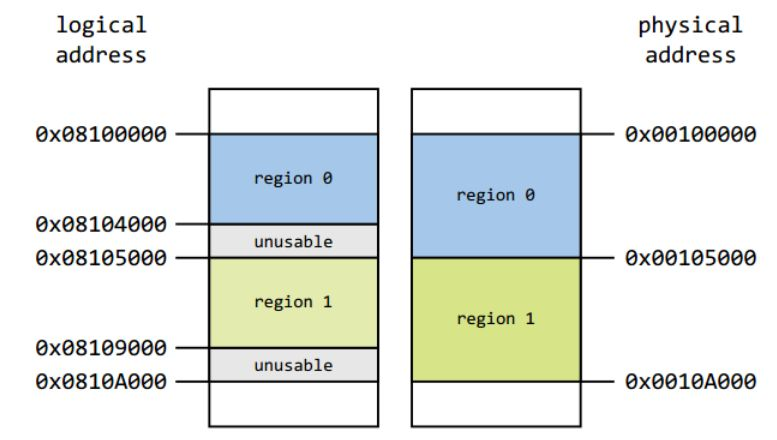
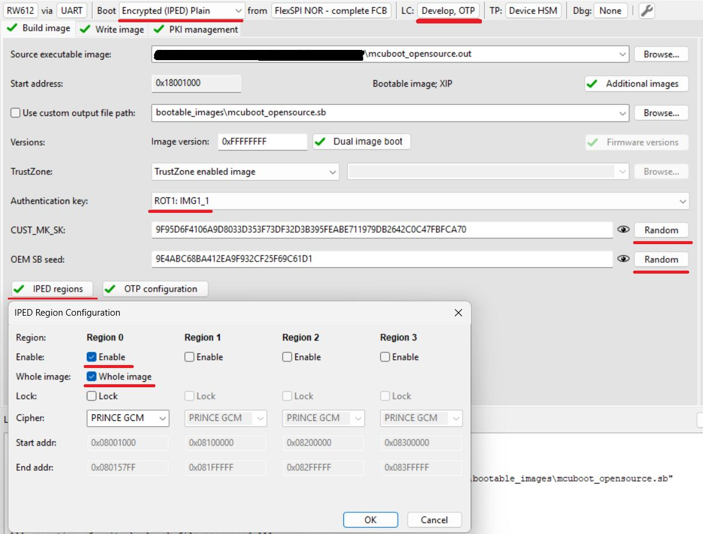

# Encrypted XIP using IPED

This document extends the documentation of [MCUboot and encrypted XIP in OTA examples](encrypted_xip.md) and provides additional information related to the IPED module.

Note: __The extension currently supports only the IPED module based on the GCM algorithm in RW61x devices.__

## 1. Introduction

IPED (Inline PRINCE Encryption/Decryption for off-chip flash) is an encryption unit for external flash, specific to the NXP RW61x, RT700 and MCX N MCUs.

The IPED engine generates an 8-byte authentication tag for each 32-byte block of encrypted data. When storing this encrypted data in Flash memory, the FlexSPI controller organizes it in a specific pattern:

* Each block of 32 bytes of ciphertext is followed by 8 bytes of authentication tag data (total: 40 bytes per unit)
* The authentication tags are stored physically in flash but are hidden from the CPU's logical address space (AHB read, fetch) - the CPU only sees the decrypted payload
* Due to this interleaving scheme, the actual physical flash consumption is 1.25× (5/4) the logical address space visible to the CPU


Following image shows an example of a valid IPED region configuration for MCUboot slot - logical to physical address mapping



There are several points to be aware of when using IPED in an OTA process:

* Resulting consumption of physical memory
	* range of IPED region is defined in terms of logical address but the physical memory consumption is 1.25× the logical memory consumption
	* OTA process must ensure the installed OTA image doesn't overlap the maximal size of the IPED region. The NXP MCUboot hooks enforce this: if the output (encrypted) image would exceed the primary slot (including the slot trailer), the image is rejected and invalidated. Rather than relying on runtime rejection, it is strongly advised to constrain the application up front — adjust the output binary size in the linker file and/or check the image size before encryption — so the app fits within the slot budget (roughly `slot_size / 1.25`, minus the trailer)

* Flash operations have to respect the boundaries of the flash page/sector size and the encryption unit size
  * due to internal software arbitration, only the ROM IAP can be used for flash writes
  * the size of a data chunk must be aligned to 4 * page size; no partial writes are allowed - the last data chunk must be padded with dummy bytes
* IPED region usage and collisions
	* the MCUboot IPED initialization (NXP customization) implicitly uses IPED region 14 and 15; region 0 is reserved for MCUboot. IPED has 15 regions total, of which the first 4 can be initialized by ROM at startup and the rest only manually
* Reading raw flash of slot 0 with a debugger returns ciphertext
	* this is expected. The ROM initializes its IPED regions during debugger startup, so those regions return decrypted data. The IPED region covering slot 0 is set up manually by the bootloader at runtime, so it is not initialized in the debugger context and you correctly observe ciphertext there

The whole IPED initialization, metadata handling and image re-encryption are implemented in `encrypted_xip_platform_iped.c`, `bootutil_hooks.c`, and the flash backend porting layer.

Additional information about IPED in RW61x can be found in its reference manual.

## 2. Troubleshooting: unexpected resets / reset loops (IPED / PRINCE)

If you observe an unexpected reset or a reset loop, inspect the ITRC status register to determine which IP module triggered the reset. Of particular interest is the `IN12_STATUS` bit (PRINCE IP module detected an error event).

When `IN12_STATUS` is set, the most common cause is that code tried to execute or fetch from an IPED region containing invalid ciphertext. The IPED/PRINCE module treats this as a security violation and forces a reset. For example, a pointer that reads an erased flash area inside an IPED region has no valid data to decrypt, the IP module faults, and the device resets.

ITRC status register read example:

```c
PRINTF("At(0x%x) is 0x%x \n\r", (0x40024000), *(volatile uint32_t *)(0x40024000));
```

Debugging an issue in a reset loop is tricky because the fault happens before you can attach. A practical technique:

1. Near the very start of the application add a spin loop so the program halts there:
   ```c
   volatile int test = 1;
   while (test);
   ```
2. Attach a debugger to the running target. This is necessary because the customized MCUboot initializes the IPED region at runtime (the ROM does not do it during startup), so the IPED configuration only exists once MCUboot has run and handed off to the application.
3. From the debugger, set `test = 0` and single-step through the code to find the exact line that triggers the reset (most likely an access into an IPED region with no valid ciphertext).


## 3. Metadata structure

The structure follows the ROM code, but the IPED configuration is handled manually from the MCUboot context.

```
Metadata Flash Sector (IPED)
━━━━━━━━━━━━━━━━━━━━━━━━━━━━━━━━━━━━━━━━━━━━━━━━━━━━━━━━━━━━━━━━━━━━━━━━━━━━━━

 0                    ┌─────────────────────────────────────────────────────┐
                      │  tag           [4 bytes]                            │
                      │  params        [252 bytes]                          │
                      │    configId    [4 bytes]                            │
                      │    princeRnds  [4 bytes]                            │
                      │    regionOff   [4 bytes]                            │
                      │    ipedConfig  [60 bytes]  × 4 = 240 bytes          │
                      │      start     [4 bytes]                            │
                      │      end       [4 bytes]                            │
                      │      flags     [1 byte]                             │
                      │      padding   [3 bytes]                            │
                      │      encIv     [48 bytes]                           │
                      │        iv      [16 bytes]                           │
                      │        cipher  [16 bytes]                           │
                      │        tag     [16 bytes]                           │
 +256                 ├╌╌╌╌╌╌╌╌╌╌╌╌╌╌╌╌╌╌╌╌╌╌╌╌╌╌╌╌╌╌╌╌╌╌╌╌╌╌╌╌╌╌╌╌╌╌╌╌╌╌╌╌╌┤
                      │                                                     │
                      │              (erased 0xFF)                          │
                      │                                                     │
 SECTOR_SIZE/2        ╠═════════════════════════════════════════════════════╣
                      │                                                     │
                      │              (erased 0xFF)                          │
                      │                                                     │
 SECTOR_SIZE-32       ├─────────────────────────────────────────────────────┤
                      │  enc_confirm_t [32 bytes]                           │
 SECTOR_SIZE          └─────────────────────────────────────────────────────┘
━━━━━━━━━━━━━━━━━━━━━━━━━━━━━━━━━━━━━━━━━━━━━━━━━━━━━━━━━━━━━━━━━━━━━━━━━━━━━━
```

```
flexspi_nor_mem_image_iped_config_t (256 bytes, 16-byte aligned):
  [  0..  3]  tag                        (4 bytes)   "IPCB" (0x42435049) validity marker
  [  4..  7]    configId                 (4 bytes)   engine selector: kNBOOT_MemCryptIped (0x95959595)
  [  8.. 11]    ipedPrinceRounds         (4 bytes)   number of PRINCE rounds: 12 or 22
  [ 12.. 15]    regionOffset             (4 bytes)   lowest IPED context register index
  [ 16..255]    ipedConfig[4]          (240 bytes)   4 × nboot_iped_region_config_t (60 bytes each):
  [ +0.. +3]      startAddress           (4 bytes)   IPEDx_START register value
  [ +4.. +7]      endAddress             (4 bytes)   IPEDx_END register value
  [ +8.. +8]      regionFlags            (1 byte)    bit0=enabled, bit1=locked
  [ +9..+11]      padding                (3 bytes)   explicit alignment padding
  [+12..+59]      encryptedIv           (48 bytes)   AES-GCM protected IV blob:
  [+12..+27]        iv                  (16 bytes)   AES-GCM nonce used to encrypt the IV
  [+28..+43]        ciphertext          (16 bytes)   encrypted IPED region IV
  [+44..+59]        tag                 (16 bytes)   AES-GCM authentication tag

enc_confirm_t (32 bytes):
  [  0.. 31]  magic                  (32 bytes)   written last in a separate flash page — confirms config block
                                                  was fully persisted; absence signals incomplete OTA update
```

## 4. Encryption of MCUboot (OVERWRITE_ONLY only)

Encrypting the MCUboot partition is required only when a private key used for offline encryption is embedded in the bootloader code as a C array; otherwise it is optional.

To simplify the workflow, the MCUXpresso Secure Provisioning Tool (SEC tool) is used.

To provision the device and encrypt the bootloader perform the following steps:

1. Erase the device
2. Build `mcuboot_opensource`
3. Get the device into ISP mode
    * On development boards this is typically done by holding the ISP button and pressing the reset button
4. Open the SEC tool and create a new workspace for the RW61x target device
    * Test the ISP connection in the SEC tool
5. Switch to PKI management tab
    * Click __Generate keys__ (leave default settings)
6. Build Image
    * Boot: __Encrypted (IPED) Plain__
    * Select the `mcuboot_opensource` output binary or ELF image as __Source executable image__
    * Lifecycle: __Develop, OTP__
    * Select an __authentication key__ and generate __CUST_MK_SK__ and __OEM SB seed__
    * Click __Build image__
7. Configure IPED regions
    * Click __IPED regions__
    * Configure Region 0 for the MCUboot partition as shown in the following image (Region 1 is reserved for the execution slot)
8. Write image
    * Click __Write image__

Note: This operation provisions the device with __RKTH__ and __CUST_MK_SK__ permanently, but the board remains usable for development purposes, as OTP BOOT_CFG0 (fuseword 15) remains intact. __A user is advised to save the SEC tool workspace (or at least the keys) for future use.__



## 5. Initial SB3 image, OTA SB3 image (FLASH_REMAP only)

__Note: Encrypted XIP with FLASH_REMAP support is currently in an experimental state. The mode can be evaluated only with ota_mcuboot_basic example__

Due to the customized placement of the configuration structures outside the FCB, an initial SB3 is required for safe deployment during end-product manufacturing. The SB3 container can also be used as a secure capsule for a signed image, providing encryption during the OTA image transport. Additional information can be found in the [SB3 documentation](sb3_common_readme.md).

Note: The device must be provisioned with __RKTH__ and __CUST_MK_SK__. For provisioning, you can follow the previous chapter.

To simplify the workflow, the MCUXpresso Secure Provisioning Tool (SEC tool) is used.

1. Build `ota_mcuboot_basic` and sign the image with `imgtool` as usual.
2. Look into the `ota_examples/_common/sb3_templates` and `ota_examples/_common/binaries` directories and copy the template and additional binaries to your `$sec_tool_workspace`
    * `rw61x_IPED_initial_image.yaml` for the initial image
    * `rw61x_IPED_ota_slot0_image.yaml` or `rw61x_IPED_ota_slot1_image.yaml` for OTA image
    * `iped_conf_magic_page.bin` magic (confirmation) for configuration structure
    * `slot_trailer_page.bin` MCUboot slot trailer with confirmation flag (required for DIRECT-XIP mode)
3. Extract the FCB from the `mcuboot_opensource` binary and place it in the `source_images` folder
    * `nxpimage utils binary-image extract -b mcuboot_opensource.bin -a 0x400 -s 512 -o parsed_fcb.bin`
4. In the SEC tool, open __Tools/SB Editor__ and click __Import__ to import the template
    * Check and, if necessary, fix the paths to the keys and the image binary
    * Click __Generate__
    * alternatively use SPSDK directly:  `nxpimage sb31 export -c template.yaml`

For initial image:

1. Get the device into ISP mode
    * On development boards this is typically done by holding the ISP button and pressing the reset button
    * Test the ISP connection in the SEC tool
2. The initial image can be loaded using `blhost`
    * `blhost -t 100000 -p COM3,115200 receive-sb-file initial_image_slot_0.sb`

For an OTA update using SB3, follow the instructions in [MCUboot and encrypted XIP in OTA examples](encrypted_xip.md).
