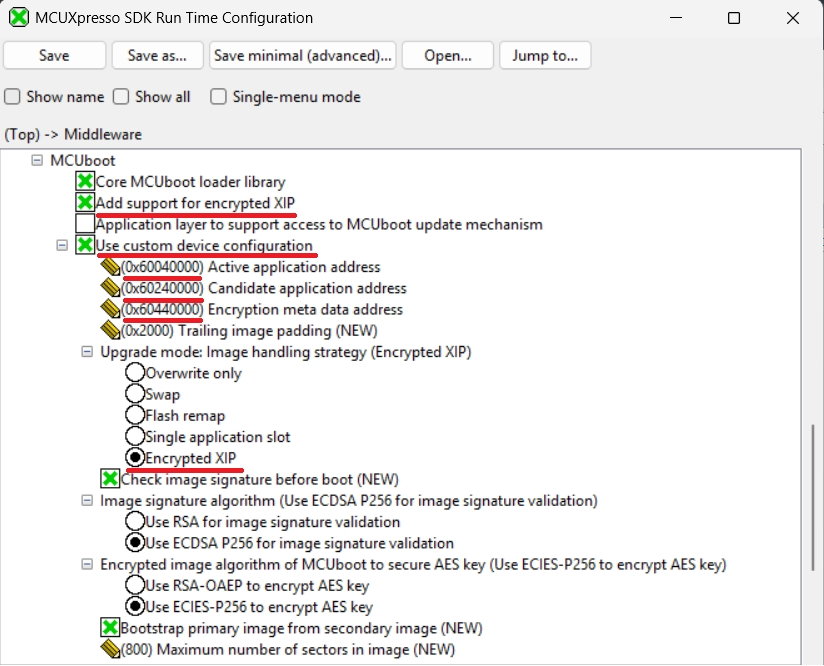
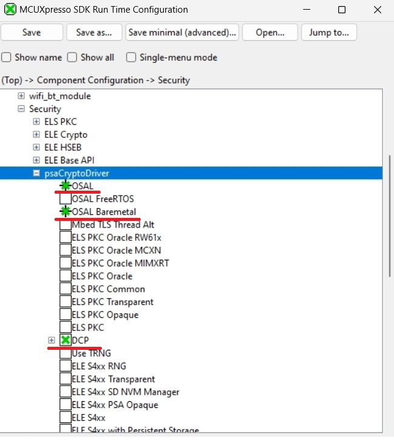
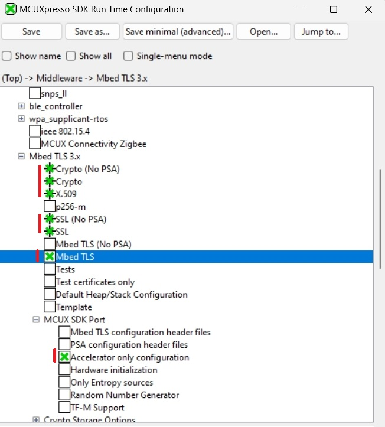
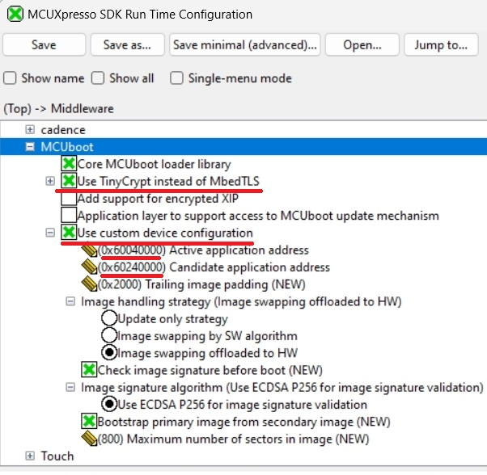

# Kconfig and customization of OTA examples

The OTA examples support an alternative way to adjust the default project settings using Kconfig. For more information about Kconfig, please see the [MCUXpresso SDK documentation](https://mcuxpresso.nxp.com/mcuxsdk/latest/html/introduction/README.html).

## Encrypted XIP mode

This is one of the ways to build and evaluate projects configured for Encrypted XIP mode. For more information please see [Encrypted XIP and MCUboot](encrypted_xip.md).

The following walkthrough for the EVKBMIMXRT1060 and the IAR toolchain demonstrates how to enable Encrypted XIP mode.

1. Build the GUI configuration

~~~
west build -p always examples/ota_examples/mcuboot_opensource --toolchain iar --config flexspi_nor_release -b evkbmimxrt1060 -t guiconfig -d builds/evkbmimxrt1060_mcuboot

~~~
2. Modify settings in Middleware->MCUboot
    * enable `Add support for encrypted XIP` and `Use custom device configuration`
    * enable `Enable Encrypted XIP mode`
    * fill in the addresses of the active and candidate application and the metadata - the default values from `flash_partitioning.h` or the `mcuboot_opensource` board readme can be reused

3. Click Save and close the window.
4. Navigate to the folder with the generated project and run
~~~
west build -t guiproject

~~~

Note: `-t guiproject` is optional; for the IAR toolchain it generates the IDE project.

## MCUboot and Crypto backend selection

MCUboot in the SDK supports these crypto backend options:

   1. __TinyCrypt__
      * a lightweight crypto library for resource-constrained devices
      * full feature support
   2. __Mbed TLS using the legacy API__
      * built-in implementation only (no hardware crypto accelerators)
      * full feature support
   3. __Mbed TLS using the PSA Crypto API__
      * supports hardware crypto accelerators (requires a PSA driver)
      * currently not compatible with Encrypted XIP mode, as encrypted images are not supported by the PSA API in the current MCUboot version

By default, TinyCrypt is used for memory-constrained NXP devices such as MCX N (bootloader in the IFR region), MCX A, and MCX E. Other NXP devices with external flash memory typically use Mbed TLS with PSA to take advantage of hardware acceleration of the crypto algorithms. If the Encrypted XIP feature is enabled, Mbed TLS switches to the legacy API.

Since Mbed TLS using the legacy API has only software implementation of crypto functions, it may be desirable to replace Mbed TLS with TinyCrypt to reduce the memory footprint of MCUboot. The same applies in the opposite direction when replacing TinyCrypt with Mbed TLS using the PSA Crypto API.

The following walkthrough demonstrates how to replace Mbed TLS with TinyCrypt. The example is for the EVKBMIMXRT1060 and the IAR toolchain.

1. Build the GUI configuration

~~~
west build -p always examples/ota_examples/mcuboot_opensource --toolchain iar --config flexspi_nor_release -b evkbmimxrt1060 -t guiconfig -d builds/evkbmimxrt1060_mcuboot

~~~

2. Remove any PSA Crypto driver occurrences in Component Configuration->Security, and any related drivers in Driver Configuration
    

3. Remove Mbed TLS middleware and all related components

4. Enable TinyCrypt and custom device configuration in MCUboot configuration

5. Click Save and close the window.
6. Navigate to the folder with the generated project and run
~~~
west build -t guiproject

~~~

Note: `-t guiproject` is optional; for the IAR toolchain it generates the IDE project.

With this configuration, the final size of the MCUboot application is approximately 30 kB.
