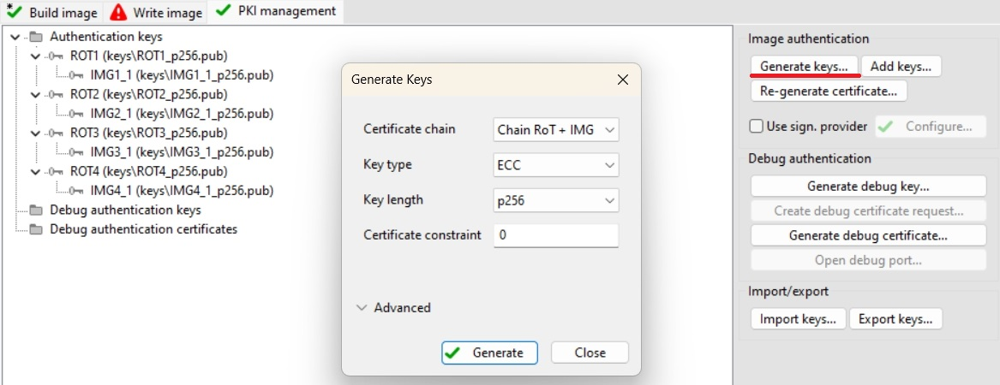
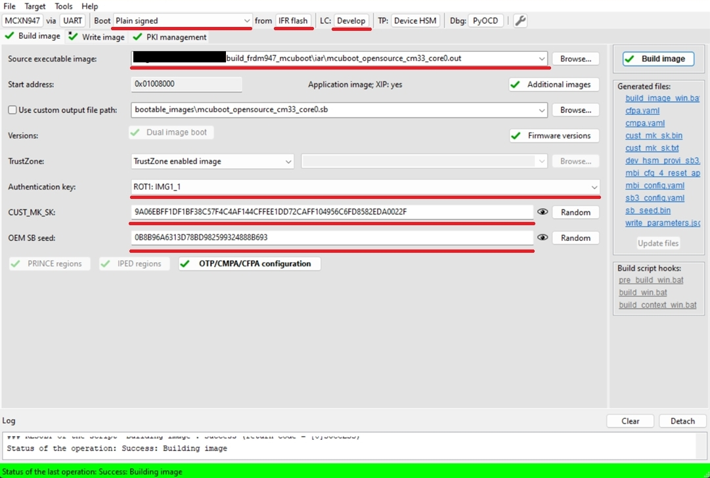
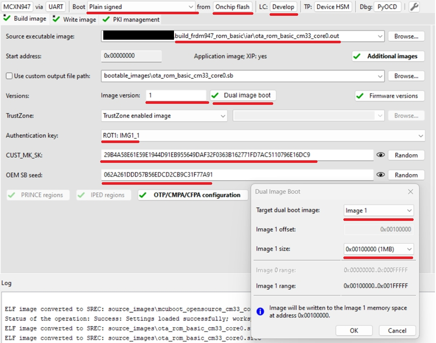
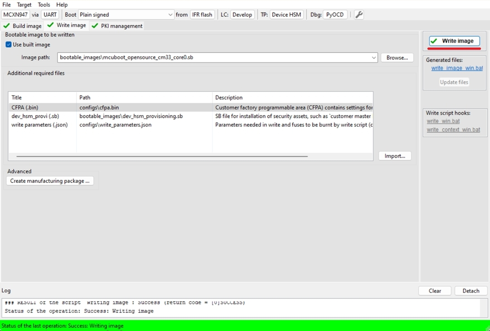
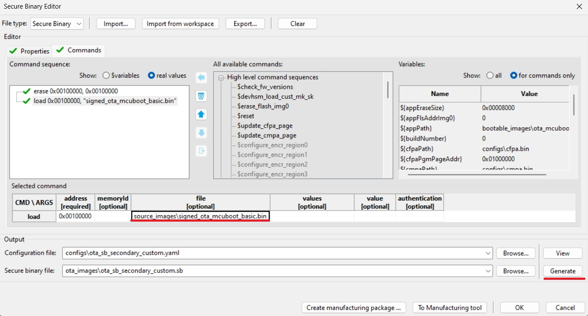
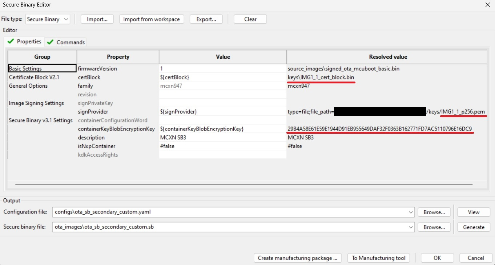

# MCXN - OTA update by using SB3 file

- [MCXN - OTA update by using SB3 file](#mcxn---ota-update-by-using-sb3-file)
   * [1. Provision the device](#1-provision-the-device)
   * [2. Prepare OTA images](#2-prepare-ota-images)
      + [2.1 ROM bootloader only use case](#21-rom-bootloader-only-use-case)
      + [2.2 MCUboot bootloader use case](#22-mcuboot-bootloader-use-case)
   * [3. Firmware update](#3-firmware-update)
      + [3.1 ROM bootloader only use case](#31-rom-bootloader-only-use-case)
      + [3.2 MCUboot bootloader use case](#32-mcuboot-bootloader-use-case)
   * [Supported Boards](#supported-boards)

In this walkthrough, the device lifecycle is not changed where possible (for development purposes), so that the device can be restored to its initial state. In real-world scenarios, transitioning the chip to the appropriate lifecycle depends on the specific requirements.

Common information related to SB3 is available in the documentation ['OTA update by using SB3 file'](sb3_common_readme.md).

## 1. Provision the device

The device must be provisioned to support SB3 processing. To simplify the workflow, the MCUXpresso Secure Provisioning Tool (SEC tool) is used.

To provision the device perform the following steps:

1. Erase the device
2. Build the `mcuboot_opensource` + `ota_mcuboot_basic` or the `ota_rom_basic` project, depending on what you want to evaluate
3. Get the device into ISP mode - on development boards this is typically done by holding the ISP button and pressing the reset button
4. Open the SEC tool, create a new workspace for the MCXN target device, and test the ISP connection
5. Switch to PKI management tab
    * Click __Generate keys__ (leave default settings)

7. Build Image tab
    * Boot: __Plain signed__ from __IFR/Onchip flash__ based on `mcuboot_opensource` or `ota_rom_basic` location
    * Lifecycle: Develop
    * Select an __authentication key__ and generate __CUST_MK_SK__ and __OEM SB seed__
    * Enable Dual image support if you evaluate `ota_rom_basic`
        * Define Image version 1
        * Target dual boot image: __Image 1__
        * Image 1 size: 
            * For MCXN9xx/5xx select 0x100000 (1MB)
            * For MCXN2xx select 0x80000 (512kB)

Following image is for MCUboot use case

Following image is for ROM only use case

    
8. Click __Build image__ 

9. Write image tab
    * Click __Write image__

## 2. Prepare OTA images

### 2.1 ROM bootloader only use case

MCXN uses flash remapping based on the swap mechanism, so the SB3 OTA file always targets the Image 1 memory region.

1. Build Image tab
    * Increase the image version from 1 to 2
    * __Build image__
2. Rename the generated SB3 file `bootable_images/ota_rom_basic.sb` to `ota_rom_basic_image_1_v2.sb`

### 2.2 MCUboot bootloader use case

1. Build `ota_mcuboot_basic` and sign the image with `imgtool` as usual, following the steps in the `example_board_readme.md` for your board. Copy the signed binary to your `$sec_tool_workspace/source_images`.
2. Look into the `ota_examples/_common/sb3_templates` directory and copy the SB3 configuration templates for your device to your `$sec_tool_workspace/configs`.
    * MCXN: `mcxn_sb3_cfg_primary_slot.yaml`

3. In the SEC tool, open __Tools/SB Editor__ and click __Import__ to import `sb3_config_mcxn_secondary_slot.yaml`.
    * Check and, if necessary, fix the paths to the keys and the image binary.
    * Click __Generate__.

Note: Optionally, an initial SB3 file containing the initial (first) `ota_mcuboot_basic` application for the primary/secondary slot (generated with the additional __`--pad --confirm`__ imgtool arguments) can be created to simulate the manufacturing process. Otherwise, the initial signed image can also be loaded directly using ISP or another preferred method, as usual.

## 3. Firmware update

For demonstration purposes we use the [ExtraPutty](https://sourceforge.net/projects/extraputty/) tool, as this fork of the classic PuTTY has XMODEM support. Alternatively, [TeraTerm](https://teratermproject.github.io/index-en.html) can be used.

### 3.1 ROM bootloader only use case

1. Run the initial `ota_rom_basic` application loaded in chapter 1.
    * Note: alternatively, run the unsigned application via a debug session using your preferred IDE (IAR, MCUX, VS Code) - in this case the `image` command returns invalid information, as there is no valid image header to parse.

2. Check the image state and the active flag location with the `image` command.
    * Use the active flag location to determine the inactive image slot.

3. Send the OTA image.
    * Run the `xmodem_sb3` command.
    * Send `ota_rom_basic_image_1_v2.sb`, targeting the inactive slot, via __Files Transfer/Xmodem (1k)__.

4. Reboot the device with `reboot` command

5. Check image update with `image` command

Here is an example of serial output:
~~~

*************************************
* Basic ROM application example     *
*************************************

$ image
Flash REMAP_SWAP disabled
IMAGE 0:
    <IMG_VERSION 0x1 LENGTH 36820 EXEC_ADDR 0x28004000>
    *ACTIVE*
IMAGE 1: Invalid image header
$ xmodem_sb3
Started xmodem processing SB3
Initiated XMODEM-CRC transfer. Receiving... (Press 'x' to cancel)
CCCC
Received 37880 bytes
SB3 has been processed
$
$ reboot
System reset!

*************************************
* Basic ROM application example     *
*************************************

$ image
Flash REMAP_SWAP active
IMAGE 0:
    <IMG_VERSION 0x1 LENGTH 36820 EXEC_ADDR 0x28004000>
IMAGE 1:
    <IMG_VERSION 0x2 LENGTH 36820 EXEC_ADDR 0x28004000>
    *ACTIVE*
$
~~~

### 3.2 MCUboot bootloader use case

1. Load and run the initial `ota_mcuboot_basic` application as usual - alternatively, load the initial SB3 via `blhost` and the `receive-sb-file` command.

2. Check the image state and the active flag location with the `image` command.
    * Use the active flag location to determine the inactive image slot.

3. Erase the inactive slot with the `image erase` command.
    * Note: not needed if the SB file contains the erase command.

4. Send the OTA image.
    * Run the `xmodem_sb3` command.
    * Send `ota_mcuboot_secondary_slot.sb`, targeting the inactive slot, via __Files Transfer/Xmodem (1k)__.

5. Mark the installed image ready for test.
    * Run the `image test` command.

6. Reboot the device with the `reboot` command.

7. Check the image update with the `image` command.

8. Mark the updated slot with the confirm flag using `image accept`, and check the state again with the `image` command.

~~~
hello sbl.
Bootloader Version 2.2.0
Primary   slot: version=1.0.0+1000
Image 0 Secondary slot: Image not found
Image 0 loaded from the primary slot
Bootloader chainload address offset: 0x40000
Reset_Handler address offset: 0x40400
Jumping to the image

Booting the primary slot - flash remapping is disabled

*************************************
* Basic MCUBoot application example *
*************************************

$ image
Image 0; name APP; state None:

  Slot 0 APP_PRIMARY; offset 0x0; size 0x100000 (1038576):
    <IMAGE: size 28828; version 1.0.0+1000>
    SHA256 of image payload: E069B6127A708EE88B39...
    log_addr 0x0
    *ACTIVE*

  Slot 1 APP_SECONDARY; offset 0x100000; size 0x100000 (1038576):
    <No Image Found>

$ image erase
Erasing inactive slot...done
$ xmodem_sb3
Started xmodem processing SB3
Make sure this device is provisioned to accept secure binary and its load address is 0x100000
Initiated XMODEM-CRC transfer. Receiving... (Press 'x' to cancel)
CCCCC
Received 51200 bytes
SB3 has been processed
$
$ image test
write magic number offset = 0x43ff00
$ reboot
System reset!
hello sbl.
Bootloader Version 2.2.0
Primary   slot: version=1.0.0+1000
Secondary slot: version=1.1.0+1000
writing copy_done; fa_id=1 off=0x1fffe0 (0x43ffe0)
Image 0 loaded from the secondary slot
Bootloader chainload address offset: 0x240000
Reset_Handler address offset: 0x240400
Jumping to the image

Booting the secondary slot - flash remapping is enabled

*************************************
* Basic MCUBoot application example *
*************************************

$ image
Flash REMAP_SWAP active.

Image 0; name APP; state Testing:

  Slot 0 APP_PRIMARY; offset 0x0; size 0x100000 (1038576):
    <IMAGE: size 28828; version 1.0.0+1000>
    SHA256 of image payload: E069B6127A708EE88B39...
    log_addr 0x0 remaps to 0x100000

  Slot 1 APP_SECONDARY; offset 0x100000; size 0x100000 (1038576):
    <IMAGE: size 28828; version 1.1.0+1000>
    SHA256 of image payload: E069B6127A708EE88B39...
    log_addr 0x100000 remaps to 0x0
    *ACTIVE*

$ image accept
$ image
Flash REMAP_SWAP active.

Image 0; name APP; state Permanent:

  Slot 0 APP_PRIMARY; offset 0x0; size 0x100000 (1038576):
    <IMAGE: size 28828; version 1.0.0+1000>
    SHA256 of image payload: E069B6127A708EE88B39...
    log_addr 0x0 remaps to 0x100000

  Slot 1 APP_SECONDARY; offset 0x100000; size 0x100000 (1038576):
    <IMAGE: size 28828; version 1.1.0+1000>
    SHA256 of image payload: E069B6127A708EE88B39...
    log_addr 0x100000 remaps to 0x0
    *ACTIVE*

$
~~~

## Supported Boards

- [FRDM-MCXN236](../../_boards/frdmmcxn236/ota_examples/mcuboot_opensource/example_board_readme.md)
- [FRDM-MCXN947](../../_boards/frdmmcxn947/ota_examples/mcuboot_opensource/example_board_readme.md)
- [MCX-N9XX-EVK](../../_boards/mcxn9xxevk/ota_examples/mcuboot_opensource/example_board_readme.md)
